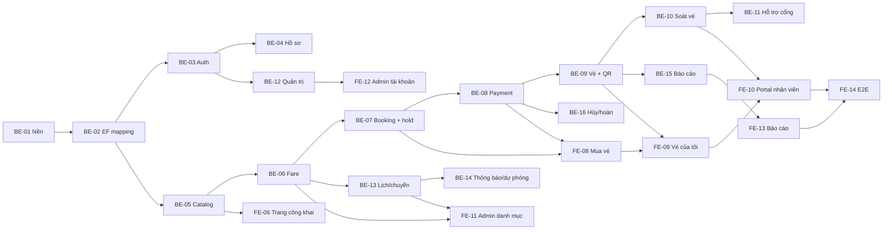

# Kế hoạch chia task — Nhóm 6 thành viên (5 full-stack + Lead backend)

| Thông tin | Giá trị |
| --- | --- |
| Dự án | Hệ thống quản lý vé và hỗ trợ hành khách Metro |
| Tài liệu | Kế hoạch phân công công việc (TASK-ASSIGNMENT) |
| Phiên bản | 3.0 |
| Ngày lập | 13/11/2026 |
| Người lập | Lead (M1) |
| Trạng thái | Draft — chờ nhóm xác nhận tên thành viên |
| Căn cứ | `docs/requirements/Metro_SRS_v1.2.docx` (47 UC), `Metro_Dac_ta_ UC_v1.6.docx`, gói `infra/database`, `README.md`, `docs/git-workflow/BRANCH-POLICY.md` |
| Mốc bàn giao | Release `v1.0-demo` **20/12/2026**; UAT/demo và sửa lỗi P0–P1 đến **24/12/2026** |

## 1. Mục đích và thay đổi so với bản trước

Tài liệu chia phạm vi SRS thành task kỹ thuật có mã, người phụ trách, sprint, ước lượng, phụ thuộc và tiêu chí hoàn thành cho **6 thành viên**, để cả nhóm chạy song song trong **5 sprint** và kịp bàn giao giữa–cuối tháng 12/2026.

Khác biệt chính so với bản 2.0:

1. **M1 (Lead) chỉ làm Backend**: kiến trúc, auth, payment, hoàn tiền, hardening, review và release.
2. **M2–M6 là full-stack**: mỗi người sở hữu một **vertical slice** — tự làm Backend và Frontend của cùng một miền nghiệp vụ — để ai cũng code cả hai tầng và tự kiểm chứng luồng end-to-end của mình.
3. Nhờ vậy không còn cảnh "FE ngồi chờ BE": mỗi người tự chốt contract cho slice của mình ngay từ S0, dùng mock cho phần chưa xong, rồi nối API thật khi BE của chính mình hoàn tất.
4. Phạm vi vẫn giữ **27 UC Must-have** trong 5 tuần; Stretch và Out giữ nguyên như bản 2.0.

## 2. Căn cứ và giả định

### 2.1. Căn cứ

- **SRS 1.2**: 47 UC, 4 tác nhân chính (Guest, Passenger, Ticket Inspector, Administrator) và 3 tác nhân phụ (Payment Gateway, Email Service, QR Scanner/Ticket Gate).
- **UC v1.6**: danh mục 47 UC kèm mức ưu tiên, dùng để chọn Must-have.
- **Gói database** (`infra/database`): 77 bảng schema `metro`, 5 migration, các hàm nghiệp vụ `hold_trip_capacity`, `confirm_payment_and_issue_tickets`, `cancel_unpaid_order`, `expire_capacity_holds`; đã có test SQL và bộ regression test cho các lỗi review.
- **Scaffold hiện tại**: Backend ASP.NET Core (`net9.0`) 4 project (API/Application/Domain/Infrastructure); Frontend React + TypeScript + TanStack Query đã có `App.tsx`, `lib/axios.ts`, `lib/query-client.ts` và các thư mục `features/*`.
- **Quy trình Git**: `feature/* → PR → dev → PR → main`; `main` cần 2 approval, `dev` cần 1 approval, CI bắt buộc xanh.

### 2.2. Giả định về năng lực

| Hạng mục | Giá trị |
| --- | --- |
| Thời gian | 5 sprint × 1 tuần, S0 = 16/11/2026, S4 = 14–20/12/2026 |
| Ngày công gộp | 6 người × 25 ngày = 150 pd |
| Hao phí | ~20% cho review PR, họp, sửa lỗi, học công nghệ, môi trường |
| Ngày công khả dụng | ~120 pd (≈20 pd/người) |
| Cam kết trong tài liệu | BE ≈56 pd, FE ≈53 pd; còn ~11 pd cho buffer tích hợp, sửa lỗi và UAT |

M2–M6 là full-stack nhưng **không chia đều 50/50**: mỗi người được xếp theo thế mạnh, dao động 2–14 pd Backend và 5–15 pd Frontend, miễn là mỗi người có việc thật ở cả hai tầng.

Nếu một thành viên chỉ có 4 ngày/tuần, giảm ngay 20% scope theo thứ tự ở mục 6.3, không giảm thời gian test.

### 2.3. Ngoài phạm vi

- Không điều khiển cổng/tàu/SCADA/ATS, không thanh toán thật, không nhận diện khuôn mặt.
- Không làm mobile app, SMS/push, offline validation, hóa đơn thuế/PDF.
- Các yêu cầu tự động hóa/OD Matrix ở chương 15 SRS chỉ ở mức phân tích và cảnh báo.

## 3. Nguyên tắc thực hiện

1. **Vertical slice**: mỗi người làm trọn một miền từ DB/API đến màn hình, tự chịu trách nhiệm luồng end-to-end của miền đó.
2. **Contract-first**: OpenAPI của slice phải có trước khi dựng màn hình; thay đổi contract báo ngay cho người dùng chung endpoint.
3. **Mock-first**: S0–S1 FE chạy bằng MSW theo contract v0; S2 trở đi thay dần bằng API thật của chính slice đó.
4. **DB-first cho tiền và sức chứa**: giữ chỗ, xác nhận thanh toán, phát hành vé, hủy/hoàn đều gọi hàm SQL đã có; không viết lại transaction ở tầng C#.
5. **Kiểm quyền ở server**: mọi endpoint kiểm tra role + ownership + trạng thái đối tượng; không tin UI.
6. **Idempotency bắt buộc** với booking, payment callback, soát vé và thay đổi cấu hình.
7. **PR nhỏ, CI xanh, review chéo**: PR ≤ 400 dòng logic (file generated/migration không tính), có mô tả và link task.
8. **Không sửa trực tiếp `main`/`dev`**, không force push, không commit secret.
9. **Ưu tiên chạy được end-to-end** hơn là nhiều màn hình dở dang.

Quy ước full-stack khi làm việc:

- Một task Backend và một task Frontend của cùng slice được gắn cặp (ví dụ BE-07 → FE-08); người sở hữu tự nối hai đầu, không chuyển giao qua người khác.
- PR Backend và PR Frontend tách riêng nhưng cùng link task/UC; PR Frontend chỉ merge khi contract đã có trên `dev`.
- Mỗi người phải tự chạy được luồng của mình trên máy local: DB → API → UI.

## 4. Đội hình và vai trò

| Mã | Vai trò | Slice sở hữu | BE (pd) | FE (pd) | Ghi chú |
| --- | --- | --- | --- | --- | --- |
| **M1** | Lead / Backend Architect | Nền tảng API, auth, payment, hoàn tiền, hardening, release | 16 | 0 | Là bạn; review toàn bộ PR chạm auth/payment/vé; merge `dev → main` |
| **M2** | Full-stack — Ticketing | EF mapping, booking/giữ chỗ, vé/QR, luồng mua vé FE | 14 | 5 | Người mạnh nhất về transaction/concurrency |
| **M3** | Full-stack — Catalog & Fare | Tuyến/ga, lịch/chuyến, giá, thông báo; trang công khai + admin danh mục | 13 | 7 | Kiêm dữ liệu giá mẫu |
| **M4** | Full-stack — Passenger & Gate | Soát vé, hỗ trợ tại cổng; app shell, auth/hồ sơ, vé của tôi | 6 | 12 | Chủ trì quy ước FE với M6 |
| **M5** | Full-stack — Staff & Admin | Quản trị tài khoản, báo cáo doanh thu; portal nhân viên, admin tài khoản | 2 | 15 | BE mỏng hơn (admin CRUD), bù lại nhiều FE |
| **M6** | Full-stack — Platform, Reports & QA | Báo cáo/BI (BE), test + seed; design system, types/mock, E2E, CI | 5 | 14 | Giữ "xương sống" FE và chất lượng |

Tổng: **56 pd Backend + 53 pd Frontend = 109 pd**, mỗi người 16–20 pd (còn 1–4 pd buffer cá nhân, chưa kể hao phí chung).

> Thay mã M1–M6 bằng tên thật khi nhóm họp chốt. M1 giữ vai trò Lead và là người duy nhất merge `dev → main`.

### 4.1. Cặp review chéo

| Người | Review chính cho | Ghi chú |
| --- | --- | --- |
| M1 | M2 (booking/payment/ticket), toàn bộ PR chạm auth/payment | Bắt buộc |
| M2 | M3 | Chéo BE |
| M3 | M4 | Chéo BE + contract |
| M4 | M5 | Chéo FE |
| M5 | M6 | Chéo báo cáo/FE |
| M6 | M1 (hạ tầng, CI), M2 (test) | Chéo test/CI |

Không ai tự merge PR của chính mình.

## 5. Lịch tổng thể và milestone

| Sprint | Thời gian | Mục tiêu chính | Milestone |
| --- | --- | --- | --- |
| **S0** | 16/11 – 22/11/2026 | Chốt kiến trúc, OpenAPI v0 theo slice, DB local, app shell + design system + mock | **M0 — Nền tảng sẵn sàng** |
| **S1** | 23/11 – 29/11 | Auth, catalog, fare engine, booking/giữ chỗ; FE public + auth trên mock | |
| **S2** | 30/11 – 06/12 | Thanh toán + phát hành vé end-to-end; FE mua vé nối API thật | **M1 — Mua vé & thanh toán chạy được** |
| **S3** | 07/12 – 13/12 | Soát vé tại cổng, quản trị lõi, báo cáo doanh thu; FE staff + admin | **M2 — Luồng vé end-to-end** |
| **S4** | 14/12 – 20/12 | Hardening, dữ liệu demo, E2E, UAT nội bộ; release | **M3 — Release `v1.0-demo`** |
| Buffer | 21/12 – 24/12 | UAT/demo, chỉ sửa P0–P1, đóng tài liệu | **M4 — Bàn giao** |

Quy ước trong sprint:

- **API freeze**: contract của luồng Must-have chốt hết **06/12**; sau đó chỉ thêm field, không đổi tên/kiểu.
- **Code freeze**: **17/12**; từ 18/12 chỉ nhận fix P0/P1 kèm test.
- Thứ Sáu mỗi tuần: demo nội bộ 30 phút, mỗi người demo cả BE + FE của slice mình.

## 6. Phạm vi cam kết

### 6.1. Must-have (bắt buộc có trong bản demo)

27 UC: **UC01–UC19, UC22–UC25, UC29, UC31, UC33, UC36**.

Lý do: đây là chuỗi giá trị tối thiểu để demo có ý nghĩa — đăng ký/đăng nhập → tra cứu → mua vé (tự gán chuyến) → thanh toán → nhận QR → soát vé tại cổng → quản trị danh mục/giá/lịch → báo cáo doanh thu.

### 6.2. Stretch (chỉ làm nếu S3 xong sớm)

10 UC: **UC20, UC21, UC26, UC27, UC30, UC32, UC34, UC35, UC38, UC42**.

Điều kiện làm Stretch: tất cả task Must-have của sprint trước đã merge và CI xanh; không lấy thời gian của buffer tích hợp.

### 6.3. Ngoài release (ghi rõ "chưa triển khai")

10 UC: **UC28, UC37, UC39–UC41, UC43–UC47**.

Bao gồm audit log đầy đủ cho admin, giới hạn tải đoàn tàu, mua hộ/bàn giao vé, xác minh danh tính nâng cao, thay đoàn tàu, tiếp cận, sự cố trên tàu, thất lạc, dự báo lượt vào.

Thứ tự cắt khi trễ: (1) Stretch → (2) màn hình admin không thuộc luồng demo → (3) báo cáo nâng cao (giữ báo cáo doanh thu cơ bản) → (4) **không cắt** test thanh toán/vé và kiểm quyền.

## 7. Task Backend

Ước lượng theo **person-day (pd)**, đã gồm code, test và review. Mỗi task tạo branch `feature/US-<số>-<slug>` và PR vào `dev`.

| Mã | Nội dung | UC/BR liên quan | Người | Sprint | pd | Phụ thuộc | Đầu ra / DoD |
| --- | --- | --- | --- | --- | --- | --- | --- |
| BE-01 | Nền tảng API: cấu trúc solution, ProblemDetails, validation, logging, health check, Swagger, cấu hình môi trường, CORS | NFR chung | M1 | S0 | 3 | — | API chạy local + Swagger; CI build/test xanh |
| BE-02 | EF Core mapping schema `metro`/`public`, DbContext, cấu hình index/constraint, `EndExclusive` | DATA-001… | M2 | S0–S1 | 4 | BE-01 | Đọc/ghi được các bảng lõi qua EF; integration test nối PostgreSQL thật; không sửa migration |
| BE-03 | Identity + JWT: đăng ký, đăng nhập/xuất, refresh, policy theo role | UC01–UC04, UC22 | M1 | S1 | 3 | BE-02 | `/api/v1/auth/*`; `RequireUniqueEmail = true`; test 401/403 và email trùng |
| BE-04 | Hồ sơ, xác minh ưu đãi | UC05, UC06 | M1 | S2 | 2 | BE-03 | API hồ sơ; upload minh chứng; trạng thái chờ/duyệt/từ chối; purge nội dung sau quyết định |
| BE-05 | Catalog đọc: tuyến, ga, hành trình, tình trạng dịch vụ | UC07, UC08, UC10, UC24 (đọc) | M3 | S0–S1 | 3 | BE-02 | 4 endpoint public, cache ngắn, tìm đường; contract cho M4/M5 |
| BE-06 | Fare engine + quản lý loại vé/giá/chính sách ưu đãi | UC09, UC25, BR-FARE-* | M3 | S1–S2 | 4 | BE-05 | Tính giá theo `fare_policy_version`; CRUD có version + audit; test khóa NULL-safe |
| BE-07 | Booking: tạo đơn, order item, giữ chỗ theo đoạn, tự gán chuyến | UC11, UC36, BR-CAP-* | M2 | S1–S2 | 5 | BE-06 | Gọi `hold_trip_capacity`; `Idempotency-Key`; lỗi hết chỗ rõ ràng; test 2 phiên đồng thời |
| BE-08 | Payment MoMo TEST: tạo giao dịch, callback/IPN, xác minh chữ ký, thử lại | UC11, UC12, IF-003…005 | M1 | S2–S3 | 4 | BE-07 | Dùng `confirm_payment_and_issue_tickets`; retry idempotent; không ghi trùng payment event |
| BE-09 | Phát hành vé + QR credential + API vé của tôi/lịch sử | UC13–UC15 | M2 | S2–S3 | 4 | BE-08 | 1 vé/hành khách; QR hash + version; lịch sử đặt/thanh toán |
| BE-10 | Soát vé tại cổng: Allow/Deny/Pending, vé không hợp lệ, tra cứu tại ga | UC16–UC18, IF-002/008 | M4 | S3–S4 | 4 | BE-09 | API scan idempotent theo `event_id`; journey vào/ra; không log token gốc |
| BE-11 | Hỗ trợ hành khách tại cổng: tra vé, cấp lại QR | UC19 | M4 | S4 | 1 | BE-10 | Tra theo mã vé/số điện thoại; cấp lại QR có audit |
| BE-12 | Quản trị tài khoản/quyền + dữ liệu hành khách | UC22, UC23 | M5 | S2 | 2 | BE-03 | CRUD role, khóa tài khoản, xem PII có audit |
| BE-13 | Tuyến/ga + lịch/chuyến + hồ sơ sức chứa + thông báo dịch vụ | UC24, UC29, UC31 | M3 | S2–S3 | 4 | BE-05 | CRUD tuyến/ga/tàu/chuyến; sinh `trip_capacity_segments`; thông báo có hiệu lực/hết hạn |
| BE-14 | Gợi ý chuyến dự phòng + API tình trạng/gián đoạn | UC30, UC36 | M3 | S3 | 2 | BE-13 | Fallback khi chuyến đầy; API tình trạng tuyến cho FE công khai |
| BE-15 | Báo cáo vé/doanh thu + export CSV | UC33 | M6 | S2–S4 | 3 | BE-09 | Doanh thu theo ngày/tuyến/loại vé; export CSV; số khớp tổng payment |
| BE-16 | Hủy đơn chưa thanh toán + hoàn tiền cơ bản | UC42 | M1 | S3 | 2 | BE-08 | `cancel_unpaid_order`; refund request/approve tối thiểu; không xóa khoản thu |
| BE-17 | Hardening NFR: rate limit, security headers, PII masking, audit bắt buộc | NFR-SEC/PERF/AUD | M1 | S4 | 2 | BE-03…BE-16 | Checklist NFR + test tải nhẹ; log không lộ PII/secret |
| BE-18 | Test + seed + kịch bản demo | AC-* | M2, M4, M6 | S2–S4 | 4 | BE-01 | Seed 2 tuyến/12 ga; integration test; Postman collection; 6 kịch bản demo |

Phân bổ BE-18: M2 1 pd (booking/payment), M4 1 pd (scan), M6 2 pd (seed + Postman + kịch bản).

Tổng Backend: **56 pd** — M1 16, M2 14, M3 13, M4 6, M5 2, M6 5.

### 7.1. Ghi chú kỹ thuật bắt buộc

- **Không tự viết transaction giữ chỗ/thanh toán**: gọi hàm SQL; nếu thiếu, tạo migration mới + test, không sửa migration đã áp dụng.
- **Quyền runtime DB**: 7 hàm workflow là `SECURITY DEFINER` với `search_path` cố định và đã `REVOKE EXECUTE ... FROM PUBLIC`. Role runtime chỉ được `GRANT EXECUTE` đúng hàm cần, không cấp quyền sở hữu/UPDATE bảng.
- **Idempotency**: booking dùng `Idempotency-Key`; payment lưu `provider_event_id` + `payload_hash` và claim event nguyên tử; scan cổng dùng `event_id`.
- **Email duy nhất**: DB có unique index theo FR-01.01 và preflight báo lỗi rõ; app phải đặt `RequireUniqueEmail = true` để trả lỗi validation thay vì lỗi 500.
- **QR**: chỉ lưu hash token, không log token gốc; QR có version và thu hồi được; `replaced_by_id` nằm trong cùng operator.
- **Thời gian**: UTC trong DB, hiển thị UTC+7; `EndExclusive` không bao gồm mốc kết thúc.
- **Lỗi**: ProblemDetails thống nhất, kèm `code` nội bộ để FE map message.
- **Mã vé**: sinh từ UUID order item + số thứ tự, không cắt tiền tố để tránh trùng.

## 8. Task Frontend

| Mã | Nội dung | UC/BR liên quan | Người | Sprint | pd | Phụ thuộc | Đầu ra / DoD |
| --- | --- | --- | --- | --- | --- | --- | --- |
| FE-01 | App shell: router, layout, auth guard, axios interceptor, TanStack Query, ErrorBoundary, env | NFR chung | M4 | S0 | 3 | — | App chạy với mock; guard chặn route theo role; refresh token xử lý tập trung |
| FE-02 | Design system: token màu/typography/spacing, component dùng chung, responsive | NFR-UX | M6 | S0–S1 | 4 | — | Button/Input/Table/Modal/Toast/Empty/Error + trang demo component |
| FE-03 | Types + sinh type từ OpenAPI + mock MSW | Hợp đồng API | M6 | S0–S1 | 3 | Contract v0 | `types/api`, mock cho 27 UC Must, script cập nhật type |
| FE-04 | Đặc tả màn hình staff/admin + test case + dữ liệu demo | AC-* | M5 | S1 | 2 | FE-02 | Danh sách màn hình Must, checklist AC, fixture demo |
| FE-05 | A11y + i18n tiếng Việt + format tiền/ngày | NFR-UX | M4 | S1 | 2 | FE-01 | Helper format VND/UTC+7; checklist aria/focus/contrast |
| FE-06 | Trang công khai: chủ, tuyến/ga, tìm hành trình, giá, tình trạng dịch vụ | UC07–UC10 | M3 | S2–S3 | 4 | FE-01, BE-05 | 4 màn hình; loading/empty/error; responsive 375/768/1440 |
| FE-07 | Auth & hồ sơ: đăng ký, đăng nhập, quên/khôi phục, hồ sơ, ưu đãi | UC01–UC06 | M4 | S1–S2 | 4 | FE-01, BE-03/04 | Form + validation + trạng thái xác minh/duyệt |
| FE-08 | Luồng mua vé: chọn chuyến, loại vé, số lượng, người đi, giữ chỗ, thanh toán, thử lại | UC11, UC12, UC36 | M2 | S3–S4 | 5 | FE-06, BE-07/08 | Luồng hoàn chỉnh; xử lý timeout/hết chỗ/thanh toán thất bại |
| FE-09 | Vé của tôi: danh sách, chi tiết, QR, lịch sử đặt/thanh toán | UC13–UC15 | M4 | S2–S3 | 3 | FE-07, BE-09 | Vé + QR + lịch sử; trạng thái vé hết hạn/đã dùng |
| FE-10 | Portal nhân viên: quét QR (camera/upload), Allow/Deny, xử lý vé lỗi, tra cứu, cấp lại QR | UC16–UC19 | M5 | S3–S4 | 5 | FE-02, BE-10/11 | Scan idempotent trên UI; hiển thị lý do Deny; tra cứu + cấp lại QR |
| FE-11 | Quản trị danh mục: tuyến/ga, loại vé/giá, lịch/chuyến, thông báo dịch vụ | UC24, UC25, UC29, UC31 | M3 | S3–S4 | 3 | FE-02, BE-06/13/14 | CRUD + bảng + validate; không cho sửa dữ liệu đã dùng |
| FE-12 | Quản trị tài khoản/quyền + dữ liệu hành khách | UC22, UC23 | M5 | S2–S3 | 3 | FE-02, BE-12 | CRUD role, khóa tài khoản, xem PII có cảnh báo |
| FE-13 | Báo cáo doanh thu: dashboard, filter, export CSV | UC33 | M5 | S3–S4 | 5 | FE-02, BE-15 | Biểu đồ + bảng có filter ngày/tuyến; export; empty/error state |
| FE-14 | Component test + E2E Playwright + CI | AC-* | M6 | S1–S4 | 5 | FE-01 | Vitest cho form/table; 6 luồng E2E; CI chạy lint + test |
| FE-15 | Tích hợp, responsive, a11y sweep, UAT | AC-* | M6 | S3–S4 | 2 | FE-06…FE-14 | Checklist 3 breakpoint; không còn mock ở luồng Must; biên bản UAT |

Tổng Frontend: **53 pd** — M2 5, M3 7, M4 12, M5 15, M6 14.

### 8.1. Quy ước Frontend

- Không gọi API trực tiếp trong component: đi qua `features/*/api` + hook TanStack Query.
- Mọi màn hình phải có 4 trạng thái: loading, empty, error, success.
- Không tự định nghĩa type trùng với OpenAPI; type sinh từ contract, mock dùng cùng type.
- Mỗi feature có `index.ts` export công khai; không import chéo sâu giữa các feature.
- Kiểm tra quyền ở UI chỉ để ẩn/hiện; quyền thật do BE quyết định.

## 9. Phân công theo sprint (mỗi người làm cả BE và FE)

Cột là người, ô là task trong sprint. Mọi ô đều ≤ 5 pd; phần còn lại của tuần dành cho review, sửa lỗi và tích hợp.

| Sprint | M1 — Lead (BE) | M2 — Ticketing | M3 — Catalog & Fare | M4 — Passenger & Gate | M5 — Staff & Admin | M6 — Platform & Reports |
| --- | --- | --- | --- | --- | --- | --- |
| S0 | BE-01, chốt kiến trúc + OpenAPI v0 | BE-02 (bắt đầu), state machine Order/Payment/Ticket | BE-05 (bắt đầu), rà UC ưu tiên, giá mẫu | FE-01 | Đọc SRS, đặc tả màn hình staff/admin, prototype form | FE-02 (bắt đầu), FE-03 |
| S1 | BE-03 | BE-02 (xong), BE-07 (bắt đầu) | BE-05 (xong), BE-06 | FE-05, FE-07 (bắt đầu) | FE-04, FE-12 (bắt đầu) | FE-02 (xong), FE-03 (xong), FE-14 (CI) |
| S2 | BE-04, BE-08 (bắt đầu) | BE-07 (xong), BE-09 (bắt đầu) | BE-06 (xong), BE-13 (bắt đầu), FE-06 (bắt đầu) | FE-07 (xong), FE-09 (bắt đầu) | BE-12, FE-12 | BE-15 (bắt đầu), BE-18 (seed), FE-14 |
| S3 | BE-08 (xong), BE-16 | BE-09 (xong), FE-08 (bắt đầu) | BE-13 (xong), BE-14, FE-06 (xong) | FE-09 (xong), BE-10 (bắt đầu) | FE-12 (xong), FE-10, FE-13 | BE-15, FE-14, FE-15 (bắt đầu) |
| S4 | BE-17, review + release | FE-08 (xong), BE-18, sửa lỗi | FE-11, sửa lỗi + hỗ trợ tích hợp | BE-10 (xong), BE-11, sửa lỗi UAT | FE-10 (xong), FE-13 | BE-15 (xong), BE-18, FE-14 (xong), FE-15 |

Kiểm tra tải theo sprint: mỗi người 3–5 pd/sprint, tổng 16–20 pd cho cả 5 sprint — vừa với quỹ ~20 pd/người sau hao phí.

### 9.1. Ma trận sở hữu để tránh conflict

| Slice | Backend | Frontend |
| --- | --- | --- |
| Ticketing | `Metro.Application/Features/Booking`, `Tickets`, `Metro.Infrastructure/Persistence` (phần order/ticket), `Metro.Infrastructure/QRCode` | `frontend/src/features/bookings`, `tickets` |
| Catalog & Fare | `Features/Catalog`, `Fares`, `Schedules` | `features/lines`, `stations`, `routes`, `fares`, `schedules` |
| Passenger & Gate | `Features/Inspection`, `Afc` | `features/auth` (phần hồ sơ), `packages` shell, `features/staff` (scan) |
| Staff & Admin | `Features/Admin`, `Reports` (phần account) | `features/dashboard`, `reports`, `staff` (hỗ trợ) |
| Platform & Reports | `Features/Reports`, `Infrastructure/Persistence` (read model) | `components/*`, `lib/*`, `types/*`, `mocks/*`, `e2e/*` |

M1 sở hữu `Features/Auth`, `Infrastructure/Payments`, `Infrastructure/Identity`, `Metro.API/Middleware`, `Filters`, `Program.cs`.

Nếu hai người cần sửa cùng file: người không sở hữu mở PR nhỏ trước, người sở hữu rebase và merge — không sửa chéo trong im lặng.

## 10. Phụ thuộc và đường găng

Đường găng: **BE-02 → BE-05/BE-06 → BE-07 → BE-08 → BE-09 → BE-10 → FE-08 → FE-09 → FE-10 → FE-14**.

Vì mỗi slice tự làm cả hai tầng, khi đường găng trễ thì người sở hữu tự cắt phần FE trang trí trước, giữ nguyên BE và luồng chính. M1 chỉ điều phối khi trễ quá 1 ngày.

## 11. Truy vết Use Case → Task

| Nhóm UC | Nội dung | Mức | Task Backend | Task Frontend | Người |
| --- | --- | --- | --- | --- | --- |
| UC01–UC04 | Đăng ký, đăng nhập, đăng xuất, khôi phục mật khẩu | Must | BE-03 | FE-07 | M1 / M4 |
| UC05–UC06 | Hồ sơ hành khách, xác minh ưu đãi | Must | BE-04 | FE-07 | M1 / M4 |
| UC07–UC10 | Tuyến/ga, hành trình, giá, tình trạng dịch vụ | Must | BE-05 | FE-06 | M3 |
| UC11–UC12 | Mua vé, thử lại thanh toán | Must | BE-07, BE-08 | FE-08 | M2 / M1 |
| UC13–UC15 | Vé của tôi, lịch sử đặt vé/thanh toán | Must | BE-09 | FE-09 | M2 / M4 |
| UC16–UC18 | Soát vé tại cổng, vé không hợp lệ, tra cứu tại ga | Must | BE-10 | FE-10 | M4 / M5 |
| UC19 | Hỗ trợ hành khách mua vé | Must | BE-11 | FE-10 | M4 / M5 |
| UC20–UC21 | Phản ánh hành khách, sự cố tại ga | Stretch | BE-14 | FE-10 | M3 / M5 |
| UC22–UC23 | Tài khoản/quyền, dữ liệu hành khách | Must | BE-12 | FE-12 | M5 |
| UC24–UC25 | Tuyến/ga, loại vé/giá/chính sách ưu đãi | Must | BE-06, BE-13 | FE-11 | M3 |
| UC26–UC27 | Cấu hình thanh toán, cấu hình thông báo | Stretch | BE-08, BE-13 | FE-11 | M1 / M3 |
| UC28 | Nhật ký kiểm toán | Out | — | — | — |
| UC29 | Lịch và hoạt động tàu | Must | BE-13 | FE-11 | M3 |
| UC30 | Tình trạng tuyến, gián đoạn | Stretch | BE-14 | FE-06 | M3 |
| UC31 | Công bố thông báo dịch vụ | Must | BE-13 | FE-11 | M3 |
| UC32 | Báo cáo vận hành | Stretch | BE-15 | FE-13 | M6 / M5 |
| UC33 | Báo cáo vé, doanh thu, hành khách | Must | BE-15 | FE-13 | M6 / M5 |
| UC34–UC35 | Xuất báo cáo, gửi thông báo nghiệp vụ | Stretch | BE-15 | FE-13 | M6 / M5 |
| UC36 | Tự gán chuyến, chọn chuyến khi quá tải | Must | BE-07, BE-14 | FE-08 | M2 / M3 |
| UC37 | Giới hạn tải đoàn tàu/toa/chuyến | Out | — | — | — |
| UC38 | Tải nhập tay, đối chiếu AFC | Stretch | BE-15 | FE-13 | M6 / M5 |
| UC39–UC41 | Mua hộ/bàn giao, xác minh danh tính, thay đoàn tàu | Out | — | — | — |
| UC42 | Hủy đơn chưa thu, đổi vé, ngoại lệ tài chính | Stretch | BE-16 | FE-09 | M1 / M4 |
| UC43–UC47 | Tiếp cận, sự cố trên tàu, thất lạc, dự báo | Out | — | — | — |

## 12. Definition of Done và quy trình

### 12.1. DoD chung

- [ ] Code build local và CI xanh; không có warning mới nghiêm trọng.
- [ ] Có test tự động cho logic mới (unit; integration nếu chạm DB/hợp đồng).
- [ ] Không hard-code secret; cấu hình qua env/user-secrets.
- [ ] Endpoint/màn hình có dữ liệu cá nhân đều kiểm quyền server-side.
- [ ] Audit log cho hành động quản trị/tiền/vé.
- [ ] OpenAPI cập nhật (BE) hoặc type FE khớp contract (FE).
- [ ] PR có mô tả, link task/UC, ảnh chụp màn hình với task FE.
- [ ] Đã review chéo theo cặp ở mục 4.1; task chạm auth/payment/vé do M1 review.

### 12.2. DoD riêng cho full-stack

- **Slice phải chạy end-to-end trên máy người làm**: UI → API → DB, không chỉ mock.
- **BE**: happy path + 2 case lỗi + case phân quyền; ví dụ request/response trong Swagger.
- **FE**: đủ loading/empty/error; responsive 375/768/1440; keyboard + aria cơ bản; không gọi API trực tiếp trong component.
- **Bàn giao**: cập nhật mock/fixture khi contract đổi để người khác không bị chặn.

### 12.3. Git và PR

- Branch: `feature/US-<số>-<slug>-be` và `...-fe` khi một UC cần cả hai tầng; `bugfix/...`, `docs/...`.
- PR target `dev`; PR `dev → main` chỉ ở milestone và do M1 merge.
- Title: `feat(be): ...`, `feat(fe): ...`, `fix: ...`, `docs: ...`.
- Không merge khi CI đỏ; không force push; xử lý conflict theo `docs/git-workflow/CONFLICT-RESOLUTION.md`.
- Review SLA: phản hồi trong 4 giờ làm việc; PR quá 24 giờ không review thì nhắc trong kênh nhóm.

### 12.4. Kiểm thử

| Loại | Công cụ | Phạm vi | Khi nào |
| --- | --- | --- | --- |
| Unit BE | xUnit + NSubstitute | Service/validator | Mỗi PR |
| Integration BE | xUnit + PostgreSQL thật | API + hàm SQL | Mỗi PR chạm DB |
| SQL | `infra/database/tests/*.sql` | Capacity, payment, constraint, regression | Khi đổi schema/hàm |
| FE component | Vitest + Testing Library | Component/form | Mỗi PR FE |
| E2E | Playwright | 6 luồng chính (mục 13) | Từ S2, bắt buộc ở S4 |
| UAT | Checklist tay | 27 UC Must-have | 21–24/12 |

## 13. Nghiệm thu và demo

6 kịch bản demo bắt buộc; mỗi kịch bản do đúng người sở hữu slice trình bày:

1. Guest tra cứu tuyến/ga/hành trình/giá và tình trạng dịch vụ — M3.
2. Passenger đăng ký, xác minh email, đăng nhập, cập nhật hồ sơ — M4.
3. Passenger mua vé (tự gán chuyến), thanh toán MoMo TEST, nhận QR — M2.
4. Nhân viên quét QR: Allow; quét lại Deny; xử lý vé không hợp lệ và cấp lại QR — M4.
5. Admin cấu hình giá/chuyến/sức chứa, công bố thông báo, xem báo cáo và export — M3 / M5.
6. Hủy đơn chưa thanh toán và xem lịch sử giao dịch không bị xóa — M1.

Tiêu chí đạt: 27 UC Must-have chạy đúng; không còn lỗi P0/P1; dữ liệu demo tạo lại được bằng seed; CI xanh trên `main`; mọi Stretch/Out được ghi rõ "chưa triển khai" trong báo cáo.

## 14. Rủi ro và giảm thiểu

| Rủi ro | Ảnh hưởng | Giảm thiểu | Người theo dõi |
| --- | --- | --- | --- |
| 5 tuần là quá ngắn cho 47 UC | Trễ milestone | Cam kết 27 UC Must-have; cắt Stretch/Out đúng hạn | M1 |
| Full-stack bị chuyển ngữ cảnh BE/FE liên tục | Giảm năng suất | Chia sprint theo mốc: BE trước trong sprint, FE sau; mỗi sprint chỉ 1–2 slice | M1 |
| Một người ốm/chậm làm gãy cả slice | Chặn luồng end-to-end | Mỗi slice có người review chéo; contract + mock cho phép người khác tiếp quản FE | M1 |
| MoMo TEST đổi/hết hạn sandbox | Chặn UC11/12 | Adapter + mock provider; chốt sandbox ở S0 | M1 |
| Sai logic giữ chỗ/sức chứa | Bán quá tải, demo lỗi | Dùng hàm SQL đã test; test 2 phiên đồng thời; M1 review | M2 |
| PR lớn gây conflict | Chậm tích hợp | PR ≤400 dòng logic; ma trận sở hữu mục 9.1; rebase hằng ngày | Cả nhóm |
| Khác biệt .NET 9 (scaffold) và .NET 10 (README) | Build/deploy lệch | Chốt phiên bản ở S0, pin `global.json` | M1 |
| Thiếu dữ liệu seed/giá thật | Demo không thuyết phục | Seed mô phỏng theo SRS, tái tạo bằng script | M6 |
| Lộ PII/secret trong log | Rủi ro bảo mật | Masking, review, không commit `.env` | M1 |
| Chỉ test tay trước demo | Lỗi hồi quy | E2E từ S2; code freeze 17/12 | M6 |

## 15. Việc cần chốt ngay (Sprint 0)

1. Điền tên thật và số ngày làm việc/tuần của từng thành viên (M1–M6).
2. Chốt mốc bàn giao: release 20/12 và buffer đến 24/12 có đúng không.
3. Chốt .NET 9 hay nâng .NET 10; chốt PostgreSQL local/Docker cho cả nhóm.
4. Chốt tài khoản MoMo TEST, email sandbox, nơi deploy demo (FE + BE).
5. Chốt style API: prefix `/api/v1`, ProblemDetails, phân trang, bảng mã lỗi.
6. Lập GitHub Issues theo mã task (BE-01…BE-18, FE-01…FE-15), label `be`/`fe`/`blocked`/`stretch`.
7. Chốt cặp review chéo (mục 4.1) và lịch: daily 15 phút, demo nội bộ thứ Sáu.

## 16. Checklist khởi động cho từng người

- **M1**: chốt kiến trúc + OpenAPI v0; dựng BE-01; tạo issue; xác nhận `RequireUniqueEmail` và quyền runtime DB; chốt mốc review/merge.
- **M2**: đọc `infra/database/documentation/DATABASE_DESIGN.md`; vẽ state machine Order/Payment/Ticket; dựng BE-02; viết test capacity đồng thời; phác contract booking cho FE-08.
- **M3**: chuẩn bị seed 2 tuyến/12 ga + giá mẫu; dựng catalog đọc; chốt contract catalog cho FE-06/FE-11.
- **M4**: dựng app shell + router + axios + query; chốt quy ước code FE với M6; nối MSW; đặc tả luồng auth.
- **M5**: đặc tả màn hình staff/admin; dựng form/table mẫu; chốt contract scan và báo cáo.
- **M6**: dựng design token + component dùng chung; script sinh type từ OpenAPI; dựng mock MSW và CI FE; chốt khung E2E.

## 17. Backlog sau deadline (ghi nhận, không làm trong 5 sprint)

| Nhóm | Nội dung | Ghi chú |
| --- | --- | --- |
| Bảo mật & audit | UC28 nhật ký kiểm toán đầy đủ, che PII nâng cao | Có audit tối thiểu trong BE-12/BE-17 |
| Vận hành nâng cao | UC30, UC32, UC34, UC35, UC37, UC38 | Báo cáo vận hành, giới hạn tải, đối chiếu AFC |
| Hành khách nâng cao | UC39, UC40, UC41, UC43–UC47 | Mua hộ/bàn giao, xác minh danh tính, thay đoàn, tiếp cận, thất lạc, dự báo |
| Kỹ thuật | Nâng .NET 10, tối ưu hiệu năng, mobile app | Sau khi chốt bản demo |

---

**Ghi chú phiên bản**: 3.0 — 6 thành viên, 5 full-stack (M2–M6) theo mô hình vertical slice, Lead chỉ làm Backend; 5 sprint (16/11–20/12/2026); 27 UC Must-have; dựa trên SRS 1.2, UC v1.6 và hiện trạng repo ngày 13/11/2026.
