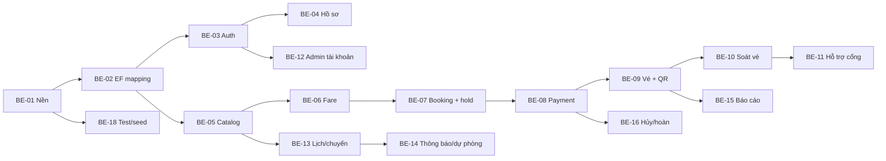

# Kế hoạch Backend-first — Nhóm 6 thành viên

| Thông tin | Giá trị |
| --- | --- |
| Dự án | Hệ thống quản lý vé và hỗ trợ hành khách Metro |
| Tài liệu | Kế hoạch phân công công việc — giai đoạn Backend (TASK-ASSIGNMENT) |
| Phiên bản | 4.0 |
| Ngày lập | 13/11/2026 |
| Người lập | Lead (M1) |
| Trạng thái | Draft — chờ nhóm xác nhận tên thành viên; mốc BE freeze và mốc chia FE đã chốt |
| Căn cứ | `docs/requirements/Metro_SRS_v1.2.docx` (47 UC), `Metro_Dac_ta_ UC_v1.6.docx`, gói `infra/database`, scaffold `backend/`, `docs/git-workflow/BRANCH-POLICY.md` |
| Mốc BE core | **06/12/2026** — toàn bộ endpoint Must-have trừ soát vé/báo cáo |
| Mốc BE hoàn tất | **13/12/2026** — soát vé, hỗ trợ cổng, báo cáo, hardening |
| Mốc FE | **Chia task FE ngày 07/12/2026**, chạy 07–20/12 (2 tuần), cả 6 người |
| Mốc bàn giao dự án | Release `v1.0-demo` **20/12/2026**, buffer UAT đến **24/12/2026** |

## 1. Mục đích và phạm vi giai đoạn này

Tài liệu chia **toàn bộ công việc Backend** của 27 UC Must-have thành task có mã, người phụ trách, sprint, ước lượng, phụ thuộc và tiêu chí hoàn thành, để cả 6 thành viên cùng làm BE bằng ASP.NET Core trong 4 sprint đầu.

**Frontend chưa chia task trong tài liệu này.** Task FE sẽ được chia vào **07/12/2026**, ngay sau khi BE core freeze (06/12), và chạy đến 20/12. Trong tuần 07–13/12, các task BE còn lại (soát vé, báo cáo, hardening) hoàn tất song song với việc FE bắt đầu dựng màn hình trên các endpoint đã freeze.

Nguyên tắc giai đoạn này:

1. **BE-first**: không dựng màn hình khi endpoint chưa có Swagger + test.
2. **Cả 6 người làm BE**: kể cả thành viên sẽ mạnh về FE, để ai cũng hiểu domain, contract và dữ liệu trước khi làm UI.
3. **API là hợp đồng**: mỗi endpoint có request/response mẫu, mã lỗi và test; FE sau này bám vào đó.
4. **Không sửa migration đã áp dụng**; mọi thay đổi schema đi qua migration mới + test.

## 2. Căn cứ và giả định

### 2.1. Căn cứ kỹ thuật

- **Backend scaffold**: ASP.NET Core `net9.0`, 4 project `Metro.API` / `Metro.Application` / `Metro.Domain` / `Metro.Infrastructure`; `Program.cs` đã có controllers, Swagger, CORS, health check; `ApplicationDbContext` kế thừa `IdentityDbContext`; DI đã cấu hình Npgsql + Identity Core.
- **Database**: PostgreSQL 17, schema `metro` (77 bảng) + `public."AspNet*"`; các hàm `hold_trip_capacity`, `confirm_payment_and_issue_tickets`, `cancel_unpaid_order`, `expire_capacity_holds` đã test; 7 hàm workflow là `SECURITY DEFINER` và không cấp EXECUTE cho PUBLIC.
- **SRS 1.2**: 47 UC; giai đoạn này chỉ làm 27 UC Must-have.
- **Git**: `feature/* → PR → dev → PR → main`; `dev` cần 1 approval, `main` cần 2, CI bắt buộc xanh.

### 2.2. Giả định về năng lực

| Hạng mục | Giá trị |
| --- | --- |
| Thời gian BE | S0–S3: 16/11 → 13/12/2026 (4 tuần, 20 ngày/người) |
| Ngày công gộp | 6 người × 20 ngày = 120 pd |
| Hao phí | ~20% (review, họp, sửa lỗi, học .NET/EF) |
| Khả dụng | ~96 pd |
| Khối lượng BE | ~57 pd → còn ~39 pd dự phòng cho review, test, sửa lỗi và hỗ trợ chéo |

Vì dư người so với khối lượng, mỗi người chỉ nhận 4–14 pd BE trong 4 tuần. Phần dư dùng cho: viết test, review chéo, cặp đôi (pairing) với người yếu .NET, và xử lý phát sinh EF mapping.

Nếu một thành viên chỉ có 4 ngày/tuần, giảm task của người đó theo thứ tự ở mục 6.4, không giảm thời gian test.

### 2.3. Ngoài phạm vi

- Không thanh toán thật, không điều khiển cổng/tàu/SCADA/ATS, không nhận diện khuôn mặt.
- Không làm mobile app, SMS/push, offline validation, hóa đơn thuế/PDF.
- Không làm Frontend trong giai đoạn này (trừ mock/contract do người sau này tự chuẩn bị khi được chia việc).

## 3. Kiến trúc và quy ước Backend

### 3.1. Cấu trúc

| Project | Trách nhiệm | Không được chứa |
| --- | --- | --- |
| `Metro.Domain` | Entity, enum, value object, business rule thuần, exception nghiệp vụ | EF attribute, HTTP, DI |
| `Metro.Application` | Use case theo `Features/<Module>`, DTO, validator, interface repository/service | DbContext trực tiếp, controller |
| `Metro.Infrastructure` | `ApplicationDbContext`, EF configuration, repository, payment adapter, email, QR, JWT | Business rule của domain |
| `Metro.API` | Controller, middleware, filter, ProblemDetails, Swagger, DI composition | Truy vấn LINQ phức tạp, business rule |

Quy ước thư mục: một use case = một thư mục dưới `Features/<Module>/<UseCase>/` gồm `Command|Query`, `Handler`, `Validator`, `Response`. Không tạo `Services` dùng chung quá lớn.

### 3.2. Quy ước API

- Prefix `/api/v1`, JSON camelCase, thời gian ISO-8601 UTC, tiền là `long` minor unit + `currency`.
- Lỗi trả `ProblemDetails` kèm `code` nội bộ (ví dụ `BOOKING_CAPACITY_EXCEEDED`), `traceId`, `errors` theo field.
- Phân trang `page`, `pageSize` (mặc định 20, tối đa 100), trả `items`, `page`, `pageSize`, `total`.
- Idempotency: header `Idempotency-Key` cho POST tạo đơn/thanh toán/scan; lưu và trả lại kết quả cũ khi trùng.
- Mọi endpoint ghi đều kiểm tra role + ownership + trạng thái; test 401/403 là bắt buộc.
- Swagger phải có example request/response và mô tả mã lỗi; `dotnet build` không warning mới.

### 3.3. Truy cập dữ liệu

- Đọc/ghi thường dùng EF Core; **không** cấu hình lại index/constraint trong EF (DB là nguồn sự thật).
- Các thao tác tiền/vé/sức chứa gọi hàm SQL qua `Database.SqlQuery`/`FromSql` trong transaction của request:
  - `metro.hold_trip_capacity` cho giữ chỗ,
  - `metro.confirm_payment_and_issue_tickets` cho callback thanh toán,
  - `metro.cancel_unpaid_order` cho hủy đơn chưa thanh toán,
  - `metro.expire_capacity_holds` cho job hết hạn.
- Role runtime DB chỉ có `GRANT EXECUTE` đúng hàm + `SELECT` cần thiết; không cấp quyền sở hữu bảng.
- Mọi thời điểm dùng UTC; chuyển UTC+7 chỉ ở tầng hiển thị.

## 4. Đội hình và phân công Backend

| Mã | Vai trò BE | Task sở hữu | pd |
| --- | --- | --- | --- |
| **M1** | Lead / Backend Architect | BE-01 nền tảng, BE-03 auth, BE-08 payment, BE-17 hardening; review toàn bộ PR | 12 |
| **M2** | Ticketing Engineer | BE-02 EF mapping (phần lõi), BE-07 booking/giữ chỗ, BE-09 vé/QR | 12 |
| **M3** | Operations Engineer | BE-05 catalog, BE-06 fare engine, BE-13 lịch/chuyến/thông báo | 11 |
| **M4** | Passenger & Gate Engineer | BE-02 EF mapping (phần ticketing/finance), BE-04 hồ sơ, BE-10 soát vé, BE-11 hỗ trợ cổng | 9 |
| **M5** | Admin & Reporting Engineer | BE-12 admin tài khoản, BE-14 thông báo/dự phòng, BE-16 hủy/hoàn, BE-18 seed/fixture | 8 |
| **M6** | Platform, Reporting & QA Engineer | BE-15 báo cáo, BE-18 test harness/Postman/CI | 5 |

Tổng: **57 pd**, mỗi người 5–12 pd trong 20 ngày — đủ chỗ cho review và sửa lỗi.

### 4.1. Cặp review chéo

| Người | Review chính cho | Ghi chú |
| --- | --- | --- |
| M1 | M2 (booking/payment/ticket), toàn bộ PR chạm auth/payment | Bắt buộc |
| M2 | M3 | Chéo module |
| M3 | M4 | Chéo module |
| M4 | M5 | Chéo module |
| M5 | M6 | Chéo báo cáo |
| M6 | M1 (hạ tầng, CI), test của M2 | Chéo test/CI |

Không ai tự merge PR của chính mình.

## 5. Lịch tổng thể (BE trước, FE từ 07/12)

| Sprint | Thời gian | Mục tiêu | Mốc |
| --- | --- | --- | --- |
| **S0** | 16/11 – 22/11/2026 | Dựng nền API, EF mapping, catalog đọc, Identity, seed/test harness | **B0 — Nền chạy được** |
| **S1** | 23/11 – 29/11 | Auth, fare engine, booking/giữ chỗ, admin tài khoản | |
| **S2** | 30/11 – 06/12 | Payment + phát hành vé + hồ sơ + lịch/chuyến | **B1 — BE core freeze (06/12)** |
| **S3** | 07/12 – 13/12 | BE: soát vé, hỗ trợ cổng, báo cáo, hủy/hoàn, hardening, seed demo. **FE: chia task 07/12 và bắt đầu dựng màn hình** | **B2 — BE hoàn tất (13/12)** |
| **S4** | 14/12 – 20/12 | FE hoàn thiện, tích hợp, E2E, UAT nội bộ | **Release `v1.0-demo` 20/12** |
| Buffer | 21/12 – 24/12 | UAT/demo, sửa P0–P1 | **Bàn giao** |

Quy ước:

- **BE core freeze 06/12**: endpoint của luồng mua vé → thanh toán → vé phải chốt tên/kiểu/tham số. Sau đó chỉ thêm field.
- **BE hoàn tất 13/12**: không còn endpoint Must-have nào thiếu; Swagger + Postman + seed demo đầy đủ.
- Thứ Sáu hằng tuần: demo BE bằng Swagger/Postman, không demo UI.
- Code freeze toàn dự án 17/12 (sau khi FE đã vào việc), chỉ nhận fix P0/P1.

## 6. Danh sách task Backend

Ước lượng theo **person-day (pd)**, đã gồm code, test và review. Mỗi task tạo branch `feature/US-<số>-<slug>` và PR vào `dev`.

| Mã | Nội dung | UC/BR | Người | Sprint | pd | Phụ thuộc | Đầu ra / DoD |
| --- | --- | --- | --- | --- | --- | --- | --- |
| BE-01 | Nền tảng API: middleware ProblemDetails, validation pipeline, logging, health check, Swagger + example, cấu hình môi trường, CORS, `global.json` | NFR chung | M1 | S0 | 3 | — | API chạy local; `/health` + `/swagger`; CI build/test xanh; lỗi chuẩn hóa |
| BE-02 | EF Core mapping schema `metro`/`public`: entity + configuration cho identity, network, order, ticket, payment; `EndExclusive`; query filter `operator_id` | DATA-001… | M2 (lõi 3), M4 (ticketing/finance 2) | S0–S1 | 5 | BE-01 | Đọc/ghi được các bảng lõi; `dotnet ef dbcontext info` sạch; integration test nối PostgreSQL thật |
| BE-03 | Identity + JWT: đăng ký, xác minh email, đăng nhập/xuất, refresh, policy theo role; `RequireUniqueEmail = true` | UC01–UC04 | M1 | S1 | 3 | BE-02 | 6 endpoint `/api/v1/auth/*`; test 401/403, email trùng trả 400 kèm `code` |
| BE-04 | Hồ sơ + xác minh ưu đãi: xem/sửa hồ sơ, upload minh chứng, trạng thái chờ/duyệt/từ chối, purge nội dung | UC05, UC06 | M4 | S1–S2 | 2 | BE-03 | API `/me`, `/me/eligibility`; kiểm ownership; audit thay đổi |
| BE-05 | Catalog đọc: tuyến, ga, hành trình, tình trạng dịch vụ | UC07, UC08, UC10 | M3 | S0–S1 | 3 | BE-02 | 4 endpoint public, cache ngắn (IMemoryCache), tìm đường theo ga |
| BE-06 | Fare engine + quản lý loại vé/giá/chính sách ưu đãi | UC09, UC25, BR-FARE-* | M3 | S1 | 4 | BE-05 | Tính giá theo `fare_policy_version`; CRUD có version + audit; test khóa NULL-safe, sản phẩm thiếu duration bị chặn |
| BE-07 | Booking: tạo đơn, order item, giữ chỗ theo đoạn, tự gán chuyến | UC11, UC36, BR-CAP-* | M2 | S1–S2 | 5 | BE-06 | Gọi `hold_trip_capacity`; `Idempotency-Key`; lỗi hết chỗ `BOOKING_CAPACITY_EXCEEDED`; test 2 phiên đồng thời |
| BE-08 | Payment MoMo TEST: tạo giao dịch, callback/IPN, xác minh chữ ký, thử lại | UC11, UC12, IF-003…005 | M1 | S2 | 4 | BE-07 | Gọi `confirm_payment_and_issue_tickets`; chữ ký bắt buộc; retry idempotent; không ghi trùng event |
| BE-09 | Phát hành vé + QR credential + API vé của tôi/lịch sử | UC13–UC15 | M2 | S2–S3 | 4 | BE-08 | 1 vé/hành khách; QR hash + version; lịch sử đặt/thanh toán; không log token gốc |
| BE-10 | Soát vé tại cổng: Allow/Deny/Pending, vé không hợp lệ, tra cứu tại ga | UC16–UC18, IF-002/008 | M4 | S2–S3 | 4 | BE-09 | Scan idempotent theo `event_id`; journey vào/ra; lý do Deny có mã |
| BE-11 | Hỗ trợ hành khách tại cổng: tra vé, cấp lại QR | UC19 | M4 | S3 | 1 | BE-10 | Tra theo mã vé/số điện thoại; cấp lại QR có audit |
| BE-12 | Quản trị tài khoản/quyền + dữ liệu hành khách | UC22, UC23 | M5 | S1 | 2 | BE-03 | CRUD role, khóa tài khoản, xem PII có audit; test 403 theo role |
| BE-13 | Tuyến/ga + lịch/chuyến + hồ sơ sức chứa + thông báo dịch vụ | UC24, UC29, UC31 | M3 | S2 | 4 | BE-05 | CRUD tuyến/ga/tàu/chuyến; sinh `trip_capacity_segments`; thông báo có hiệu lực/hết hạn |
| BE-14 | Gợi ý chuyến dự phòng + API tình trạng/gián đoạn | UC30, UC36 | M5 | S2 | 2 | BE-13 | Fallback khi chuyến đầy; API trạng thái tuyến; test không gợi ý chuyến đã hủy |
| BE-15 | Báo cáo vé/doanh thu + export CSV | UC33 | M6 | S2–S3 | 3 | BE-09 | Doanh thu theo ngày/tuyến/loại vé; export CSV; số khớp tổng payment |
| BE-16 | Hủy đơn chưa thanh toán + hoàn tiền cơ bản | UC42 | M5 | S2–S3 | 2 | BE-08 | Gọi `cancel_unpaid_order`; refund request/approve tối thiểu; không xóa khoản thu |
| BE-17 | Hardening NFR: rate limit, security headers, PII masking, audit bắt buộc | NFR-SEC/PERF/AUD | M1 | S3 | 2 | BE-03…BE-16 | Checklist NFR; test tải nhẹ; log không lộ PII/secret |
| BE-18 | Test + seed + Postman + kịch bản demo | AC-* | M5 (seed/fixture 2), M6 (harness/Postman 2) | S0–S3 | 4 | BE-01 | Seed 2 tuyến/12 ga; integration test chạy CI; Postman collection; 6 kịch bản demo |

Tổng Backend: **57 pd** — M1 12, M2 12, M3 11, M4 9, M5 8, M6 5.

### 6.1. Phân công theo sprint

| Sprint | M1 | M2 | M3 | M4 | M5 | M6 |
| --- | --- | --- | --- | --- | --- | --- |
| S0 | BE-01 | BE-02 (lõi) | BE-05 (bắt đầu) | BE-02 (ticketing/finance) | BE-18 (seed/fixture) | BE-18 (test harness, CI) |
| S1 | BE-03 | BE-02 (xong), BE-07 (bắt đầu) | BE-05 (xong), BE-06 | BE-04 | BE-12 | BE-15 (thiết kế query) |
| S2 | BE-08 | BE-07 (xong), BE-09 (bắt đầu) | BE-13 | BE-10 (bắt đầu) | BE-14, BE-16 (bắt đầu) | BE-15 |
| S3 | BE-17, review | BE-09 (xong), fix | fix + rà catalog/fare | BE-10 (xong), BE-11 | BE-16 (xong), BE-18 (seed demo) | BE-15 (xong), BE-18 (Postman, kịch bản) |

Tải thực tế: 1–5 pd/người/sprint. Người xong sớm nhận test/review hoặc cặp đôi với người đang tắc ở EF mapping.

### 6.2. Điều kiện "BE hoàn thành" (đo được)

- Tất cả endpoint trong mục 7 có Swagger + example + test integration.
- `dotnet build` và `dotnet test` xanh trên CI; không warning mới.
- Postman collection chạy được toàn bộ 6 kịch bản demo trên DB seed.
- Không còn `TODO`/`NotImplementedException` trong luồng Must-have.
- Không có bảng nào bị sửa ngoài migration; `python infra/database/build_deploy.py --check` khớp.

### 6.3. Ghi chú kỹ thuật bắt buộc

- **Không tự viết transaction giữ chỗ/thanh toán**: gọi hàm SQL; nếu thiếu, tạo migration mới + test, không sửa migration đã áp dụng.
- **Idempotency**: booking dùng `Idempotency-Key`; payment lưu `provider_event_id` + `payload_hash` và claim event nguyên tử; scan dùng `event_id`.
- **Bảo mật**: token hash chỉ lưu hash; PII không log; rate limit cho auth/payment/scan; role runtime DB ít quyền.
- **Email duy nhất**: DB có unique index theo FR-01.01 + preflight; app đặt `RequireUniqueEmail = true` để trả lỗi 400 thay vì 500.
- **Thời gian**: UTC trong DB, `EndExclusive` không gồm mốc kết thúc; không dùng `DateTime.Now`.
- **Mã vé**: DB sinh từ UUID order item + số thứ tự; BE không tự đặt mã.
- **Lỗi DB**: bắt `PostgresException` và map SQLSTATE (`P0001`, `P0002`, `23505`, `22023`, `28000`) sang `code` nội bộ, không trả raw message.

### 6.4. Thứ tự cắt khi trễ

1. BE-14 (gợi ý chuyến dự phòng) → chỉ trả danh sách chuyến còn chỗ.
2. BE-15 giảm còn báo cáo doanh thu theo ngày, bỏ export CSV.
3. BE-11 gộp vào BE-10 (chỉ tra cứu, không cấp lại QR).
4. BE-16 chỉ hủy đơn chưa thanh toán, hoãn refund request.
5. **Không cắt**: BE-07, BE-08, BE-09, BE-03 và test thanh toán/vé.

## 7. API surface — checklist bàn giao

| Module | Endpoint | Task |
| --- | --- | --- |
| Auth | `POST /auth/register`, `POST /auth/verify-email`, `POST /auth/login`, `POST /auth/refresh`, `POST /auth/logout`, `GET /auth/me` | BE-03 |
| Hồ sơ | `GET/PUT /me`, `POST /me/eligibility`, `GET /me/eligibility` | BE-04 |
| Catalog | `GET /lines`, `GET /stations`, `GET /journeys`, `GET /fares/quote`, `GET /service-status` | BE-05, BE-06 |
| Booking | `POST /orders`, `GET /orders/{id}`, `POST /orders/{id}/holds`, `DELETE /orders/{id}` | BE-07 |
| Payment | `POST /payments`, `POST /payments/{id}/retry`, `POST /webhooks/momo` | BE-08 |
| Vé | `GET /tickets`, `GET /tickets/{id}`, `GET /tickets/{id}/qr`, `GET /orders` (lịch sử), `GET /payments` (lịch sử) | BE-09 |
| Soát vé | `POST /inspection/scan`, `POST /inspection/lookup`, `POST /tickets/{id}/reissue` | BE-10, BE-11 |
| Admin | `GET/POST/PUT /admin/accounts`, `GET /admin/roles`, `PUT /admin/accounts/{id}/roles`, `GET/POST/PUT /admin/lines`, `/admin/stations`, `/admin/products`, `/admin/fares`, `/admin/schedules`, `/admin/trips`, `/admin/notices` | BE-12, BE-13 |
| Báo cáo | `GET /reports/revenue`, `GET /reports/tickets`, `GET /reports/revenue/export` | BE-15 |
| Hủy/hoàn | `POST /orders/{id}/cancel`, `POST /refunds`, `POST /refunds/{id}/approve` | BE-16 |

## 8. Phụ thuộc và đường găng

Đường găng: **BE-01 → BE-02 → BE-05/BE-06 → BE-07 → BE-08 → BE-09 → BE-10**.

Nếu BE-07 trễ, M3 dừng BE-13 để cùng M2 gỡ booking; BE-08 của M1 không được trễ vì chặn toàn bộ giai đoạn FE.

## 9. Truy vết Use Case → Task Backend

| Nhóm UC | Nội dung | Mức | Task BE |
| --- | --- | --- | --- |
| UC01–UC04 | Đăng ký, đăng nhập, đăng xuất, khôi phục mật khẩu | Must | BE-03 |
| UC05–UC06 | Hồ sơ hành khách, xác minh ưu đãi | Must | BE-04 |
| UC07–UC10 | Tuyến/ga, hành trình, giá, tình trạng dịch vụ | Must | BE-05, BE-06 |
| UC11–UC12 | Mua vé, thử lại thanh toán | Must | BE-07, BE-08 |
| UC13–UC15 | Vé của tôi, lịch sử đặt vé/thanh toán | Must | BE-09 |
| UC16–UC18 | Soát vé tại cổng, vé không hợp lệ, tra cứu tại ga | Must | BE-10 |
| UC19 | Hỗ trợ hành khách mua vé | Must | BE-11 |
| UC20–UC21 | Phản ánh hành khách, sự cố tại ga | Stretch | BE-14 |
| UC22–UC23 | Tài khoản/quyền, dữ liệu hành khách | Must | BE-12 |
| UC24–UC25 | Tuyến/ga, loại vé/giá/chính sách ưu đãi | Must | BE-06, BE-13 |
| UC26–UC27 | Cấu hình thanh toán, cấu hình thông báo | Stretch | BE-08, BE-13 |
| UC28 | Nhật ký kiểm toán | Out | — |
| UC29 | Lịch và hoạt động tàu | Must | BE-13 |
| UC30 | Tình trạng tuyến, gián đoạn | Stretch | BE-14 |
| UC31 | Công bố thông báo dịch vụ | Must | BE-13 |
| UC32 | Báo cáo vận hành | Stretch | BE-15 |
| UC33 | Báo cáo vé, doanh thu, hành khách | Must | BE-15 |
| UC34–UC35 | Xuất báo cáo, gửi thông báo nghiệp vụ | Stretch | BE-15 |
| UC36 | Tự gán chuyến, chọn chuyến khi quá tải | Must | BE-07, BE-14 |
| UC37 | Giới hạn tải đoàn tàu/toa/chuyến | Out | — |
| UC38 | Tải nhập tay, đối chiếu AFC | Stretch | BE-15 |
| UC39–UC41 | Mua hộ/bàn giao, xác minh danh tính, thay đoàn tàu | Out | — |
| UC42 | Hủy đơn chưa thu, đổi vé, ngoại lệ tài chính | Stretch | BE-16 |
| UC43–UC47 | Tiếp cận, sự cố trên tàu, thất lạc, dự báo | Out | — |

## 10. Definition of Done và quy trình

### 10.1. DoD cho mọi task BE

- [ ] `dotnet build` local + CI xanh, không warning mới.
- [ ] Unit test cho validator/business rule; integration test cho endpoint chạm DB.
- [ ] Swagger có example request/response và mã lỗi.
- [ ] Kiểm quyền server-side: test 401 (chưa đăng nhập) và 403 (sai role/không sở hữu).
- [ ] Idempotency cho endpoint ghi theo quy ước.
- [ ] Không hard-code secret; cấu hình qua `appsettings.Development.json`/user-secrets/env.
- [ ] Không trả raw exception DB/stack trace ra client.
- [ ] PR ≤ 400 dòng logic, có mô tả + link task/UC, được review chéo theo mục 4.1.

### 10.2. Test

| Loại | Công cụ | Phạm vi | Khi nào |
| --- | --- | --- | --- |
| Unit | xUnit + NSubstitute | Validator, handler không chạm DB | Mỗi PR |
| Integration | xUnit + `WebApplicationFactory` + PostgreSQL thật | Endpoint + EF mapping + hàm SQL | Mỗi PR chạm DB |
| SQL regression | `infra/database/tests/*.sql` | Capacity, payment, constraint | Khi đổi schema/hàm |
| Contract smoke | Postman/Newman | 6 kịch bản demo | S2–S3, trước demo |

Docker Desktop có thể không chạy trên máy nhóm — integration test phải có chế độ dùng PostgreSQL local qua biến môi trường, không bắt buộc Testcontainers.

### 10.3. Git

- Branch: `feature/US-<số>-<slug>`, `bugfix/...`, `docs/...`.
- PR target `dev`; PR `dev → main` chỉ ở milestone và do M1 merge.
- Title: `feat(be): ...`, `fix: ...`, `docs: ...`.
- Không merge khi CI đỏ; không force push; conflict theo `docs/git-workflow/CONFLICT-RESOLUTION.md`.
- Review SLA 4 giờ làm việc; PR quá 24 giờ không review thì nhắc trong kênh nhóm.

## 11. Nghiệm thu Backend

Demo BE bằng Swagger/Postman, không cần UI:

1. Đăng ký → xác minh email → đăng nhập → gọi `/auth/me` (M1).
2. Tra cứu tuyến/ga/hành trình/giá (M3).
3. Tạo đơn + giữ chỗ, chạy 2 request đồng thời để thấy một request bị từ chối đúng (M2).
4. Gửi callback thanh toán có chữ ký, nhận vé + QR; gửi lại callback thấy idempotent (M1).
5. Quét QR: Allow → quét lại Deny → tra cứu và cấp lại QR (M4).
6. Admin tạo giá/chuyến/thông báo, xem báo cáo doanh thu, hủy đơn chưa thanh toán (M5, M6).

Tiêu chí đạt: mục 6.2 thỏa mãn; Postman chạy lần lượt 6 kịch bản trên DB seed không lỗi.

## 12. Rủi ro và giảm thiểu

| Rủi ro | Ảnh hưởng | Giảm thiểu | Người theo dõi |
| --- | --- | --- | --- |
| EF mapping 77 bảng tốn thời gian | Chặn mọi module | Chỉ map bảng dùng trong Must-have trước; phần còn lại thêm sau; M4 hỗ trợ M2 | M2 |
| Thành viên chưa quen ASP.NET/EF | Chậm, lỗi kiến trúc | Pairing với M1/M2; task nhỏ; review sớm | M1 |
| Payment sandbox thay đổi | Chặn BE-08 | Adapter + mock provider; chốt sandbox ở S0 | M1 |
| Sai logic giữ chỗ | Bán quá tải | Gọi hàm SQL đã test; test 2 phiên; review bắt buộc | M2 |
| Dư người nhưng thiếu việc ở S1–S2 | Lãng phí, tranh task | Nhận thêm test/review; hỗ trợ module đang tắc; không thêm scope ngoài SRS | M1 |
| BE trễ làm FE không kịp | Trượt deadline | BE core freeze 06/12; cắt theo mục 6.4; FE chia 07/12 và chỉ bám endpoint đã freeze | M1 |
| PR lớn, conflict | Chậm tích hợp | PR ≤400 dòng; rebase hằng ngày; chốt owner theo `Features/<Module>` | Cả nhóm |
| Lộ PII/secret | Rủi ro bảo mật | Masking, review, không commit `.env` | M1 |

## 13. Việc cần chốt ngay (Sprint 0)

1. Điền tên thật và số ngày làm việc/tuần của từng thành viên.
2. Chốt .NET 9 (scaffold) hay nâng .NET 10; pin `global.json`.
3. Chốt PostgreSQL: local service (như hiện tại) hay Docker; cấu hình connection string cho cả nhóm.
4. Chốt tài khoản MoMo TEST và endpoint callback (dùng ngrok/Cloudflare tunnel).
5. Chốt style API: ProblemDetails, mã lỗi, phân trang (mục 3.2).
6. Lập GitHub Issues cho BE-01…BE-18, label `be`/`blocked`/`stretch`.
7. Chốt cặp review chéo (mục 4.1) và lịch demo thứ Sáu.

## 14. Checklist khởi động cho từng người

- **M1**: dựng BE-01; chốt ProblemDetails + mã lỗi; tạo issue; xác nhận `RequireUniqueEmail`, quyền runtime DB; đặt lịch review.
- **M2**: đọc `DATABASE_DESIGN.md`; dựng BE-02 phần lõi; vẽ state machine Order/Payment/Ticket; chốt contract booking.
- **M3**: chuẩn bị seed 2 tuyến/12 ga + giá mẫu; dựng catalog đọc; chốt contract fare.
- **M4**: dựng BE-02 phần ticketing/finance cùng M2; đặc tả luồng hồ sơ; đọc trước API soát vé.
- **M5**: dựng seed/fixture; rà UC admin; đặc tả API admin tài khoản.
- **M6**: dựng test harness + CI; thiết kế query báo cáo; chuẩn bị khung Postman.

## 15. Frontend — kế hoạch chia task (07/12/2026)

Giai đoạn này **chưa chia task FE**. Mốc chia đã chốt: **07/12/2026**, ngay sau BE core freeze, FE chạy 07–20/12 (2 tuần) với cả 6 người.

### 15.1. Điều kiện đầu vào

- Endpoint cho luồng mua vé đã freeze và có test trước 06/12: auth, hồ sơ, catalog, fare, booking, payment, vé.
- Postman collection + seed demo chạy được trên môi trường chung.
- Design token, app shell và quy ước code FE được chốt trong 07–09/12 trước khi dựng màn hình.
- Danh sách UC Must-have dành cho FE: UC01–UC19, UC22–UC25, UC29, UC31, UC33.

### 15.2. Phân bổ dự kiến

| Thời gian | Nội dung |
| --- | --- |
| 07–09/12 | App shell, design system, auth/hồ sơ, catalog; nối API thật cho module đã freeze |
| 10–13/12 | Booking → thanh toán → vé của tôi; bắt đầu soát vé và báo cáo khi BE-10/BE-15 xong |
| 14–17/12 | Portal nhân viên, quản trị, báo cáo, trạng thái loading/empty/error, responsive |
| 18–20/12 | Tích hợp, E2E, UAT nội bộ, sửa lỗi P0–P1, release |

### 15.3. Cách chia (chốt danh sách task tại buổi 07/12)

- Khối lượng khả dụng ~48 pd (6 người × 8 ngày, đã trừ hao phí) cho 27 UC Must-have phía FE.
- Giữ nguyên người sở hữu miền đã làm BE để tận dụng hiểu biết domain; M1 hỗ trợ tích hợp và review.
- Danh sách task FE (mã `FE-xx`, pd, phụ thuộc, DoD) sẽ được bổ sung vào tài liệu này ngay sau buổi chia task.
- Nếu BE core trễ sau 06/12, cắt theo mục 6.4 và dồn ngày FE tương ứng; không dời mốc release 20/12.

### 15.4. Việc chuẩn bị trong lúc làm BE

- Mỗi người ghi lại request/response của module mình vào Postman — đây là tài liệu FE sẽ dùng.
- M1 giữ Swagger chạy trên môi trường chung để FE xem contract.
- Chưa dựng màn hình, chưa cài thêm thư viện UI trước ngày chia task.

## 16. Backlog sau deadline

| Nhóm | Nội dung | Ghi chú |
| --- | --- | --- |
| Bảo mật & audit | UC28 nhật ký kiểm toán đầy đủ, che PII nâng cao | Có audit tối thiểu trong BE-12/BE-17 |
| Vận hành nâng cao | UC30, UC32, UC34, UC35, UC37, UC38 | Báo cáo vận hành, giới hạn tải, đối chiếu AFC |
| Hành khách nâng cao | UC39, UC40, UC41, UC43–UC47 | Mua hộ/bàn giao, xác minh danh tính, thay đoàn, tiếp cận, thất lạc, dự báo |
| Kỹ thuật | Nâng .NET 10, tối ưu hiệu năng, mobile app | Sau khi chốt bản demo |

---

**Ghi chú phiên bản**: 4.0 — Backend-first bằng ASP.NET Core; cả 6 người làm BE trong S0–S3 (16/11–13/12/2026); BE core freeze 06/12; 27 UC Must-have; chia task FE ngày 07/12/2026 và chạy 07–20/12; dựa trên SRS 1.2, UC v1.6 và hiện trạng repo ngày 13/11/2026.
