# ĐẶC TẢ YÊU CẦU PHẦN MỀM (SRS)

## Hệ thống quản lý tàu Metro

**Mã tài liệu:** SRS-METRO  
**Phiên bản:** 1.1-draft  
**Ngôn ngữ:** Tiếng Việt  
**Ngày dữ liệu tham khảo:** 06/11/2026  
**Trạng thái:** Bản dự thảo để thẩm định

> Tài liệu quy định yêu cầu cho phần mềm quản trị nghiệp vụ vận hành Metro và phục vụ hành khách. Tài liệu không đặc tả một hệ thống điều khiển hoặc an toàn chạy tàu. Năng lực OD Matrix và quản lý tải hành khách trong tài liệu chỉ phục vụ phân tích, lập kế hoạch và hỗ trợ quyết định; không gửi lệnh điều khiển tới tàu, cổng, tín hiệu hoặc OCC.

---

## 0. Kiểm soát tài liệu

### 0.1. Lịch sử phiên bản

| Phiên bản | Ngày | Người/nhóm thực hiện | Nội dung thay đổi | Trạng thái |
|---|---|---|---|---|
| 0.1 | 06/11/2026 | Nhóm phân tích | Phân tích form, nghiên cứu nghiệp vụ và lập baseline | Đã xác nhận |
| 1.0-draft | 06/11/2026 | Nhóm phân tích | Soạn SRS từ baseline đã khóa | Chờ thẩm định |
| 1.1-draft | 06/11/2026 | Nhóm phân tích | Bổ sung OD Matrix, quản lý tải hành khách và đề xuất tự động hóa giảm gánh nặng thủ công | Chờ thẩm định |

### 0.2. Trách nhiệm thẩm định

| Vai trò | Trách nhiệm |
|---|---|
| Chủ sở hữu yêu cầu | Xác nhận phạm vi, quy tắc dự án và thay đổi yêu cầu |
| Nhóm phân tích nghiệp vụ | Duy trì SRS, truy vết nguồn và kiểm tra tính nhất quán |
| Đại diện vận hành | Thẩm định lịch, chuyến, đoàn tàu, nhân sự, bảo trì và sự cố |
| Đại diện vé/tài chính | Thẩm định chính sách giá, thanh toán, AFC, ưu đãi và hoàn tiền |
| Đại diện phân tích nhu cầu | Thẩm định OD Matrix, ngưỡng tải/crowding, dự báo và chất lượng dữ liệu AFC/APC |
| Chủ sở hữu tự động hóa | Thẩm định quy tắc, mức rủi ro, KPI và điều kiện vận hành tự động hóa |
| Nhóm phát triển/kiểm thử | Đánh giá khả thi, xây dựng thiết kế và lập ca kiểm thử từ tiêu chí chấp nhận |

### 0.3. Quy ước yêu cầu

| Tiền tố | Ý nghĩa |
|---|---|
| `UC` | Use Case |
| `FR` | Yêu cầu chức năng (Functional Requirement) |
| `BR` | Quy tắc nghiệp vụ (Business Rule) |
| `DATA` | Yêu cầu dữ liệu |
| `INT` | Yêu cầu giao diện/tích hợp |
| `NFR` | Yêu cầu phi chức năng (Non-functional Requirement) |
| `AC` | Tiêu chí chấp nhận cấp hệ thống |
| `SRC` | Nguồn tham khảo nghiệp vụ |
| `DEC` | Quyết định dự án đã được xác nhận |
| `RPT` | Báo cáo/chỉ số |
| `AUT` | Cơ hội/yêu cầu tự động hóa giảm gánh nặng thủ công |

Các từ **phải**, **không được**, **nên** và **có thể** lần lượt biểu thị yêu cầu bắt buộc, điều cấm, khuyến nghị và khả năng tùy chọn. Mọi yêu cầu bắt buộc phải có cách kiểm chứng.

### 0.4. Cấu trúc tài liệu

| Chương | Nội dung |
|---:|---|
| 1–2 | Mục đích, phạm vi, bối cảnh, tác nhân và ranh giới hệ thống |
| 3–4 | Tổng quan chức năng, workflow, ma trận quyền và quy tắc nghiệp vụ |
| 5–6 | Yêu cầu chức năng và đặc tả đầy đủ Use Case |
| 7–8 | Dữ liệu, trạng thái, seed demo và giao diện/tích hợp |
| 9–11 | Phi chức năng, báo cáo/KPI và tiêu chí nghiệm thu hệ thống |
| 12–14 | Truy vết, quyết định đã xác nhận, vấn đề mở và kiểm soát thay đổi |
| 15 | Đề xuất tự động hóa và giảm gánh nặng thủ công cho con người |

---

## 1. Giới thiệu

### 1.1. Mục đích

SRS này là căn cứ thống nhất giữa chủ sở hữu yêu cầu, nhóm phân tích, thiết kế, phát triển và kiểm thử cho “Hệ thống quản lý tàu Metro”. Tài liệu mô tả:

- phạm vi và ranh giới phần mềm;
- tác nhân và quyền hạn;
- yêu cầu chức năng và Use Case;
- quy tắc nghiệp vụ;
- dữ liệu và vòng đời trạng thái;
- giao diện với các hệ thống mô phỏng;
- yêu cầu phi chức năng và tiêu chí nghiệm thu;
- mối liên hệ giữa nguồn thực tế, quyết định dự án, yêu cầu và kiểm thử.

### 1.2. Phạm vi sản phẩm

Sản phẩm gồm hai nhóm năng lực:

1. **Quản trị nghiệp vụ vận hành Metro:** quản lý mạng lưới, biểu đồ chạy tàu, lượt chạy, đoàn tàu, nhân sự, ca trực, bảo trì, sự cố, thông báo và báo cáo.
2. **Phục vụ hành khách và vé:** tra cứu, tài khoản, sản phẩm vé, giá, ưu đãi, bán vé, thanh toán, phát hành vé, AFC mô phỏng, ngoại lệ hành trình, hoàn tiền và hỗ trợ.

Mô hình dữ liệu và chính sách hỗ trợ nhiều nhà vận hành. Release đầu chỉ cấu hình Hanoi Metro và tuyến 2A Cát Linh–Hà Đông làm dữ liệu demo. Chính sách của một nhà vận hành không được tự động áp dụng cho nhà vận hành khác.

### 1.3. Mục tiêu nghiệp vụ

- Chuẩn hóa và truy vết quá trình lập, duyệt, công bố và thực hiện biểu đồ chạy tàu.
- Cung cấp một nguồn dữ liệu thống nhất về chuyến, đoàn tàu, nhân sự, bảo trì và sự cố.
- Bảo đảm tách nhiệm vụ giữa người lập, người duyệt và người thực hiện các nghiệp vụ nhạy cảm.
- Cung cấp kênh tra cứu và mua vé trực tuyến thuận tiện, có khả năng kiểm chứng giao dịch.
- Quản lý giá và chính sách theo phiên bản/ngày hiệu lực, không hồi tố.
- Mô phỏng đầy đủ luồng thanh toán và kiểm soát vào–ra mà không điều khiển thiết bị thật.
- Tạo báo cáo vận hành, vé, doanh thu, ưu đãi và kiểm toán phục vụ quản trị và xuất báo cáo cho cơ quan quản lý.
- Đo, dự báo và quản lý tải hành khách theo OD Matrix để chủ động điều chỉnh năng lực, giảm crowding và ưu tiên hành động dựa trên dữ liệu.
- Giảm gánh nặng thu thập, tổng hợp, đối soát và báo cáo thủ công bằng tự động hóa có kiểm soát, đồng thời giữ con người chịu trách nhiệm ở các quyết định nghiệp vụ nhạy cảm.

### 1.4. Đối tượng đọc

- Chủ nhiệm đồ án và giảng viên/hội đồng đánh giá.
- Business Analyst, Requirements Engineer.
- Nhóm thiết kế, phát triển và kiểm thử.
- Đại diện nghiệp vụ vận hành, nhà ga, bảo trì, vé và tài chính.
- Người kiểm toán yêu cầu hoặc rà soát phạm vi.

### 1.5. Thuật ngữ và chữ viết tắt

| Thuật ngữ | Diễn giải |
|---|---|
| AFC | Automatic Fare Collection — hệ thống thu soát vé tự động; trong đồ án chỉ là mô phỏng/API nghiệp vụ |
| OCC | Operations Control Center — trung tâm điều hành; phần mềm chỉ nhận dữ liệu thủ công/CSV theo hướng chỉ đọc |
| ATP | Automatic Train Protection — bảo vệ tàu tự động, ngoài phạm vi |
| ATO | Automatic Train Operation — vận hành tàu tự động, ngoài phạm vi |
| ATS | Automatic Train Supervision — giám sát tàu tự động, ngoài phạm vi điều khiển của phần mềm |
| SCADA | Supervisory Control and Data Acquisition — giám sát/điều khiển hạ tầng kỹ thuật, ngoài phạm vi |
| Biểu đồ chạy tàu | Phiên bản kế hoạch quy định lượt chạy, thời gian đến/đi, dừng ga và lịch áp dụng |
| Lượt chạy/chuyến | Một lần thực hiện hành trình có mã duy nhất, chiều chạy, thời gian kế hoạch và thực tế |
| Ngày dịch vụ | Ngày vận hành theo lịch của nhà vận hành, có loại ngày thường/cuối tuần/lễ/sự kiện |
| Headway | Khoảng giãn cách thời gian giữa hai lượt chạy kế tiếp cùng chiều |
| Trainset/đoàn tàu | Đơn vị phương tiện được phân cho lượt chạy và quản lý trạng thái sẵn sàng |
| Credential | Phương tiện định danh quyền sử dụng vé, ví dụ QR hoặc mã CCCD/NFC mô phỏng |
| Tap-in/Tap-out | Sự kiện xác nhận vào/ra khu vực kiểm soát vé |
| Anti-passback | Quy tắc ngăn một quyền đi lại được sử dụng đồng thời hoặc lặp trái phép |
| RTO | Recovery Time Objective — thời gian mục tiêu khôi phục dịch vụ |
| RPO | Recovery Point Objective — mức mất dữ liệu tối đa cho phép khi phục hồi |
| RBAC | Role-Based Access Control — kiểm soát truy cập theo vai trò |
| MFA | Multi-Factor Authentication — xác thực đa yếu tố |
| P95 | Giá trị mà 95% mẫu đo nhỏ hơn hoặc bằng |
| OD Matrix | Origin–Destination Matrix — ma trận xuất–nhập, trong đó hàng là ga đi, cột là ga đến và ô là số lượt hành khách trong một khoảng thời gian, chiều chạy và loại ngày |
| OD pair | Cặp ga đi–ga đến của một hành trình |
| APC | Automatic Passenger Counting — hệ thống đếm khách tự động trên tàu hoặc tại ga; trong đồ án là nguồn mô phỏng/API nghiệp vụ |
| Load factor | Tỷ lệ số hành khách trên tàu/toa so với sức chứa thiết kế; có thể tính theo sức chứa hoặc theo số ghế |
| PSM | Passengers per Square Metre — số hành khách đứng trên một mét vuông diện tích đứng |
| Crowding | Mức độ đông của tàu, toa, sân ga hoặc đoạn tuyến so với ngưỡng cấu hình |
| Load profile | Hồ sơ tải theo từng lượt chạy, từng đoạn giữa hai ga và/hoặc từng toa |
| Forecast horizon | Khoảng thời gian dự báo phía trước, ví dụ 15 phút, 1 giờ, 1 ngày hoặc 7 ngày |
| Human-in-the-loop | Con người kiểm tra, phê duyệt hoặc ghi đè trước khi hành động có hệ quả nghiệp vụ được thực hiện |
| Automation | Tự động hóa tác vụ lặp lại, tổng hợp, phát hiện bất thường hoặc đề xuất; không đồng nghĩa với tự động ra quyết định |
| Anomaly | Điểm dữ liệu hoặc hành vi lệch khỏi mẫu/miền hợp lệ cần con người kiểm tra |
| WAPE | Weighted Absolute Percentage Error — sai số phần trăm có trọng số, dùng đánh giá dự báo tổng |
| MAPE | Mean Absolute Percentage Error — sai số phần trăm tuyệt đối trung bình |

### 1.6. Tài liệu tham khảo

| Mã | Tài liệu/nguồn | Hệ thống và thời điểm áp dụng | Mục đích sử dụng |
|---|---|---|---|
| SRC-001 | [Hanoi Metro — Hướng dẫn sử dụng hệ thống Metro](https://metrohanoi.vn/metro-userguide/huong-dan-su-dung-he-thong-metro/) | Hanoi Metro, truy cập 06/11/2026 | Ga, lịch, loại vé, sử dụng vé và ngoại lệ hành trình |
| SRC-002 | [Quyết định 3316/QĐ-UBND](https://vanban.hanoi.gov.vn/chi-tiet-van-ban/ve-viec-ban-hanh-phuong-an-ve-lien-thong-da-phuong-thuc-cho-he-thong-van-tai-hanh-khach-cong-con-220707) | Hà Nội, ban hành 27/06/2025 | Cơ cấu vé và phương án giá đa phương thức |
| SRC-003 | [Quyết định 3553/QĐ-UBND đính chính Quyết định 3316](https://hanoi.gov.vn/chi-dao-cua-ubnd-thanh-pho-ha-noi/dinh-chinh-mot-so-noi-dung-tai-quyet-dinh-so-3316-ve-phuong-an-ve-lien-thong-da-phuong-thuc-cho-he-thong-van-tai-hanh-khach-cong-cong-4250702102102284.htm) | Hà Nội, ban hành 30/06/2025 | Giá vé thời gian được đính chính |
| SRC-004 | [Hanoi Metro — Biểu đồ chạy tàu áp dụng từ 09/02/2026](https://metrohanoi.vn/ha-noi-metro-ap-dung-bieu-do-chay-tau-voi-gio-cao-diem-moi-tu-ngay-9-2-2026-tren-02-tuyen-dsdt-2a-cat-linh-ha-dong-va-3-1-nhon-ga-ha-noi/) | Hanoi Metro, từ 09/02/2026 | Mẫu lịch ngày thường/cuối tuần/lễ và khung giờ |
| SRC-005 | [Quyết định 97/2024/QĐ-UBND TP.HCM](https://congbao.hochiminhcity.gov.vn/cong-bao/van-ban/quyet-dinh/so/97-2024-qd-ubnd/ngay/30-10-2024/tai-ve/47047) | TP.HCM, hiệu lực 11/11/2024 | Tham khảo quy trình lập lịch, điều chỉnh, vé, sự cố và báo cáo |
| SRC-006 | [W3C — WCAG 2 Overview](https://www.w3.org/WAI/standards-guidelines/wcag/) | Tiêu chuẩn web quốc tế | Căn cứ WCAG 2.2 Level AA |
| SRC-007 | [TCRP Report 165 — Transit Capacity and Quality of Service Manual, 3rd Edition](https://nap.nationalacademies.org/catalog/24766/transit-capacity-and-quality-of-service-manual-third-edition) | Tiêu chuẩn quốc tế | Định nghĩa load factor, mức phục vụ và ngưỡng crowding |
| SRC-008 | [Legislative Council of Hong Kong — MTR train capacity and 6 psm design standard](https://www.legco.gov.hk/yr13-14/english/panels/tp/tp_rdp/papers/tp_rdp0228cb1-980-3-e.pdf) | MTR Hong Kong, 2014 | Tham chiếu cách tính design capacity theo psm |
| SRC-009 | [WMATA — Metro Rail Service Standards](https://www.wmata.com/content/dam/wmata-com/migrated-assets/initiatives/plans/upload/metrorail-service-standards.pdf) | WMATA, 2026 | Mẫu passenger load standard, ngưỡng crowded/very crowded và cách dùng tap-in/tap-out |
| SRC-010 | [Crowding Prediction of In-Situ Metro Passengers Using Smart Card Data](https://arxiv.org/html/2009.02880) | Singapore MRT, 2020 | Phương pháp dự báo OD và mật độ hành khách trên tàu từ smart card |
| SRC-011 | [Transit OD Matrix Estimation Using Smartcard Data: Recent Developments and Future Research Challenges](https://doi.org/10.1016/j.trc.2021.103044) | Transportation Research Part C, 2021 | Tổng quan học thuật về ước lượng OD từ dữ liệu AFC |
| SRC-012 | [Île-de-France Mobilités — Real-time passenger information and crowding](https://www.iledefrance-mobilites.fr/en/actualites/affluence-temps-reel-trains) | Paris, 2023–2026 | Mẫu đếm khách bằng cảm biến hồng ngoại/AI và hiển thị crowding theo toa |
| SRC-013 | [Tokyo Metro — Train crowding measurement system](https://www.tokyometro-techsolutions.jp/) | Tokyo Metro, 2021–2026 | Mẫu camera depth + AI thay thế đo crowding thủ công |
| SRC-014 | [Hanoi Metro carries nearly 21 million passengers in 2025](https://en.vietnamplus.vn/hanoi-metro-carries-nearly-21-million-passengers-last-year-as-revenue-beats-targets-post336038.vnp) | Hanoi Metro, 2026 | Sản lượng, doanh thu và định hướng e-ticketing/biometric |
| SRC-015 | [HCMC Metro Line 1 carries over 20.5 million passengers in 2025](https://news.tuoitre.vn/saigontimes/hcmc-metro-line-1-carries-over-20-5-million-passengers-in-2025-105511945.htm) | HCMC Metro, 2026 | Sản lượng thực tế và biến động theo ngày thường/cuối tuần |
| SRC-016 | [Google Cloud — Delhi Metro Rail Corporation predictive maintenance case study](https://cloud.google.com/customers/dmrc) | DMRC, 2026 | Mẫu tự động hóa bảo trì dự đoán và giảm giám sát thủ công |
| SRC-017 | [FMT — ARIIS automated rail infrastructure inspection for Dubai Metro](https://www.thinkfmt.com/projects/ariis-for-dubai-metro) | Dubai Metro, 2026 | Mẫu kiểm tra hạ tầng tự động, giảm giờ công kiểm tra thủ công |

Thông tin từ SRC-005 chỉ là căn cứ tham khảo nghiệp vụ chung, không được biến thành chính sách của Hanoi Metro nếu không có quyết định dự án tương ứng. SRC-009, SRC-012 và SRC-013 là ví dụ quốc tế về ngưỡng/measurement; giá trị áp dụng cho dữ liệu demo phải được cấu hình và ghi rõ là giả định, không phải tiêu chuẩn an toàn.

---

## 2. Mô tả tổng quan

### 2.1. Bối cảnh sản phẩm

Hệ thống là phần mềm nghiệp vụ độc lập, không phải OCC, AFC thật hoặc hệ thống an toàn chạy tàu. Phần mềm cung cấp cổng hành khách và back office dùng chung một kho dữ liệu nghiệp vụ, đồng thời giao tiếp với năm thành phần mô phỏng: thanh toán, AFC, APC/CCTV, email và nguồn dữ liệu OCC dạng CSV. Nguồn APC/CCTV chỉ cung cấp số đếm tổng hợp; hệ thống không nhận diện danh tính hành khách từ hình ảnh.

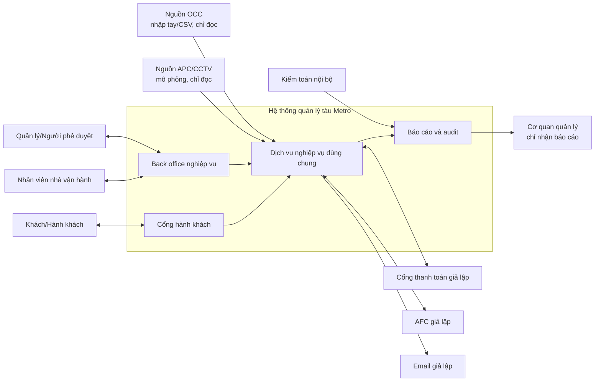

### 2.2. Ranh giới hệ thống

#### 2.2.1. Trong phạm vi

- Nhà vận hành, tuyến, đoạn tuyến, ga và thứ tự ga.
- Biểu đồ chạy tàu, lịch dịch vụ, phiên bản, phê duyệt và công bố.
- Lượt chạy kế hoạch, đoàn tàu/nhân sự được phân và dữ liệu thực tế.
- Đoàn tàu, cấu hình toa và trạng thái sẵn sàng.
- Hồ sơ nhân viên, vai trò, chứng chỉ, ca và phân công.
- Bảo trì đoàn tàu cấp trainset, lệnh việc, thực hiện và nghiệm thu.
- Sự cố, ảnh hưởng, nhiệm vụ, thông báo, nguyên nhân và đóng sự cố.
- Tra cứu công cộng, tài khoản và tùy chọn thông báo.
- Sản phẩm vé, ma trận giá, ưu đãi và hồ sơ xét duyệt.
- Bán vé, thanh toán sandbox, tiền mặt tại quầy và phát hành vé.
- AFC mô phỏng, tap-in/tap-out và xử lý ngoại lệ.
- Xây dựng, kiểm tra, phiên bản hóa và công bố OD Matrix từ AFC/APC; tính tải theo đoạn tuyến, lượt chạy và toa.
- Dự báo nhu cầu, mô phỏng kịch bản năng lực, phát hiện crowding, cảnh báo và đề xuất hành động có con người phê duyệt.
- Tự động hóa tác vụ báo cáo, đối soát, chất lượng dữ liệu, cảnh báo, đề xuất lịch/phân công/bảo trì và hỗ trợ xử lý ngoại lệ.
- Hoàn tiền, hỗ trợ, báo cáo, KPI, audit và quản trị.

#### 2.2.2. Ngoài phạm vi

- ATP, ATO, ATS, liên khóa, tín hiệu, đặt đường chạy và mệnh lệnh chạy tàu.
- Điều khiển tốc độ/chạy/dừng tàu, điện kéo/SCADA, cửa tàu, cửa chắn ke ga và cổng vật lý.
- OCC, AFC, thanh toán, CCCD/VNeID hoặc sinh trắc học thật.
- Ứng dụng di động native và SMS thật.
- Vé liên thông xe buýt–Metro trong MVP.
- Lương, chấm công và nghỉ phép.
- Kho phụ tùng, mua sắm, nhà cung cấp, bảo hành và chi phí bảo trì.
- Portal cho cơ quan quản lý nhà nước.
- Mô phỏng vị trí tàu thời gian thực.
- Đặt chỗ hoặc chọn ghế.
- Lựa chọn framework, cơ sở dữ liệu và kiến trúc triển khai.
- Phần cứng APC/CCTV thật, nhận diện khuôn mặt/cá nhân và theo dõi vị trí riêng của hành khách.
- Tự động gửi lệnh điều độ, giữ tàu, quay đầu, đổi đường chạy, điều khiển cửa/cổng hoặc bất kỳ lệnh nào tới ATP/ATO/ATS/SCADA/OCC.
- Tự động phê duyệt hoặc công bố biểu đồ chạy tàu, chính sách giá, hoàn tiền, nghiệm thu bảo trì hoặc quyết định có hệ quả pháp lý với hành khách.
- Dự báo thay thế hoàn toàn thẩm định của con người trong tình huống khẩn cấp hoặc an toàn.

### 2.3. Tác nhân và đặc điểm người dùng

#### 2.3.1. Tác nhân con người

| Mã | Tác nhân | Trách nhiệm và đặc điểm sử dụng |
|---|---|---|
| ACT-01 | Khách chưa đăng nhập | Tra cứu và mua vé lượt; cần luồng ngắn, dễ tiếp cận và có thể tra cứu lại bằng mã giao dịch kết hợp email. |
| ACT-02 | Hành khách có tài khoản | Mua vé thời gian, mua hộ, quản lý vé, lịch sử, hành trình, thông báo và hoàn tiền. |
| ACT-03 | Hành khách ưu tiên | Đăng ký, gia hạn và sử dụng quyền miễn/giảm; có dữ liệu cá nhân cần được tối thiểu hóa. |
| ACT-04 | Nhân viên bán vé | Bán vé tại quầy và ghi nhận thanh toán tiền mặt trong phạm vi nhà vận hành được cấp. |
| ACT-05 | Nhân viên CSKH | Hỗ trợ vé, khôi phục credential, tiếp nhận và thẩm định bước đầu yêu cầu hoàn. |
| ACT-06 | Nhân viên xét duyệt ưu đãi | Thẩm định, duyệt, từ chối, gia hạn hoặc thu hồi ưu đãi; không lưu ảnh minh chứng sau quyết định. |
| ACT-07 | Nhân viên ga | Sử dụng AFC mô phỏng và xử lý ngoại lệ hành trình tại ga theo quyền. |
| ACT-08 | Quản lý ga | Giám sát hoạt động ga và phê duyệt xử lý đặc biệt trong phạm vi được giao. |
| ACT-09 | Nhân viên lập biểu đồ | Lập lịch dịch vụ và phiên bản biểu đồ chạy tàu; không tự duyệt/công bố bản mình lập. |
| ACT-10 | Quản lý vận hành | Duyệt, công bố lịch, giám sát vận hành và sử dụng báo cáo điều hành. |
| ACT-11 | Điều độ viên | Theo dõi, nhập hoặc import hành trình thực tế và trạng thái chuyến; không điều khiển hệ thống an toàn. |
| ACT-12 | Quản lý đoàn tàu | Quản lý hồ sơ trainset, cấu hình toa và trạng thái sẵn sàng. |
| ACT-13 | Nhân viên quản lý ca | Quản lý hồ sơ nghề nghiệp, chứng chỉ, ca và phân công nhân sự. |
| ACT-14 | Nhân viên lập kế hoạch bảo trì | Lập chu kỳ và tạo/phân công lệnh bảo trì cấp trainset. |
| ACT-15 | Kỹ thuật viên bảo trì | Tiếp nhận, thực hiện và ghi kết quả lệnh việc; không tự nghiệm thu công việc của mình. |
| ACT-16 | Người nghiệm thu bảo trì | Duyệt kết quả và quyết định đưa trainset trở lại sẵn sàng. |
| ACT-17 | Điều phối viên sự cố | Phân loại, phân công, theo dõi, phân tích nguyên nhân và đóng sự cố. |
| ACT-18 | Nhân viên truyền thông dịch vụ | Soạn, trình duyệt và công bố thông báo dịch vụ cho hành khách. |
| ACT-19 | Chuyên viên chính sách vé | Cấu hình sản phẩm, ma trận giá và chính sách ưu đãi; không tự phê duyệt bản mình lập. |
| ACT-20 | Người phê duyệt chính sách giá | Duyệt và công bố phiên bản giá/chính sách; sử dụng báo cáo vé và AFC. |
| ACT-21 | Nhân viên tài chính/đối soát | Đối soát thanh toán, phê duyệt theo thẩm quyền và thực hiện hoàn tiền. |
| ACT-22 | Quản trị hệ thống | Quản lý tài khoản nội bộ, vai trò, quyền, phiên, tích hợp và tham số; không phê duyệt nghiệp vụ thay vai trò chuyên môn. |
| ACT-23 | Kiểm toán viên nội bộ | Tra cứu audit và báo cáo theo quyền chỉ đọc; không sửa dữ liệu nghiệp vụ hoặc audit. |
| ACT-24 | Chuyên viên phân tích nhu cầu và tải hành khách | Xây dựng, kiểm tra, hiệu chỉnh và trình duyệt phiên bản OD Matrix; dự báo, mô phỏng kịch bản, phân tích crowding và đề xuất hành động; không tự phê duyệt/công bố, không tự thay đổi biểu đồ/giá và không gửi lệnh điều độ. |

Lái tàu được quản lý như nhân viên/nguồn lực nhưng không phải tác nhân đăng nhập. Cơ quan quản lý nhà nước chỉ nhận tệp báo cáo xuất và không có tài khoản trong hệ thống.

#### 2.3.2. Tác nhân hệ thống ngoài hoặc mô phỏng

| Mã | Tác nhân/hệ thống | Ranh giới tương tác |
|---|---|---|
| EXT-01 | Cổng thanh toán giả lập | Nhận yêu cầu thanh toán/hoàn và gửi callback sandbox; không xử lý tiền thật. |
| EXT-02 | AFC giả lập | Kiểm tra quyền vé, ghi tap-in/tap-out và trả kết quả nghiệp vụ; không điều khiển cổng vật lý. |
| EXT-03 | Dịch vụ email giả lập | Ghi nhận yêu cầu gửi và trạng thái gửi thông báo nghiệp vụ; không bảo đảm chuyển phát thật. |
| EXT-04 | Nguồn dữ liệu OCC | Cung cấp file CSV hoặc dữ liệu nhập thủ công theo chiều chỉ đọc; hệ thống không gửi lệnh ngược lại. |
| EXT-05 | Nguồn APC/CCTV mô phỏng | Cung cấp số đếm lên/xuống tàu, theo toa/ga/lượt chạy ở dạng tổng hợp; không cung cấp hình ảnh định danh, không nhận lệnh điều khiển. |

### 2.4. Mô hình Use Case mức cao

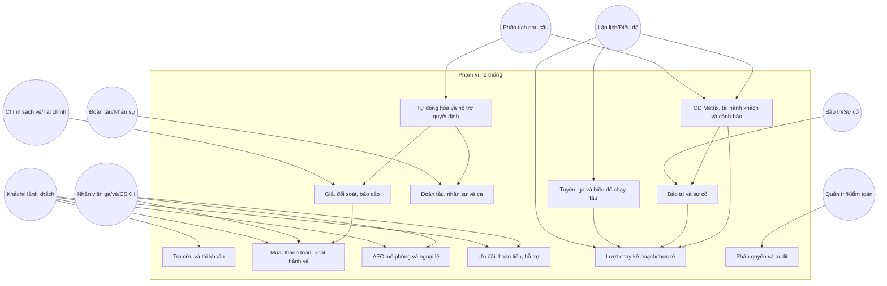

### 2.5. Giả định và phụ thuộc

| Mã | Giả định/phụ thuộc |
|---|---|
| ASM-001 | Dữ liệu seed tuyến 2A và chính sách giá được nhập từ nguồn chính thức, ghi rõ phiên bản/ngày áp dụng. |
| ASM-002 | Cổng thanh toán giả lập có thể trả các trạng thái thành công, thất bại, hết hạn và hoàn tiền. |
| ASM-003 | AFC giả lập có đồng hồ đồng bộ đủ để sắp xếp sự kiện tap; không phải thiết bị được chứng nhận an toàn. |
| ASM-004 | OCC cung cấp file CSV đúng đặc tả; dữ liệu không được sử dụng để phát lệnh điều khiển. |
| ASM-005 | Email giả lập có thể ghi nhận trạng thái gửi; việc chuyển phát thật không thuộc tiêu chí nghiệm thu MVP. |
| ASM-006 | Mọi nhà vận hành cung cấp chính sách retention, ngoại lệ credential và hạn kích hoạt trước khi triển khai production. |
| ASM-007 | Release demo cho phép `latest_activation_date` rỗng khi chính sách công bố không quy định hạn kích hoạt trước lần dùng đầu. |
| ASM-008 | AFC mô phỏng cung cấp tap-in/tap-out với tỷ lệ tap-out đủ cao cho demo; hành trình thiếu tap-out được suy luận và gắn cờ, không coi là quan sát đầy đủ. |
| ASM-009 | APC/CCTV mô phỏng cung cấp số đếm lên/xuống theo lượt chạy, ga và toa với độ trễ cấu hình; không có dữ liệu định danh cá nhân. |
| ASM-010 | Dữ liệu OD phục vụ phân tích/lập kế hoạch, không phải nguồn lệnh điều khiển và không thay thế hệ thống an toàn. |
| ASM-011 | Ngưỡng crowding, sức chứa toa và tham số mô hình là cấu hình có phiên bản; giá trị demo chỉ là giả định kỹ thuật cần được đại diện vận hành xác nhận. |
| ASM-012 | Dữ liệu lịch, sự kiện, thời tiết và gián đoạn có thể được dùng làm feature dự báo nếu có nguồn và quyền sử dụng; thiếu dữ liệu thì dự báo ghi rõ độ tin cậy thấp hơn. |
| ASM-013 | Việc suy luận OD/transfer từ AFC chỉ dùng dữ liệu tổng hợp hoặc định danh giả lập; không truy vết hành trình cá nhân ngoài mục đích vận hành đã được phê duyệt. |
| ASM-014 | Tự động hóa trong MVP là hỗ trợ quyết định và xử lý tác vụ lặp lại; các quyết định nhạy cảm vẫn cần con người phê duyệt. |

### 2.6. Ràng buộc

- Mọi dữ liệu đa nhà vận hành phải được phân vùng logic bằng `operator_id` và kiểm soát quyền tương ứng.
- Không cho phép sửa trực tiếp phiên bản lịch/giá đã công bố hoặc giao dịch lịch sử.
- Các thao tác duyệt/công bố/hoàn tiền/đưa đoàn tàu trở lại sẵn sàng phải có audit.
- Dữ liệu thời gian phải giữ giá trị tuyệt đối và múi giờ; giao diện demo hiển thị theo `Asia/Ho_Chi_Minh`.
- Không ghi toàn bộ số thẻ ngân hàng, mã bảo mật hoặc dữ liệu sinh trắc học.
- OD Matrix, load profile và dự báo phải gắn nhà vận hành, tuyến, ngày dịch vụ, khoảng thời gian, chiều chạy, phiên bản phương pháp và thời điểm dữ liệu.
- Không được hiển thị hoặc xuất dữ liệu OD ở cấp cá nhân; ô OD nhỏ hơn ngưỡng k phải bị ức chế hoặc gộp.
- Hệ thống chỉ đề xuất hành động vận hành; không có đường dẫn kỹ thuật gửi lệnh điều khiển tới tàu, cổng, tín hiệu hoặc OCC.
- Mọi khuyến nghị/duyệt tự động phải có phiên bản mô hình/quy tắc, đầu vào, độ tin cậy, người chịu trách nhiệm và khả năng ghi đè có audit.

---

## 3. Tổng quan yêu cầu chức năng

Chi tiết Use Case được trình bày tại chương đặc tả Use Case. Bảng dưới xác định phạm vi FR và trách nhiệm chính để kiểm soát tính đầy đủ.

| Nhóm FR | Năng lực bắt buộc | Tác nhân chính | Nhóm UC liên quan |
|---|---|---|---|
| FR-ACC | Tài khoản hành khách, đăng nhập, MFA, phiên, RBAC | ACT-01, ACT-02, ACT-22 | UC-ACC |
| FR-NET | Nhà vận hành, tuyến, đoạn tuyến, ga và thứ tự ga | ACT-10, ACT-22 | UC-NET |
| FR-SCH | Lịch dịch vụ, biểu đồ, phiên bản, duyệt và công bố | ACT-09, ACT-10 | UC-SCH |
| FR-OPS | Kế hoạch ngày, phân tàu, hành trình thực tế và OCC CSV | ACT-10, ACT-11, ACT-13 | UC-OPS |
| FR-FLT | Đoàn tàu, cấu hình toa và độ sẵn sàng | ACT-12, ACT-16 | UC-FLT |
| FR-HR | Nhân viên, chứng chỉ, ca và phân công | ACT-13 | UC-HR |
| FR-MNT | Kế hoạch/lệnh bảo trì, thực hiện và nghiệm thu | ACT-14–ACT-16 | UC-MNT |
| FR-INC | Sự cố, ảnh hưởng, thông báo, nguyên nhân và đóng | ACT-10, ACT-17, ACT-18 | UC-INC |
| FR-PUB | Tra cứu tuyến/ga/lịch/trạng thái/giá | ACT-01, ACT-02 | UC-PUB |
| FR-FAR | Sản phẩm vé, ma trận giá và chính sách ưu đãi | ACT-19, ACT-20 | UC-FAR |
| FR-ELG | Hồ sơ miễn/giảm, duyệt, gia hạn và thu hồi | ACT-03, ACT-06 | UC-ELG |
| FR-TKT | Bán vé trực tuyến/quầy, phát hành và quản lý vé | ACT-01, ACT-02, ACT-04 | UC-TKT |
| FR-PAY | Thanh toán sandbox, tiền mặt, callback và đối soát | ACT-04, ACT-21, EXT-01 | UC-PAY |
| FR-AFC | Tap-in/out, anti-passback và ngoại lệ hành trình | ACT-07, EXT-02 | UC-AFC |
| FR-REF | Tiếp nhận, thẩm định, duyệt và thực hiện hoàn | ACT-02, ACT-05, ACT-21 | UC-REF |
| FR-SUP | Hỗ trợ vé/dịch vụ và khôi phục credential | ACT-01, ACT-02, ACT-05 | UC-SUP |
| FR-NOT | Thông báo trong hệ thống và email mô phỏng | ACT-18, EXT-03 | UC-NOT |
| FR-RPT | Dashboard, KPI, báo cáo và xuất dữ liệu | ACT-10, ACT-20, ACT-21 | UC-RPT |
| FR-AUD | Audit bất biến, tra cứu và xuất | ACT-23 | UC-AUD |
| FR-ADM | Cấu hình tích hợp, retention, lỗi import/callback | ACT-22 | UC-ADM |

### 3.1. Luồng nghiệp vụ liên phân hệ

#### 3.1.1. Lập và công bố biểu đồ chạy tàu

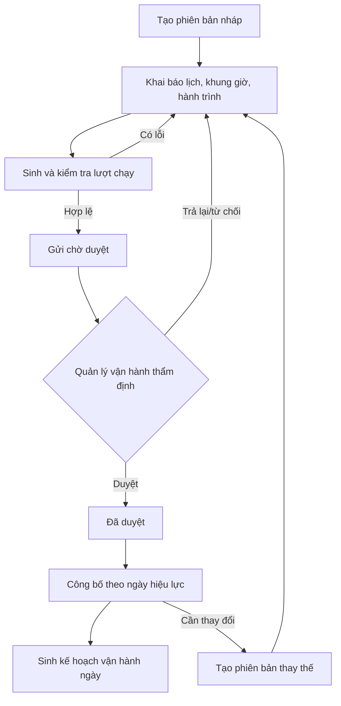

#### 3.1.2. Mua và phát hành vé

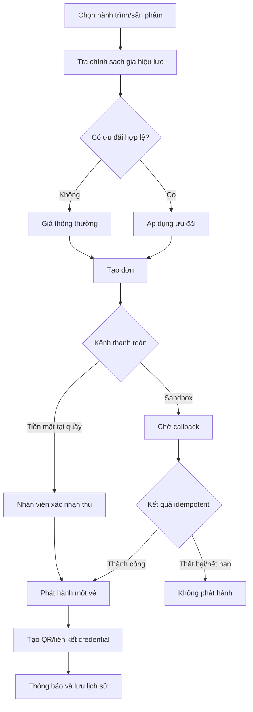

#### 3.1.3. Hành trình qua AFC mô phỏng

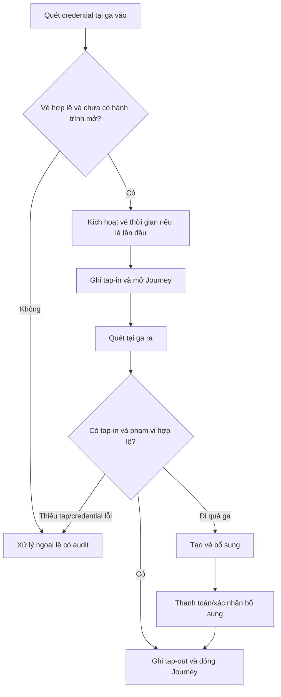

#### 3.1.4. Bảo trì và đưa đoàn tàu trở lại khai thác

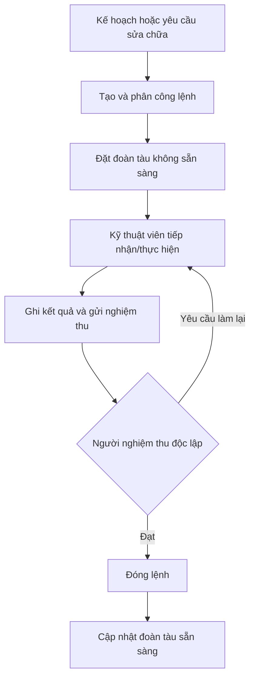

#### 3.1.5. Xử lý sự cố và hoàn vé liên quan

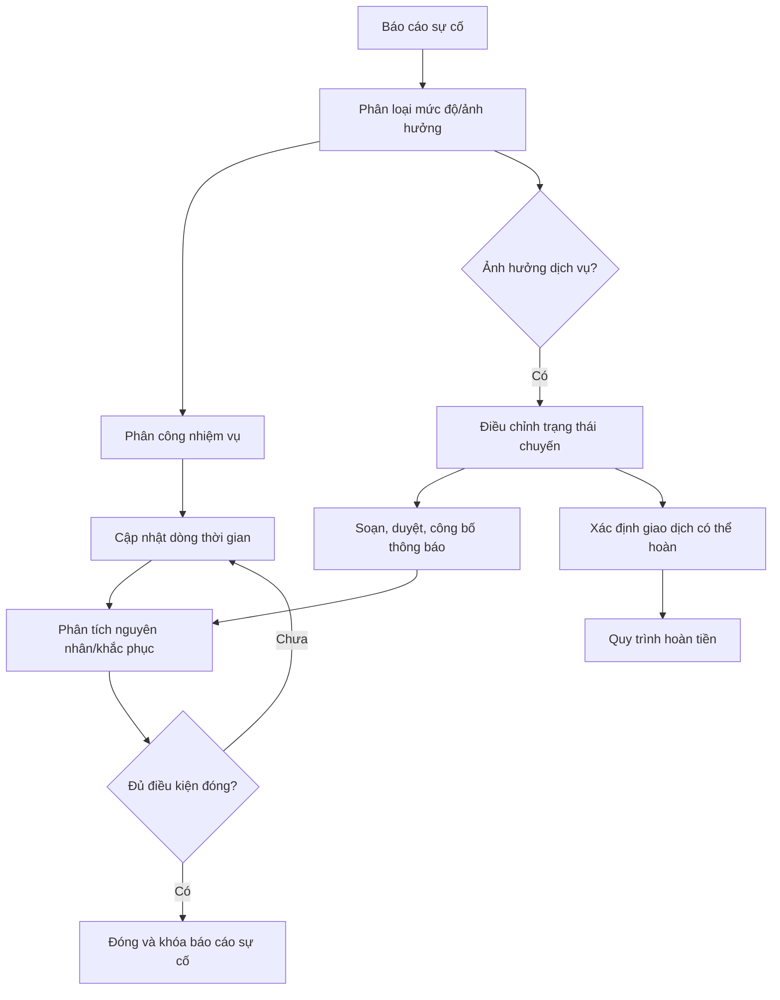

#### 3.1.6. Xây dựng OD Matrix, tính tải và quản lý crowding

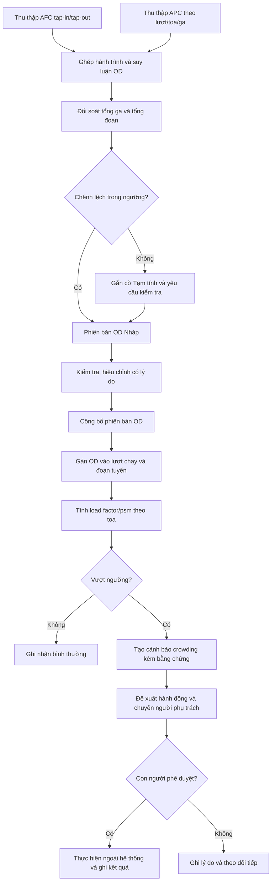

#### 3.1.7. Dự báo nhu cầu và tự động hóa có kiểm soát

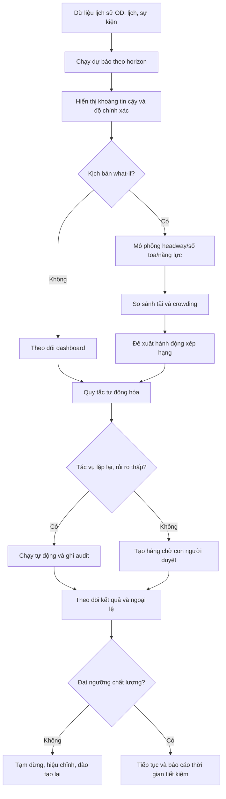

---

### 4.1. Đa nhà vận hành và phiên bản

| Mã | Quy tắc |
|---|---|
| BR-001 | Mọi tuyến, ga, nhân viên, chính sách, vé và giao dịch phải thuộc đúng một nhà vận hành. |
| BR-002 | Người dùng nội bộ chỉ truy cập dữ liệu nhà vận hành được cấp quyền, trừ vai trò quản trị nền tảng được phê duyệt rõ ràng. |
| BR-003 | Phiên bản lịch và bảng giá có ngày hiệu lực; bản đã công bố không được sửa trực tiếp hoặc áp dụng hồi tố. |
| BR-004 | Tại một thời điểm, cùng một phạm vi áp dụng không được có hai phiên bản công bố chồng lấn gây kết quả không xác định. |
| BR-005 | Giao dịch phải lưu tham chiếu đến phiên bản giá/quy tắc được sử dụng tại thời điểm tính. |
| BR-006 | Dữ liệu demo Hà Nội không được tự động sao chép sang nhà vận hành mới. |

### 4.2. Tách nhiệm vụ và phê duyệt

| Mã | Quy tắc |
|---|---|
| BR-007 | Người lập biểu đồ không được tự duyệt hoặc tự công bố biểu đồ đó. |
| BR-008 | Người cấu hình giá không được tự phê duyệt chính sách giá do mình tạo. |
| BR-009 | Kỹ thuật viên thực hiện không được tự nghiệm thu lệnh bảo trì của mình. |
| BR-010 | Nhân viên tiếp nhận/thẩm định yêu cầu hoàn không được tự phê duyệt hoàn tiền. |
| BR-011 | Quản trị hệ thống không được phê duyệt nghiệp vụ thay người có thẩm quyền. |
| BR-012 | Thao tác duyệt, từ chối hoặc trả lại phải lưu người thực hiện, thời điểm và lý do. |

#### 4.2.1. Ma trận quyền nghiệp vụ tối thiểu

Ký hiệu: `Q` = tự phục vụ/công khai hoặc chỉ dữ liệu của chính mình; `R` = xem; `C` = tạo/cập nhật/thực hiện; `A` = duyệt/nghiệm thu/đóng; `P` = công bố; `X` = xuất; `M` = quản trị. Quyền thực tế có thể hẹp hơn nhưng không được rộng hơn bảng nếu chưa có thay đổi SRS được phê duyệt. Mọi quyền nội bộ đều bị giới hạn bởi `operator_id` và phạm vi được gán.

| Tác nhân | PUB/ACC | FAR/ELG | TKT/PAY | AFC/SUP | NET/SCH | OPS | FLT/HR | MNT | INC/NOT | REF | RPT | ADM | AUD |
|---|---|---|---|---|---|---|---|---|---|---|---|---|---|
| ACT-01 Khách | Q | R | Q (vé lượt) | Q | — | — | — | — | R | Q | — | — | — |
| ACT-02 Hành khách | Q | Q | Q | Q | — | — | — | — | R | Q | — | — | — |
| ACT-03 Hành khách ưu tiên | Q | Q | Q | Q | — | — | — | — | R | Q | — | — | — |
| ACT-04 Nhân viên bán vé | R | R | R/C | R | — | — | — | — | R | — | — | — | — |
| ACT-05 Nhân viên CSKH | R | R | R | R/C | — | — | — | — | R | R/C | R | — | — |
| ACT-06 Duyệt ưu đãi | R | R/C/A | R | R | — | — | — | — | — | — | R | — | — |
| ACT-07 Nhân viên ga | R | R | R | R/C | — | R | — | — | R | — | R | — | — |
| ACT-08 Quản lý ga | R | R | R | R/C/A | — | R | — | — | R | — | R/X | — | — |
| ACT-09 Lập biểu đồ | — | — | — | — | R/C | R | — | — | — | — | R | — | — |
| ACT-10 Quản lý vận hành | — | — | — | — | R/C/A/P | R/C/A | R | R | R/A/P | — | R/X | — | — |
| ACT-11 Điều độ viên | — | — | — | — | R | R/C | R | — | R/C | — | R | — | — |
| ACT-12 Quản lý đoàn tàu | — | — | — | — | R | R | R/C | R | R | — | R | — | — |
| ACT-13 Quản lý ca | — | — | — | — | R | R | R/C | R | R | — | R | — | — |
| ACT-14 Lập kế hoạch bảo trì | — | — | — | — | — | R | R | R/C | R | — | R | — | — |
| ACT-15 Kỹ thuật viên | — | — | — | — | — | — | R | R/C | R | — | — | — | — |
| ACT-16 Nghiệm thu bảo trì | — | — | — | — | — | R | R/C | R/A | R | — | R | — | — |
| ACT-17 Điều phối sự cố | — | — | — | — | R | R | R | R | R/C/A | R | R/X | — | — |
| ACT-18 Truyền thông dịch vụ | R | — | — | — | R | R | — | — | R/C/P | — | R | — | — |
| ACT-19 Chính sách vé | R | R/C | R | R | — | — | — | — | — | — | R | — | — |
| ACT-20 Duyệt giá | R | R/A/P | R | R | — | — | — | — | — | — | R/X | — | — |
| ACT-21 Tài chính/đối soát | — | R | R/C | R | — | — | — | — | — | R/A/C | R/X | — | — |
| ACT-22 Quản trị hệ thống | R | — | — | — | — | — | — | — | — | — | R (tình trạng tích hợp) | M | R (hành động quản trị) |
| ACT-23 Kiểm toán nội bộ | R | R | R | R | R | R | R | R | R | R | R/X | — | R/X |
| ACT-24 Phân tích nhu cầu | — | — | — | — | R | R | R | — | — | — | R | — | — |

Các ràng buộc danh tính bắt buộc, áp dụng kể cả khi tài khoản có nhiều vai trò:

1. Tài khoản tạo/sửa biểu đồ không được duyệt hoặc công bố chính phiên bản đó.
2. Tài khoản tạo/sửa giá không được duyệt hoặc công bố chính phiên bản đó.
3. Tài khoản thực hiện lệnh bảo trì không được nghiệm thu lệnh đó.
4. Tài khoản tiếp nhận/thẩm định hoàn không được phê duyệt cùng yêu cầu; ACT-21 có thể mang quyền phê duyệt và thực hiện giao dịch hoàn nhưng hệ thống vẫn kiểm tra các bước/người dùng theo chính sách phê duyệt.
5. Người soạn thông báo dịch vụ không được tự duyệt nếu mẫu/chính sách yêu cầu người duyệt độc lập; quyền `P` chỉ cho phép công bố bản đã đủ điều kiện.
6. ACT-22 không được nhận quyền `A/P` nghiệp vụ; ACT-23 và mọi quyền `AUD` không được sửa dữ liệu nguồn hoặc audit.

#### 4.2.2. Ma trận quyền bổ sung cho OD Matrix và tự động hóa

Bảng dưới mở rộng ma trận tại 4.2.1 cho hai miền `ODM` (OD Matrix, tải hành khách, crowding) và `AUT` (cấu hình/chạy/giám sát tự động hóa). Ký hiệu giữ nguyên: `R` xem, `C` tạo/cập nhật/chạy, `A` duyệt/đóng, `P` công bố, `X` xuất, `M` quản trị. Không actor nào được tự duyệt thay đổi biểu đồ, giá, hoàn tiền hoặc nghiệm thu bảo trì thông qua quyền `ODM/AUT`.

| Tác nhân | ODM | AUT | Ghi chú giới hạn |
|---|---|---|---|
| ACT-07 Nhân viên ga | R | — | Chỉ xem cảnh báo/ga được giao; không sửa OD |
| ACT-08 Quản lý ga | R | — | Xem tải/crowding và xác nhận đã xử lý tại ga |
| ACT-09 Lập biểu đồ | R | R | Dùng OD/dự báo làm đầu vào; không tự công bố |
| ACT-10 Quản lý vận hành | R/A/P | R/A | Duyệt/công bố phiên bản OD và ngưỡng; duyệt khuyến nghị rủi ro cao |
| ACT-11 Điều độ viên | R/C | R | Xử lý cảnh báo, ghi hành động; không gửi lệnh điều khiển |
| ACT-12 Quản lý đoàn tàu | R | R | Xem tải theo trainset; cập nhật sức chứa cần duyệt |
| ACT-13 Quản lý ca | R | R | Xem nhu cầu nhân sự theo ga/giờ |
| ACT-14 Lập kế hoạch bảo trì | R | R | Xem đề xuất bảo trì dự đoán |
| ACT-17 Điều phối sự cố | R | R | Xem cảnh báo liên quan sự cố |
| ACT-18 Truyền thông dịch vụ | R | R | Soạn/công bố thông báo theo quyền hiện có; không tự duyệt |
| ACT-19 Chính sách vé | R | — | Xem OD để phân tích nhu cầu |
| ACT-20 Duyệt giá | R/X | — | Xem/xuất báo cáo OD tổng hợp |
| ACT-22 Quản trị hệ thống | R | M | Cấu hình kỹ thuật, kill switch; không duyệt nghiệp vụ |
| ACT-23 Kiểm toán nội bộ | R/X | R/X | Chỉ đọc audit/run/override |
| ACT-24 Phân tích nhu cầu | R/C | R/C | Tạo/kiểm tra OD và chuyển duyệt; không tự duyệt/công bố, không tự thay đổi lịch/giá, không gửi lệnh |

### 4.3. Lịch, chuyến và nguồn lực

| Mã | Quy tắc |
|---|---|
| BR-013 | Mỗi lượt chạy có mã duy nhất trong phạm vi nhà vận hành và ngày dịch vụ. |
| BR-014 | Chuỗi giờ đến/đi kế hoạch phải tăng theo thứ tự ga và phù hợp chiều tuyến. |
| BR-015 | Lịch lễ/sự kiện/gián đoạn chỉ thay thế lịch thường trong phạm vi và thời gian được công bố. |
| BR-016 | Đoàn tàu đang bảo trì hoặc ngừng khai thác không được gán cho lượt chạy. |
| BR-017 | Một đoàn tàu không được gán cho hai lượt có thời gian chồng lấn không khả thi. |
| BR-018 | Nhân viên thiếu, hết hạn hoặc bị thu hồi chứng chỉ không được phân vào nhiệm vụ yêu cầu chứng chỉ đó. |
| BR-019 | Một nhân viên không được phân hai ca/nhiệm vụ chồng lấn. |
| BR-020 | Dữ liệu OCC chỉ cập nhật hành trình thực tế sau khi vượt kiểm tra định dạng, mã chuyến, thời gian và trùng lặp. |

### 4.4. Bảo trì và sự cố

| Mã | Quy tắc |
|---|---|
| BR-021 | MVP chỉ quản lý bảo trì đoàn tàu ở cấp trainset; toa xe là cấu hình thành phần. |
| BR-022 | Khi lệnh bảo trì bắt đầu, đoàn tàu phải chuyển sang trạng thái không sẵn sàng phù hợp. |
| BR-023 | Chỉ người nghiệm thu được phân quyền mới có thể đưa đoàn tàu trở lại sẵn sàng sau bảo trì. |
| BR-024 | Sự cố không được đóng khi còn nhiệm vụ bắt buộc chưa hoàn tất hoặc chưa ghi kết quả phục hồi. |
| BR-025 | Mọi thay đổi lịch/chuyến do sự cố phải liên kết đến sự cố nguồn. |
| BR-026 | Thông báo dịch vụ phải được duyệt trước khi công bố, trừ mẫu khẩn cấp đã được nhà vận hành cấu hình và phân quyền riêng. |

### 4.5. Vé, thanh toán và AFC

| Mã | Quy tắc |
|---|---|
| BR-027 | Chỉ phát hành vé sau khi thanh toán thành công hoặc tiền mặt tại quầy được xác nhận. |
| BR-028 | Callback thanh toán lặp với cùng mã nhà cung cấp không được tạo thêm đơn, giao dịch hoặc vé. |
| BR-029 | Không lưu số thẻ đầy đủ, mã bảo mật hoặc thông tin xác thực ngân hàng. |
| BR-030 | Vé thời gian bắt đầu hiệu lực tại tap-in hợp lệ đầu tiên; thời hạn là 1 ngày, 7 ngày, 30 ngày hoặc số tháng theo sản phẩm. |
| BR-031 | Ngày lễ không tự động kéo dài hiệu lực vé thời gian. |
| BR-032 | `latest_activation_date` được cấu hình theo sản phẩm và có thể rỗng khi chính sách không công bố hạn kích hoạt trước lần dùng đầu. |
| BR-033 | Một vé có thể liên kết nhiều credential mô phỏng nhưng anti-passback được áp dụng ở cấp vé. |
| BR-034 | Vé lượt chỉ được hoàn thành một Journey hợp lệ và chuyển trạng thái đã dùng khi tap-out thành công. |
| BR-035 | Đi quá ga đã mua phải hoàn tất quy trình vé bổ sung trước khi đóng Journey, trừ xử lý thủ công có lý do và quyền phù hợp. |
| BR-036 | Thiếu tap-in/tap-out được xử lý theo chính sách riêng của loại credential; không mặc nhiên áp quy tắc Visa cho QR/CCCD/NFC. |
| BR-037 | Khách mua vé lượt nhận QR sau phát hành và có thể tra cứu bằng mã giao dịch kết hợp email. |
| BR-038 | Người được mua hộ vé thời gian phải có tài khoản hoặc định danh mô phỏng tồn tại trước khi phát hành. |

### 4.6. Ưu đãi, hoàn tiền và dữ liệu cá nhân

| Mã | Quy tắc |
|---|---|
| BR-039 | Chỉ hồ sơ ưu đãi đã duyệt, còn hiệu lực và phù hợp loại vé mới được áp dụng. |
| BR-040 | Minh chứng ưu đãi chỉ tồn tại trong giai đoạn xét duyệt; sau quyết định phải xóa ảnh và giữ metadata đã che, kết quả, người duyệt và audit. |
| BR-041 | Vé chưa sử dụng chỉ được hoàn khi chưa có tap-in/kích hoạt và không bị khóa bởi quy trình khác. |
| BR-042 | Vé lượt bị ảnh hưởng bởi gián đoạn đủ điều kiện có thể được hoàn toàn phần vé. |
| BR-043 | Vé thời gian bị ảnh hưởng được CSKH thẩm định thủ công; hệ thống không tự tính hoàn theo tỷ lệ. |
| BR-044 | Phê duyệt hoàn phải kiểm tra trạng thái vé, payment, AFC event, sự cố và các yêu cầu hoàn trùng. |
| BR-045 | Hoàn thành hoàn tiền phải vô hiệu hóa quyền sử dụng còn lại tương ứng và lưu tham chiếu giao dịch hoàn. |

### 4.7. Audit và thời gian lưu giữ

| Mã | Quy tắc |
|---|---|
| BR-046 | Audit là bất biến; không vai trò nào được sửa hoặc xóa audit qua chức năng nghiệp vụ. |
| BR-047 | Audit tối thiểu ghi `operator_id`, tác nhân, hành động, đối tượng, thời điểm, kết quả, lý do và correlation ID. |
| BR-048 | Chính sách retention cấu hình theo loại dữ liệu và nhà vận hành; release demo không tự tuyên bố thời hạn pháp lý. |
| BR-049 | Khi hết nhu cầu lưu giữ, dữ liệu cá nhân phải được xóa hoặc ẩn danh theo chính sách; tham chiếu audit cần được bảo toàn ở dạng không tái nhận dạng nếu có thể. |

### 4.8. OD Matrix, tải hành khách và crowding

Các quy tắc dưới đây ràng buộc miền `ODM`. OD Matrix là dữ liệu dẫn xuất phục vụ phân tích, lập kế hoạch và cảnh báo; không phải dữ liệu gốc và không được dùng để gửi lệnh điều khiển.

| Mã | Quy tắc |
|---|---|
| BR-ODM-001 | OD Matrix chỉ được tổng hợp từ hành trình AFC hợp lệ; hành trình thiếu tap-out chỉ được bổ khuyết bằng phương pháp đã công bố và phải mang cờ `imputed`. |
| BR-ODM-002 | Mỗi OD Matrix là một phiên bản bất biến theo `operator_id`, tuyến, ngày dịch vụ, chiều, khung giờ và phiên bản thuật toán; sửa đổi phải tạo phiên bản mới. |
| BR-ODM-003 | Mỗi ô OD phải truy vết được đến nguồn đếm (AFC, APC, khảo sát, seed), phương pháp ước lượng và mức chất lượng dữ liệu. |
| BR-ODM-004 | OD Matrix công bố phải được tổng hợp theo ngưỡng tối thiểu (mặc định 10 hành trình/ô); ô dưới ngưỡng bị ẩn hoặc gộp để chống tái nhận dạng. |
| BR-ODM-005 | Tải theo đoạn tuyến phải tính từ OD Matrix và quy tắc chọn đường đã công bố; cùng đầu vào và cùng phiên bản thuật toán phải cho cùng kết quả. |
| BR-ODM-006 | Hệ số tải chỉ được tính từ phiên bản `CAPACITY_PROFILE` đã duyệt; thay đổi sức chứa phải qua phê duyệt và tạo phiên bản mới. |
| BR-ODM-007 | Ngưỡng crowding được cấu hình theo tuyến/ga/khung giờ, có phiên bản và người duyệt; giá trị demo chỉ là giả định kỹ thuật, không phải giới hạn an toàn. |
| BR-ODM-008 | Cảnh báo crowding chỉ được phát khi có phiên bản OD/tải đã công bố hoặc dữ liệu thời gian thực đạt kiểm tra chất lượng; cảnh báo phải kèm độ tin cậy và độ mới dữ liệu. |
| BR-ODM-009 | OD Matrix, tải và cảnh báo không được tự động thay đổi biểu đồ, giá vé, phân công hoặc phát thông báo công khai; chỉ tạo đầu vào/khuyến nghị cho quy trình có phê duyệt. |
| BR-ODM-010 | Mọi dự báo nhu cầu phải nêu rõ chân trời, khoảng tin cậy, phiên bản mô hình và chỉ số backtest; dự báo ngoài phạm vi kiểm chứng phải bị đánh dấu. |
| BR-ODM-011 | Dữ liệu APC phải qua kiểm tra định dạng, khoảng thời gian, sức chứa và đối chiếu AFC; sai lệch chỉ được gắn cờ, không ghi đè âm thầm lên dữ liệu nguồn. |
| BR-ODM-012 | Kịch bản sự kiện/giả định phải được gắn nhãn `scenario` và không được thay thế phiên bản OD chính thức. |
| BR-ODM-013 | Báo cáo/xuất OD chỉ chứa dữ liệu tổng hợp; xuất dữ liệu chi tiết phải có quyền riêng và được audit. |
| BR-ODM-014 | Phiên bản OD/tải không được công bố nếu độ đầy đủ dữ liệu thấp hơn ngưỡng cấu hình, trừ khi có ngoại lệ được duyệt và ghi lý do. |

### 4.9. Tự động hóa có kiểm soát

Các quy tắc dưới đây ràng buộc miền `AUT`. Tự động hóa trong hệ thống là tự động hóa nghiệp vụ có con người giám sát (human-in-the-loop), không bao gồm điều khiển chạy tàu.

| Mã | Quy tắc |
|---|---|
| BR-AUTO-001 | Mỗi quy tắc tự động hóa phải có chủ sở hữu, phạm vi, điều kiện kích hoạt, hành động, mức rủi ro, chế độ phê duyệt và phiên bản. |
| BR-AUTO-002 | Không quy tắc nào được gửi lệnh trực tiếp hoặc gián tiếp tới ATP, ATO, ATS, liên khóa, tín hiệu, SCADA hoặc OCC. |
| BR-AUTO-003 | Các hành động công bố biểu đồ, giá, hoàn tiền, nghiệm thu bảo trì hoặc thông báo công khai luôn cần người có quyền phê duyệt; tự động hóa chỉ được tạo bản nháp/khuyến nghị. |
| BR-AUTO-004 | Mỗi lần chạy phải ghi đầu vào, phiên bản quy tắc/mô hình, đầu ra, độ tin cậy, quyết định của người, thời lượng và correlation ID. |
| BR-AUTO-005 | Khi quy tắc lỗi, quá thời gian hoặc mất dữ liệu, hệ thống phải chuyển sang hàng đợi thủ công và thông báo; không được bỏ qua im lặng. |
| BR-AUTO-006 | ACT-22 được bật/tắt từng quy tắc hoặc cả miền qua kill switch; mọi lần tắt/bật đều phải audit và không xóa lịch sử chạy. |
| BR-AUTO-007 | Ghi đè kết quả tự động phải có lý do, đúng quyền và được lưu; ghi đè lặp lại trên cùng quy tắc phải kích hoạt rà soát. |
| BR-AUTO-008 | Khuyến nghị tự động phải giải thích được yếu tố chính, ngưỡng bị vượt và phạm vi ảnh hưởng để người duyệt ra quyết định. |
| BR-AUTO-009 | Tự động hóa không được sửa dữ liệu nguồn hoặc audit; chỉ được tạo bản ghi dẫn xuất, đề xuất, cảnh báo và nhiệm vụ. |
| BR-AUTO-010 | Thay đổi mô hình, ngưỡng hoặc quy tắc phải chạy shadow/backtest trước khi kích hoạt chính thức. |
| BR-AUTO-011 | Chỉ được bật quy tắc dự báo/crowding khi đạt ngưỡng chất lượng đã cấu hình (ví dụ WAPE/MAPE, độ đầy đủ, độ trễ); kết quả dưới ngưỡng phải hiển thị cảnh báo. |
| BR-AUTO-012 | Quy tắc liên quan crowding, sự cố hoặc an toàn vận hành phải có SLA phản hồi của con người và tự leo thang khi quá hạn. |
| BR-AUTO-013 | Đầu vào tự động hóa phải tối thiểu hóa dữ liệu cá nhân; không ra quyết định tự động ảnh hưởng quyền lợi hành khách. |
| BR-AUTO-014 | Hệ thống phải giám sát trôi mô hình/dữ liệu; khi vượt ngưỡng suy giảm phải hạ cấp về thủ công và ghi nhận. |
| BR-AUTO-015 | Hành động tự động phải có khả năng đảo ngược hoặc bồi hoàn; nếu không, bắt buộc phê duyệt thủ công trước khi thực hiện. |

---

## 5. Yêu cầu chức năng

Phân hệ chỉ quản lý kế hoạch, hồ sơ, phê duyệt, ghi nhận và báo cáo. Hệ thống không gửi lệnh đến OCC hoặc các hệ thống an toàn như ATP, ATO, ATS, liên khóa, tín hiệu và SCADA.

### 5.1. Yêu cầu chức năng vận hành

| Mã | Yêu cầu |
|---|---|
| FR-NET-001 | Quản lý nhiều nhà vận hành và cô lập dữ liệu theo `operator_id`. |
| FR-NET-002 | Quản lý tuyến, chiều chạy, đoạn tuyến và trạng thái khai thác theo ngày hiệu lực. |
| FR-NET-003 | Quản lý ga, thứ tự ga theo chiều và khoảng cách giữa các ga liên tiếp. |
| FR-NET-004 | Không sửa hồi tố cấu trúc mạng lưới đã được dùng trong lịch hoặc giao dịch; thay đổi phải tạo phiên bản. |
| FR-SCH-001 | Quản lý loại ngày, giờ vận hành, khung giờ và tần suất. |
| FR-SCH-002 | Tạo phiên bản biểu đồ gồm hành trình, ga dừng, giờ đến/đi, thời gian dừng và lượt chạy. |
| FR-SCH-003 | Kiểm tra thứ tự thời gian/ga, số hiệu, khoảng giãn cách và tính đầy đủ trước khi gửi duyệt. |
| FR-SCH-004 | Thực thi vòng đời `Nháp → Chờ duyệt → Đã duyệt → Đã công bố → Hết hiệu lực`. |
| FR-SCH-005 | Người lập không được tự duyệt/công bố; điều chỉnh bản đã công bố phải tạo phiên bản thay thế. |
| FR-SCH-006 | Lưu lịch sử lập, gửi, trả lại, từ chối, duyệt, công bố và hết hiệu lực. |
| FR-OPS-001 | Sinh và hiển thị kế hoạch vận hành ngày từ biểu đồ đang hiệu lực. |
| FR-OPS-002 | Gán đoàn tàu đủ điều kiện cho lượt chạy và ngăn phân công trùng thời gian. |
| FR-OPS-003 | Ghi giờ đến/đi, trạng thái và nguồn dữ liệu thực tế của từng lượt chạy. |
| FR-OPS-004 | Import CSV từ OCC theo hướng chỉ đọc; phân loại bản ghi hợp lệ, lỗi, trùng và xung đột. |
| FR-OPS-005 | Ghi chuyến chậm/hủy/gián đoạn, nguyên nhân và sự cố liên quan. |
| FR-OPS-006 | Đối chiếu kế hoạch–thực tế và tính độ lệch/KPI. |
| FR-FLT-001 | Quản lý hồ sơ trainset, Depot và danh sách/thứ tự toa xe thành phần. |
| FR-FLT-002 | Quản lý trạng thái trainset: Sẵn sàng, Đã phân công, Đang chạy, Bảo trì, Ngừng khai thác. |
| FR-FLT-003 | Lưu lịch sử trạng thái/phân công; cấm gán trainset Bảo trì hoặc Ngừng khai thác. |
| FR-HR-001 | Quản lý hồ sơ nghề nghiệp, vai trò, năng lực và chứng chỉ nhân viên. |
| FR-HR-002 | Quản lý ca theo thời gian, địa điểm và nhu cầu vai trò. |
| FR-HR-003 | Kiểm tra trùng ca, trạng thái, vai trò và chứng chỉ khi phân công. |
| FR-HR-004 | Lái tàu được quản lý/phân ca nhưng không đăng nhập; không quản lý lương, chấm công, nghỉ phép. |
| FR-MNT-001 | Quản lý kế hoạch bảo trì định kỳ ở cấp trainset. |
| FR-MNT-002 | Tạo/phân công lệnh định kỳ hoặc đột xuất, cập nhật tiến độ và kết quả. |
| FR-MNT-003 | Kỹ thuật viên không tự nghiệm thu; chỉ người nghiệm thu được đưa trainset về Sẵn sàng. |
| FR-MNT-004 | Cảnh báo quá hạn và tra cứu lịch sử bảo trì; không quản lý kho/vật tư/nhà cung cấp/chi phí. |
| FR-INC-001 | Ghi sự cố với nguồn, thời gian, địa điểm, mức độ, ảnh hưởng và đối tượng liên quan. |
| FR-INC-002 | Phân công nhiệm vụ và lưu dòng thời gian bất biến của xử lý/khôi phục. |
| FR-INC-003 | Liên kết sự cố với tuyến, ga, trainset, lượt chạy và giao dịch vé. |
| FR-INC-004 | Soạn, duyệt, công bố và lưu phiên bản thông báo dịch vụ. |
| FR-INC-005 | Ghi nguyên nhân gốc, hành động khắc phục/phòng ngừa và điều kiện đóng sự cố. |
| FR-INC-006 | Xác định giao dịch có thể hoàn do gián đoạn nhưng không tự phê duyệt hoàn. |

---

### 5.2. Yêu cầu chức năng hành khách, giá vé, thanh toán và AFC

#### 5.2.1. Quy ước phạm vi

Phần này áp dụng cho cổng hành khách, quầy vé và hệ thống thu soát vé tự động (Automatic Fare Collection — AFC) mô phỏng. Mọi dữ liệu phải thuộc một `operator_id`. Bản demo chỉ kích hoạt Hanoi Metro và tuyến 2A Cát Linh–Hà Đông; chính sách của nhà vận hành khác không được kế thừa ngầm.

Các hành vi phát hành vé, kích hoạt vé, gửi thông báo, xử lý callback và ghi audit là hành vi được `include` trong Use Case do tác nhân bên ngoài khởi tạo, không được mô hình hóa thành tác nhân “Hệ thống”.

#### 5.2.2. Danh sách yêu cầu chức năng

##### Tra cứu công cộng

| Mã | Yêu cầu |
|---|---|
| FR-PUB-001 | Hệ thống phải cho phép khách và hành khách tra cứu tuyến, ga, thứ tự ga, chiều chạy và trạng thái khai thác. |
| FR-PUB-002 | Hệ thống phải hiển thị biểu đồ chạy tàu đang hiệu lực và các thay đổi dịch vụ đã công bố. |
| FR-PUB-003 | Hệ thống phải ước tính giá theo nhà vận hành, ga đi, ga đến, sản phẩm vé, nhóm ưu đãi và kênh thanh toán. |
| FR-PUB-004 | Kết quả tra cứu phải ghi rõ thời điểm dữ liệu, phiên bản giá và trạng thái dự kiến; kết quả không thay thế vé hợp lệ. |

##### Sản phẩm vé, giá và ưu đãi

| Mã | Yêu cầu |
|---|---|
| FR-FAR-001 | Chuyên viên chính sách vé phải cấu hình được vé lượt, ngày, tuần, tháng và dài hạn 2–12 tháng theo từng nhà vận hành. |
| FR-FAR-002 | Mỗi sản phẩm phải có phạm vi tuyến, số lượt, cách tính thời hạn, quy tắc kích hoạt, credential được phép và `latest_activation_date` có thể để trống. |
| FR-FAR-003 | Hệ thống phải quản lý ma trận giá ga đi–ga đến, tách giá tiền mặt và không tiền mặt, dưới dạng phiên bản có ngày hiệu lực. |
| FR-FAR-004 | Phiên bản giá phải qua vòng đời `Nháp → Chờ duyệt → Đã duyệt → Đã công bố → Hết hiệu lực`. |
| FR-FAR-005 | Người tạo/sửa phiên bản giá không được tự duyệt hoặc công bố phiên bản đó. |
| FR-FAR-006 | Hệ thống phải lưu lịch sử phiên bản và không được tính lại giao dịch đã phát sinh bằng giá mới. |
| FR-FAR-007 | Chính sách miễn/giảm phải cấu hình được theo đối tượng, sản phẩm, tỷ lệ/mức giá, điều kiện chứng minh và thời hạn. |

##### Hồ sơ ưu đãi

| Mã | Yêu cầu |
|---|---|
| FR-ELG-001 | Hành khách phải có thể đăng ký, bổ sung và theo dõi hồ sơ miễn/giảm giá vé. |
| FR-ELG-002 | Nhân viên xét duyệt phải có thể yêu cầu bổ sung, duyệt, từ chối, gia hạn hoặc thu hồi quyền ưu đãi kèm lý do. |
| FR-ELG-003 | Ảnh minh chứng chỉ được giữ trong thời gian xét duyệt và phải bị xóa sau khi có quyết định; hệ thống chỉ giữ metadata đã che, kết quả và audit. |
| FR-ELG-004 | Quyền ưu đãi chỉ được áp dụng khi còn hiệu lực và phù hợp với sản phẩm vé. |
| FR-ELG-005 | Phiên bản chính sách phải cấu hình được đầy đủ nhóm giá ưu tiên và miễn tiền vé của dữ liệu demo Hà Nội tại Mục 7.5.5, không hard-code điều kiện vào giao diện hoặc mã chương trình. |

##### Bán vé, thanh toán và phát hành

| Mã | Yêu cầu |
|---|---|
| FR-TKT-001 | Khách chưa đăng nhập chỉ được mua vé lượt; vé thời gian, ưu đãi, lịch sử và mua hộ yêu cầu tài khoản. |
| FR-TKT-002 | Hệ thống phải tính giá tại thời điểm tạo đơn và lưu snapshot sản phẩm, hành trình, phiên bản giá, ưu đãi và số tiền. |
| FR-TKT-003 | Hệ thống phải hỗ trợ thanh toán sandbox và ghi nhận tiền mặt tại quầy. |
| FR-TKT-004 | Vé chỉ được phát hành một lần sau khi thanh toán thành công hoặc tiền mặt được xác nhận. |
| FR-TKT-005 | Callback lặp phải được xử lý idempotent và không được tạo thêm giao dịch hoặc vé. |
| FR-TKT-006 | Vé phải có QR và có thể liên kết CCCD/NFC mô phỏng; nhiều credential không tạo thêm quyền đi lại. |
| FR-TKT-007 | Khách mua vé lượt phải nhận QR trên màn hình và email mô phỏng, đồng thời tra cứu lại được bằng mã giao dịch và email. |
| FR-TKT-008 | Người được mua hộ vé thời gian phải có tài khoản hoặc định danh mô phỏng tồn tại trước khi đặt mua. |
| FR-TKT-009 | Hệ thống không được lưu số thẻ thanh toán đầy đủ, CVV hoặc thông tin xác thực ngân hàng. |

##### Thanh toán và hoàn tiền qua nhà cung cấp giả lập

| Mã | Yêu cầu |
|---|---|
| FR-PAY-001 | Mỗi lần thử thanh toán/hoàn tiền phải có mã riêng, khóa idempotency và vòng đời trạng thái độc lập với đơn hàng. |
| FR-PAY-002 | Callback phải được xác minh nguồn/chữ ký mô phỏng, mã đơn, số tiền, trạng thái và khóa idempotency trước khi cập nhật nghiệp vụ. |
| FR-PAY-003 | Callback sai mã đơn, sai số tiền hoặc sai nhà vận hành không được phát hành vé và phải được ghi nhận để xử lý lỗi tích hợp. |
| FR-PAY-004 | Giao dịch tiền mặt phải gắn với quầy, ca và nhân viên xác nhận; không được sửa trực tiếp sau phát hành vé. |
| FR-PAY-005 | Hệ thống chỉ lưu mã tham chiếu/token của nhà cung cấp, không lưu số thẻ đầy đủ, CVV hoặc thông tin xác thực ngân hàng. |
| FR-PAY-006 | Yêu cầu hoàn qua adapter phải idempotent và không được hoàn thành công nhiều hơn số tiền đã phê duyệt. |

##### AFC và ngoại lệ hành trình

| Mã | Yêu cầu |
|---|---|
| FR-AFC-001 | AFC mô phỏng phải kiểm tra credential, trạng thái vé, nhà vận hành, tuyến, ga, thời hạn và anti-passback khi tap-in/tap-out. |
| FR-AFC-002 | Tap-in hợp lệ đầu tiên phải kích hoạt vé thời gian và thiết lập thời điểm hết hạn theo snapshot sản phẩm. |
| FR-AFC-003 | Tap-out hợp lệ phải đóng hành trình; vé lượt phải chuyển sang trạng thái đã sử dụng. |
| FR-AFC-004 | Hành khách đi quá ga phải mua vé bổ sung theo phiên bản chính sách đã áp dụng cho hành trình. |
| FR-AFC-005 | Thiếu tap-in/tap-out phải dùng chính sách ngoại lệ theo từng loại credential; không mặc định áp quy tắc Visa cho QR/CCCD/NFC. |
| FR-AFC-006 | Hệ thống phải xử lý vé hết hạn, chưa hiệu lực, đã dùng, trùng lượt, sai định danh, credential bị thu hồi và sự kiện ngoại tuyến. |
| FR-AFC-007 | Mọi xử lý thủ công phải ghi nhân viên, lý do, dữ liệu kiểm tra và kết quả vào audit. |
| FR-AFC-008 | AFC chỉ trả kết quả nghiệp vụ và ghi sự kiện; không điều khiển cổng vật lý. |

##### Hoàn vé, hỗ trợ và thông báo

| Mã | Yêu cầu |
|---|---|
| FR-REF-001 | Hành khách phải có thể yêu cầu hoàn vé chưa sử dụng hoặc vé bị ảnh hưởng bởi gián đoạn dịch vụ. |
| FR-REF-002 | Nhân viên CSKH thẩm định nhưng không được tự phê duyệt hoàn tiền; nhân viên tài chính thực hiện quyết định. |
| FR-REF-003 | Vé lượt đủ điều kiện do gián đoạn được hoàn toàn bộ; vé thời gian do CSKH thẩm định thủ công và không tự tính hoàn theo tỷ lệ. |
| FR-REF-004 | Hoàn tiền thành công phải vô hiệu hóa quyền sử dụng tương ứng và không xóa lịch sử giao dịch. |
| FR-SUP-001 | Khách/hành khách phải gửi và theo dõi được yêu cầu hỗ trợ liên quan đến vé, thanh toán, AFC hoặc dịch vụ. |
| FR-SUP-002 | CSKH phải phân loại, giao xử lý, trả lời và đóng yêu cầu kèm lịch sử trao đổi. |
| FR-NOT-001 | Hệ thống phải gửi thông báo trong ứng dụng và email mô phỏng cho các thay đổi quan trọng của đơn, vé, ưu đãi, hoàn tiền và dịch vụ. |
| FR-NOT-002 | Hành khách được cấu hình tùy chọn nhận email, trừ thông báo bắt buộc về an toàn, giao dịch và thay đổi quyền sử dụng vé. |

#### 5.2.3. Quy tắc nghiệp vụ chuyên biệt

| Mã | Quy tắc |
|---|---|
| BR-FAR-001 | Tại một thời điểm, một nhà vận hành không được có hai phiên bản giá đã công bố chồng lấn cùng phạm vi sản phẩm/tuyến/kênh thanh toán. |
| BR-FAR-002 | Giá của đơn hàng là snapshot bất biến, kể cả khi phiên bản giá hết hiệu lực sau đó. |
| BR-ELG-001 | Hồ sơ ưu đãi chỉ được duyệt khi loại đối tượng, giấy tờ và thời hạn đáp ứng chính sách đang hiệu lực. |
| BR-ELG-002 | Ảnh minh chứng phải bị xóa sau quyết định; audit không được chứa nội dung ảnh hoặc số giấy tờ đầy đủ. |
| BR-TKT-001 | Vé thời gian có thời hạn 1 ngày, 7 ngày, 30 ngày hoặc số tháng tương ứng kể từ tap-in hợp lệ đầu tiên; ngày lễ không kéo dài thời hạn. |
| BR-TKT-002 | `latest_activation_date` là cấu hình theo sản phẩm và có thể để trống; bản demo không tự đặt giới hạn khi không có chính sách nguồn. |
| BR-TKT-003 | Một vé chỉ có một hành trình đang mở tại một thời điểm, bất kể credential nào được sử dụng. |
| BR-TKT-004 | Người được mua hộ phải tồn tại trước dưới dạng tài khoản hoặc định danh mô phỏng; không phát sinh luồng nhận vé ẩn danh. |
| BR-PAY-001 | Mỗi yêu cầu/callback thanh toán có khóa idempotency duy nhất trong phạm vi nhà cung cấp. |
| BR-PAY-002 | Trạng thái thanh toán gồm tối thiểu `PENDING`, `SUCCEEDED`, `FAILED`, `EXPIRED`, `REFUND_PENDING`, `REFUNDED`. |
| BR-AFC-001 | Quy tắc thiếu tap và mức vé bổ sung phải được cấu hình theo loại credential; nếu không có chính sách phù hợp, nhân viên ga xử lý thủ công. |
| BR-AFC-002 | Sự kiện AFC ngoại tuyến chỉ có hiệu lực sau đồng bộ và phải được kiểm tra trùng/xung đột theo mã sự kiện. |
| BR-REF-001 | Yêu cầu hoàn không được phê duyệt nếu quyền đi lại liên quan đã được tiêu thụ, trừ trường hợp gián đoạn được xác minh. |
| BR-REF-002 | Người thẩm định và người phê duyệt hoàn phải là hai tài khoản khác nhau. |

---

### 5.3. Yêu cầu chức năng dùng chung, quản trị, báo cáo và audit

#### 5.3.1. Tài khoản và xác thực

| Mã | Yêu cầu |
|---|---|
| FR-ACC-001 | Hệ thống phải cho phép hành khách đăng ký tài khoản bằng email duy nhất, chấp nhận điều khoản và hoàn tất kích hoạt qua liên kết do email giả lập ghi nhận. |
| FR-ACC-002 | Hệ thống phải xác thực bằng thông tin đăng nhập; tài khoản nội bộ/đặc quyền bắt buộc MFA, còn MFA hành khách được cấu hình theo chính sách. |
| FR-ACC-003 | Hệ thống phải quản lý vòng đời phiên, cho phép đăng xuất phiên hiện tại hoặc thu hồi các phiên khác và áp dụng thời gian hết hạn cấu hình được. |
| FR-ACC-004 | Hệ thống phải hỗ trợ yêu cầu đặt lại mật khẩu bằng token một lần, có hạn, không tiết lộ email có tồn tại hay không. |
| FR-ACC-005 | Hành khách phải xem/cập nhật được hồ sơ, ngôn ngữ và tùy chọn thông báo trong phạm vi dữ liệu được phép thay đổi. |
| FR-ACC-006 | Hệ thống phải quản lý trạng thái tài khoản `PENDING`, `ACTIVE`, `LOCKED`, `DISABLED`, `CLOSED` và ngăn đăng nhập khi trạng thái không cho phép. |
| FR-ACC-007 | Việc đóng tài khoản phải vô hiệu hóa truy cập, xử lý dữ liệu cá nhân theo retention và không xóa các giao dịch/audit còn phải bảo toàn. |

#### 5.3.2. Quản trị truy cập và cấu hình

| Mã | Yêu cầu |
|---|---|
| FR-ADM-001 | Quản trị hệ thống phải tạo, cập nhật, khóa/mở khóa và ngừng hiệu lực tài khoản người dùng nội bộ. |
| FR-ADM-002 | Mỗi người dùng nội bộ phải được gán phạm vi nhà vận hành và một hoặc nhiều vai trò; quyền ngoài phạm vi phải bị từ chối ở giao diện, API và export. |
| FR-ADM-003 | Quản trị hệ thống phải quản lý danh mục vai trò–quyền theo phiên bản, gồm quyền xem, tạo, sửa, duyệt, công bố, hoàn tiền, export và quản trị. |
| FR-ADM-004 | Hệ thống phải kiểm tra xung đột tách nhiệm vụ khi gán quyền và tại thời điểm thực hiện nghiệp vụ nhạy cảm. |
| FR-ADM-005 | Khóa/ngừng hiệu lực tài khoản phải thu hồi toàn bộ phiên đang hoạt động trong không quá 1 phút; quản trị viên được thu hồi phiên theo yêu cầu bảo mật. |
| FR-ADM-006 | Quản trị hệ thống phải cấu hình tham số nghiệp vụ dùng chung, endpoint/khóa tham chiếu của adapter giả lập, mẫu import/export và tùy chọn email mà không làm lộ bí mật. |
| FR-ADM-007 | Quản trị hệ thống phải cấu hình retention theo nhà vận hành và loại dữ liệu, chạy thử tác vụ xóa/ẩn danh và xem báo cáo ảnh hưởng trước khi thực thi. |
| FR-ADM-008 | Mọi thay đổi tài khoản nội bộ, quyền, cấu hình tích hợp và retention phải ghi audit giá trị trước/sau, người thực hiện, thời điểm và lý do. |

#### 5.3.3. Dashboard và báo cáo

| Mã | Yêu cầu |
|---|---|
| FR-RPT-001 | Hệ thống phải cung cấp dashboard vận hành với độ đúng giờ, chuyến hoàn thành/chậm/hủy, thời gian gián đoạn và độ sẵn sàng đoàn tàu theo bộ lọc. |
| FR-RPT-002 | Hệ thống phải cung cấp báo cáo bán vé, doanh thu, thanh toán, hoàn tiền, lượt vào–ra và ngoại lệ AFC theo phiên bản giá và kênh. |
| FR-RPT-003 | Hệ thống phải cung cấp báo cáo bảo trì quá hạn, sự cố, phân công nhân sự và hồ sơ ưu đãi theo quyền. |
| FR-RPT-004 | Mỗi KPI/báo cáo phải hiển thị định nghĩa, công thức hoặc quy tắc tổng hợp, kỳ dữ liệu, múi giờ và phiên bản định nghĩa. |
| FR-RPT-005 | Người có quyền phải lọc, xem chi tiết tới bản ghi nguồn phù hợp và xuất báo cáo; tác vụ lớn được xử lý bất đồng bộ có trạng thái. |
| FR-RPT-006 | Hệ thống phải xuất gói báo cáo cho cơ quan quản lý bằng PDF và định dạng bảng dữ liệu phổ biến, có metadata, phiên bản mẫu và dữ liệu cá nhân đã che. |
| FR-RPT-007 | Dashboard, drill-down và tệp xuất phải tuân thủ phạm vi nhà vận hành, RBAC và ghi audit tải/xuất. |

#### 5.3.4. Audit

| Mã | Yêu cầu |
|---|---|
| FR-AUD-001 | Hệ thống phải tự động ghi audit bất biến cho đăng nhập đặc quyền, thay đổi dữ liệu, duyệt/từ chối/công bố, thay đổi quyền, hoàn tiền, export và xử lý ngoại lệ. |
| FR-AUD-002 | Kiểm toán viên phải tra cứu audit theo nhà vận hành, thời gian, tác nhân, hành động, loại/ID đối tượng, kết quả và correlation ID. |
| FR-AUD-003 | Chi tiết audit phải hiển thị giá trị trước/sau khi phù hợp, đồng thời che bí mật, token, dữ liệu thẻ và dữ liệu cá nhân không cần thiết. |
| FR-AUD-004 | Người có quyền phải xuất được kết quả audit kèm bộ lọc, thời điểm tạo, người tạo và checksum để kiểm tra tính toàn vẹn tệp. |
| FR-AUD-005 | Không vai trò nghiệp vụ hoặc quản trị nào được sửa/xóa audit; tác vụ retention chỉ được ẩn danh trường cá nhân theo chính sách và vẫn bảo toàn bằng chứng hành động. |

### 5.4. Yêu cầu chức năng OD Matrix, tải hành khách và crowding

Nhóm yêu cầu này bổ sung năng lực phân tích nhu cầu dựa trên OD Matrix. Đầu vào là dữ liệu AFC, cấu trúc mạng lưới, biểu đồ và dữ liệu APC mô phỏng; đầu ra là OD Matrix, tải theo đoạn, hệ số tải, cảnh báo crowding, dự báo và khuyến nghị. Không yêu cầu nào trong nhóm này cho phép gửi lệnh điều khiển.

#### 5.4.1. Quy ước phạm vi

1. OD Matrix là dữ liệu dẫn xuất, có phiên bản; không thay thế dữ liệu hành trình, vé hoặc giao dịch gốc.
2. Mọi kết quả tải/crowding phải gắn với phiên bản OD, phiên bản sức chứa, phiên bản ngưỡng và độ mới dữ liệu.
3. Hành động cải thiện vận hành (đổi giãn cách, tăng chuyến, điều chuyển nhân sự, thông báo) chỉ được tạo khuyến nghị hoặc bản nháp để con người quyết định.
4. Dữ liệu APC/CCTV trong bản demo là dữ liệu mô phỏng; hợp đồng tích hợp thật được quản lý như vấn đề mở.

#### 5.4.2. Danh sách yêu cầu chức năng

| Mã | Yêu cầu |
|---|---|
| FR-ODM-001 | Hệ thống phải tổng hợp hành trình AFC hợp lệ thành OD Matrix theo nhà vận hành, tuyến, chiều, ngày dịch vụ và khung giờ. |
| FR-ODM-002 | Hệ thống phải cho phép nhập dữ liệu đếm APC mô phỏng theo ga/đoạn, chuyến và khoảng thời gian, kèm nguồn và độ tin cậy. |
| FR-ODM-003 | Hệ thống phải kiểm tra định dạng, khoảng thời gian, sức chứa, trùng lặp và tính liên tục của dữ liệu AFC/APC trước khi dùng để tính toán. |
| FR-ODM-004 | Hệ thống phải đối chiếu APC với AFC theo ga/khung giờ, gắn cờ sai lệch vượt ngưỡng và không ghi đè dữ liệu nguồn. |
| FR-ODM-005 | Hệ thống phải tính và hiển thị điểm chất lượng dữ liệu (độ đầy đủ, độ trễ, tỷ lệ bổ khuyết, sai lệch APC–AFC) cho từng phiên bản OD. |
| FR-ODM-006 | Hệ thống phải xây dựng OD Matrix từ hành trình có đủ tap-in/tap-out; hành trình thiếu tap-out chỉ được bổ khuyết theo phương pháp cấu hình và phải gắn cờ `imputed`. |
| FR-ODM-007 | Hệ thống phải cho phép cấu hình quy tắc chọn đường (path choice) và phân bổ hành khách lên các đoạn tuyến, có phiên bản thuật toán. |
| FR-ODM-008 | Hệ thống phải tính tải hành khách theo đoạn tuyến, chuyến và khung giờ từ OD Matrix và quy tắc phân bổ đã công bố. |
| FR-ODM-009 | Hệ thống phải lưu mỗi OD Matrix/tải là một phiên bản bất biến, có trạng thái nháp, chờ duyệt, đã công bố, hết hiệu lực. |
| FR-ODM-010 | Hệ thống phải kiểm tra tính đầy đủ và nhất quán trước khi cho phép công bố phiên bản OD/tải; ngoại lệ phải có lý do và người duyệt. |
| FR-ODM-011 | Hệ thống phải quản lý phiên bản `CAPACITY_PROFILE` theo tuyến/đoàn tàu/toa, gồm sức chứa chỗ ngồi, chỗ đứng và hệ số thiết kế. |
| FR-ODM-012 | Hệ thống phải tính hệ số tải (load factor) và mật độ hành khách (psm) theo đoạn, chuyến và khung giờ từ tải và sức chứa đã duyệt. |
| FR-ODM-013 | Hệ thống phải quản lý ngưỡng crowding theo tuyến/ga/khung giờ, có phiên bản, người duyệt và giá trị mặc định của bản demo. |
| FR-ODM-014 | Hệ thống phải hiển thị bản đồ nhiệt (heatmap) tải/crowding theo ga, đoạn, chuyến và khung giờ. |
| FR-ODM-015 | Hệ thống phải phát cảnh báo crowding khi vượt ngưỡng, kèm mức độ, độ tin cậy, độ mới dữ liệu và phạm vi ảnh hưởng. |
| FR-ODM-016 | Hệ thống phải cho phép ACT-11/ACT-08 ghi nhận xử lý cảnh báo (xác nhận, phân công, đóng) và lý do. |
| FR-ODM-017 | Hệ thống phải cung cấp dự báo nhu cầu theo chân trời cấu hình (ví dụ 15 phút, 1 giờ, 1 ngày, 1 tuần) kèm khoảng tin cậy và phiên bản mô hình. |
| FR-ODM-018 | Hệ thống phải cho phép chạy kịch bản giả định (sự kiện, đóng ga, đổi giãn cách) và so sánh với phương án cơ sở, có nhãn `scenario`. |
| FR-ODM-019 | Hệ thống phải tạo khuyến nghị điều chỉnh giãn cách/tăng chuyến/điều chuyển nhân sự dưới dạng đề xuất, kèm tác động dự kiến và mức tin cậy. |
| FR-ODM-020 | Hệ thống phải cung cấp dashboard OD/tải/crowding theo phạm vi nhà vận hành, có drill-down đến ga/đoạn/chuyến và bộ lọc thời gian. |
| FR-ODM-021 | Hệ thống phải xuất báo cáo OD/tải/crowding dạng PDF/bảng dữ liệu, chỉ chứa dữ liệu tổng hợp đã che thông tin cá nhân. |
| FR-ODM-022 | Hệ thống phải ghi audit cho tạo/sửa/công bố OD, thay đổi ngưỡng/sức chứa, xem chi tiết nhạy cảm và mọi lần xuất dữ liệu. |
| FR-ODM-023 | Hệ thống phải cung cấp API/định dạng trao đổi OD và dự báo cho phân hệ lập biểu đồ, bảo trì và truyền thông, theo quyền và phiên bản. |
| FR-ODM-024 | Hệ thống phải hiển thị rõ dữ liệu nào là thực đo, bổ khuyết, mô phỏng hoặc dự báo để người dùng không nhầm với số liệu chính thức. |

#### 5.4.3. Quy tắc nghiệp vụ chuyên biệt

Áp dụng BR-ODM-001 đến BR-ODM-014 tại 4.8. Các giá trị mặc định của bản demo (ngưỡng psm, hệ số tải, sức chứa) được nêu tại 7.5.6 và chỉ mang tính giả định kỹ thuật.

### 5.5. Yêu cầu chức năng tự động hóa có kiểm soát

Nhóm yêu cầu này bổ sung năng lực tự động hóa nghiệp vụ có con người giám sát, nhằm giảm thao tác thủ công lặp lại nhưng không thay thế trách nhiệm phê duyệt.

#### 5.5.1. Quy ước phạm vi

1. Tự động hóa chỉ tạo bản nháp, đề xuất, cảnh báo, nhiệm vụ hoặc bản ghi dẫn xuất.
2. Mọi hành động công bố, phê duyệt, hoàn tiền, nghiệm thu hoặc điều khiển chạy tàu vẫn do con người hoặc hệ thống an toàn chuyên dụng thực hiện.
3. Mỗi quy tắc có thể bật/tắt, có phiên bản, chủ sở hữu và nhật ký chạy độc lập.

#### 5.5.2. Danh sách yêu cầu chức năng

| Mã | Yêu cầu |
|---|---|
| FR-AUTO-001 | Hệ thống phải quản lý danh mục quy tắc tự động hóa gồm mã, tên, chủ sở hữu, phạm vi, mức rủi ro, điều kiện kích hoạt và hành động. |
| FR-AUTO-002 | Hệ thống phải quản lý phiên bản quy tắc/mô hình và chỉ cho phép kích hoạt phiên bản đã được duyệt. |
| FR-AUTO-003 | Hệ thống phải hỗ trợ chạy quy tắc theo lịch, theo sự kiện hoặc thủ công bởi người có quyền, có theo dõi trạng thái. |
| FR-AUTO-004 | Hệ thống phải đưa kết quả cần phê duyệt vào hàng đợi có SLA, hiển thị ngữ cảnh và cho phép duyệt, từ chối hoặc yêu cầu bổ sung. |
| FR-AUTO-005 | Hệ thống phải hiển thị giải thích cho mỗi khuyến nghị: yếu tố chính, ngưỡng bị vượt, dữ liệu đầu vào và độ tin cậy. |
| FR-AUTO-006 | Hệ thống phải cho phép ghi đè kết quả tự động với lý do bắt buộc, đúng quyền và lưu audit. |
| FR-AUTO-007 | Hệ thống phải chuyển sang hàng đợi thủ công khi quy tắc lỗi, quá hạn, thiếu dữ liệu hoặc không đạt kiểm tra chất lượng. |
| FR-AUTO-008 | Hệ thống phải cung cấp kill switch theo từng quy tắc và theo miền, chỉ ACT-22 được vận hành, có audit. |
| FR-AUTO-009 | Hệ thống phải giám sát số lần chạy, tỷ lệ thành công, thời lượng, tỷ lệ ghi đè, độ trễ dữ liệu và tỷ lệ leo thang. |
| FR-AUTO-010 | Hệ thống phải ghi audit đầy đủ cho mỗi lần chạy, thay đổi cấu hình, phê duyệt, từ chối, ghi đè và tắt/bật. |
| FR-AUTO-011 | Hệ thống phải hỗ trợ chạy shadow/backtest và so sánh kết quả với phương án thủ công trước khi kích hoạt. |
| FR-AUTO-012 | Hệ thống phải cung cấp dashboard KPI tự động hóa, gồm thời gian tiết kiệm ước tính và tỷ lệ can thiệp của con người. |
| FR-AUTO-013 | Hệ thống phải gửi thông báo tới vai trò phụ trách khi có việc cần duyệt, quá SLA, lỗi hoặc suy giảm chất lượng. |
| FR-AUTO-014 | Hệ thống phải kiểm tra độ mới dữ liệu trước khi chạy quy tắc phụ thuộc dữ liệu thời gian thực; dữ liệu cũ phải bị chặn hoặc gắn cờ. |
| FR-AUTO-015 | Hệ thống phải ngăn mọi hành động tự động gửi lệnh tới ATP, ATO, ATS, SCADA, tín hiệu, liên khóa hoặc OCC. |
| FR-AUTO-016 | Hệ thống phải hỗ trợ cấu hình quy tắc tự động hóa cho các tác vụ lặp lại như tạo bản nháp thông báo, phân loại sự cố, nhắc bảo trì và tổng hợp báo cáo. |
| FR-AUTO-017 | Hệ thống phải lưu lịch sử thay đổi ngưỡng, mô hình và quy tắc, kèm người thay đổi, lý do và kết quả backtest. |
| FR-AUTO-018 | Hệ thống phải cho phép ACT-23 tra cứu/xuất toàn bộ lịch sử chạy, ghi đè và quyết định của con người. |

#### 5.5.3. Quy tắc nghiệp vụ chuyên biệt

Áp dụng BR-AUTO-001 đến BR-AUTO-015 tại 4.9. Danh mục cơ hội tự động hóa và mức tự động hóa đề xuất được trình bày tại Chương 15.

---

## 6. Đặc tả Use Case

### 6.1. Phân hệ vận hành

Các mã BR dưới đây tham chiếu trực tiếp bộ quy tắc hợp nhất tại Chương 4 của SRS.

#### UC-NET-01 — Quản lý hồ sơ nhà vận hành

| Thuộc tính | Nội dung |
|---|---|
| Mục tiêu | Tạo/cập nhật hồ sơ và trạng thái nhà vận hành. |
| Tác nhân | Chính: ACT-22; phụ: ACT-23. |
| Kích hoạt | Cần cấu hình một nhà vận hành. |
| Tiền điều kiện | ACT-22 đã MFA và có quyền toàn hệ thống. |
| Hậu điều kiện | Hồ sơ được lưu theo phiên bản và audit. |
| Luồng chính | 1) Mở danh sách; 2) tạo/cập nhật mã, tên, liên hệ, múi giờ, trạng thái; 3) hệ thống kiểm tra mã duy nhất; 4) xác nhận; 5) hệ thống lưu và ghi audit. |
| Thay thế/ngoại lệ | Mã trùng: từ chối. Đã có giao dịch: không xóa vật lý, chỉ ngừng hoạt động theo ngày hiệu lực. Thiếu quyền/MFA: từ chối và ghi sự kiện bảo mật. |
| Liên quan | FR-NET-001; BR-001, BR-002, BR-011, BR-046, BR-047. |
| Chấp nhận | **Given** phạm vi, tiền điều kiện và dữ liệu hợp lệ của UC, **When** tác nhân hoàn tất luồng chính, **Then** Dữ liệu hai nhà vận hành không bị truy cập chéo; thay đổi truy được giá trị trước/sau, người và thời điểm. |
#### UC-NET-02 — Quản lý tuyến và đoạn tuyến

| Thuộc tính | Nội dung |
|---|---|
| Mục tiêu | Quản lý tuyến, hai chiều và các đoạn được khai thác. |
| Tác nhân | Chính: ACT-10; phụ: ACT-23. |
| Kích hoạt | Tạo tuyến hoặc thay đổi phạm vi khai thác. |
| Tiền điều kiện | Nhà vận hành tồn tại; ACT-10 có quyền tương ứng. |
| Hậu điều kiện | Cấu trúc tuyến/đoạn được lưu theo hiệu lực. |
| Luồng chính | 1) Chọn nhà vận hành; 2) khai báo mã, tên, chiều và Depot; 3) khai báo ga đầu/cuối, trạng thái, ngày hiệu lực; 4) kiểm tra mã/phạm vi; 5) xác nhận; 6) lưu phiên bản và audit. |
| Thay thế/ngoại lệ | Ảnh hưởng lịch đã công bố: bắt buộc phiên bản tương lai. Tạm ngừng đoạn: cảnh báo lịch/chuyến tương lai. Ga đầu/cuối không thuộc tuyến: từ chối. |
| Liên quan | FR-NET-002, FR-NET-004; BR-001, BR-003, BR-046, BR-047. |
| Chấp nhận | **Given** phạm vi, tiền điều kiện và dữ liệu hợp lệ của UC, **When** tác nhân hoàn tất luồng chính, **Then** Biểu diễn được toàn tuyến và đoạn đang khai thác; phiên bản mới không đổi dữ liệu trước ngày hiệu lực. |
#### UC-NET-03 — Quản lý ga, thứ tự ga và khoảng cách

| Thuộc tính | Nội dung |
|---|---|
| Mục tiêu | Thiết lập ga và cấu trúc liên tục theo từng chiều. |
| Tác nhân | Chính: ACT-10; phụ: ACT-09. |
| Kích hoạt | Tạo/cập nhật ga hoặc thứ tự ga. |
| Tiền điều kiện | Tuyến tồn tại. |
| Hậu điều kiện | Danh sách ga có thứ tự, khoảng cách và ngày hiệu lực hợp lệ. |
| Luồng chính | 1) Chọn tuyến/phiên bản; 2) nhập mã, tên, loại, trạng thái; 3) sắp thứ tự hai chiều và khoảng cách; 4) kiểm tra mã, thứ tự, khoảng cách, tính liên tục; 5) xem trước; 6) lưu/audit. |
| Thay thế/ngoại lệ | Đổi tên: lưu lịch sử tên. Ngừng ga: cảnh báo lịch/giá tương lai. Có vòng lặp/khoảng trống/mã trùng: từ chối. |
| Liên quan | FR-NET-003, FR-NET-004; BR-003, BR-046, BR-047. |
| Chấp nhận | **Given** phạm vi, tiền điều kiện và dữ liệu hợp lệ của UC, **When** tác nhân hoàn tất luồng chính, **Then** Dữ liệu demo biểu diễn đúng 12 ga tuyến 2A ở cả hai chiều; không công bố được cấu trúc không liên tục. |
#### UC-SCH-01 — Quản lý lịch dịch vụ, khung giờ và tần suất

| Thuộc tính | Nội dung |
|---|---|
| Mục tiêu | Cấu hình loại ngày, giờ vận hành và tần suất làm đầu vào biểu đồ. |
| Tác nhân | Chính: ACT-09; phụ: ACT-10. |
| Kích hoạt | Tạo lịch thường hoặc ngoại lệ. |
| Tiền điều kiện | Tuyến/cấu trúc ga đang hiệu lực. |
| Hậu điều kiện | Lịch dịch vụ hợp lệ được lưu theo phiên bản. |
| Luồng chính | 1) Chọn tuyến/loại ngày; 2) nhập phạm vi ngày và giờ mở–đóng; 3) tạo khung cao điểm/bình thường/thấp điểm và tần suất; 4) kiểm tra chồng lấn/khoảng trống; 5) lưu và audit. |
| Thay thế/ngoại lệ | Lễ/sự kiện: tạo ngoại lệ ưu tiên cao hơn lịch tuần. Khoảng dừng có chủ ý: phải đánh dấu. Tần suất không dương hoặc khung chồng: từ chối. |
| Liên quan | FR-SCH-001; BR-001, BR-003, BR-015. |
| Chấp nhận | **Given** phạm vi, tiền điều kiện và dữ liệu hợp lệ của UC, **When** tác nhân hoàn tất luồng chính, **Then** Hệ thống chọn đúng lịch ưu tiên; mọi khung truy được phiên bản/người khai báo. |
#### UC-SCH-02 — Tạo và kiểm tra phiên bản biểu đồ

| Thuộc tính | Nội dung |
|---|---|
| Mục tiêu | Tạo bản nháp, hành trình và các lượt chạy kế hoạch. |
| Tác nhân | Chính: ACT-09. |
| Kích hoạt | Lập biểu đồ mới hoặc bản thay thế. |
| Tiền điều kiện | Cấu trúc tuyến và lịch dịch vụ hợp lệ. |
| Hậu điều kiện | Phiên bản Nháp chứa lượt chạy đã kiểm tra. |
| Luồng chính | 1) Tạo mới/sao chép; 2) hệ thống cấp mã phiên bản; 3) chọn lịch, chiều, ngày hiệu lực; 4) nhập thời gian chạy/dừng và quy tắc số hiệu; 5) sinh lượt; 6) kiểm tra ga, giờ, giãn cách, số hiệu; 7) sửa lỗi và lưu. |
| Thay thế/ngoại lệ | Sao chép: giữ liên kết nguồn nhưng dữ liệu độc lập. Nhập trực tiếp giờ từng lượt: vẫn kiểm tra. Còn lỗi nghiêm trọng: không cho gửi duyệt. |
| Liên quan | FR-SCH-002, FR-SCH-003; BR-003, BR-007, BR-013, BR-014. |
| Chấp nhận | **Given** phạm vi, tiền điều kiện và dữ liệu hợp lệ của UC, **When** tác nhân hoàn tất luồng chính, **Then** Mỗi lượt có tuyến, chiều, số hiệu, ga và giờ kế hoạch; bản lỗi không chuyển Chờ duyệt. |
#### UC-SCH-03 — Gửi, duyệt hoặc từ chối biểu đồ

| Thuộc tính | Nội dung |
|---|---|
| Mục tiêu | Thực thi vòng đời duyệt và tách nhiệm vụ. |
| Tác nhân | Chính: ACT-09 và ACT-10; phụ: ACT-23. |
| Kích hoạt | Người lập hoàn tất Nháp hoặc người duyệt nhận hồ sơ. |
| Tiền điều kiện | Biểu đồ hợp lệ ở Nháp/Chờ duyệt. |
| Hậu điều kiện | Chờ duyệt, Đã duyệt, Nháp do trả lại hoặc Từ chối. |
| Luồng chính | 1) ACT-09 gửi duyệt; 2) hệ thống kiểm tra lại, khóa nội dung, chuyển Chờ duyệt; 3) thông báo ACT-10; 4) ACT-10 xem chi tiết/so sánh; 5) nhập nhận xét và duyệt; 6) hệ thống kiểm tra khác người lập, chuyển Đã duyệt và audit. |
| Thay thế/ngoại lệ | Trả lại: về Nháp kèm nhận xét. Từ chối: khóa và bắt buộc lý do. Người duyệt trùng người lập/thiếu quyền: từ chối. Dữ liệu nền đổi: yêu cầu kiểm tra lại. |
| Liên quan | FR-SCH-003–FR-SCH-006; BR-007, BR-012, BR-046, BR-047. |
| Chấp nhận | **Given** phạm vi, tiền điều kiện và dữ liệu hợp lệ của UC, **When** tác nhân hoàn tất luồng chính, **Then** Không có đường đi tự duyệt; mọi quyết định có người, thời điểm và nhận xét. |
#### UC-SCH-04 — Công bố, thay thế và kết thúc hiệu lực biểu đồ

| Thuộc tính | Nội dung |
|---|---|
| Mục tiêu | Đưa biểu đồ đã duyệt vào sử dụng và quản lý lịch ngoại lệ. |
| Tác nhân | Chính: ACT-10; phụ: ACT-18. |
| Kích hoạt | Biểu đồ đã duyệt cần công bố/thay thế. |
| Tiền điều kiện | Trạng thái Đã duyệt; phạm vi hiệu lực hợp lệ. |
| Hậu điều kiện | Bản mới Đã công bố; bản bị thay thế Hết hiệu lực đúng thời điểm. |
| Luồng chính | 1) Chọn phiên bản; 2) xem phạm vi/ảnh hưởng; 3) xác nhận thời điểm; 4) kiểm tra xung đột; 5) lập lịch kích hoạt và kết thúc bản cũ; 6) cấp dữ liệu cho cổng hành khách và audit. |
| Thay thế/ngoại lệ | Lễ/sự kiện chỉ ghi đè ngày chọn. Điều chỉnh khẩn vẫn phải là phiên bản/ngoại lệ gắn sự cố. Chưa duyệt/xung đột: từ chối. |
| Liên quan | FR-SCH-004–FR-SCH-006; BR-003, BR-004, BR-007. |
| Chấp nhận | **Given** phạm vi, tiền điều kiện và dữ liệu hợp lệ của UC, **When** tác nhân hoàn tất luồng chính, **Then** Tại một thời điểm xác định duy nhất lịch ưu tiên theo tuyến/chiều/ngày; không sửa trực tiếp bản công bố. |
#### UC-OPS-01 — Xem kế hoạch ngày và phân bổ đoàn tàu

| Thuộc tính | Nội dung |
|---|---|
| Mục tiêu | Hiển thị lượt chạy của ngày và gán trainset đủ điều kiện. |
| Tác nhân | Chính: ACT-11; phụ: ACT-10, ACT-12, ACT-07. |
| Kích hoạt | Chuẩn bị kế hoạch vận hành ngày. |
| Tiền điều kiện | Có biểu đồ công bố; dữ liệu trainset hiện hành. |
| Hậu điều kiện | Lượt được gán trainset hợp lệ hoặc đánh dấu Chưa phân bổ. |
| Luồng chính | 1) Chọn ngày/tuyến; 2) hệ thống hiển thị lượt từ lịch hiệu lực; 3) hiển thị trainset Sẵn sàng; 4) chọn trainset; 5) kiểm tra trạng thái/xung đột; 6) xác nhận, lưu và audit. |
| Thay thế/ngoại lệ | Không có trainset: để Chưa phân bổ và cảnh báo. Đổi trainset: lưu người cũ/lý do. Trainset Bảo trì, Ngừng khai thác hoặc trùng lịch: từ chối. |
| Liên quan | FR-OPS-001, FR-OPS-002, FR-FLT-002, FR-FLT-003; BR-016, BR-017. |
| Chấp nhận | **Given** phạm vi, tiền điều kiện và dữ liệu hợp lệ của UC, **When** tác nhân hoàn tất luồng chính, **Then** Một trainset không được gán hai lượt chồng lấn; kế hoạch chỉ lấy biểu đồ hiệu lực. |
#### UC-OPS-02 — Ghi nhận hành trình thực tế thủ công

| Thuộc tính | Nội dung |
|---|---|
| Mục tiêu | Nhập giờ đến/đi và trạng thái thực tế khi không import OCC. |
| Tác nhân | Chính: ACT-11; phụ: ACT-07. |
| Kích hoạt | Có dữ liệu thực tế cần cập nhật. |
| Tiền điều kiện | Lượt chạy tồn tại; tác nhân có quyền. |
| Hậu điều kiện | Dữ liệu nguồn `MANUAL`, người nhập và audit được lưu. |
| Luồng chính | 1) Tìm lượt; 2) xem kế hoạch/dữ liệu đã có; 3) nhập giờ theo ga và trạng thái; 4) kiểm tra thứ tự/phạm vi; 5) xác nhận; 6) lưu, tính độ lệch và audit. |
| Thay thế/ngoại lệ | Sửa dữ liệu: bắt buộc lý do và lưu trước/sau. Dữ liệu một phần: trạng thái Chưa hoàn tất. Thời gian bất hợp lý: cảnh báo hoặc từ chối nếu nghiêm trọng. |
| Liên quan | FR-OPS-003, FR-OPS-005; BR-020, BR-046, BR-047. |
| Chấp nhận | **Given** phạm vi, tiền điều kiện và dữ liệu hợp lệ của UC, **When** tác nhân hoàn tất luồng chính, **Then** Mỗi bản ghi có nguồn/người chịu trách nhiệm; giao diện không có lệnh chạy/dừng. |
#### UC-OPS-03 — Import và đối chiếu dữ liệu OCC từ CSV

| Thuộc tính | Nội dung |
|---|---|
| Mục tiêu | Nhập dữ liệu hành trình từ nguồn OCC chỉ đọc. |
| Tác nhân | Chính: ACT-11; phụ: EXT-04. |
| Kích hoạt | Nhận file CSV đúng mẫu. |
| Tiền điều kiện | Tác nhân có quyền tuyến/ngày; mẫu import hiệu lực. |
| Hậu điều kiện | Bản hợp lệ được nhập; lỗi/trùng/xung đột được báo cáo. |
| Luồng chính | 1) Chọn tuyến/ngày và tải file; 2) kiểm tra tệp/cột/mã hóa; 3) đối chiếu lượt/ga/thời gian/khóa trùng; 4) xem trước kết quả; 5) xác nhận bản hợp lệ; 6) lưu nguồn `OCC_CSV`, checksum và audit. |
| Thay thế/ngoại lệ | Import lại checksum: không tạo trùng. Xung đột dữ liệu thủ công: đưa hàng chờ, không ghi đè. Sai mẫu/quá giới hạn: từ chối file và nêu lỗi. |
| Liên quan | FR-OPS-004, FR-OPS-006; BR-020, BR-046, BR-047. |
| Chấp nhận | **Given** phạm vi, tiền điều kiện và dữ liệu hợp lệ của UC, **When** tác nhân hoàn tất luồng chính, **Then** Import lặp không tăng bản ghi; không tồn tại luồng lệnh từ hệ thống sang OCC. |
#### UC-OPS-04 — Quản lý chuyến chậm, hủy hoặc gián đoạn

| Thuộc tính | Nội dung |
|---|---|
| Mục tiêu | Cập nhật trạng thái bất thường, nguyên nhân và sự cố liên quan. |
| Tác nhân | Chính: ACT-11; phụ: ACT-17. |
| Kích hoạt | Lượt bị chậm, hủy hoặc gián đoạn. |
| Tiền điều kiện | Lượt tồn tại. |
| Hậu điều kiện | Trạng thái, thời lượng, nguyên nhân và liên kết sự cố được lưu. |
| Luồng chính | 1) Mở lượt; 2) chọn trạng thái; 3) nhập thời điểm/phạm vi/mã nguyên nhân; 4) chọn hoặc tạo báo cáo sự cố; 5) hệ thống tính ảnh hưởng; 6) xác nhận/audit. |
| Thay thế/ngoại lệ | Khôi phục: ghi thời điểm và trạng thái mới. Chưa rõ nguyên nhân: dùng mã tạm, bắt buộc cập nhật trước đóng sự cố. Chuyển trạng thái trái quy tắc: từ chối. |
| Liên quan | FR-OPS-005, FR-INC-003; BR-025, BR-046, BR-047. |
| Chấp nhận | **Given** phạm vi, tiền điều kiện và dữ liệu hợp lệ của UC, **When** tác nhân hoàn tất luồng chính, **Then** Mỗi chuyến bất thường có nguyên nhân hoặc cờ chờ xác minh; liên kết hai chiều với sự cố. |
#### UC-OPS-05 — Đối chiếu kế hoạch với thực tế

| Thuộc tính | Nội dung |
|---|---|
| Mục tiêu | Tính độ lệch và kết quả thực hiện biểu đồ. |
| Tác nhân | Chính: ACT-10, ACT-11; phụ: ACT-23. |
| Kích hoạt | Yêu cầu đối chiếu ngày/kỳ. |
| Tiền điều kiện | Có lượt kế hoạch và dữ liệu thực tế toàn phần/một phần. |
| Hậu điều kiện | Kết quả được hiển thị/xuất mà không sửa nguồn. |
| Luồng chính | 1) Chọn tuyến/kỳ; 2) ghép kế hoạch–thực tế; 3) tính độ lệch và dữ liệu thiếu; 4) tổng hợp đúng giờ/chậm/hủy/gián đoạn; 5) xem chi tiết/xuất. |
| Thay thế/ngoại lệ | Nhiều bản thực tế xung đột: gắn Cần đối chiếu thủ công. Dữ liệu thiếu: kết quả Tạm tính. |
| Liên quan | FR-OPS-006. |
| Chấp nhận | **Given** phạm vi, tiền điều kiện và dữ liệu hợp lệ của UC, **When** tác nhân hoàn tất luồng chính, **Then** Chỉ tiêu truy được tới lượt/bản ghi nguồn; số liệu Tạm tính không hiển thị như đã chốt. |
#### UC-FLT-01 — Quản lý trainset và cấu hình toa xe

| Thuộc tính | Nội dung |
|---|---|
| Mục tiêu | Duy trì hồ sơ trainset và toa thành phần. |
| Tác nhân | Chính: ACT-12; phụ: ACT-23. |
| Kích hoạt | Tạo/cập nhật hồ sơ hoặc cấu hình. |
| Tiền điều kiện | Nhà vận hành và Depot tồn tại. |
| Hậu điều kiện | Hồ sơ/cấu hình lưu theo hiệu lực và audit. |
| Luồng chính | 1) Tạo/chọn trainset; 2) nhập mã, Depot, ngày sử dụng; 3) thêm toa và thứ tự; 4) kiểm tra mã duy nhất/toa không trùng; 5) xác nhận; 6) lưu/audit. |
| Thay thế/ngoại lệ | Thay cấu hình: tạo phiên bản. Ngừng khai thác: giữ lịch sử, ngăn phân công. Toa thuộc trainset khác cùng thời kỳ: từ chối. |
| Liên quan | FR-FLT-001, FR-FLT-003; BR-001, BR-021, BR-046, BR-047. |
| Chấp nhận | **Given** phạm vi, tiền điều kiện và dữ liệu hợp lệ của UC, **When** tác nhân hoàn tất luồng chính, **Then** Xác định được cấu hình tại mọi thời điểm; không phát sinh bảo trì riêng cấp toa trong MVP. |
#### UC-FLT-02 — Quản lý trạng thái và độ sẵn sàng trainset

| Thuộc tính | Nội dung |
|---|---|
| Mục tiêu | Chuyển trạng thái trainset theo quy tắc và cung cấp dữ liệu phân bổ. |
| Tác nhân | Chính: ACT-12, ACT-16; phụ: ACT-10, ACT-11, ACT-14. |
| Kích hoạt | Trạng thái thay đổi do vận hành/bảo trì/quản lý. |
| Tiền điều kiện | Trainset tồn tại; tác nhân có quyền với chuyển trạng thái. |
| Hậu điều kiện | Trạng thái mới, thời điểm, lý do và lịch sử được lưu. |
| Luồng chính | 1) Mở hồ sơ; 2) hệ thống hiện trạng thái đích hợp lệ; 3) chọn đích/thời điểm/lý do; 4) kiểm tra phân bổ/lệnh bảo trì/quyền; 5) xác nhận; 6) cập nhật, cảnh báo ảnh hưởng và audit. |
| Thay thế/ngoại lệ | Vào Bảo trì: đánh dấu phân bổ tương lai cần thay. Trở lại Sẵn sàng sau bảo trì: chỉ ACT-16 khi nghiệm thu đạt. Còn lệnh mở/phân bổ đang chạy: từ chối trạng thái không tương thích. |
| Liên quan | FR-FLT-002, FR-FLT-003; BR-016, BR-017, BR-022, BR-023. |
| Chấp nhận | **Given** phạm vi, tiền điều kiện và dữ liệu hợp lệ của UC, **When** tác nhân hoàn tất luồng chính, **Then** Trainset Bảo trì/Ngừng khai thác không hiện trong danh sách sẵn sàng; lần trở lại Sẵn sàng truy được lệnh/người nghiệm thu. |
#### UC-HR-01 — Quản lý nhân viên, vai trò và chứng chỉ

| Thuộc tính | Nội dung |
|---|---|
| Mục tiêu | Duy trì hồ sơ nghề nghiệp và điều kiện phân công. |
| Tác nhân | Chính: ACT-13; phụ: ACT-22. |
| Kích hoạt | Có nhân sự mới hoặc thay đổi vai trò/chứng chỉ. |
| Tiền điều kiện | Nhà vận hành tồn tại. |
| Hậu điều kiện | Hồ sơ, vai trò, chứng chỉ lưu theo hiệu lực và audit. |
| Luồng chính | 1) Tạo/mở hồ sơ; 2) nhập thông tin nghề nghiệp/trạng thái; 3) gắn vai trò/năng lực; 4) thêm chứng chỉ và ngày; 5) kiểm tra dữ liệu; 6) lưu/audit. |
| Thay thế/ngoại lệ | Lái tàu: có hồ sơ nhưng không tài khoản. Chứng chỉ sắp hết: cảnh báo. Ngày hết trước ngày cấp: từ chối. |
| Liên quan | FR-HR-001, FR-HR-004; BR-018, BR-046, BR-047. |
| Chấp nhận | **Given** phạm vi, tiền điều kiện và dữ liệu hợp lệ của UC, **When** tác nhân hoàn tất luồng chính, **Then** Xác định được điều kiện nhân viên tại thời điểm ca; không có trường/quy trình lương, chấm công, nghỉ phép. |
#### UC-HR-02 — Lập ca trực

| Thuộc tính | Nội dung |
|---|---|
| Mục tiêu | Tạo ca theo thời gian, địa điểm và nhu cầu vai trò. |
| Tác nhân | Chính: ACT-13; phụ: ACT-10. |
| Kích hoạt | Lập kế hoạch ca cho ngày/kỳ. |
| Tiền điều kiện | Tuyến, ga/Depot và danh mục vai trò tồn tại. |
| Hậu điều kiện | Ca hợp lệ sẵn sàng nhận phân công. |
| Luồng chính | 1) Chọn kỳ/địa điểm/nhóm; 2) khai báo giờ và số lượng vai trò; 3) kiểm tra thời gian/phạm vi; 4) xem trước; 5) xác nhận/lưu/audit. |
| Thay thế/ngoại lệ | Sao chép mẫu: tạo bản mới và kiểm tra lễ/ngoại lệ. Ca qua ngày: hiển thị rõ hai ngày. Kết thúc không sau bắt đầu: từ chối. |
| Liên quan | FR-HR-002; BR-001, BR-019, BR-046, BR-047. |
| Chấp nhận | **Given** phạm vi, tiền điều kiện và dữ liệu hợp lệ của UC, **When** tác nhân hoàn tất luồng chính, **Then** Mỗi ca có địa điểm, thời gian, nhu cầu; sao chép không tự sao chép phân công chưa xác nhận. |
#### UC-HR-03 — Phân công và kiểm tra điều kiện nhân sự

| Thuộc tính | Nội dung |
|---|---|
| Mục tiêu | Gán nhân viên vào ca/ga/lượt/lệnh sau kiểm tra điều kiện. |
| Tác nhân | Chính: ACT-13; phụ: ACT-10, ACT-14. |
| Kích hoạt | Có ca/nhiệm vụ cần nhân sự. |
| Tiền điều kiện | Ca/nhiệm vụ tồn tại; nhân viên đang hoạt động. |
| Hậu điều kiện | Phân công hợp lệ được lưu và thông báo khi có tài khoản. |
| Luồng chính | 1) Chọn ca/nhiệm vụ; 2) hệ thống lọc nhân viên phù hợp; 3) chọn người; 4) kiểm tra trùng ca, trạng thái, vai trò, chứng chỉ; 5) xác nhận; 6) lưu/thông báo/audit. |
| Thay thế/ngoại lệ | Lái tàu: lưu nhưng không thông báo tài khoản. Thay người: giữ lịch sử/lý do. Chứng chỉ hết hạn hoặc trùng ca: từ chối. |
| Liên quan | FR-HR-003, FR-HR-004; BR-018, BR-019, BR-046, BR-047. |
| Chấp nhận | **Given** phạm vi, tiền điều kiện và dữ liệu hợp lệ của UC, **When** tác nhân hoàn tất luồng chính, **Then** Không thể xác nhận người không đủ điều kiện; thay đổi phân công không ghi đè lịch sử. |
#### UC-MNT-01 — Lập kế hoạch bảo trì định kỳ

| Thuộc tính | Nội dung |
|---|---|
| Mục tiêu | Định nghĩa chu kỳ và mốc bảo trì trainset. |
| Tác nhân | Chính: ACT-14; phụ: ACT-12. |
| Kích hoạt | Thiết lập/điều chỉnh kế hoạch. |
| Tiền điều kiện | Trainset tồn tại. |
| Hậu điều kiện | Kế hoạch có hiệu lực, có thể sinh/cảnh báo lệnh đến hạn. |
| Luồng chính | 1) Chọn trainset/nhóm; 2) nhập loại, chu kỳ, mốc đầu, thời lượng, ngưỡng cảnh báo; 3) hệ thống tính mốc; 4) kiểm tra trùng/xung đột; 5) xác nhận/lưu/audit. |
| Thay thế/ngoại lệ | Đổi chu kỳ: tạo phiên bản, không đổi lệnh đã phát hành. Tạm dừng: bắt buộc lý do, giữ lệnh mở. Chu kỳ/ngày sai: từ chối. |
| Liên quan | FR-MNT-001, FR-MNT-004; BR-001, BR-021, BR-046, BR-047. |
| Chấp nhận | **Given** phạm vi, tiền điều kiện và dữ liệu hợp lệ của UC, **When** tác nhân hoàn tất luồng chính, **Then** Mỗi mốc truy được kế hoạch/phiên bản; đổi kế hoạch không mất lịch sử lệnh. |
#### UC-MNT-02 — Tạo và phân công lệnh bảo trì

| Thuộc tính | Nội dung |
|---|---|
| Mục tiêu | Phát hành lệnh định kỳ/đột xuất và giao kỹ thuật viên. |
| Tác nhân | Chính: ACT-14; phụ: ACT-17. |
| Kích hoạt | Đến hạn hoặc có hư hỏng/sự cố. |
| Tiền điều kiện | Trainset tồn tại; có kế hoạch nguồn hoặc căn cứ đột xuất. |
| Hậu điều kiện | Lệnh được phát hành/phân công; trainset chuyển Bảo trì theo thời điểm. |
| Luồng chính | 1) Chọn loại lệnh; 2) chọn trainset, ưu tiên, thời hạn, nội dung; 3) chọn kỹ thuật viên đủ điều kiện; 4) kiểm tra xung đột/trạng thái; 5) xác nhận; 6) phát hành, cập nhật trạng thái, thông báo/audit. |
| Thay thế/ngoại lệ | Từ sự cố: liên kết hai hồ sơ. Chưa có người: trạng thái Chưa phân công và cảnh báo. Lệnh xung đột: cảnh báo/từ chối theo chính sách. |
| Liên quan | FR-MNT-002, FR-FLT-002; BR-009, BR-016, BR-018, BR-021, BR-022. |
| Chấp nhận | **Given** phạm vi, tiền điều kiện và dữ liệu hợp lệ của UC, **When** tác nhân hoàn tất luồng chính, **Then** Lệnh có căn cứ, trainset, người/phòng ban, thời hạn; trainset Bảo trì không nhận lượt mới. |
#### UC-MNT-03 — Thực hiện và gửi nghiệm thu lệnh bảo trì

| Thuộc tính | Nội dung |
|---|---|
| Mục tiêu | Ghi tiếp nhận, tiến độ, kiểm tra và kết quả. |
| Tác nhân | Chính: ACT-15. |
| Kích hoạt | Kỹ thuật viên mở lệnh được giao. |
| Tiền điều kiện | Lệnh được phân công và chưa đóng. |
| Hậu điều kiện | Nhật ký được lưu; lệnh hoàn tất chuyển Chờ nghiệm thu. |
| Luồng chính | 1) Mở lệnh; 2) xác nhận tiếp nhận/bắt đầu; 3) cập nhật hạng mục/diễn biến/kết quả; 4) ghi kết luận/đề xuất trạng thái; 5) gửi nghiệm thu; 6) kiểm tra trường bắt buộc, chuyển trạng thái/audit. |
| Thay thế/ngoại lệ | Phát hiện mới: ghi và đề nghị mở rộng/lệnh mới. Không hoàn thành: ghi lý do, đề nghị gia hạn/chuyển người. Thiếu kết quả: không cho gửi. |
| Liên quan | FR-MNT-002, FR-MNT-003; BR-009, BR-022, BR-046, BR-047. |
| Chấp nhận | **Given** phạm vi, tiền điều kiện và dữ liệu hợp lệ của UC, **When** tác nhân hoàn tất luồng chính, **Then** Nhật ký theo thứ tự thời gian/người cập nhật; kỹ thuật viên không có quyền nghiệm thu. |
#### UC-MNT-04 — Nghiệm thu và đưa trainset trở lại sẵn sàng

| Thuộc tính | Nội dung |
|---|---|
| Mục tiêu | Chấp nhận/yêu cầu làm lại và quyết định trạng thái trainset. |
| Tác nhân | Chính: ACT-16; phụ: ACT-12, ACT-14. |
| Kích hoạt | Lệnh Chờ nghiệm thu. |
| Tiền điều kiện | Người nghiệm thu khác người thực hiện và đủ quyền. |
| Hậu điều kiện | Lệnh Hoàn tất/Trả lại; trainset chỉ Sẵn sàng khi đạt. |
| Luồng chính | 1) Mở lệnh; 2) xem kế hoạch, nhật ký, kết quả; 3) nhập nhận xét và chọn Đạt; 4) kiểm tra tách nhiệm vụ/điều kiện; 5) chọn thời điểm Sẵn sàng; 6) đóng lệnh, cập nhật trainset/audit. |
| Thay thế/ngoại lệ | Không đạt: trả Đang thực hiện kèm hạng mục. Đạt nhưng chưa khai thác: đóng lệnh, giữ Bảo trì/Ngừng. Người nghiệm thu là người thực hiện: từ chối. |
| Liên quan | FR-MNT-003, FR-MNT-004, FR-FLT-002; BR-009, BR-016, BR-023. |
| Chấp nhận | **Given** phạm vi, tiền điều kiện và dữ liệu hợp lệ của UC, **When** tác nhân hoàn tất luồng chính, **Then** Không có Sẵn sàng nếu chưa nghiệm thu đạt; quá hạn/lịch sử phản ánh đúng quyết định. |
#### UC-INC-01 — Báo cáo sự cố

| Thuộc tính | Nội dung |
|---|---|
| Mục tiêu | Tạo hồ sơ ban đầu cho sự kiện bất thường. |
| Tác nhân | Chính: ACT-07, ACT-11 hoặc ACT-15; phụ: ACT-17. |
| Kích hoạt | Phát hiện sự kiện bất thường. |
| Tiền điều kiện | Tác nhân đăng nhập và có quyền phạm vi liên quan. |
| Hậu điều kiện | Sự cố Mới có mã duy nhất và thông báo ACT-17. |
| Luồng chính | 1) Chọn Báo cáo; 2) nhập thời điểm, địa điểm, mô tả, nguồn, đối tượng; 3) kiểm tra/gợi ý trùng; 4) xác nhận; 5) cấp mã, lưu Mới, thông báo/audit. |
| Thay thế/ngoại lệ | Có sự cố tương tự: bổ sung hồ sơ cũ. Chưa rõ đối tượng: cho bổ sung sau. Thiếu thời gian/địa điểm/mô tả tối thiểu: từ chối. |
| Liên quan | FR-INC-001, FR-INC-003; BR-025, BR-046, BR-047. |
| Chấp nhận | **Given** phạm vi, tiền điều kiện và dữ liệu hợp lệ của UC, **When** tác nhân hoàn tất luồng chính, **Then** Mỗi sự cố có nguồn/thời điểm; cảnh báo trùng không tự hợp nhất. |
#### UC-INC-02 — Phân loại, đánh giá ảnh hưởng và phân công

| Thuộc tính | Nội dung |
|---|---|
| Mục tiêu | Xác định loại/mức độ/phạm vi và giao nhiệm vụ xử lý. |
| Tác nhân | Chính: ACT-17; phụ: ACT-10, ACT-14, ACT-18. |
| Kích hoạt | Có sự cố Mới hoặc cần đánh giá lại. |
| Tiền điều kiện | Sự cố tồn tại và chưa đóng. |
| Hậu điều kiện | Sự cố Đang xử lý với mức độ, ảnh hưởng, nhiệm vụ. |
| Luồng chính | 1) Mở hồ sơ; 2) chọn loại/mức độ/ưu tiên/phạm vi; 3) liên kết tuyến, ga, trainset, lượt; 4) tạo nhiệm vụ/người/thời hạn; 5) kiểm tra; 6) kích hoạt xử lý, thông báo và ghi timeline. |
| Thay thế/ngoại lệ | Đổi mức độ: bắt buộc lý do/lịch sử. Cần bảo trì: khởi tạo lệnh liên kết. Nghiêm trọng mà chưa người phụ trách: không hoàn tất phân công. |
| Liên quan | FR-INC-001–FR-INC-003; BR-024, BR-046, BR-047. |
| Chấp nhận | **Given** phạm vi, tiền điều kiện và dữ liệu hợp lệ của UC, **When** tác nhân hoàn tất luồng chính, **Then** Mọi đổi mức độ/phân công có timeline; nhiệm vụ truy được người/bộ phận/thời hạn. |
#### UC-INC-03 — Cập nhật dòng thời gian và ảnh hưởng lượt chạy

| Thuộc tính | Nội dung |
|---|---|
| Mục tiêu | Ghi diễn biến/khôi phục và cập nhật trạng thái nghiệp vụ của lượt liên quan. |
| Tác nhân | Chính: ACT-17, ACT-11; phụ: người được giao. |
| Kích hoạt | Có diễn biến hoặc thay đổi ảnh hưởng. |
| Tiền điều kiện | Sự cố đang mở; người cập nhật có quyền/nhiệm vụ. |
| Hậu điều kiện | Timeline và trạng thái lượt được cập nhật; không gửi lệnh điều khiển. |
| Luồng chính | 1) Thêm cập nhật; 2) nhập thời điểm/diễn biến/hành động/kết quả; 3) ACT-11 chọn lượt chậm/hủy/gián đoạn; 4) tính thời lượng/kiểm tra thời gian; 5) xác nhận; 6) thêm mốc bất biến/audit. |
| Thay thế/ngoại lệ | Phục hồi: ghi thời điểm/trạng thái. Sai dữ liệu: tạo mốc đính chính, không xóa. Dữ liệu ngoài schema/lệnh an toàn: từ chối. |
| Liên quan | FR-INC-002, FR-INC-003, FR-OPS-005; BR-020, BR-025, BR-046, BR-047. |
| Chấp nhận | **Given** phạm vi, tiền điều kiện và dữ liệu hợp lệ của UC, **When** tác nhân hoàn tất luồng chính, **Then** Timeline chỉ bổ sung/đính chính; trạng thái lượt truy được sự cố và người đổi. |
#### UC-INC-04 — Soạn, duyệt và công bố thông báo dịch vụ

| Thuộc tính | Nội dung |
|---|---|
| Mục tiêu | Công bố thông tin gián đoạn/thay đổi dịch vụ nhất quán. |
| Tác nhân | Chính: ACT-18 và ACT-10; phụ: EXT-03. |
| Kích hoạt | Sự cố/lịch cần thông báo. |
| Tiền điều kiện | Có hồ sơ nguồn; tác nhân có quyền. |
| Hậu điều kiện | Thông báo công bố trên cổng và gửi email mô phỏng. |
| Luồng chính | 1) ACT-18 chọn nguồn/tạo nháp; 2) nhập nội dung/phạm vi/thời gian/đối tượng; 3) kiểm tra/xem trước; 4) gửi duyệt; 5) ACT-10 đối chiếu và duyệt; 6) công bố, gửi email, lưu kết quả/audit. |
| Thay thế/ngoại lệ | Trả lại: về Nháp. Cập nhật bản công bố: tạo phiên bản. Trùng người soạn–duyệt khi tách nhiệm vụ: từ chối. Email lỗi: vẫn công bố nội bộ, ghi lỗi để thử lại. |
| Liên quan | FR-INC-004; BR-012, BR-026, BR-046, BR-047. |
| Chấp nhận | **Given** phạm vi, tiền điều kiện và dữ liệu hợp lệ của UC, **When** tác nhân hoàn tất luồng chính, **Then** Nội dung công khai truy được nguồn/người duyệt; phiên bản cũ không mất khi cập nhật. |
#### UC-INC-05 — Phân tích nguyên nhân, xác định giao dịch ảnh hưởng và đóng sự cố

| Thuộc tính | Nội dung |
|---|---|
| Mục tiêu | Hoàn tất hồ sơ và chuyển giao ứng viên hoàn vé sang quy trình độc lập. |
| Tác nhân | Chính: ACT-17; phụ: ACT-14, ACT-05, ACT-21. |
| Kích hoạt | Dịch vụ đã phục hồi và nhiệm vụ gần hoàn tất. |
| Tiền điều kiện | Sự cố đang mở; có mốc phục hồi hoặc lý do đóng khác. |
| Hậu điều kiện | Sự cố Đã đóng; danh sách giao dịch ứng viên được tạo, chưa phê duyệt hoàn. |
| Luồng chính | 1) Kiểm tra nhiệm vụ/timeline/lượt/thông báo; 2) ghi nguyên nhân gốc, khắc phục, phòng ngừa; 3) hệ thống tìm hành trình/giao dịch theo phạm vi–thời gian; 4) ACT-05/21 rà soát ứng viên; 5) xác nhận điều kiện đóng; 6) khóa hồ sơ cốt lõi/audit. |
| Thay thế/ngoại lệ | Còn nhiệm vụ: từ chối đóng hoặc quyền ngoại lệ + lý do. Chưa kết luận nguyên nhân: ghi kế hoạch điều tra. Vé thời gian: CSKH thẩm định thủ công, không tính tỷ lệ. Không cho phê duyệt hoàn trong hồ sơ sự cố. |
| Liên quan | FR-INC-005, FR-INC-006; BR-010, BR-024, BR-042, BR-043, BR-046, BR-047. |
| Chấp nhận | **Given** phạm vi, tiền điều kiện và dữ liệu hợp lệ của UC, **When** tác nhân hoàn tất luồng chính, **Then** Không đóng bình thường nếu thiếu phục hồi, nguyên nhân/kế hoạch và trạng thái nhiệm vụ; ứng viên hoàn luôn qua quy trình độc lập. |
---

### 6.2. Phân hệ hành khách và vé

#### UC-PUB-01 — Tra cứu tuyến, ga và hành trình

- **Mục tiêu:** Cung cấp thông tin tuyến 2A, ga, thứ tự ga, chiều đi và hành trình giữa hai ga.
- **Tác nhân chính:** ACT-01, ACT-02.
- **Kích hoạt:** Tác nhân mở chức năng tra cứu hành trình.
- **Tiền điều kiện:** Dữ liệu mạng lưới đã được công bố và đang hiệu lực.
- **Hậu điều kiện:** Kết quả tra cứu được hiển thị; không tạo giao dịch.
- **Luồng chính:**
  1. Tác nhân chọn nhà vận hành và tuyến hoặc nhập ga đi, ga đến.
  2. Hệ thống chỉ trả các ga/đoạn đang khai thác tại thời điểm tra cứu.
  3. Hệ thống xác định chiều đi, danh sách ga trung gian và số chặng.
  4. Hệ thống hiển thị thông tin tiếp cận ga và trạng thái dịch vụ liên quan nếu có.
- **Luồng thay thế/ngoại lệ:**
  - A1. Ga đi và ga đến trùng nhau: hệ thống yêu cầu chọn lại.
  - A2. Đoạn tuyến tạm ngừng: hệ thống vẫn hiển thị cấu trúc nhưng cảnh báo không thể lập hành trình khai thác.
  - E1. Không có dữ liệu đã công bố: hệ thống thông báo chưa có thông tin thay vì suy đoán.
- **Liên quan:** FR-PUB-001, FR-PUB-004, BR-FAR-002.
- **Tiêu chí chấp nhận:** **Given** phạm vi, tiền điều kiện và dữ liệu hợp lệ của UC, **When** tác nhân hoàn tất luồng chính, **Then** Kết quả có đúng thứ tự ga, chiều chạy và không chứa đoạn chưa khai thác.
#### UC-PUB-02 — Xem lịch chạy và trạng thái dịch vụ

- **Mục tiêu:** Cho phép hành khách xem lịch đang hiệu lực và thông báo gián đoạn đã công bố.
- **Tác nhân chính:** ACT-01, ACT-02.
- **Kích hoạt:** Tác nhân chọn ngày, ga hoặc chiều chạy.
- **Tiền điều kiện:** Có biểu đồ chạy tàu đã công bố.
- **Hậu điều kiện:** Không thay đổi dữ liệu.
- **Luồng chính:**
  1. Hệ thống xác định loại ngày và phiên bản lịch có hiệu lực.
  2. Hệ thống hiển thị khung giờ hoạt động, các lượt dự kiến và thời gian cập nhật.
  3. Hệ thống ghép thông báo thay đổi/gián đoạn còn hiệu lực.
  4. Tác nhân có thể lọc theo ga, chiều hoặc khoảng thời gian.
- **Luồng thay thế/ngoại lệ:**
  - A1. Có lịch ngoại lệ: lịch ngoại lệ được ưu tiên và ghi rõ lý do.
  - E1. Không có lượt chạy: hiển thị “không có dịch vụ” và không tự lấy lịch ngày khác.
- **Liên quan:** FR-PUB-002, FR-PUB-004, FR-NOT-001.
- **Tiêu chí chấp nhận:** **Given** phạm vi, tiền điều kiện và dữ liệu hợp lệ của UC, **When** tác nhân hoàn tất luồng chính, **Then** Lịch hiển thị khớp phiên bản đã công bố cho ngày được chọn.
#### UC-PUB-03 — Tra cứu sản phẩm vé và ước tính giá

- **Mục tiêu:** Ước tính giá trước khi mua theo hành trình và điều kiện đã chọn.
- **Tác nhân chính:** ACT-01, ACT-02, ACT-04.
- **Kích hoạt:** Tác nhân chọn sản phẩm vé hoặc hành trình.
- **Tiền điều kiện:** Có sản phẩm và phiên bản giá đã công bố.
- **Hậu điều kiện:** Hiển thị kết quả ước tính cùng phiên bản giá; chưa khóa giá.
- **Luồng chính:**
  1. Tác nhân chọn ga đi, ga đến, sản phẩm, kênh thanh toán và ngày dự kiến.
  2. Hệ thống lấy chính sách có hiệu lực tại thời điểm dự kiến.
  3. Nếu tác nhân đã đăng nhập, hệ thống kiểm tra quyền ưu đãi còn hiệu lực.
  4. Hệ thống hiển thị giá gốc, ưu đãi, tổng tiền và quy tắc hiệu lực.
- **Luồng thay thế/ngoại lệ:**
  - A1. Khách chưa đăng nhập chọn sản phẩm ưu đãi: chỉ hiển thị thông tin, không áp ưu đãi.
  - E1. Thiếu ô giá trong ma trận: hệ thống báo lỗi cấu hình và không tự nội suy.
- **Liên quan:** FR-PUB-003, FR-FAR-003, FR-ELG-004.
- **Tiêu chí chấp nhận:** **Given** phạm vi, tiền điều kiện và dữ liệu hợp lệ của UC, **When** tác nhân hoàn tất luồng chính, **Then** Giá hiển thị truy vết được tới đúng phiên bản ma trận và không dùng phiên bản nháp.
#### UC-FAR-01 — Quản lý sản phẩm vé và chính sách ưu đãi

- **Mục tiêu:** Cấu hình sản phẩm vé và điều kiện miễn/giảm theo từng nhà vận hành.
- **Tác nhân chính:** ACT-19.
- **Tác nhân phụ:** ACT-20.
- **Kích hoạt:** Chuyên viên tạo mới hoặc tạo bản sửa đổi cấu hình.
- **Tiền điều kiện:** Tác nhân có quyền thuộc đúng nhà vận hành.
- **Hậu điều kiện:** Bản cấu hình ở trạng thái nháp hoặc chờ duyệt; audit được ghi.
- **Luồng chính:**
  1. Tác nhân chọn loại vé lượt/ngày/tuần/tháng/dài hạn.
  2. Tác nhân cấu hình phạm vi, số lượt, thời hạn, credential và hạn kích hoạt có thể để trống.
  3. Với ưu đãi, tác nhân khai báo đối tượng, sản phẩm áp dụng, mức hưởng, minh chứng và thời hạn.
  4. Hệ thống kiểm tra tính đầy đủ, mâu thuẫn và phạm vi nhà vận hành.
  5. Tác nhân lưu nháp hoặc gửi chờ ACT-20 duyệt.
- **Luồng thay thế/ngoại lệ:**
  - A1. Sửa cấu hình đã công bố: hệ thống tạo phiên bản kế tiếp, không sửa bản gốc.
  - E1. Thời hạn/tỷ lệ không hợp lệ hoặc phạm vi chồng lấn: từ chối lưu chờ duyệt.
- **Liên quan:** FR-FAR-001, FR-FAR-002, FR-FAR-007, BR-FAR-001.
- **Tiêu chí chấp nhận:** **Given** phạm vi, tiền điều kiện và dữ liệu hợp lệ của UC, **When** tác nhân hoàn tất luồng chính, **Then** Không thể sửa trực tiếp bản đã công bố; thay đổi luôn có phiên bản và audit.
#### UC-FAR-02 — Tạo phiên bản ma trận giá

- **Mục tiêu:** Tạo ma trận giá ga đi–ga đến có ngày hiệu lực cho tiền mặt và không tiền mặt.
- **Tác nhân chính:** ACT-19.
- **Kích hoạt:** Tác nhân tạo phiên bản giá mới hoặc sao chép phiên bản cũ.
- **Tiền điều kiện:** Tuyến, ga và sản phẩm vé đã tồn tại; phiên bản chưa được công bố.
- **Hậu điều kiện:** Phiên bản `DRAFT` được lưu cùng kết quả kiểm tra.
- **Luồng chính:**
  1. Tác nhân chọn nhà vận hành, tuyến, sản phẩm và ngày hiệu lực dự kiến.
  2. Hệ thống sinh các cặp ga hợp lệ theo thứ tự tuyến.
  3. Tác nhân nhập/import giá tiền mặt và không tiền mặt kèm nguồn căn cứ.
  4. Hệ thống kiểm tra đủ cặp ga, kiểu dữ liệu, giá âm và xung đột hiệu lực.
  5. Tác nhân lưu nháp và xem báo cáo lỗi/cảnh báo.
- **Luồng thay thế/ngoại lệ:**
  - A1. Import có bản ghi lỗi: các dòng lỗi không được nhận; hệ thống trả danh sách có vị trí.
  - E1. Thiếu cặp ga bắt buộc: không cho gửi duyệt.
- **Liên quan:** FR-FAR-003, FR-FAR-004, BR-FAR-001.
- **Tiêu chí chấp nhận:** **Given** phạm vi, tiền điều kiện và dữ liệu hợp lệ của UC, **When** tác nhân hoàn tất luồng chính, **Then** Phiên bản chỉ đủ điều kiện gửi duyệt khi mọi cặp ga bắt buộc có giá hợp lệ.
#### UC-FAR-03 — Duyệt và công bố chính sách giá

- **Mục tiêu:** Thực hiện tách nhiệm vụ và đưa phiên bản giá hợp lệ vào sử dụng.
- **Tác nhân chính:** ACT-20.
- **Tác nhân phụ:** ACT-19.
- **Kích hoạt:** Có phiên bản ở trạng thái chờ duyệt.
- **Tiền điều kiện:** ACT-20 khác người tạo/sửa cuối; phiên bản qua kiểm tra đầy đủ.
- **Hậu điều kiện:** Phiên bản được duyệt/công bố hoặc bị trả lại/từ chối; lịch sử bất biến.
- **Luồng chính:**
  1. ACT-20 xem nội dung, nguồn căn cứ, khác biệt và báo cáo kiểm tra.
  2. ACT-20 duyệt phiên bản và xác nhận ngày hiệu lực.
  3. Hệ thống kiểm tra lần cuối xung đột phạm vi/thời gian.
  4. ACT-20 công bố; hệ thống lập lịch kích hoạt và hết hiệu lực phiên bản trước khi đến thời điểm.
  5. Hệ thống ghi audit và thông báo cho ACT-19.
- **Luồng thay thế/ngoại lệ:**
  - A1. Cần sửa: trả lại kèm lý do; phiên bản trở về nháp.
  - A2. Từ chối: chuyển `REJECTED`, không được tái công bố.
  - E1. Người duyệt là người tạo: hệ thống chặn theo tách nhiệm vụ.
- **Liên quan:** FR-FAR-004–FR-FAR-006, BR-FAR-001, BR-FAR-002.
- **Tiêu chí chấp nhận:** **Given** phạm vi, tiền điều kiện và dữ liệu hợp lệ của UC, **When** tác nhân hoàn tất luồng chính, **Then** Giao dịch trước ngày hiệu lực vẫn giữ snapshot cũ; không tồn tại hai bản công bố chồng lấn.
#### UC-FAR-04 — Tra cứu lịch sử giá và chính sách

- **Mục tiêu:** Truy vết phiên bản giá/sản phẩm/ưu đãi và thay đổi phê duyệt.
- **Tác nhân chính:** ACT-19, ACT-20, ACT-21, ACT-23.
- **Kích hoạt:** Tác nhân tìm kiếm theo nhà vận hành, thời gian hoặc mã phiên bản.
- **Tiền điều kiện:** Đã đăng nhập và có quyền xem.
- **Hậu điều kiện:** Không thay đổi dữ liệu.
- **Luồng chính:**
  1. Tác nhân đặt bộ lọc.
  2. Hệ thống hiển thị trạng thái, hiệu lực, người tạo/duyệt và nguồn.
  3. Tác nhân so sánh hai phiên bản hoặc mở các giao dịch tham chiếu.
  4. ACT-23 có thể xuất báo cáo audit theo quyền.
- **Luồng thay thế/ngoại lệ:**
  - E1. Tác nhân yêu cầu operator khác: hệ thống từ chối và ghi sự kiện truy cập bị chặn.
- **Liên quan:** FR-FAR-006, BR-FAR-002, BR-046, BR-047.
- **Tiêu chí chấp nhận:** **Given** phạm vi, tiền điều kiện và dữ liệu hợp lệ của UC, **When** tác nhân hoàn tất luồng chính, **Then** Từ giao dịch có thể truy ngược chính xác snapshot và phiên bản nguồn.
#### UC-ELG-01 — Đăng ký hưởng ưu đãi

- **Mục tiêu:** Cho phép hành khách nộp hồ sơ miễn/giảm giá vé theo chính sách đang hiệu lực.
- **Tác nhân chính:** ACT-03.
- **Kích hoạt:** Hành khách chọn loại ưu đãi và tạo hồ sơ.
- **Tiền điều kiện:** Có tài khoản/định danh mô phỏng; chính sách ưu đãi đang nhận hồ sơ.
- **Hậu điều kiện:** Hồ sơ `SUBMITTED` hoặc `DRAFT`; minh chứng tạm thời được quản lý có kiểm soát.
- **Luồng chính:**
  1. Hệ thống hiển thị nhóm đối tượng và điều kiện theo nhà vận hành.
  2. Hành khách nhập dữ liệu tối thiểu, loại giấy tờ, mã đã che và tải minh chứng.
  3. Hệ thống kiểm tra định dạng, trùng hồ sơ đang hiệu lực và thời hạn giấy tờ.
  4. Hành khách xác nhận tính chính xác và gửi hồ sơ.
  5. Hệ thống tạo mã hồ sơ và thông báo đã tiếp nhận.
- **Luồng thay thế/ngoại lệ:**
  - A1. Lưu nháp: minh chứng chưa được chuyển cho nhân viên xét duyệt.
  - E1. Đã có quyền cùng loại còn hiệu lực: hệ thống hướng dẫn gia hạn/thay đổi thay vì tạo trùng.
- **Liên quan:** FR-ELG-001, FR-ELG-003, FR-ELG-005, BR-ELG-001.
- **Tiêu chí chấp nhận:** **Given** phạm vi, tiền điều kiện và dữ liệu hợp lệ của UC, **When** tác nhân hoàn tất luồng chính, **Then** Hồ sơ không lưu số giấy tờ dạng rõ trong audit và chỉ hiện cho đúng operator.
#### UC-ELG-02 — Thẩm định và quyết định hồ sơ ưu đãi

- **Mục tiêu:** Yêu cầu bổ sung, duyệt hoặc từ chối hồ sơ và xóa minh chứng sau quyết định.
- **Tác nhân chính:** ACT-06.
- **Tác nhân phụ:** ACT-03.
- **Kích hoạt:** Nhân viên mở hồ sơ `SUBMITTED` hoặc `RESUBMITTED`.
- **Tiền điều kiện:** Hồ sơ thuộc operator của nhân viên; chính sách nguồn còn xác định được.
- **Hậu điều kiện:** Hồ sơ `NEEDS_INFO`, `APPROVED` hoặc `REJECTED`; ảnh minh chứng bị xóa khi có quyết định cuối.
- **Luồng chính:**
  1. Nhân viên xem metadata, minh chứng tạm thời và chính sách áp dụng.
  2. Nhân viên đối chiếu nhóm đối tượng, giấy tờ và thời hạn.
  3. Nhân viên chọn duyệt hoặc từ chối, nhập lý do và thời hạn quyền ưu đãi.
  4. Hệ thống tạo/cập nhật quyền ưu đãi nếu duyệt.
  5. Hệ thống xóa ảnh minh chứng, giữ hash/metadata đã che, kết quả và audit.
  6. Hệ thống gửi thông báo cho hành khách.
- **Luồng thay thế/ngoại lệ:**
  - A1. Cần bổ sung: chuyển `NEEDS_INFO`; chỉ dẫn rõ trường cần sửa; chưa xóa minh chứng hiện có cho đến quyết định hoặc hết hạn hồ sơ.
  - E1. Chính sách đã hết hiệu lực: không cho duyệt; yêu cầu đánh giá theo chính sách mới hoặc từ chối có lý do.
- **Liên quan:** FR-ELG-002–FR-ELG-005, BR-ELG-001, BR-ELG-002.
- **Tiêu chí chấp nhận:** **Given** phạm vi, tiền điều kiện và dữ liệu hợp lệ của UC, **When** tác nhân hoàn tất luồng chính, **Then** Sau duyệt/từ chối không còn truy xuất được ảnh minh chứng, nhưng vẫn truy vết được quyết định.
#### UC-ELG-03 — Gia hạn hoặc thu hồi quyền ưu đãi

- **Mục tiêu:** Quản lý vòng đời quyền ưu đãi sau khi được cấp.
- **Tác nhân chính:** ACT-06.
- **Tác nhân phụ:** ACT-03.
- **Kích hoạt:** Hành khách đề nghị gia hạn hoặc nhân viên phát hiện điều kiện thu hồi/kết thúc.
- **Tiền điều kiện:** Có quyền ưu đãi tồn tại.
- **Hậu điều kiện:** Quyền được gia hạn, thu hồi hoặc kết thúc; vé đã phát hành giữ snapshot trừ khi có quyết định vô hiệu hóa riêng.
- **Luồng chính:**
  1. Nhân viên mở quyền ưu đãi và lịch sử.
  2. Hệ thống hiển thị chính sách, ngày hết hạn và vé đã phát hành liên quan.
  3. Nhân viên chọn gia hạn/thu hồi/kết thúc và ghi lý do.
  4. Hệ thống cập nhật hiệu lực cho giao dịch tương lai, ghi audit và gửi thông báo.
- **Luồng thay thế/ngoại lệ:**
  - A1. Gia hạn cần hồ sơ mới: hệ thống chuyển sang UC-ELG-01.
  - E1. Cố thu hồi hồi tố quyền đã dùng hợp lệ: hệ thống chặn và yêu cầu xử lý nghiệp vụ riêng.
- **Liên quan:** FR-ELG-002, FR-ELG-004, BR-FAR-002.
- **Tiêu chí chấp nhận:** **Given** phạm vi, tiền điều kiện và dữ liệu hợp lệ của UC, **When** tác nhân hoàn tất luồng chính, **Then** Thu hồi không tự sửa giá hoặc trạng thái của giao dịch quá khứ.
#### UC-TKT-01 — Khách mua vé lượt trực tuyến

- **Mục tiêu:** Cho phép khách chưa đăng nhập mua một vé lượt và nhận/tra cứu lại QR.
- **Tác nhân chính:** ACT-01.
- **Tác nhân phụ:** EXT-01, EXT-03.
- **Kích hoạt:** Khách chọn “Mua vé lượt”.
- **Tiền điều kiện:** Sản phẩm vé lượt, lịch khai thác và ma trận giá đang hiệu lực.
- **Hậu điều kiện:** Đơn được tạo; nếu thanh toán thành công, một vé được phát hành và gửi cho khách.
- **Luồng chính:**
  1. Khách chọn ga đi, ga đến, ngày sử dụng và số lượng trong giới hạn cấu hình.
  2. Khách nhập email nhận vé.
  3. Hệ thống tính giá, hiển thị phiên bản giá, điều kiện sử dụng và tạo snapshot đơn.
  4. Khách xác nhận và thực hiện UC-PAY-01.
  5. Sau thanh toán thành công, hệ thống phát hành đúng một vé/đơn vị số lượng với QR riêng.
  6. Hệ thống hiển thị QR, mã giao dịch và gửi email mô phỏng.
- **Luồng thay thế/ngoại lệ:**
  - A1. Khách đăng nhập giữa luồng: có thể gắn đơn với tài khoản trước thanh toán.
  - A2. Thanh toán thất bại/hết hạn: đơn không phát hành vé; khách được phép tạo lần thử mới theo chính sách.
  - E1. Giá thay đổi trước khi khách xác nhận: hệ thống yêu cầu xác nhận lại snapshot mới.
- **Liên quan:** FR-TKT-001–FR-TKT-007, FR-PUB-003, BR-TKT-003, BR-PAY-001.
- **Tiêu chí chấp nhận:** **Given** phạm vi, tiền điều kiện và dữ liệu hợp lệ của UC, **When** tác nhân hoàn tất luồng chính, **Then** Callback lặp không phát hành vé thứ hai; khách tra cứu lại được bằng email và mã giao dịch.
#### UC-TKT-02 — Hành khách mua vé thời gian

- **Mục tiêu:** Mua vé ngày, tuần, tháng hoặc dài hạn cho chính hành khách.
- **Tác nhân chính:** ACT-02; ACT-03 khi sử dụng ưu đãi.
- **Tác nhân phụ:** EXT-01.
- **Kích hoạt:** Hành khách chọn một sản phẩm vé thời gian.
- **Tiền điều kiện:** Đã đăng nhập; tài khoản/định danh hợp lệ; sản phẩm đang bán.
- **Hậu điều kiện:** Sau thanh toán thành công, vé `ISSUED_NOT_ACTIVATED` được gắn với hành khách.
- **Luồng chính:**
  1. Hành khách chọn tuyến, sản phẩm, số tháng và credential sử dụng.
  2. Hệ thống kiểm tra quyền ưu đãi, sản phẩm đủ điều kiện và vé hiện có gây xung đột.
  3. Hệ thống tính giá, hiển thị thời hạn tính từ tap-in đầu tiên và hạn kích hoạt nếu có.
  4. Hành khách xác nhận snapshot và thanh toán qua UC-PAY-01.
  5. Hệ thống phát hành một vé chưa kích hoạt, sinh QR và liên kết credential mô phỏng.
  6. Hệ thống gửi biên nhận và thông báo cách kích hoạt.
- **Luồng thay thế/ngoại lệ:**
  - A1. Không có ưu đãi hợp lệ: hành khách có thể tiếp tục với giá phổ thông.
  - A2. `latest_activation_date` để trống: vé không tự hết hạn trước lần sử dụng đầu tiên.
  - E1. Credential đã gắn với vé không tương thích: yêu cầu chọn credential khác.
- **Liên quan:** FR-FAR-001–FR-FAR-002, FR-ELG-004, FR-TKT-002–FR-TKT-006, BR-TKT-001–BR-TKT-003.
- **Tiêu chí chấp nhận:** **Given** phạm vi, tiền điều kiện và dữ liệu hợp lệ của UC, **When** tác nhân hoàn tất luồng chính, **Then** Vé chưa bắt đầu thời hạn trước tap-in hợp lệ đầu tiên; snapshot giá không đổi sau phát hành.
#### UC-TKT-03 — Mua vé thời gian hộ người khác

- **Mục tiêu:** Cho phép hành khách thanh toán vé thời gian cho một người đã có định danh trong hệ thống.
- **Tác nhân chính:** ACT-02.
- **Tác nhân phụ:** Người nhận vé đã có tài khoản/định danh mô phỏng, EXT-01.
- **Kích hoạt:** Người mua chọn “Mua vé hộ”.
- **Tiền điều kiện:** Người mua đã đăng nhập; người nhận tồn tại và có credential hợp lệ.
- **Hậu điều kiện:** Vé được sở hữu/sử dụng bởi người nhận; giao dịch hiển thị cho người mua theo quyền thanh toán.
- **Luồng chính:**
  1. Người mua tìm người nhận bằng mã định danh an toàn.
  2. Hệ thống chỉ hiển thị thông tin tối thiểu để xác nhận đúng người.
  3. Hệ thống kiểm tra quyền ưu đãi và vé xung đột của người nhận.
  4. Người mua chọn sản phẩm, xem snapshot và thanh toán qua UC-PAY-01.
  5. Hệ thống phát hành vé cho người nhận và thông báo cho cả hai bên.
- **Luồng thay thế/ngoại lệ:**
  - A1. Người nhận không có quyền ưu đãi: tính giá phổ thông.
  - E1. Không tìm thấy định danh hoặc người nhận bị khóa: không cho tạo đơn.
  - E2. Người mua cố gắn vé vào chính credential của mình: hệ thống từ chối.
- **Liên quan:** FR-TKT-001, FR-TKT-002, FR-TKT-008, BR-TKT-004.
- **Tiêu chí chấp nhận:** **Given** phạm vi, tiền điều kiện và dữ liệu hợp lệ của UC, **When** tác nhân hoàn tất luồng chính, **Then** Vé không xuất hiện như quyền đi lại của người mua và chỉ người nhận dùng được.
#### UC-TKT-04 — Bán vé tại quầy

- **Mục tiêu:** Cho phép nhân viên bán vé lượt/thời gian và ghi nhận tiền mặt hoặc thanh toán sandbox.
- **Tác nhân chính:** ACT-04.
- **Tác nhân phụ:** ACT-01/ACT-02/ACT-03, EXT-01.
- **Kích hoạt:** Hành khách yêu cầu mua vé tại quầy.
- **Tiền điều kiện:** Nhân viên đăng nhập, ca/quầy đang mở và có quyền bán cho operator.
- **Hậu điều kiện:** Giao dịch hợp lệ được ghi nhận; vé được phát hành một lần.
- **Luồng chính:**
  1. Nhân viên chọn loại vé, hành trình và người sử dụng nếu vé định danh.
  2. Hệ thống tính giá và kiểm tra quyền ưu đãi.
  3. Nhân viên đọc lại sản phẩm, giá và điều kiện cho hành khách.
  4. Nhân viên chọn tiền mặt (UC-PAY-02) hoặc không tiền mặt (UC-PAY-01).
  5. Sau xác nhận thanh toán, hệ thống phát hành QR/liên kết credential và in/hiển thị biên nhận mô phỏng.
- **Luồng thay thế/ngoại lệ:**
  - A1. Khách không định danh chỉ được mua vé lượt.
  - E1. Nhân viên tự áp mức giảm ngoài chính sách: hệ thống từ chối.
  - E2. Ca/quầy đóng: không cho ghi nhận tiền mặt.
- **Liên quan:** FR-TKT-001–FR-TKT-006, FR-TKT-009, FR-ELG-004.
- **Tiêu chí chấp nhận:** **Given** phạm vi, tiền điều kiện và dữ liệu hợp lệ của UC, **When** tác nhân hoàn tất luồng chính, **Then** Mọi giao dịch tiền mặt gắn với nhân viên/ca; không thể phát hành vé khi chưa xác nhận thu tiền.
#### UC-TKT-05 — Xem, tra cứu lại và quản lý vé

- **Mục tiêu:** Cho phép hành khách quản lý vé/lịch sử và khách tra cứu lại vé lượt.
- **Tác nhân chính:** ACT-01, ACT-02.
- **Kích hoạt:** Tác nhân mở “Vé của tôi” hoặc trang tra cứu vé khách.
- **Tiền điều kiện:** Có vé/giao dịch phù hợp.
- **Hậu điều kiện:** Không thay đổi quyền đi lại, trừ cập nhật tùy chọn hiển thị hợp lệ.
- **Luồng chính:**
  1. Tác nhân chọn tra cứu theo tài khoản hoặc theo giao dịch khách.
  2. Nếu là ACT-02, hành khách đăng nhập, lọc vé theo trạng thái và xem QR, credential liên kết, thời điểm kích hoạt/hết hạn, hành trình, thanh toán, tap và hoàn tiền theo quyền.
  3. Nếu là ACT-01, khách nhập mã giao dịch và đúng email đã dùng khi mua.
  4. Hệ thống áp dụng kiểm soát chống dò tìm, xác minh cặp thông tin và chỉ hiển thị/gửi lại vé lượt còn quyền truy cập.
- **Luồng thay thế/ngoại lệ:**
  - A1. Vé đã được hoàn/thu hồi: vẫn hiển thị lịch sử nhưng QR không còn hiệu lực.
  - E1. Sai thông tin tra cứu nhiều lần: áp giới hạn tần suất và không tiết lộ giao dịch có tồn tại hay không.
- **Liên quan:** FR-TKT-006–FR-TKT-008, FR-NOT-001.
- **Tiêu chí chấp nhận:** **Given** phạm vi, tiền điều kiện và dữ liệu hợp lệ của UC, **When** tác nhân hoàn tất luồng chính, **Then** Khách không thể tra cứu vé chỉ bằng mã giao dịch; lịch sử tài khoản không lộ vé mua cho người khác ngoài thông tin thanh toán được phép.
#### UC-PAY-01 — Thanh toán qua cổng sandbox

- **Mục tiêu:** Tạo lần thanh toán sandbox, nhận callback an toàn và trả kết quả cho luồng mua vé.
- **Tác nhân chính:** ACT-01, ACT-02 hoặc ACT-04.
- **Tác nhân phụ:** EXT-01.
- **Kích hoạt:** Tác nhân xác nhận thanh toán không tiền mặt.
- **Tiền điều kiện:** Đơn hàng `PENDING`, snapshot hợp lệ và chưa có thanh toán thành công.
- **Hậu điều kiện:** Thanh toán có trạng thái cuối hoặc vẫn chờ; vé chỉ phát hành khi `SUCCEEDED`.
- **Luồng chính:**
  1. Hệ thống tạo payment attempt và khóa idempotency duy nhất.
  2. Hệ thống gửi mã đơn, số tiền, callback URL và dữ liệu tối thiểu tới EXT-01.
  3. Tác nhân hoàn tất kịch bản sandbox.
  4. EXT-01 gửi callback; hệ thống xác minh nguồn/chữ ký mô phỏng, idempotency, mã đơn, số tiền và trạng thái.
  5. Hệ thống cập nhật attempt và đơn trong một giao dịch nhất quán.
  6. Nếu thành công, luồng mua vé phát hành đúng số vé; hệ thống gửi thông báo.
- **Luồng thay thế/ngoại lệ:**
  - A1. Người dùng quay lại trước callback: hiển thị `PENDING` và cho phép làm mới trạng thái, không tự coi là thành công.
  - A2. Thất bại/hết hạn: không phát hành vé; cho phép retry bằng attempt mới theo chính sách.
  - E1. Callback lặp: trả kết quả đã xử lý, không tạo hiệu ứng mới.
  - E2. Sai số tiền/mã đơn: chuyển trạng thái xem xét lỗi tích hợp; không phát hành vé.
- **Liên quan:** FR-TKT-002–FR-TKT-005, FR-PAY-001–FR-PAY-005, BR-PAY-001, BR-PAY-002.
- **Tiêu chí chấp nhận:** **Given** phạm vi, tiền điều kiện và dữ liệu hợp lệ của UC, **When** tác nhân hoàn tất luồng chính, **Then** Gửi cùng callback nhiều lần vẫn chỉ có một chuyển trạng thái và một lần phát hành vé.
#### UC-PAY-02 — Ghi nhận thanh toán tiền mặt

- **Mục tiêu:** Ghi nhận khoản thu tiền mặt tại quầy và mở điều kiện phát hành vé.
- **Tác nhân chính:** ACT-04.
- **Kích hoạt:** Hành khách chọn tiền mặt và nhân viên xác nhận đã nhận đủ tiền.
- **Tiền điều kiện:** Ca/quầy đang mở; đơn đang chờ; nhân viên có quyền.
- **Hậu điều kiện:** Giao dịch tiền mặt `SUCCEEDED` hoặc thao tác bị hủy; audit gắn với nhân viên/ca.
- **Luồng chính:**
  1. Hệ thống hiển thị số tiền phải thu và snapshot.
  2. Nhân viên nhập số tiền nhận; hệ thống tính tiền thừa hỗ trợ.
  3. Nhân viên xác nhận đã thu đủ.
  4. Hệ thống tạo giao dịch tiền mặt thành công, ghi quầy/ca/nhân viên.
  5. Luồng bán vé phát hành vé và biên nhận.
- **Luồng thay thế/ngoại lệ:**
  - A1. Hủy trước xác nhận: đơn bị hủy, không có vé.
  - E1. Số tiền nhận nhỏ hơn số phải thu: không cho xác nhận thành công.
- **Liên quan:** FR-TKT-003, FR-TKT-004, FR-PAY-004, FR-PAY-005.
- **Tiêu chí chấp nhận:** **Given** phạm vi, tiền điều kiện và dữ liệu hợp lệ của UC, **When** tác nhân hoàn tất luồng chính, **Then** Không thể thay đổi số tiền giao dịch tiền mặt sau phát hành; điều chỉnh phải qua nghiệp vụ hoàn/đối soát.
#### UC-AFC-01 — Quét và xác nhận vào ga

- **Mục tiêu:** Kiểm tra quyền vào ga, mở hành trình nghiệp vụ và kích hoạt vé thời gian khi cần.
- **Tác nhân chính:** ACT-02 hoặc người giữ vé lượt của ACT-01.
- **Tác nhân phụ:** ACT-07, EXT-02.
- **Kích hoạt:** Credential được quét tại cổng mô phỏng của ga vào.
- **Tiền điều kiện:** Ga đang khai thác; AFC có cấu hình operator; credential đọc được.
- **Hậu điều kiện:** Nếu hợp lệ, tap-in và hành trình mở được ghi; vé thời gian có thể được kích hoạt.
- **Luồng chính:**
  1. EXT-02 gửi mã sự kiện, ga, thời điểm, thiết bị mô phỏng và credential.
  2. Hệ thống xác định vé duy nhất và kiểm tra operator, trạng thái, phạm vi, hạn kích hoạt và anti-passback.
  3. Nếu vé thời gian chưa kích hoạt, hệ thống đặt `activated_at` và `expires_at` từ snapshot.
  4. Hệ thống tạo hành trình `OPEN`, ghi tap-in và trả `ACCEPT`.
  5. Hệ thống không gửi lệnh điều khiển cổng vật lý.
- **Luồng thay thế/ngoại lệ:**
  - A1. Sự kiện trùng mã: trả lại kết quả cũ, không tạo tap mới.
  - E1. Vé hết hạn/chưa được phép kích hoạt/đã có hành trình mở: trả `REJECT` với mã lý do an toàn, không lộ dữ liệu cá nhân.
  - E2. Không kết nối: chuyển UC-AFC-04 luồng ngoại tuyến.
- **Liên quan:** FR-AFC-001, FR-AFC-002, FR-AFC-007, FR-AFC-008, BR-TKT-001–BR-TKT-003.
- **Tiêu chí chấp nhận:** **Given** phạm vi, tiền điều kiện và dữ liệu hợp lệ của UC, **When** tác nhân hoàn tất luồng chính, **Then** Tap đồng thời bằng QR và CCCD của cùng vé chỉ mở được một hành trình.
#### UC-AFC-02 — Quét và xác nhận ra ga

- **Mục tiêu:** Kiểm tra điều kiện kết thúc hành trình và tiêu thụ quyền đi lại tương ứng.
- **Tác nhân chính:** Hành khách/người giữ vé.
- **Tác nhân phụ:** ACT-07, EXT-02.
- **Kích hoạt:** Credential được quét tại ga ra.
- **Tiền điều kiện:** Có credential đọc được; ga thuộc operator/tuyến tương ứng.
- **Hậu điều kiện:** Hành trình đóng và vé lượt được đánh dấu đã dùng, hoặc yêu cầu xử lý ngoại lệ.
- **Luồng chính:**
  1. Hệ thống nhận sự kiện tap-out và xác định vé/hành trình mở.
  2. Hệ thống kiểm tra ga ra nằm trong phạm vi vé/hành trình.
  3. Hệ thống ghi tap-out, đóng hành trình và cập nhật số lượt/quyền còn lại.
  4. Với vé lượt, hệ thống chuyển vé sang `USED`.
  5. Hệ thống trả `ACCEPT` và ghi audit kỹ thuật.
- **Luồng thay thế/ngoại lệ:**
  - A1. Đi quá ga: chuyển UC-AFC-03.
  - A2. Thiếu tap-in/không có hành trình mở: chuyển UC-AFC-04.
  - E1. Vé đã hoàn/thu hồi trong lúc hành trình hợp lệ đang mở: đưa vào xử lý thủ công, không tự mất dữ liệu hành trình.
- **Liên quan:** FR-AFC-001, FR-AFC-003, FR-AFC-004–FR-AFC-007.
- **Tiêu chí chấp nhận:** **Given** phạm vi, tiền điều kiện và dữ liệu hợp lệ của UC, **When** tác nhân hoàn tất luồng chính, **Then** Sau tap-out thành công, cùng vé lượt không thể tap-in lần nữa.
#### UC-AFC-03 — Mua vé bổ sung khi đi quá ga

- **Mục tiêu:** Thu phần bổ sung hợp lệ và cho phép kết thúc hành trình ngoài phạm vi vé lượt.
- **Tác nhân chính:** Hành khách/người giữ vé, ACT-07.
- **Tác nhân phụ:** ACT-04, EXT-01.
- **Kích hoạt:** UC-AFC-02 phát hiện ga ra vượt ga đến đã mua.
- **Tiền điều kiện:** Có hành trình mở và chính sách vé bổ sung phù hợp.
- **Hậu điều kiện:** Khoản bổ sung được thanh toán; hành trình được phép đóng, hoặc vẫn ở trạng thái cần hỗ trợ.
- **Luồng chính:**
  1. Hệ thống xác định ga đi thực tế, ga đến theo vé và ga ra thực tế.
  2. Hệ thống tính phần bổ sung theo phiên bản chính sách gắn với hành trình.
  3. Nhân viên/hành khách xác nhận và thanh toán sandbox hoặc tiền mặt.
  4. Hệ thống phát hành quyền bổ sung gắn duy nhất với hành trình.
  5. Hệ thống thực hiện lại tap-out, đóng hành trình và ghi lý do.
- **Luồng thay thế/ngoại lệ:**
  - E1. Không có chính sách cho credential/sản phẩm: ACT-07 chuyển xử lý thủ công, không tự đặt mức phạt.
  - E2. Thanh toán không thành công: hành trình không được tự đóng.
- **Liên quan:** FR-AFC-004, FR-AFC-005, BR-AFC-001.
- **Tiêu chí chấp nhận:** **Given** phạm vi, tiền điều kiện và dữ liệu hợp lệ của UC, **When** tác nhân hoàn tất luồng chính, **Then** Vé bổ sung không dùng được cho hành trình khác và truy vết tới phiên bản giá ban đầu.
#### UC-AFC-04 — Xử lý ngoại lệ AFC

- **Mục tiêu:** Xử lý thiếu tap, vé không hợp lệ, trùng credential và sự kiện ngoại tuyến mà không suy diễn chính sách.
- **Tác nhân chính:** ACT-07.
- **Tác nhân phụ:** ACT-08, ACT-05, EXT-02.
- **Kích hoạt:** AFC trả mã từ chối hoặc sự kiện ngoại tuyến cần đồng bộ.
- **Tiền điều kiện:** Nhân viên đăng nhập; có sự kiện/credential cần xử lý.
- **Hậu điều kiện:** Ngoại lệ được giải quyết hoặc chuyển cấp; mọi quyết định có audit.
- **Luồng chính:**
  1. Nhân viên tra cứu credential, vé, thanh toán, hành trình và sự kiện liên quan.
  2. Hệ thống phân loại: thiếu tap-in, thiếu tap-out, hết hạn, đã dùng, anti-passback, sai định danh, thu hồi hoặc ngoại tuyến.
  3. Hệ thống tìm chính sách ngoại lệ đúng loại credential và phiên bản.
  4. Nhân viên áp dụng hành động được phép: bổ sung sự kiện có căn cứ, yêu cầu mua bổ sung, từ chối, hoặc chuyển ACT-08/CSKH.
  5. Hệ thống ghi lý do, bằng chứng tham chiếu, người xử lý và kết quả.
- **Luồng thay thế/ngoại lệ:**
  - A1. Không có chính sách: chỉ cho xử lý thủ công theo quyền quản lý, không tự tính giá tối đa.
  - A2. Đồng bộ sự kiện ngoại tuyến: kiểm tra mã trùng, thứ tự thời gian và xung đột trước khi nhận.
  - E1. Không đủ bằng chứng: không sửa lịch sử; tạo yêu cầu hỗ trợ.
- **Liên quan:** FR-AFC-005–FR-AFC-008, BR-AFC-001, BR-AFC-002.
- **Tiêu chí chấp nhận:** **Given** phạm vi, tiền điều kiện và dữ liệu hợp lệ của UC, **When** tác nhân hoàn tất luồng chính, **Then** Quy tắc Visa không được áp cho QR/CCCD/NFC nếu chính sách không khai báo rõ.
#### UC-AFC-05 — Khôi phục hoặc thay thế credential vé

- **Mục tiêu:** Khôi phục quyền sử dụng khi mất/không hiển thị QR mà không tạo thêm quyền đi lại.
- **Tác nhân chính:** ACT-05, ACT-07.
- **Tác nhân phụ:** ACT-02 hoặc khách có vé lượt.
- **Kích hoạt:** Hành khách báo mất credential hoặc không thể xuất trình QR.
- **Tiền điều kiện:** Có thể xác minh giao dịch/vé bằng dữ liệu tối thiểu được phép.
- **Hậu điều kiện:** Credential cũ bị thu hồi và credential mới được liên kết, hoặc yêu cầu bị từ chối.
- **Luồng chính:**
  1. Nhân viên tra cứu bằng tài khoản hoặc mã giao dịch + email cùng dữ liệu xác minh.
  2. Hệ thống hiển thị trạng thái vé, hành trình mở, tap và credential hiện có.
  3. Nhân viên xác nhận đủ căn cứ và chọn thay thế.
  4. Hệ thống thu hồi credential cũ, sinh credential mới cho cùng vé và giữ nguyên trạng thái/quyền còn lại.
  5. Hệ thống ghi audit và gửi thông báo.
- **Luồng thay thế/ngoại lệ:**
  - A1. Chỉ lỗi hiển thị: gửi lại QR hiện tại, không thay credential.
  - E1. Vé đã dùng/hết hạn/hoàn hoặc không đủ căn cứ: không cấp lại.
- **Liên quan:** FR-TKT-006, FR-TKT-007, FR-AFC-006, FR-AFC-007.
- **Tiêu chí chấp nhận:** **Given** phạm vi, tiền điều kiện và dữ liệu hợp lệ của UC, **When** tác nhân hoàn tất luồng chính, **Then** Credential cũ không còn hợp lệ ngay sau thay thế và số quyền đi lại không tăng.
#### UC-REF-01 — Gửi yêu cầu hoàn vé

- **Mục tiêu:** Cho phép yêu cầu hoàn vé chưa sử dụng hoặc vé bị ảnh hưởng bởi gián đoạn.
- **Tác nhân chính:** ACT-02; ACT-05 có thể tạo hộ sau khi xác minh.
- **Kích hoạt:** Tác nhân chọn một vé/giao dịch và lý do hoàn.
- **Tiền điều kiện:** Vé/giao dịch tồn tại và thuộc quyền yêu cầu của hành khách.
- **Hậu điều kiện:** Yêu cầu `SUBMITTED` được tạo với snapshot bằng chứng.
- **Luồng chính:**
  1. Tác nhân chọn loại “chưa sử dụng” hoặc “gián đoạn dịch vụ”.
  2. Hệ thống kiểm tra trạng thái vé, tap, hành trình, thanh toán và sự cố liên kết.
  3. Tác nhân cung cấp thông tin bổ sung cần thiết và xác nhận yêu cầu.
  4. Hệ thống tạo yêu cầu, tạm khóa hành động có thể làm thay đổi điều kiện hoàn theo chính sách và thông báo đã tiếp nhận.
- **Luồng thay thế/ngoại lệ:**
  - A1. Vé lượt bị sự cố đã đánh dấu đủ điều kiện: hệ thống đề xuất hoàn toàn bộ.
  - A2. Vé thời gian: luôn chuyển thẩm định thủ công, không tính prorata.
  - E1. Vé đã sử dụng nhưng không có gián đoạn xác minh: không cho nộp hoặc ghi rõ lý do không đủ điều kiện.
- **Liên quan:** FR-REF-001, FR-REF-003, BR-REF-001.
- **Tiêu chí chấp nhận:** **Given** phạm vi, tiền điều kiện và dữ liệu hợp lệ của UC, **When** tác nhân hoàn tất luồng chính, **Then** Hệ thống không tự hứa số tiền hoàn cho vé thời gian trước quyết định thủ công.
#### UC-REF-02 — Thẩm định và phê duyệt yêu cầu hoàn

- **Mục tiêu:** Tách vai trò thẩm định CSKH và quyết định tài chính.
- **Tác nhân chính:** ACT-05, ACT-21.
- **Kích hoạt:** Có yêu cầu hoàn `SUBMITTED`.
- **Tiền điều kiện:** Hai vai trò thuộc đúng operator; người phê duyệt khác người thẩm định.
- **Hậu điều kiện:** Yêu cầu `APPROVED`, `REJECTED` hoặc `NEEDS_INFO`.
- **Luồng chính:**
  1. ACT-05 kiểm tra vé, tap, thanh toán, sự cố và chính sách.
  2. ACT-05 ghi kết luận, số tiền đề xuất và gửi tài chính.
  3. ACT-21 kiểm tra đề xuất, tách nhiệm vụ và khả năng hoàn theo kênh gốc.
  4. ACT-21 phê duyệt hoặc từ chối kèm lý do.
  5. Hệ thống ghi audit và thông báo quyết định.
- **Luồng thay thế/ngoại lệ:**
  - A1. Thiếu thông tin: ACT-05 yêu cầu bổ sung; yêu cầu chưa sang tài chính.
  - E1. Cùng một tài khoản thẩm định và phê duyệt: hệ thống chặn.
  - E2. Số tiền vượt giao dịch gốc/số dư quyền còn lại: hệ thống chặn.
- **Liên quan:** FR-REF-002, FR-REF-003, BR-REF-001, BR-REF-002.
- **Tiêu chí chấp nhận:** **Given** phạm vi, tiền điều kiện và dữ liệu hợp lệ của UC, **When** tác nhân hoàn tất luồng chính, **Then** Không yêu cầu nào chuyển `APPROVED` nếu không có hai dấu vết tác nhân khác nhau.
#### UC-REF-03 — Thực hiện hoàn tiền và vô hiệu hóa quyền vé

- **Mục tiêu:** Hoàn tiền theo quyết định và đồng bộ quyền sử dụng vé.
- **Tác nhân chính:** ACT-21.
- **Tác nhân phụ:** EXT-01, ACT-04 đối với tiền mặt.
- **Kích hoạt:** Yêu cầu hoàn đã được phê duyệt.
- **Tiền điều kiện:** Có số tiền/kênh hoàn hợp lệ; chưa thực hiện hoàn thành công trước đó.
- **Hậu điều kiện:** Yêu cầu `REFUNDED` hoặc `REFUND_FAILED`; quyền vé tương ứng được vô hiệu hóa khi hoàn thành công.
- **Luồng chính:**
  1. Hệ thống tạo refund attempt có khóa idempotency.
  2. Với thanh toán sandbox, hệ thống gọi EXT-01; với tiền mặt, ACT-21/ACT-04 ghi nhận chi trả theo quyền.
  3. Hệ thống nhận/xác nhận kết quả hoàn.
  4. Khi thành công, hệ thống vô hiệu hóa toàn bộ hoặc phần quyền đã được quyết định mà không xóa vé/giao dịch.
  5. Hệ thống ghi audit, cập nhật đối soát và gửi thông báo.
- **Luồng thay thế/ngoại lệ:**
  - A1. Callback hoàn lặp: trả kết quả cũ, không hoàn thêm.
  - E1. Hoàn thất bại: giữ trạng thái quyền theo chính sách an toàn, chuyển `REFUND_FAILED` để xử lý lại có kiểm soát.
- **Liên quan:** FR-REF-004, FR-PAY-001, FR-PAY-006, BR-PAY-001, BR-PAY-002.
- **Tiêu chí chấp nhận:** **Given** phạm vi, tiền điều kiện và dữ liệu hợp lệ của UC, **When** tác nhân hoàn tất luồng chính, **Then** Một quyết định hoàn chỉ tạo tối đa một kết quả hoàn thành công và lịch sử không bị xóa.
#### UC-SUP-01 — Gửi yêu cầu hỗ trợ

- **Mục tiêu:** Ghi nhận yêu cầu hỗ trợ liên quan tới vé, thanh toán, AFC hoặc dịch vụ.
- **Tác nhân chính:** ACT-01, ACT-02.
- **Kích hoạt:** Tác nhân mở biểu mẫu hỗ trợ.
- **Tiền điều kiện:** Không bắt buộc đăng nhập; khách phải cung cấp kênh liên hệ.
- **Hậu điều kiện:** Yêu cầu có mã theo dõi và trạng thái `OPEN`.
- **Luồng chính:**
  1. Tác nhân chọn loại vấn đề và mô tả.
  2. Nếu có, tác nhân liên kết mã giao dịch/vé/sự kiện AFC.
  3. Hệ thống kiểm tra dữ liệu nhạy cảm và cảnh báo không nhập thông tin thẻ đầy đủ.
  4. Tác nhân gửi yêu cầu; hệ thống cấp mã theo dõi và gửi xác nhận.
- **Luồng thay thế/ngoại lệ:**
  - A1. Tác nhân đã đăng nhập: hệ thống tự liên kết tài khoản nhưng vẫn yêu cầu xác nhận vé/giao dịch liên quan.
  - E1. Nội dung/đính kèm không hợp lệ: từ chối và nêu lý do.
- **Liên quan:** FR-SUP-001, FR-NOT-001, FR-TKT-009.
- **Tiêu chí chấp nhận:** **Given** phạm vi, tiền điều kiện và dữ liệu hợp lệ của UC, **When** tác nhân hoàn tất luồng chính, **Then** Yêu cầu không lưu số thẻ/CVV rõ và khách nhận được mã theo dõi.
#### UC-SUP-02 — Tiếp nhận và giải quyết yêu cầu hỗ trợ

- **Mục tiêu:** Phân loại, giao xử lý, trao đổi và đóng yêu cầu hỗ trợ.
- **Tác nhân chính:** ACT-05.
- **Tác nhân phụ:** ACT-04, ACT-07, ACT-19, ACT-21, ACT-22.
- **Kích hoạt:** Có yêu cầu `OPEN` hoặc phản hồi mới.
- **Tiền điều kiện:** Nhân viên có quyền theo operator và loại yêu cầu.
- **Hậu điều kiện:** Yêu cầu được cập nhật/đóng; lịch sử trao đổi và audit được giữ.
- **Luồng chính:**
  1. ACT-05 kiểm tra phân loại, mức ưu tiên và dữ liệu liên kết.
  2. ACT-05 tự xử lý hoặc giao đúng bộ phận.
  3. Người xử lý tra cứu dữ liệu theo quyền, ghi hành động và phản hồi.
  4. ACT-05 xác nhận kết quả, gửi trả lời và đóng yêu cầu.
  5. Hệ thống gửi thông báo và lưu thời gian xử lý.
- **Luồng thay thế/ngoại lệ:**
  - A1. Cần thêm thông tin: chuyển `WAITING_CUSTOMER`; không tự đóng trước hạn cấu hình.
  - A2. Phát sinh hoàn tiền: liên kết UC-REF-01, không hoàn trực tiếp trong hỗ trợ.
  - E1. Yêu cầu thuộc operator khác: chuyển đúng operator hoặc từ chối truy cập.
- **Liên quan:** FR-SUP-002, FR-NOT-001, BR-046, BR-047.
- **Tiêu chí chấp nhận:** **Given** phạm vi, tiền điều kiện và dữ liệu hợp lệ của UC, **When** tác nhân hoàn tất luồng chính, **Then** Mọi lần giao/chuyển/đóng đều có người thực hiện và thời điểm; CSKH không tự phê duyệt hoàn.
#### UC-NOT-01 — Xem và quản lý thông báo

- **Mục tiêu:** Cho phép hành khách xem thông báo và quản lý lựa chọn nhận email.
- **Tác nhân chính:** ACT-02.
- **Tác nhân phụ:** EXT-03.
- **Kích hoạt:** Hành khách mở trung tâm thông báo hoặc cập nhật tùy chọn.
- **Tiền điều kiện:** Đã đăng nhập.
- **Hậu điều kiện:** Trạng thái đã đọc hoặc tùy chọn email được cập nhật; thông báo bắt buộc vẫn được bảo lưu.
- **Luồng chính:**
  1. Hệ thống hiển thị thông báo giao dịch, vé, ưu đãi, hoàn tiền và dịch vụ theo thời gian.
  2. Hành khách mở/đánh dấu đã đọc.
  3. Hành khách bật/tắt email cho nhóm tùy chọn.
  4. Hệ thống giữ email bắt buộc đối với giao dịch, thay đổi quyền vé và thông báo an toàn/dịch vụ quan trọng.
- **Luồng thay thế/ngoại lệ:**
  - A1. Email mô phỏng gửi thất bại: thông báo trong hệ thống vẫn tồn tại và lỗi được ghi để quản trị theo dõi.
  - E1. Hành khách cố tắt nhóm bắt buộc: hệ thống giải thích và không áp dụng thay đổi.
- **Liên quan:** FR-NOT-001, FR-NOT-002.
- **Tiêu chí chấp nhận:** **Given** phạm vi, tiền điều kiện và dữ liệu hợp lệ của UC, **When** tác nhân hoàn tất luồng chính, **Then** Tắt email marketing/tùy chọn không làm mất thông báo giao dịch bắt buộc trong hệ thống.
### 6.3. Phân hệ OD Matrix, tải hành khách và crowding

#### UC-ODM-01 — Xây dựng và kiểm tra OD Matrix

| Thuộc tính | Nội dung |
|---|---|
| Mục tiêu | Tạo phiên bản OD Matrix từ hành trình AFC hợp lệ và đánh giá chất lượng trước khi trình duyệt. |
| Tác nhân | Chính: ACT-24; phụ: ACT-09, ACT-23. |
| Kích hoạt | Đến kỳ tổng hợp hoặc có yêu cầu phân tích nhu cầu. |
| Tiền điều kiện | Có cấu trúc mạng lưới, biểu đồ hiệu lực và dữ liệu hành trình AFC trong kỳ. |
| Hậu điều kiện | Phiên bản OD Matrix ở trạng thái `DRAFT`, có điểm chất lượng, cờ bổ khuyết và audit. |
| Luồng chính | 1) Chọn nhà vận hành, tuyến, chiều, ngày và khung giờ; 2) hệ thống tổng hợp hành trình hợp lệ; 3) áp dụng phương pháp bổ khuyết đã cấu hình cho hành trình thiếu tap-out; 4) tính ô OD và điểm chất lượng; 5) hiển thị ma trận, tổng theo ga và kiểm tra bất thường; 6) lưu phiên bản `DRAFT` và ghi audit. |
| Thay thế/ngoại lệ | A1. Độ đầy đủ thấp: vẫn lưu nháp nhưng chặn gửi duyệt nếu dưới ngưỡng. A2. Phát hiện ga/tuyến không ánh xạ: đưa vào hàng đợi lỗi. E1. Không có dữ liệu trong kỳ: không tạo phiên bản rỗng, thông báo cho ACT-24. |
| Liên quan | FR-ODM-001, FR-ODM-005, FR-ODM-006, FR-ODM-009; BR-ODM-001, BR-ODM-002, BR-ODM-003, BR-ODM-004, BR-ODM-014. |
| Chấp nhận | **Given** dữ liệu AFC hợp lệ trong kỳ, **When** ACT-24 hoàn tất luồng, **Then** một phiên bản OD `DRAFT` được tạo, mọi ô truy vết được nguồn và phương pháp, và không có ô nào chứa dữ liệu cá nhân. |

#### UC-ODM-02 — Nhập, đối chiếu APC và đánh giá chất lượng dữ liệu

| Thuộc tính | Nội dung |
|---|---|
| Mục tiêu | Bổ sung dữ liệu đếm APC, đối chiếu với AFC và gắn cờ sai lệch. |
| Tác nhân | Chính: ACT-24; phụ: ACT-23. |
| Kích hoạt | Có tệp/nguồn APC mô phỏng mới hoặc theo lịch đối chiếu. |
| Tiền điều kiện | Phiên bản OD/tải tương ứng tồn tại; ACT-24 có quyền nhập dữ liệu. |
| Hậu điều kiện | Dữ liệu APC được lưu kèm nguồn, độ tin cậy; báo cáo sai lệch và điểm chất lượng được cập nhật. |
| Luồng chính | 1) Chọn kỳ và nguồn APC; 2) tải tệp hoặc kết nối nguồn mô phỏng; 3) hệ thống kiểm tra định dạng, khoảng thời gian, sức chứa và trùng lặp; 4) đối chiếu APC với AFC theo ga/khung giờ; 5) hiển thị sai lệch và cho phép gắn cờ/ghi chú; 6) lưu và audit. |
| Thay thế/ngoại lệ | A1. Bản ghi lỗi: tách vào hàng đợi lỗi, không chặn toàn bộ tệp. A2. Sai lệch vượt ngưỡng: đánh dấu phiên bản là `QUALITY_WARNING`. E1. Nguồn APC không khả dụng: giữ dữ liệu AFC và ghi nhận thiếu nguồn. |
| Liên quan | FR-ODM-002, FR-ODM-003, FR-ODM-004, FR-ODM-005; BR-ODM-011. |
| Chấp nhận | **Given** tệp APC hợp lệ, **When** hoàn tất nhập, **Then** dữ liệu nguồn không bị sửa, sai lệch được gắn cờ và báo cáo chất lượng hiển thị cả tỷ lệ bổ khuyết và sai lệch APC–AFC. |

#### UC-ODM-03 — Duyệt và công bố phiên bản OD/tải

| Thuộc tính | Nội dung |
|---|---|
| Mục tiêu | Kiểm tra, duyệt và công bố phiên bản OD/tải để dùng cho phân tích và cảnh báo. |
| Tác nhân | Chính: ACT-10; phụ: ACT-24, ACT-23. |
| Kích hoạt | Phiên bản OD `DRAFT` được gửi duyệt. |
| Tiền điều kiện | Phiên bản đạt kiểm tra chất lượng hoặc có ngoại lệ được phép; người duyệt không phải người tạo. |
| Hậu điều kiện | Phiên bản chuyển `PUBLISHED` và trở thành nguồn chính thức cho kỳ tương ứng. |
| Luồng chính | 1) ACT-10 mở hàng đợi duyệt; 2) xem tóm tắt, điểm chất lượng, cờ bổ khuyết và so sánh kỳ trước; 3) kiểm tra ngưỡng và phạm vi; 4) duyệt hoặc từ chối kèm lý do; 5) nếu duyệt, hệ thống công bố và vô hiệu hóa phiên bản thay thế; 6) ghi audit và thông báo. |
| Thay thế/ngoại lệ | A1. Cần bổ sung: trả về `DRAFT` kèm nhận xét. A2. Ngoại lệ chất lượng: yêu cầu lý do và quyền đặc biệt. E1. Người tạo tự duyệt: từ chối. |
| Liên quan | FR-ODM-009, FR-ODM-010; BR-ODM-002, BR-ODM-014, BR-013. |
| Chấp nhận | **Given** phiên bản `DRAFT` đạt điều kiện, **When** ACT-10 duyệt, **Then** chỉ một phiên bản `PUBLISHED` cho mỗi kỳ/chiều/khung giờ, người tạo không thể tự duyệt và mọi thay đổi có audit. |

#### UC-ODM-04 — Cấu hình sức chứa và ngưỡng crowding

| Thuộc tính | Nội dung |
|---|---|
| Mục tiêu | Quản lý phiên bản sức chứa và ngưỡng crowding dùng để tính hệ số tải/cảnh báo. |
| Tác nhân | Chính: ACT-10; phụ: ACT-12, ACT-22. |
| Kích hoạt | Có thay đổi cấu hình toa/đoàn tàu hoặc chính sách cảnh báo. |
| Tiền điều kiện | Có quyền `ODM/C` hoặc `ODM/A`; tuyến/đoàn tàu tồn tại. |
| Hậu điều kiện | Phiên bản `CAPACITY_PROFILE`/`CROWDING_THRESHOLD` mới được duyệt và áp dụng từ thời điểm hiệu lực. |
| Luồng chính | 1) Chọn tuyến/đoàn tàu/khung giờ; 2) nhập sức chứa chỗ ngồi, chỗ đứng và hệ số thiết kế; 3) nhập ngưỡng psm/hệ số tải; 4) xem trước tác động lên cảnh báo; 5) gửi duyệt; 6) ACT-10 duyệt, hệ thống tạo phiên bản và audit. |
| Thay thế/ngoại lệ | A1. Giá trị ngoài dải hợp lệ: từ chối kèm giải thích. A2. Thay đổi ảnh hưởng báo cáo đã công bố: chỉ áp dụng từ ngày hiệu lực. E1. ACT-12 không có quyền duyệt: chỉ được đề xuất. |
| Liên quan | FR-ODM-011, FR-ODM-012, FR-ODM-013; BR-ODM-006, BR-ODM-007. |
| Chấp nhận | **Given** cấu hình hợp lệ, **When** được duyệt, **Then** hệ số tải/cảnh báo mới chỉ áp dụng từ thời điểm hiệu lực và không làm thay đổi kết quả lịch sử. |

#### UC-ODM-05 — Giám sát tải, cảnh báo và xử lý crowding

| Thuộc tính | Nội dung |
|---|---|
| Mục tiêu | Phát hiện, cảnh báo và ghi nhận xử lý tình trạng crowding theo ga/đoạn/chuyến. |
| Tác nhân | Chính: ACT-11; phụ: ACT-08, ACT-17, ACT-18. |
| Kích hoạt | Cảnh báo vượt ngưỡng hoặc điều độ viên mở dashboard. |
| Tiền điều kiện | Có phiên bản OD/tải đã công bố hoặc dữ liệu thời gian thực đạt kiểm tra chất lượng. |
| Hậu điều kiện | Cảnh báo được tạo/xác nhận/đóng, có người xử lý và hành động ghi nhận. |
| Luồng chính | 1) Hệ thống tính tải/crowding và so ngưỡng; 2) tạo cảnh báo kèm mức độ, độ tin cậy, độ mới dữ liệu; 3) ACT-11 xem bản đồ nhiệt và chi tiết; 4) chọn hành động (theo dõi, điều chuyển nhân sự, đề xuất tăng chuyến, soạn thông báo); 5) ghi nhận kết quả; 6) đóng cảnh báo hoặc leo thang. |
| Thay thế/ngoại lệ | A1. Dữ liệu cũ/không đủ tin cậy: hiển thị cảnh báo mức thấp, không tự leo thang. A2. Cảnh báo trùng: gộp theo ga/đoạn/khoảng thời gian. E1. Quá SLA không phản hồi: tự leo thang tới ACT-10. |
| Liên quan | FR-ODM-014, FR-ODM-015, FR-ODM-016, FR-ODM-019; BR-ODM-008, BR-ODM-009, BR-AUTO-012. |
| Chấp nhận | **Given** tải vượt ngưỡng đã duyệt, **When** hệ thống phát cảnh báo, **Then** cảnh báo có mức độ, độ tin cậy, độ mới dữ liệu và không tự gửi lệnh điều khiển hay tự công bố thông báo. |

#### UC-ODM-06 — Dự báo nhu cầu, kịch bản và khuyến nghị điều chỉnh

| Thuộc tính | Nội dung |
|---|---|
| Mục tiêu | Dự báo nhu cầu, mô phỏng kịch bản và tạo khuyến nghị điều chỉnh có giải thích. |
| Tác nhân | Chính: ACT-24; phụ: ACT-09, ACT-10, ACT-22. |
| Kích hoạt | Cần đánh giá kế hoạch, sự kiện hoặc thay đổi giãn cách. |
| Tiền điều kiện | Có phiên bản OD/tải lịch sử và mô hình đã được duyệt. |
| Hậu điều kiện | Kết quả dự báo/kịch bản được lưu theo phiên bản, có khoảng tin cậy và nhãn nguồn. |
| Luồng chính | 1) Chọn chân trời, tuyến, ga và kịch bản; 2) hệ thống chạy mô hình dự báo; 3) hiển thị kết quả, khoảng tin cậy và so sánh phương án cơ sở; 4) tạo khuyến nghị giãn cách/nhân sự/thông báo kèm tác động dự kiến; 5) ACT-24 lưu hoặc gửi đề xuất tới quy trình có phê duyệt; 6) audit. |
| Thay thế/ngoại lệ | A1. Mô hình ngoài phạm vi kiểm chứng: gắn nhãn `UNVALIDATED`. A2. Dữ liệu đầu vào thiếu: chặn chạy hoặc hạ cấp độ tin cậy. E1. Kịch bản không hợp lệ: từ chối và giải thích. |
| Liên quan | FR-ODM-017, FR-ODM-018, FR-ODM-019; BR-ODM-010, BR-ODM-012, BR-AUTO-011. |
| Chấp nhận | **Given** dữ liệu và mô hình hợp lệ, **When** chạy dự báo/kịch bản, **Then** kết quả nêu rõ chân trời, khoảng tin cậy, phiên bản mô hình và chỉ là khuyến nghị, không tự thay đổi biểu đồ/giá. |

### 6.4. Phân hệ tự động hóa có kiểm soát

#### UC-AUTO-01 — Cấu hình và kích hoạt quy tắc tự động hóa

| Thuộc tính | Nội dung |
|---|---|
| Mục tiêu | Tạo, phiên bản hóa và kích hoạt quy tắc tự động hóa trong phạm vi được duyệt. |
| Tác nhân | Chính: ACT-22; phụ: ACT-10, ACT-24, ACT-23. |
| Kích hoạt | Có nhu cầu tự động hóa tác vụ lặp lại hoặc thay đổi quy tắc. |
| Tiền điều kiện | Quy tắc có chủ sở hữu, phạm vi, mức rủi ro và kết quả backtest nếu là mô hình. |
| Hậu điều kiện | Quy tắc/phiên bản được lưu; chỉ phiên bản được duyệt mới ở trạng thái `ACTIVE`. |
| Luồng chính | 1) ACT-22 tạo/cập nhật quy tắc; 2) khai báo điều kiện kích hoạt, hành động, phạm vi và chế độ phê duyệt; 3) chạy kiểm tra cú pháp và shadow/backtest; 4) ACT-10 duyệt nếu cần; 5) ACT-22 kích hoạt; 6) hệ thống ghi audit và bật giám sát. |
| Thay thế/ngoại lệ | A1. Mức rủi ro cao: bắt buộc duyệt và có người giám sát. A2. Backtest dưới ngưỡng: chỉ cho chạy shadow. E1. Quy tắc chứa hành động bị cấm: từ chối khi lưu. |
| Liên quan | FR-AUTO-001, FR-AUTO-002, FR-AUTO-011, FR-AUTO-015, FR-AUTO-017; BR-AUTO-001, BR-AUTO-002, BR-AUTO-010. |
| Chấp nhận | **Given** quy tắc hợp lệ và đã đạt kiểm tra, **When** được kích hoạt, **Then** chỉ phiên bản đã duyệt chạy, mọi thay đổi có audit và không quy tắc nào chứa lệnh điều khiển. |

#### UC-AUTO-02 — Duyệt, từ chối hoặc ghi đè kết quả tự động

| Thuộc tính | Nội dung |
|---|---|
| Mục tiêu | Kiểm soát của con người đối với khuyến nghị/bản nháp do tự động hóa tạo ra. |
| Tác nhân | Chính: ACT-10/ACT-11/ACT-09 theo miền; phụ: ACT-23. |
| Kích hoạt | Có mục trong hàng đợi phê duyệt hoặc người dùng mở kết quả. |
| Tiền điều kiện | Kết quả có giải thích, độ tin cậy và đúng phạm vi nhà vận hành. |
| Hậu điều kiện | Quyết định được lưu; hành động nghiệp vụ chỉ thực hiện qua quy trình có thẩm quyền. |
| Luồng chính | 1) Mở hàng đợi; 2) xem đầu vào, giải thích, tác động và SLA; 3) chọn duyệt, từ chối, yêu cầu bổ sung hoặc ghi đè; 4) nhập lý do khi từ chối/ghi đè; 5) hệ thống ghi audit và thông báo; 6) chuyển hành động sang quy trình tương ứng nếu được duyệt. |
| Thay thế/ngoại lệ | A1. Quá SLA: leo thang. A2. Người duyệt không đủ quyền: chỉ xem. E1. Ghi đè lặp lại: kích hoạt rà soát chất lượng quy tắc. |
| Liên quan | FR-AUTO-004, FR-AUTO-005, FR-AUTO-006, FR-AUTO-010, FR-AUTO-013; BR-AUTO-003, BR-AUTO-007, BR-AUTO-008. |
| Chấp nhận | **Given** một khuyến nghị tự động, **When** người có quyền quyết định, **Then** quyết định và lý do được lưu, và không hành động công bố/hoàn tiền/nghiệm thu nào diễn ra nếu thiếu phê duyệt. |

#### UC-AUTO-03 — Giám sát, xử lý lỗi và kill switch

| Thuộc tính | Nội dung |
|---|---|
| Mục tiêu | Theo dõi sức khỏe tự động hóa, xử lý lỗi và dừng khẩn cấp khi cần. |
| Tác nhân | Chính: ACT-22; phụ: ACT-10, ACT-23. |
| Kích hoạt | Cảnh báo lỗi, quá SLA, suy giảm chất lượng hoặc yêu cầu dừng. |
| Tiền điều kiện | ACT-22 có quyền quản trị miền `AUT`. |
| Hậu điều kiện | Quy tắc bị tạm dừng hoặc chuyển thủ công; sự kiện được audit và thông báo. |
| Luồng chính | 1) Xem dashboard sức khỏe; 2) mở chi tiết lần chạy lỗi; 3) quyết định thử lại, chuyển thủ công hoặc tắt quy tắc; 4) nhập lý do; 5) hệ thống cập nhật trạng thái và thông báo; 6) ghi audit. |
| Thay thế/ngoại lệ | A1. Lỗi tạm thời: thử lại có giới hạn, không lặp vô hạn. A2. Mất dữ liệu: chuyển hàng đợi thủ công. E1. Kill switch đã bật: không cho chạy mới cho tới khi bật lại có kiểm soát. |
| Liên quan | FR-AUTO-007, FR-AUTO-008, FR-AUTO-009, FR-AUTO-014, FR-AUTO-018; BR-AUTO-005, BR-AUTO-006, BR-AUTO-014. |
| Chấp nhận | **Given** quy tắc lỗi hoặc bị tắt, **When** có lần chạy tiếp theo, **Then** hệ thống không bỏ qua im lặng, chuyển hàng đợi thủ công và lưu đầy đủ lý do, người thao tác và thời điểm. |

### 6.5. Quan hệ Include/Extend chính

- UC-TKT-01, UC-TKT-02, UC-TKT-03 `include` UC-PAY-01 và hành vi phát hành vé sau thanh toán thành công.
- UC-TKT-04 `include` UC-PAY-01 hoặc UC-PAY-02 tùy kênh.
- UC-TKT-02 và UC-TKT-03 `include` kiểm tra quyền ưu đãi do UC-ELG-02/03 tạo ra.
- UC-AFC-01 `include` kích hoạt vé thời gian ở tap-in hợp lệ đầu tiên.
- UC-AFC-03 `extend` UC-AFC-02 khi ga ra vượt phạm vi vé.
- UC-AFC-04 `extend` UC-AFC-01/02 khi thiếu tap, vé không hợp lệ hoặc dữ liệu ngoại tuyến.
- UC-REF-01 có hai biến thể: hoàn vé chưa dùng và hoàn do gián đoạn; cả hai được UC-REF-02 thẩm định rồi UC-REF-03 thực hiện.
- UC-SUP-02 có thể tạo/liên kết UC-REF-01 nhưng không thay thế quy trình tách nhiệm vụ hoàn tiền.
- UC-ODM-01 `include` kiểm tra cấu trúc mạng lưới, biểu đồ hiệu lực và dữ liệu AFC; `extend` UC-ODM-02 khi cần đối chiếu APC.
- UC-ODM-03 `include` kiểm tra chất lượng dữ liệu và tách nhiệm vụ người tạo/người duyệt.
- UC-ODM-05 `include` tính tải từ phiên bản OD/tải đã công bố; `extend` UC-AUTO-02 khi cảnh báo cần con người quyết định.
- UC-ODM-06 `include` dự báo/dựng kịch bản; đầu ra chỉ là khuyến nghị cho UC-SCH-01/02 và UC-INC-04, không tự công bố.
- UC-AUTO-01 `include` kiểm tra quy tắc bị cấm và backtest; UC-AUTO-02 `include` kiểm tra quyền phê duyệt theo miền nghiệp vụ.
- UC-AUTO-03 `extend` UC-AUTO-01/02 khi lỗi, quá SLA hoặc kill switch được kích hoạt.

### 6.6. Tiêu chí chấp nhận liên phân hệ

1. Cùng một callback thanh toán hoặc hoàn tiền được gửi lặp ít nhất ba lần vẫn chỉ tạo một hiệu ứng nghiệp vụ.
2. Cùng một vé thời gian quét đồng thời bằng QR và CCCD/NFC mô phỏng chỉ mở một hành trình.
3. Thay đổi bảng giá sau khi mua không làm thay đổi số tiền, thời hạn hoặc quyền ưu đãi snapshot trên vé đã phát hành.
4. Sau quyết định hồ sơ ưu đãi, ảnh minh chứng không còn truy xuất được; audit vẫn đủ xác định ai quyết định, khi nào và theo chính sách nào.
5. Khách chỉ có mã giao dịch nhưng không có đúng email không thể tra cứu lại QR.
6. Người mua hộ không thể sử dụng credential của mình để đi bằng vé đã phát hành cho người nhận.
7. Thiếu tap đối với QR/CCCD/NFC không tự động áp mức giá tối đa của Visa nếu không có phiên bản chính sách tương ứng.
8. Vé lượt được hoàn do gián đoạn phải bị vô hiệu hóa sau hoàn; vé thời gian không được tự hoàn theo tỷ lệ.
9. Mọi xử lý ngoại lệ AFC, điều chỉnh credential, duyệt ưu đãi và hoàn tiền đều tạo audit bất biến.
10. API AFC mô phỏng chỉ trả `ACCEPT`/`REJECT` và mã lý do; không có lệnh điều khiển cổng vật lý.
11. OD Matrix công bố chỉ chứa ô tổng hợp đạt ngưỡng tối thiểu; không truy ngược được hành khách cá nhân từ báo cáo OD.
12. Cùng một đầu vào và cùng phiên bản thuật toán phải cho cùng OD Matrix, tải đoạn và hệ số tải; sai khác phải giải thích được bằng phiên bản hoặc dữ liệu.
13. Thay đổi sức chứa/ngưỡng crowding chỉ áp dụng từ thời điểm hiệu lực và không làm thay đổi báo cáo lịch sử.
14. Cảnh báo crowding không tự gửi lệnh điều khiển, không tự công bố thông báo và không tự thay đổi biểu đồ.
15. Mọi khuyến nghị tự động phải có giải thích, độ tin cậy và đường dẫn tới hàng đợi phê duyệt; khi lỗi phải chuyển thủ công.
16. Kill switch và mọi lần ghi đè tự động đều để lại audit bất biến, kể cả khi quy tắc đã bị tắt.

---

### 6.7. Use Case dùng chung, quản trị, báo cáo và audit

#### UC-ACC-01 — Đăng ký tài khoản hành khách

- **Mục tiêu:** Tạo tài khoản hành khách có email duy nhất và trạng thái sử dụng hợp lệ.
- **Tác nhân chính:** ACT-01.
- **Tác nhân phụ:** EXT-03.
- **Kích hoạt:** Khách chọn chức năng đăng ký.
- **Tiền điều kiện:** Khách chưa đăng nhập; email chưa thuộc tài khoản hoạt động.
- **Hậu điều kiện:** Tài khoản được kích hoạt ở trạng thái `ACTIVE`, hoặc giữ `PENDING` nếu liên kết chưa được xác nhận; sự kiện được audit.
- **Luồng chính:**
  1. Khách nhập email, mật khẩu và các trường hồ sơ bắt buộc tối thiểu.
  2. Hệ thống hiển thị mục đích xử lý dữ liệu và điều khoản; khách xác nhận.
  3. Hệ thống kiểm tra email duy nhất và chính sách mật khẩu, sau đó tạo tài khoản `PENDING`.
  4. Hệ thống yêu cầu email giả lập ghi nhận liên kết kích hoạt một lần, có hạn.
  5. Khách mở liên kết; hệ thống xác minh token, chuyển tài khoản sang `ACTIVE` và ghi audit.
- **Luồng thay thế/ngoại lệ:**
  - A1. Email đã thuộc tài khoản chưa kích hoạt: hệ thống cho gửi lại liên kết trong giới hạn tần suất.
  - E1. Email đã thuộc tài khoản hoạt động: hệ thống không tạo bản ghi trùng và hướng dẫn đăng nhập/khôi phục.
  - E2. Token sai, hết hạn hoặc đã dùng: hệ thống từ chối kích hoạt và cho yêu cầu token mới.
- **Liên quan:** FR-ACC-001, FR-ACC-006, INT-MAIL-001, INT-MAIL-002, NFR-SEC-004, NFR-PRI-001, BR-046, BR-047.
- **Tiêu chí chấp nhận:** **Given** email chưa tồn tại và dữ liệu hợp lệ, **When** khách xác nhận liên kết còn hạn, **Then** chỉ một tài khoản `ACTIVE` được tạo và có audit; **Given** token đã dùng, **When** dùng lại, **Then** hệ thống từ chối mà không tạo thêm tài khoản.

#### UC-ACC-02 — Đăng nhập và xác thực MFA

- **Mục tiêu:** Xác thực người dùng, áp dụng MFA và phạm vi quyền phù hợp trước khi tạo phiên.
- **Tác nhân chính:** ACT-02–ACT-23, trừ nhân sự không có tài khoản đăng nhập.
- **Kích hoạt:** Người dùng gửi thông tin đăng nhập.
- **Tiền điều kiện:** Tài khoản tồn tại, đang `ACTIVE` và không bị khóa bởi chính sách bảo mật.
- **Hậu điều kiện:** Phiên hợp lệ được tạo với phạm vi quyền đã tính, hoặc lần đăng nhập thất bại được ghi nhận an toàn.
- **Luồng chính:**
  1. Người dùng nhập định danh và mật khẩu.
  2. Hệ thống xác thực mà không tiết lộ chi tiết nguyên nhân khi thất bại.
  3. Với tài khoản bắt buộc MFA, hệ thống yêu cầu yếu tố thứ hai và kiểm tra mã còn hạn.
  4. Hệ thống nạp vai trò, phạm vi nhà vận hành và các hạn chế tách nhiệm vụ.
  5. Hệ thống tạo phiên, ghi thời điểm/thiết bị ở mức cần thiết và chuyển tới màn hình được phép.
- **Luồng thay thế/ngoại lệ:**
  - A1. Hành khách được cấu hình MFA tùy chọn: hệ thống thực hiện MFA khi đã bật.
  - E1. Sai thông tin vượt ngưỡng: hệ thống khóa tạm theo chính sách và ghi sự kiện bảo mật.
  - E2. MFA sai/hết hạn hoặc tài khoản không `ACTIVE`: không tạo phiên.
- **Liên quan:** FR-ACC-002, FR-ACC-006, FR-ADM-002, NFR-SEC-001–NFR-SEC-004, BR-002, BR-046, BR-047.
- **Tiêu chí chấp nhận:** **Given** tài khoản nội bộ đúng mật khẩu nhưng chưa hoàn tất MFA, **When** yêu cầu truy cập, **Then** không có phiên nghiệp vụ; **Given** xác thực đầy đủ, **When** phiên được tạo, **Then** quyền chỉ thuộc đúng vai trò và nhà vận hành.

#### UC-ACC-03 — Đăng xuất và quản lý phiên

- **Mục tiêu:** Cho phép người dùng kết thúc phiên hiện tại hoặc thu hồi phiên khác một cách kiểm chứng được.
- **Tác nhân chính:** ACT-02–ACT-23 có tài khoản đăng nhập.
- **Kích hoạt:** Người dùng chọn đăng xuất/quản lý phiên hoặc phiên hết hạn.
- **Tiền điều kiện:** Có ít nhất một phiên đang hoạt động hoặc token phiên được gửi tới hệ thống.
- **Hậu điều kiện:** Phiên được chọn mất hiệu lực; yêu cầu sau đó phải xác thực lại.
- **Luồng chính:**
  1. Người dùng mở danh sách phiên hoặc chọn đăng xuất.
  2. Hệ thống hiển thị các phiên đã che định danh thiết bị và thời điểm hoạt động gần nhất.
  3. Người dùng chọn phiên hiện tại, một phiên khác hoặc tất cả phiên.
  4. Hệ thống thu hồi token/phiên được chọn và ghi audit phù hợp.
  5. Truy cập kế tiếp bằng phiên đã thu hồi bị từ chối.
- **Luồng thay thế/ngoại lệ:**
  - A1. Phiên hết hạn do không hoạt động: hệ thống tự thu hồi và yêu cầu đăng nhập lại.
  - E1. Phiên đã thu hồi: yêu cầu lặp trả kết quả idempotent, không khôi phục phiên.
- **Liên quan:** FR-ACC-003, FR-ADM-005, NFR-SEC-003, BR-046, BR-047.
- **Tiêu chí chấp nhận:** **Given** một phiên đang hoạt động, **When** người dùng thu hồi phiên đó, **Then** lần truy cập kế tiếp bị từ chối; **Given** thao tác thu hồi được gửi lặp, **When** xử lý, **Then** trạng thái vẫn là đã thu hồi.

#### UC-ACC-04 — Yêu cầu và hoàn tất đặt lại mật khẩu

- **Mục tiêu:** Khôi phục quyền truy cập mà không làm lộ sự tồn tại của tài khoản hoặc cho phép dùng lại token.
- **Tác nhân chính:** ACT-02–ACT-23 có tài khoản đăng nhập.
- **Tác nhân phụ:** EXT-03.
- **Kích hoạt:** Người dùng chọn “Quên mật khẩu”.
- **Tiền điều kiện:** Không yêu cầu phiên đăng nhập; adapter email giả lập đang nhận yêu cầu hoặc có thể ghi trạng thái lỗi.
- **Hậu điều kiện:** Mật khẩu được thay đổi và các phiên cũ bị thu hồi, hoặc không có thay đổi khi yêu cầu không hợp lệ.
- **Luồng chính:**
  1. Người dùng nhập email.
  2. Hệ thống luôn trả thông báo trung tính và, nếu tài khoản hợp lệ, tạo token một lần có hạn.
  3. Email giả lập ghi nhận liên kết đặt lại.
  4. Người dùng mở liên kết và nhập mật khẩu mới đáp ứng chính sách.
  5. Hệ thống đổi mật khẩu, vô hiệu token, thu hồi các phiên cũ và ghi audit.
- **Luồng thay thế/ngoại lệ:**
  - A1. Người dùng yêu cầu lại: token cũ bị vô hiệu theo chính sách và giới hạn tần suất được áp dụng.
  - E1. Token sai/hết hạn/đã dùng: hệ thống từ chối mà không thay đổi mật khẩu.
  - E2. Email giả lập lỗi: lưu trạng thái gửi lỗi và không hiển thị dữ liệu nhạy cảm.
- **Liên quan:** FR-ACC-003, FR-ACC-004, INT-MAIL-001–INT-MAIL-003, NFR-SEC-003, NFR-SEC-004, BR-046, BR-047.
- **Tiêu chí chấp nhận:** **Given** token hợp lệ chưa dùng, **When** đặt mật khẩu mới hợp lệ, **Then** token không dùng lại được và mọi phiên cũ mất hiệu lực; phản hồi yêu cầu ban đầu không khác nhau giữa email có và không tồn tại.

#### UC-ACC-05 — Quản lý hồ sơ, tùy chọn và đóng tài khoản

- **Mục tiêu:** Cho phép hành khách tự quản lý dữ liệu được phép, tùy chọn nhận tin và yêu cầu đóng tài khoản.
- **Tác nhân chính:** ACT-02, ACT-03.
- **Kích hoạt:** Hành khách mở trang hồ sơ/cài đặt tài khoản.
- **Tiền điều kiện:** Hành khách đã đăng nhập; thao tác nhạy cảm có thể yêu cầu xác thực lại.
- **Hậu điều kiện:** Thay đổi hợp lệ được lưu và audit; nếu đóng, tài khoản không còn đăng nhập được và dữ liệu được xử lý theo retention.
- **Luồng chính:**
  1. Hệ thống hiển thị hồ sơ với trường nhạy cảm đã che.
  2. Hành khách cập nhật tên hiển thị, liên hệ, ngôn ngữ hoặc tùy chọn email.
  3. Hệ thống kiểm tra dữ liệu và lưu thay đổi.
  4. Nếu hành khách yêu cầu đóng, hệ thống hiển thị ảnh hưởng tới vé/yêu cầu đang mở và yêu cầu xác nhận lại.
  5. Hệ thống chuyển tài khoản sang `CLOSED`, thu hồi phiên và lập tác vụ retention phù hợp.
- **Luồng thay thế/ngoại lệ:**
  - A1. Thông báo bắt buộc về giao dịch/an toàn: không cho tắt dù người dùng tắt email tiếp thị/tùy chọn.
  - E1. Còn giao dịch/yêu cầu cần xử lý: hệ thống thông báo và áp dụng chính sách hoãn/giữ dữ liệu, không xóa lịch sử trái quy tắc.
- **Liên quan:** FR-ACC-005–FR-ACC-007, FR-NOT-002, NFR-PRI-001, NFR-PRI-004, BR-048, BR-049.
- **Tiêu chí chấp nhận:** **Given** hành khách tắt email tùy chọn, **When** lưu, **Then** tùy chọn được áp dụng nhưng thông báo giao dịch bắt buộc vẫn được gửi; **Given** tài khoản đã đóng, **When** đăng nhập, **Then** bị từ chối và giao dịch/audit cần bảo toàn vẫn còn.

#### UC-ADM-01 — Quản lý người dùng nội bộ và phạm vi nhà vận hành

- **Mục tiêu:** Quản lý vòng đời tài khoản nhân viên và giới hạn dữ liệu theo nhà vận hành.
- **Tác nhân chính:** ACT-22.
- **Kích hoạt:** Có yêu cầu cấp mới, thay đổi hoặc ngừng quyền truy cập nhân viên.
- **Tiền điều kiện:** ACT-22 đã đăng nhập bằng MFA và có quyền quản trị tương ứng.
- **Hậu điều kiện:** Tài khoản/phạm vi được cập nhật; phiên bị thu hồi nếu trạng thái không còn cho phép; audit lưu đầy đủ.
- **Luồng chính:**
  1. Quản trị viên tìm hoặc tạo tài khoản nội bộ.
  2. Nhập thông tin nghề nghiệp tối thiểu và chọn nhà vận hành được truy cập.
  3. Chọn vai trò hiện có; hệ thống tính quyền hiệu lực và kiểm tra xung đột.
  4. Quản trị viên nhập lý do, xác nhận bằng MFA khi chính sách yêu cầu.
  5. Hệ thống lưu thay đổi, gửi thông báo giả lập và ghi audit trước/sau.
- **Luồng thay thế/ngoại lệ:**
  - A1. Điều chuyển nhà vận hành: kết thúc phạm vi cũ theo ngày hiệu lực và thêm phạm vi mới, không hồi tố lịch sử.
  - E1. Email/định danh trùng hoặc vai trò không thuộc phạm vi: từ chối.
  - E2. Gán quyền gây xung đột tách nhiệm vụ: từ chối và nêu nhóm quyền xung đột.
- **Liên quan:** FR-ADM-001, FR-ADM-002, FR-ADM-004, FR-ADM-008, NFR-SEC-001, NFR-SEC-002, BR-001, BR-002, BR-011, BR-046, BR-047.
- **Tiêu chí chấp nhận:** **Given** người dùng chỉ có phạm vi nhà vận hành A, **When** truy vấn giao diện, API hoặc export của B, **Then** bị từ chối và không rò rỉ dữ liệu; mọi thay đổi truy được người, lý do và giá trị trước/sau.

#### UC-ADM-02 — Quản lý vai trò, quyền và tách nhiệm vụ

- **Mục tiêu:** Duy trì mô hình RBAC có phiên bản và ngăn tổ hợp quyền trái quy tắc tách nhiệm vụ.
- **Tác nhân chính:** ACT-22.
- **Tác nhân phụ:** ACT-23.
- **Kích hoạt:** Cần tạo/sửa vai trò hoặc ma trận quyền.
- **Tiền điều kiện:** ACT-22 đã MFA; danh mục quyền hệ thống tồn tại.
- **Hậu điều kiện:** Phiên bản vai trò hợp lệ được áp dụng theo ngày hiệu lực; thay đổi được audit và có thể kiểm toán.
- **Luồng chính:**
  1. Quản trị viên tạo vai trò hoặc bản sửa đổi của vai trò hiện có.
  2. Chọn quyền theo đối tượng/hành động và phạm vi áp dụng.
  3. Hệ thống kiểm tra quyền lập–duyệt, tiếp nhận–phê duyệt hoàn và thực hiện–nghiệm thu.
  4. Quản trị viên xem danh sách người dùng bị ảnh hưởng, nhập lý do và xác nhận.
  5. Hệ thống công bố phiên bản, tính lại quyền phiên và ghi audit; ACT-23 có thể xem chỉ đọc.
- **Luồng thay thế/ngoại lệ:**
  - A1. Sửa vai trò đang dùng: hệ thống tạo phiên bản mới thay vì đổi hồi tố bản cũ.
  - E1. Tổ hợp quyền bị cấm hoặc làm mất quản trị viên hợp lệ cuối cùng: từ chối.
- **Liên quan:** FR-ADM-003, FR-ADM-004, FR-ADM-008, NFR-SEC-001, NFR-SEC-008–NFR-SEC-010, BR-007–BR-012, BR-046, BR-047.
- **Tiêu chí chấp nhận:** **Given** vai trò chứa cả quyền lập và tự duyệt biểu đồ, **When** lưu, **Then** hệ thống từ chối; **Given** phiên bản vai trò mới hợp lệ, **When** có hiệu lực, **Then** lịch sử quyền cũ vẫn truy vết được.

#### UC-ADM-03 — Khóa/mở khóa tài khoản và thu hồi phiên

- **Mục tiêu:** Phản ứng với yêu cầu bảo mật bằng cách thay đổi trạng thái truy cập và kết thúc phiên kịp thời.
- **Tác nhân chính:** ACT-22.
- **Kích hoạt:** Có sự cố bảo mật, yêu cầu nhân sự hoặc người dùng cần được mở khóa.
- **Tiền điều kiện:** ACT-22 đã MFA; tài khoản mục tiêu tồn tại và không phải chính tài khoản đang thực hiện nếu thao tác làm mất quản trị viên hợp lệ cuối cùng.
- **Hậu điều kiện:** Trạng thái tài khoản được cập nhật; khi khóa/ngừng hiệu lực, mọi phiên mất hiệu lực trong không quá 1 phút.
- **Luồng chính:**
  1. Quản trị viên tìm tài khoản và xem trạng thái/phiên hiện tại.
  2. Chọn khóa, mở khóa, ngừng hiệu lực hoặc chỉ thu hồi phiên.
  3. Nhập lý do và thời hạn nếu là khóa tạm.
  4. Hệ thống yêu cầu xác nhận, cập nhật trạng thái và thu hồi phiên liên quan.
  5. Hệ thống ghi audit và thông báo giả lập cho chủ tài khoản khi phù hợp.
- **Luồng thay thế/ngoại lệ:**
  - A1. Mở khóa: không tự khôi phục các phiên cũ; người dùng phải đăng nhập lại.
  - E1. Thao tác lặp trên trạng thái đích: trả kết quả idempotent và vẫn không khôi phục phiên.
  - E2. Thiếu quyền/MFA hoặc cố tự tước quyền quản trị viên cuối cùng: từ chối.
- **Liên quan:** FR-ADM-001, FR-ADM-005, FR-ADM-008, FR-ACC-006, NFR-SEC-002, NFR-SEC-003, BR-046, BR-047.
- **Tiêu chí chấp nhận:** **Given** tài khoản có phiên hoạt động, **When** bị khóa, **Then** phiên mất hiệu lực trong 1 phút và yêu cầu kế tiếp bị từ chối; mở khóa không làm sống lại token cũ.

#### UC-ADM-04 — Cấu hình hệ thống, tích hợp và retention

- **Mục tiêu:** Quản lý tham số dùng chung, adapter mô phỏng, mẫu trao đổi và chính sách retention có kiểm soát.
- **Tác nhân chính:** ACT-22.
- **Tác nhân phụ:** ACT-23.
- **Kích hoạt:** Cần thay đổi cấu hình hoặc chuẩn bị tác vụ retention.
- **Tiền điều kiện:** ACT-22 đã MFA; có quyền theo nhà vận hành/phạm vi cấu hình.
- **Hậu điều kiện:** Cấu hình hợp lệ được áp dụng theo phiên bản; bí mật không bị lộ; tác vụ retention có kết quả/audit.
- **Luồng chính:**
  1. Quản trị viên chọn nhóm cấu hình và nhà vận hành.
  2. Hệ thống hiển thị giá trị hiện tại, nguồn mặc định và trường bí mật đã che.
  3. Quản trị viên nhập giá trị mới, ngày hiệu lực và lý do.
  4. Hệ thống kiểm tra schema/ràng buộc; với adapter, chạy kiểm tra kết nối giả lập; với retention, chạy thử và hiển thị số bản ghi theo hành động.
  5. Quản trị viên xác nhận; hệ thống lưu phiên bản, bảo vệ bí mật và ghi audit.
- **Luồng thay thế/ngoại lệ:**
  - A1. Chỉ lưu nháp cấu hình: chưa tác động runtime cho đến khi được áp dụng.
  - A2. Retention production chưa có thời hạn được phê duyệt: chỉ cho chạy thử, không xóa/ẩn danh thật.
  - E1. Giá trị sai, kết nối kiểm tra lỗi hoặc thay đổi phá vỡ schema đang dùng: từ chối áp dụng và giữ phiên bản hiện hành.
- **Liên quan:** FR-ADM-006–FR-ADM-008, NFR-PRI-004, NFR-PRI-005, NFR-SEC-005, BR-048, BR-049, INT-PAY-001, INT-AFC-001, INT-OCC-001, INT-MAIL-001.
- **Tiêu chí chấp nhận:** **Given** chính sách retention chưa được phê duyệt, **When** yêu cầu thực thi, **Then** hệ thống chỉ cung cấp preview và không xóa dữ liệu; **Given** cấu hình tích hợp không hợp lệ, **When** kiểm tra, **Then** bản đang dùng không bị thay thế.

#### UC-RPT-01 — Xem dashboard và báo cáo nghiệp vụ

- **Mục tiêu:** Cung cấp chỉ số vận hành, vé, AFC, bảo trì, sự cố và nhân sự có định nghĩa, bộ lọc và drill-down.
- **Tác nhân chính:** ACT-10, ACT-12–ACT-14, ACT-17, ACT-20, ACT-21.
- **Tác nhân phụ:** ACT-23.
- **Kích hoạt:** Người dùng mở dashboard hoặc chọn một báo cáo.
- **Tiền điều kiện:** Người dùng đã đăng nhập và có quyền với nhóm báo cáo/nhà vận hành; dữ liệu nguồn đã được ghi nhận.
- **Hậu điều kiện:** Kết quả được hiển thị hoặc tác vụ báo cáo lớn được xếp hàng; việc xem dữ liệu nhạy cảm được audit khi chính sách yêu cầu.
- **Luồng chính:**
  1. Người dùng chọn báo cáo, kỳ, nhà vận hành, tuyến và các bộ lọc được phép.
  2. Hệ thống kiểm tra quyền và chốt phiên bản định nghĩa KPI.
  3. Hệ thống tổng hợp dữ liệu, hiển thị thời điểm cập nhật, múi giờ, công thức/quy tắc và bộ lọc.
  4. Người dùng drill-down tới bản ghi nguồn trong phạm vi quyền.
  5. Người dùng có thể yêu cầu export; hệ thống ghi metadata và audit.
- **Luồng thay thế/ngoại lệ:**
  - A1. Khối lượng lớn: tạo tác vụ bất đồng bộ có mã/trạng thái và thông báo khi hoàn tất.
  - A2. Dữ liệu chưa hoàn tất kỳ: gắn nhãn tạm tính và thời điểm chốt gần nhất.
  - E1. Không có quyền hoặc bộ lọc vượt phạm vi operator: từ chối mà không lộ số liệu.
  - E2. Nguồn thiếu: hiển thị trạng thái chất lượng dữ liệu, không tự nội suy.
- **Liên quan:** FR-RPT-001–FR-RPT-005, FR-RPT-007, NFR-PERF-005, BR-001, BR-002, BR-005, BR-046, BR-047.
- **Tiêu chí chấp nhận:** **Given** người dùng thuộc nhà vận hành A, **When** xem hoặc drill-down, **Then** không có dữ liệu B; mỗi KPI hiển thị kỳ, múi giờ, định nghĩa và phiên bản, còn tác vụ lớn có trạng thái theo dõi được.

#### UC-RPT-02 — Xuất báo cáo cho cơ quan quản lý

- **Mục tiêu:** Tạo gói báo cáo có phiên bản, metadata và dữ liệu đã che để chuyển ngoài hệ thống mà không cấp tài khoản cho cơ quan nhận.
- **Tác nhân chính:** ACT-10, ACT-20, ACT-21.
- **Tác nhân phụ:** ACT-23.
- **Kích hoạt:** Người có thẩm quyền chọn mẫu báo cáo cơ quan quản lý và kỳ dữ liệu.
- **Tiền điều kiện:** Mẫu export đang hiệu lực; dữ liệu kỳ đã sẵn sàng; tác nhân có quyền export đúng nhà vận hành.
- **Hậu điều kiện:** Tệp PDF và/hoặc bảng dữ liệu được tạo với checksum, metadata và audit tải xuống.
- **Luồng chính:**
  1. Tác nhân chọn nhà vận hành, kỳ, mẫu và định dạng.
  2. Hệ thống hiển thị phiên bản mẫu, định nghĩa chỉ số và cảnh báo dữ liệu chưa chốt.
  3. Hệ thống kiểm tra quyền, tổng hợp dữ liệu và che trường cá nhân theo mục đích.
  4. Hệ thống tạo tệp với nhà vận hành, kỳ, thời điểm, người tạo, bộ lọc, phiên bản mẫu và checksum.
  5. Tác nhân tải tệp; hệ thống ghi audit. Việc chuyển tệp cho cơ quan quản lý nằm ngoài hệ thống.
- **Luồng thay thế/ngoại lệ:**
  - A1. Khối lượng lớn: tạo tác vụ bất đồng bộ và thông báo khi tệp sẵn sàng.
  - E1. Thiếu dữ liệu bắt buộc hoặc mẫu hết hiệu lực: không tạo bản chính thức, cho phép xem báo cáo lỗi.
  - E2. Tác nhân không có quyền: từ chối và không sinh tệp tạm có dữ liệu.
- **Liên quan:** FR-RPT-002, FR-RPT-004–FR-RPT-007, INT-EXP-001–INT-EXP-003, NFR-PRI-006, BR-001, BR-002, BR-046, BR-047.
- **Tiêu chí chấp nhận:** **Given** mẫu hợp lệ và người có quyền, **When** xuất, **Then** tệp có đủ metadata/checksum, dữ liệu cá nhân đã che và audit; không cần và không tạo tài khoản cho cơ quan quản lý.

#### UC-AUD-01 — Tra cứu và xuất nhật ký audit

- **Mục tiêu:** Cho phép kiểm toán viên kiểm chứng hành động và tính toàn vẹn mà không sửa dữ liệu nguồn.
- **Tác nhân chính:** ACT-23.
- **Tác nhân phụ:** ACT-22 chỉ được xem phần audit thuộc quyền quản trị, không được sửa/xóa.
- **Kích hoạt:** Có yêu cầu kiểm tra một sự kiện, đối tượng, giao dịch hoặc khoảng thời gian.
- **Tiền điều kiện:** Tác nhân đã MFA, có quyền chỉ đọc và phạm vi nhà vận hành phù hợp.
- **Hậu điều kiện:** Kết quả được hiển thị hoặc xuất; chính thao tác export được audit; audit nguồn không thay đổi.
- **Luồng chính:**
  1. Kiểm toán viên nhập thời gian, tác nhân, hành động, loại/ID đối tượng, kết quả hoặc correlation ID.
  2. Hệ thống áp dụng phạm vi nhà vận hành và trả danh sách theo thứ tự thời gian ổn định.
  3. Kiểm toán viên mở chi tiết để xem metadata và giá trị trước/sau đã che.
  4. Kiểm toán viên chọn các cột/bộ lọc cần xuất.
  5. Hệ thống tạo tệp có bộ lọc, thời điểm, người tạo và checksum; ghi audit cho thao tác xuất.
- **Luồng thay thế/ngoại lệ:**
  - A1. Kết quả lớn: hệ thống xử lý bất đồng bộ và giữ nguyên snapshot tiêu chí truy vấn.
  - A2. Trường đã ẩn danh theo retention: hiển thị dấu hiệu đã ẩn danh, không khôi phục dữ liệu cá nhân.
  - E1. Tìm kiếm vượt phạm vi hoặc cố gọi thao tác sửa/xóa: từ chối, ghi sự kiện bảo mật khi phù hợp.
- **Liên quan:** FR-AUD-001–FR-AUD-005, NFR-SEC-008–NFR-SEC-010, NFR-AUD-001–NFR-AUD-002, BR-002, BR-046–BR-049.
- **Tiêu chí chấp nhận:** **Given** một hành động đã audit, **When** tìm bằng correlation ID, **Then** trả đúng bản ghi trong phạm vi với người, thời điểm, hành động, đối tượng và kết quả; **When** bất kỳ vai trò nào yêu cầu sửa/xóa, **Then** hệ thống từ chối.

---

## 7. Yêu cầu dữ liệu

### 7.1. Nguyên tắc dữ liệu

| Mã | Yêu cầu |
|---|---|
| DATA-001 | Mọi thực thể nghiệp vụ đa nhà vận hành phải có `operator_id` hoặc liên kết không mơ hồ đến thực thể có `operator_id`. |
| DATA-002 | Mọi thực thể có vòng đời phải lưu mã, trạng thái, thời điểm tạo/cập nhật và người tạo/cập nhật. |
| DATA-003 | Phiên bản công bố phải bất biến; sửa đổi được thực hiện bằng phiên bản thay thế. |
| DATA-004 | Giao dịch tài chính, vé, Journey và AFC event phải có mã duy nhất và correlation ID xuyên suốt. |
| DATA-005 | Số tiền lưu bằng đơn vị tiền tệ nhỏ nhất hoặc kiểu số thập phân chính xác; không dùng số dấu phẩy động. |
| DATA-006 | Mốc thời gian phải lưu giá trị tuyệt đối kèm múi giờ; giao diện demo hiển thị `Asia/Ho_Chi_Minh`. |
| DATA-007 | Tệp CSV OCC phải được lưu metadata nhập, checksum, người nhập, kết quả và danh sách lỗi; không được âm thầm bỏ bản ghi lỗi. |
| DATA-008 | Dữ liệu định danh nhạy cảm phải được tối thiểu hóa và che khi hiển thị; ảnh minh chứng ưu đãi bị xóa sau quyết định. |
| DATA-009 | Khóa ngoại, uniqueness và ràng buộc trạng thái phải ngăn dữ liệu mồ côi hoặc giao dịch chồng lấn không hợp lệ. |
| DATA-010 | Mọi bản ghi bị ẩn danh phải giữ cờ, thời điểm và căn cứ thực hiện. |
| DATA-011 | Phiên bản OD Matrix phải bất biến và duy nhất theo `operator_id`, tuyến, chiều, ngày dịch vụ, khung giờ và phiên bản thuật toán. |
| DATA-012 | Mỗi ô OD phải tham chiếu ga đi, ga đến, số hành trình, tỷ lệ bổ khuyết, nguồn dữ liệu và trạng thái chất lượng; không lưu định danh hành khách. |
| DATA-013 | Bản ghi APC phải có ga/đoạn, chuyến, cửa sổ thời gian, số đếm, thiết bị/nguồn và độ tin cậy. |
| DATA-014 | Hồ sơ tải theo chuyến phải có đoạn, số hành khách trên tàu, phiên bản sức chứa, hệ số tải và mật độ psm. |
| DATA-015 | `CAPACITY_PROFILE` phải được phiên bản hóa, có sức chứa ngồi/đứng, hệ số thiết kế, người duyệt và ngày hiệu lực. |
| DATA-016 | `CROWDING_THRESHOLD` phải được phiên bản hóa theo tuyến/ga/khung giờ, có mức cảnh báo, giá trị ngưỡng, người duyệt và hiệu lực. |
| DATA-017 | Cảnh báo crowding phải lưu mức độ, độ tin cậy, độ mới dữ liệu, trạng thái xử lý, người xử lý và hành động. |
| DATA-018 | Dự báo nhu cầu phải lưu chân trời, phiên bản mô hình, khoảng tin cậy, chỉ số backtest, cờ kịch bản và thời điểm tạo. |
| DATA-019 | Quy tắc tự động hóa phải được phiên bản hóa; mỗi lần chạy lưu hash đầu vào, đầu ra, giải thích, độ tin cậy, quyết định của người và correlation ID. |
| DATA-020 | Ghi đè tự động hóa phải lưu người ghi đè, thời điểm, lý do, phạm vi ảnh hưởng và liên kết tới lần chạy nguồn. |

### 7.2. Mô hình dữ liệu khái niệm

```mermaid
erDiagram
    OPERATOR ||--o{ LINE : owns
    LINE ||--o{ LINE_STATION : contains
    STATION ||--o{ LINE_STATION : ordered_on
    OPERATOR ||--o{ SCHEDULE_VERSION : publishes
    SCHEDULE_VERSION ||--o{ PLANNED_TRIP : generates
    PLANNED_TRIP ||--o| ACTUAL_TRIP : realized_as
    TRAINSET ||--o{ CAR : consists_of
    TRAINSET ||--o{ TRIP_ALLOCATION : assigned
    PLANNED_TRIP ||--o{ TRIP_ALLOCATION : receives

    OPERATOR ||--o{ EMPLOYEE : employs
    EMPLOYEE ||--o{ EMPLOYEE_CERTIFICATE : holds
    SHIFT ||--o{ STAFF_ASSIGNMENT : contains
    EMPLOYEE ||--o{ STAFF_ASSIGNMENT : receives
    PLANNED_TRIP o|--o{ STAFF_ASSIGNMENT : trip_duty
    STATION o|--o{ STAFF_ASSIGNMENT : station_duty

    TRAINSET ||--o{ MAINTENANCE_PLAN : subject
    MAINTENANCE_PLAN o|--o{ WORK_ORDER : generates
    TRAINSET ||--o{ WORK_ORDER : maintained_by
    EMPLOYEE ||--o{ WORK_ORDER : assigned_to

    OPERATOR ||--o{ INCIDENT : records
    INCIDENT ||--o{ INCIDENT_TIMELINE : has
    INCIDENT }o--o{ PLANNED_TRIP : affects
    INCIDENT ||--o{ SERVICE_NOTICE : produces

    OPERATOR ||--o{ TICKET_PRODUCT : configures
    OPERATOR ||--o{ FARE_POLICY_VERSION : publishes
    FARE_POLICY_VERSION ||--o{ FARE_MATRIX_ENTRY : contains
    OPERATOR ||--o{ ELIGIBILITY_POLICY : defines
    USER_ACCOUNT ||--o{ ELIGIBILITY_APPLICATION : submits
    ELIGIBILITY_POLICY ||--o{ ELIGIBILITY_APPLICATION : governs

    USER_ACCOUNT ||--o{ ACCOUNT_ROLE_ASSIGNMENT : receives
    OPERATOR ||--o{ ACCOUNT_ROLE_ASSIGNMENT : scopes
    ROLE_PERMISSION ||--o{ ACCOUNT_ROLE_ASSIGNMENT : grants
    USER_ACCOUNT ||--o{ AUTH_SESSION : opens
    OPERATOR ||--o{ SYSTEM_CONFIG_VERSION : configures
    OPERATOR ||--o{ RETENTION_POLICY : defines

    USER_ACCOUNT o|--o{ ORDER : places
    ORDER ||--o{ PAYMENT : paid_by
    ORDER ||--o{ TICKET : issues
    TICKET_PRODUCT ||--o{ TICKET : instantiates
    FARE_POLICY_VERSION ||--o{ ORDER : priced_by
    TICKET ||--o{ TICKET_CREDENTIAL : represented_by
    TICKET ||--o{ JOURNEY : authorizes
    JOURNEY ||--o{ AFC_EVENT : contains

    INCIDENT o|--o{ REFUND_REQUEST : justifies
    TICKET ||--o{ REFUND_REQUEST : requested_for
    PAYMENT ||--o{ REFUND_TRANSACTION : reversed_by
    REFUND_REQUEST ||--o| REFUND_TRANSACTION : results_in
    USER_ACCOUNT o|--o{ SUPPORT_REQUEST : submits
    USER_ACCOUNT o|--o{ NOTIFICATION : receives
    USER_ACCOUNT o|--o{ AUDIT_LOG : acts_in
    USER_ACCOUNT ||--o{ REPORT_JOB : requests
    REPORT_JOB ||--o{ EXPORT_ARTIFACT : produces

    OPERATOR ||--o{ OD_MATRIX_VERSION : owns
    OD_MATRIX_VERSION ||--o{ OD_MATRIX_CELL : contains
    STATION ||--o{ OD_MATRIX_CELL : origin_of
    STATION ||--o{ OD_MATRIX_CELL : destination_of
    OPERATOR ||--o{ APC_COUNT : collects
    PLANNED_TRIP ||--o{ APC_COUNT : observed_on
    STATION ||--o{ APC_COUNT : measured_at

    OPERATOR ||--o{ CAPACITY_PROFILE : defines
    CAPACITY_PROFILE ||--o{ TRIP_LOAD_PROFILE : caps
    OD_MATRIX_VERSION ||--o{ TRIP_LOAD_PROFILE : produces
    PLANNED_TRIP ||--o{ TRIP_LOAD_PROFILE : loaded_on

    OPERATOR ||--o{ CROWDING_THRESHOLD : configures
    TRIP_LOAD_PROFILE ||--o{ CROWDING_ALERT : triggers
    CROWDING_THRESHOLD ||--o{ CROWDING_ALERT : classifies
    OD_MATRIX_VERSION ||--o{ DEMAND_FORECAST : forecasts

    OPERATOR ||--o{ AUTOMATION_RULE : configures
    AUTOMATION_RULE ||--o{ AUTOMATION_RUN : executes
    AUTOMATION_RUN ||--o{ AUTOMATION_OVERRIDE : overridden_by
    OD_MATRIX_VERSION o|--o{ AUTOMATION_RUN : input_to
```

### 7.3. Từ điển dữ liệu mức khái niệm

| Thực thể | Mục đích | Trường/ràng buộc chính |
|---|---|---|
| `OPERATOR` | Nhà vận hành và phạm vi dữ liệu | `operator_id`, mã duy nhất, tên, trạng thái, múi giờ |
| `LINE` | Tuyến Metro | `line_id`, `operator_id`, mã/tên, trạng thái, ngày khai thác |
| `STATION` | Ga | `station_id`, mã/tên, loại ga, trạng thái, tọa độ tùy chọn |
| `LINE_STATION` | Thứ tự ga trên từng chiều | line, station, direction, sequence, distance; duy nhất theo line/direction/sequence |
| `SERVICE_CALENDAR` | Loại ngày và ngoại lệ | ngày/nhóm ngày, loại ngày, độ ưu tiên, phạm vi hiệu lực |
| `SCHEDULE_VERSION` | Phiên bản biểu đồ | mã phiên bản, hiệu lực, trạng thái, người lập/duyệt/công bố |
| `PLANNED_TRIP` | Lượt chạy kế hoạch | mã chuyến, schedule, ngày dịch vụ, chiều, giờ kế hoạch |
| `PLANNED_STOP_TIME` | Giờ kế hoạch theo ga | trip, station, sequence, arrival/departure, dwell |
| `ACTUAL_TRIP` | Kết quả thực tế | trip, trạng thái, giờ thực tế, nguyên nhân chậm/hủy, nguồn dữ liệu |
| `ACTUAL_STOP_TIME` | Giờ thực tế theo ga | actual trip, station, arrival/departure, source |
| `TRAINSET` | Đoàn tàu | mã duy nhất, Depot, trạng thái, thời điểm trạng thái |
| `CAR` | Cấu hình toa | mã toa, trainset, thứ tự; không có vòng đời bảo trì độc lập trong MVP |
| `TRIP_ALLOCATION` | Phân đoàn tàu cho lượt chạy | trip, trainset, khoảng thời gian, trạng thái; không chồng lấn không khả thi |
| `EMPLOYEE` | Nhân sự nghiệp vụ | mã nhân viên, vai trò nghề, trạng thái, đơn vị/địa điểm |
| `EMPLOYEE_CERTIFICATE` | Chứng chỉ/năng lực | loại, số chứng chỉ đã che nếu cần, cấp/hết hạn/thu hồi |
| `SHIFT` | Ca trực | ngày, giờ bắt đầu/kết thúc, địa điểm, nhóm nghề |
| `STAFF_ASSIGNMENT` | Phân công | employee, shift, trip/station/work order, trạng thái, kết quả kiểm tra điều kiện |
| `MAINTENANCE_PLAN` | Chu kỳ bảo trì | trainset, loại, chu kỳ/mốc, hiệu lực |
| `WORK_ORDER` | Lệnh bảo trì/sửa chữa | mã, trainset, loại, mức ưu tiên, người giao/thực hiện/nghiệm thu, trạng thái |
| `INCIDENT` | Hồ sơ sự cố | mã, loại, mức độ, thời gian/địa điểm, phạm vi ảnh hưởng, trạng thái |
| `INCIDENT_TIMELINE` | Dòng thời gian xử lý | incident, thời điểm, tác nhân, hành động, ghi chú, tệp tham chiếu |
| `SERVICE_NOTICE` | Thông báo dịch vụ | nội dung, đối tượng, thời gian công bố/hết hiệu lực, người duyệt |
| `USER_ACCOUNT` | Tài khoản đăng nhập | định danh tối thiểu, trạng thái, nhà vận hành/quyền, MFA flags |
| `ROLE_PERMISSION` | Danh mục vai trò–quyền | role, permission, phiên bản, trạng thái và hiệu lực |
| `ACCOUNT_ROLE_ASSIGNMENT` | Gán quyền theo phạm vi | account, role, operator scope, hiệu lực, người/lý do gán |
| `AUTH_SESSION` | Phiên xác thực | account, token hash/reference, issued/last active/expires/revoked, device metadata đã tối thiểu hóa |
| `SYSTEM_CONFIG_VERSION` | Phiên bản cấu hình | operator/phạm vi, nhóm tham số, giá trị đã che, hiệu lực, người/lý do thay đổi |
| `RETENTION_POLICY` | Chính sách lưu giữ | operator, loại dữ liệu, hành động xóa/ẩn danh, thời hạn, trạng thái phê duyệt |
| `TICKET_PRODUCT` | Loại vé và quy tắc hiệu lực | code, loại lượt/thời gian, duration, latest activation nullable, điều kiện định danh |
| `FARE_POLICY_VERSION` | Phiên bản giá | operator, version, trạng thái, ngày hiệu lực, kênh thanh toán |
| `FARE_MATRIX_ENTRY` | Giá ga–ga | version, line, ga đi/đến, chiều nếu cần, kênh, số tiền |
| `ELIGIBILITY_POLICY` | Chính sách miễn/giảm | nhóm đối tượng, sản phẩm đủ điều kiện, mức hỗ trợ, hiệu lực |
| `ELIGIBILITY_APPLICATION` | Hồ sơ xét duyệt | applicant, policy, metadata giấy tờ đã che, trạng thái, quyết định/audit |
| `ORDER` | Đơn mua vé | mã, người mua/người hưởng, items, giá snapshot, trạng thái, expiry |
| `PAYMENT` | Lần thanh toán | order, provider reference, method, amount, status, idempotency key |
| `TICKET` | Quyền đi lại được phát hành | product, holder, source order, trạng thái, effective/expiry, fare version |
| `TICKET_CREDENTIAL` | QR/CCCD/NFC mô phỏng | ticket, type, token/hash, trạng thái; không lưu dữ liệu thô quá mức cần thiết |
| `JOURNEY` | Một hành trình vào–ra | ticket, ga vào/ra dự kiến/thực tế, trạng thái, phí bổ sung |
| `AFC_EVENT` | Sự kiện cổng mô phỏng | journey/ticket, type, station, device mock, time, result, offline flag |
| `REFUND_REQUEST` | Yêu cầu hoàn | ticket/payment, loại lý do, incident nếu có, trạng thái, người thẩm định/duyệt |
| `REFUND_TRANSACTION` | Giao dịch hoàn | refund request, provider reference, amount, method, status |
| `SUPPORT_REQUEST` | Yêu cầu hỗ trợ | người gửi, loại, đối tượng liên quan, ưu tiên, trạng thái, người xử lý |
| `NOTIFICATION` | Thông báo cho người dùng | type, channel, recipient, content reference, sent/read/status |
| `AUDIT_LOG` | Nhật ký bất biến | operator, actor, action, object, before/after hash hoặc summary, timestamp, correlation ID |
| `REPORT_JOB` | Tác vụ tổng hợp/xuất báo cáo | template/version, filters snapshot, requester, status, started/completed/error |
| `EXPORT_ARTIFACT` | Tệp báo cáo/audit xuất | report job, format, metadata, masked flag, checksum, expiry/reference tải |
| `OD_MATRIX_VERSION` | Phiên bản OD Matrix theo kỳ/chiều/khung giờ | operator, line, direction, service date, time band, algorithm version, quality score, status, người tạo/duyệt/công bố |
| `OD_MATRIX_CELL` | Một cặp ga đi–đến trong phiên bản OD | version, origin/destination station, trip count, imputed ratio, source mix, quality flag; không chứa định danh hành khách |
| `APC_COUNT` | Số đếm hành khách từ APC mô phỏng | operator, trip/segment, station, time window, count, source device, confidence, reconciliation flag |
| `TRIP_LOAD_PROFILE` | Tải hành khách theo đoạn của chuyến | version, trip, segment, onboard count, capacity profile, load factor, psm |
| `CAPACITY_PROFILE` | Sức chứa được duyệt | operator, line/trainset/car type, seat capacity, standing capacity, design factor, hiệu lực, người duyệt |
| `CROWDING_THRESHOLD` | Ngưỡng phân mức crowding | operator, line/station, time band, level, psm/factor threshold, hiệu lực, người duyệt |
| `CROWDING_ALERT` | Cảnh báo crowding | load profile/threshold, severity, confidence, data freshness, status, người xử lý, hành động, thời điểm đóng |
| `DEMAND_FORECAST` | Kết quả dự báo nhu cầu | OD version, horizon, model version, point estimate, confidence interval, backtest metrics, scenario flag |
| `AUTOMATION_RULE` | Danh mục quy tắc tự động hóa | code, owner, domain, scope, trigger, action, risk level, approval mode, version, trạng thái |
| `AUTOMATION_RUN` | Một lần chạy quy tắc | rule version, input hash/reference, output, explanation, confidence, status, duration, human decision, correlation ID |
| `AUTOMATION_OVERRIDE` | Ghi đè kết quả tự động | automation run, actor, reason, before/after, scope, timestamp, audit reference |

### 7.4. Mô hình trạng thái

#### 7.4.1. Phiên bản biểu đồ

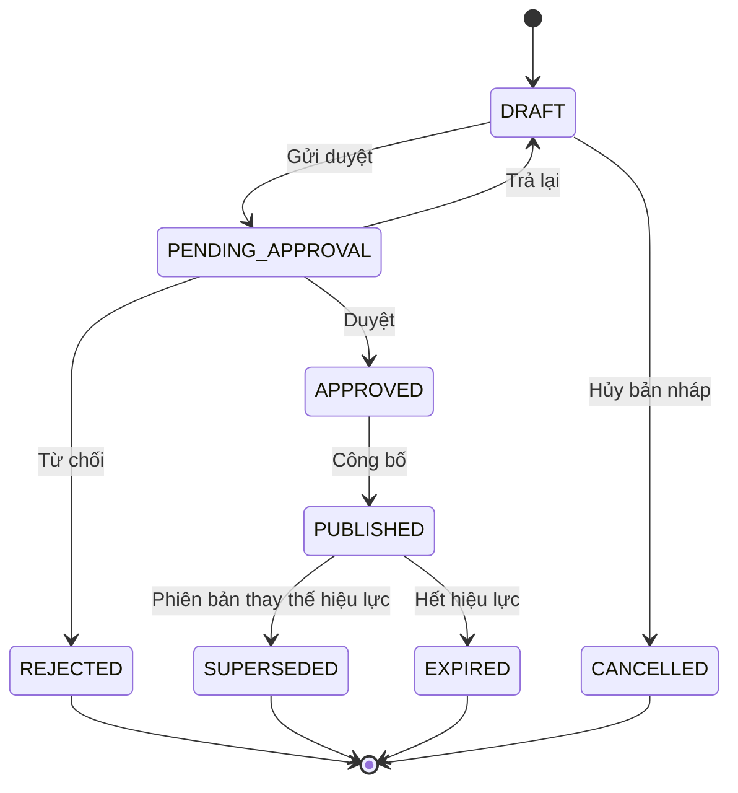

#### 7.4.2. Đoàn tàu

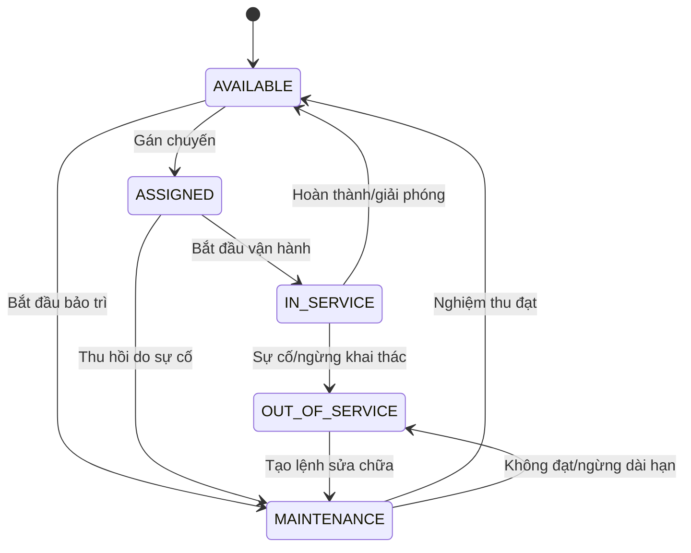

#### 7.4.3. Lệnh bảo trì

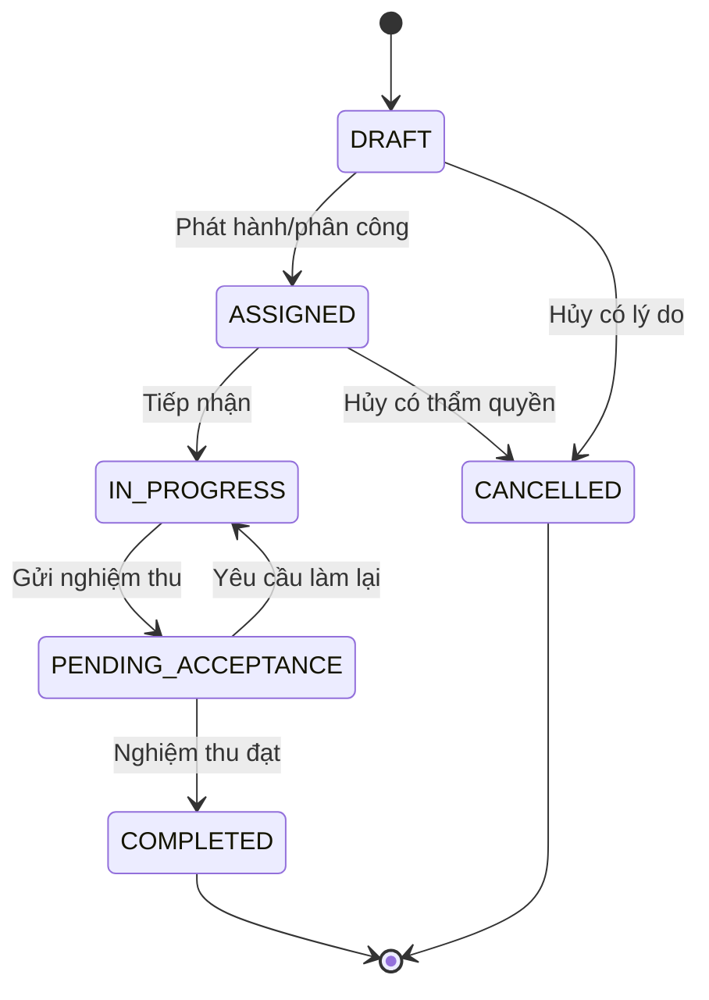

#### 7.4.4. Sự cố

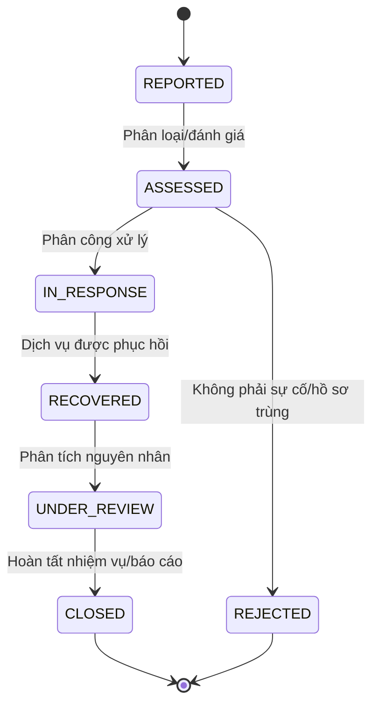

#### 7.4.5. Thanh toán

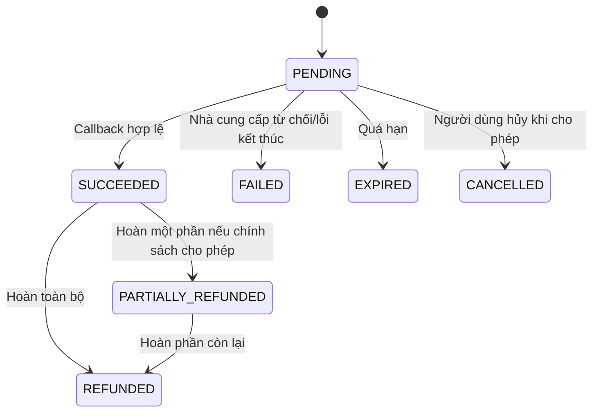

#### 7.4.6. Vé

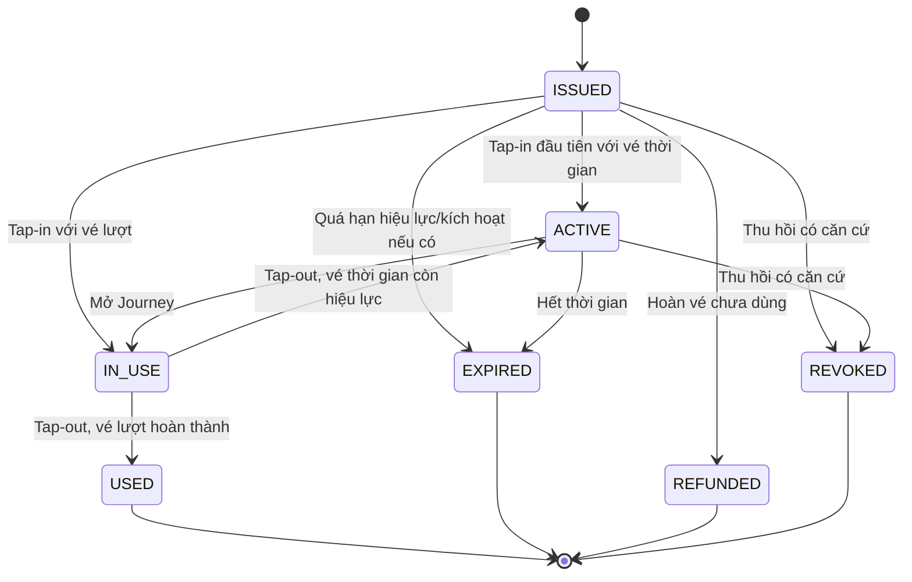

#### 7.4.7. Hồ sơ ưu đãi

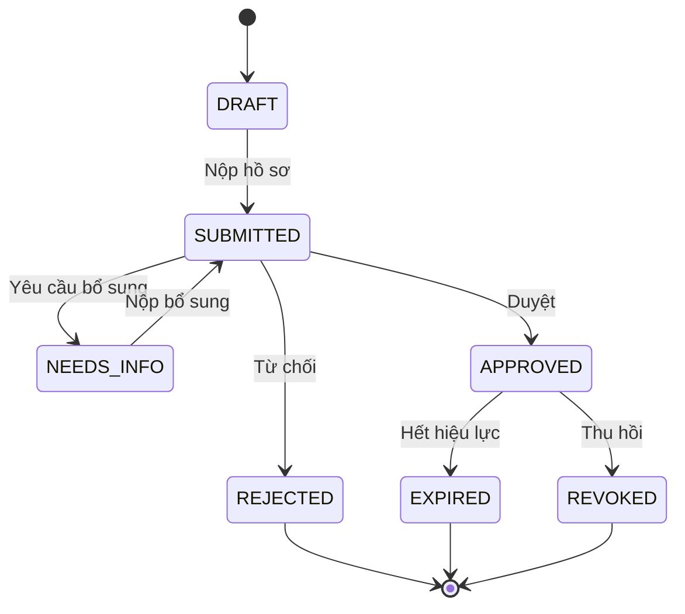

#### 7.4.8. Hoàn tiền

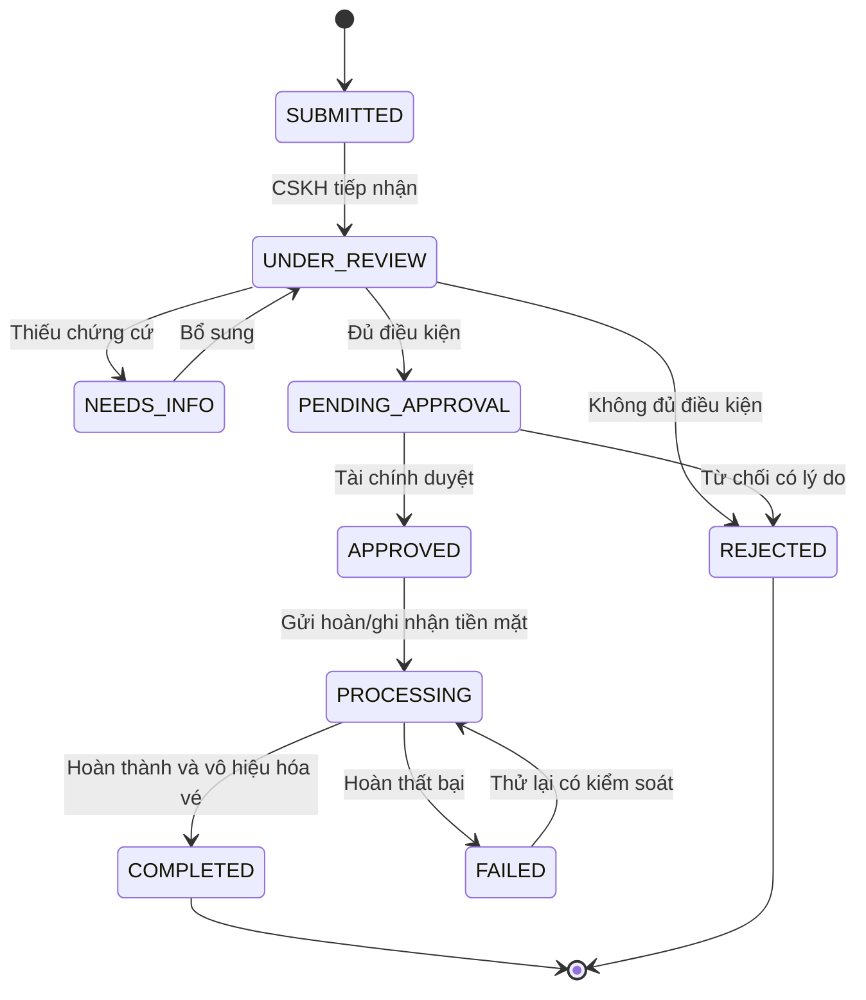

#### 7.4.9. Tài khoản người dùng

```mermaid
stateDiagram-v2
    [*] --> PENDING: Đăng ký/tạo tài khoản
    PENDING --> ACTIVE: Kích hoạt/xác nhận
    PENDING --> CLOSED: Hủy hoặc hết quy trình đăng ký
    ACTIVE --> LOCKED: Khóa tạm/bảo mật
    LOCKED --> ACTIVE: Mở khóa; phải đăng nhập lại
    ACTIVE --> DISABLED: Ngừng hiệu lực nội bộ
    LOCKED --> DISABLED: Ngừng hiệu lực
    ACTIVE --> CLOSED: Hành khách đóng tài khoản
    DISABLED --> ACTIVE: Khôi phục có thẩm quyền
    CLOSED --> [*]
```

#### 7.4.10. Phiên bản OD Matrix

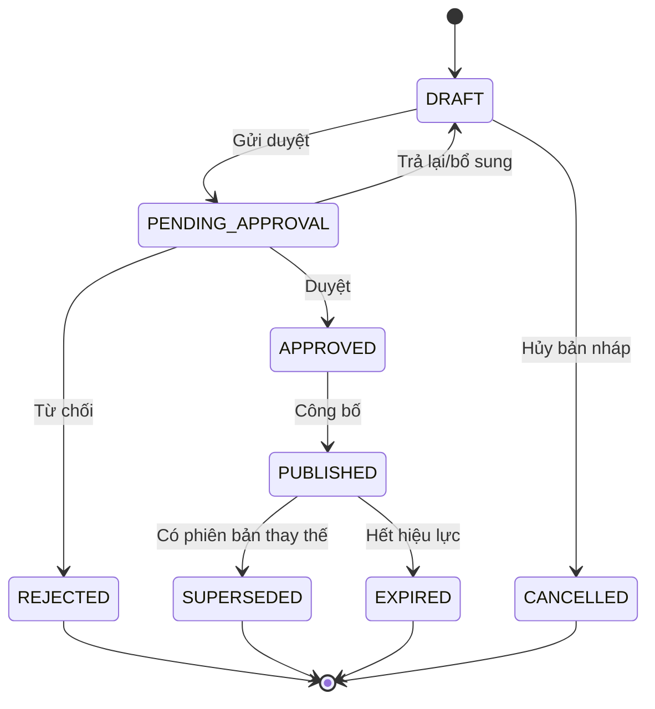

#### 7.4.11. Cảnh báo crowding

```mermaid
stateDiagram-v2
    [*] --> OPEN
    OPEN --> ACKNOWLEDGED: Tiếp nhận
    ACKNOWLEDGED --> IN_PROGRESS: Phân công/xử lý
    OPEN --> ESCALATED: Quá SLA
    ACKNOWLEDGED --> ESCALATED: Quá SLA
    IN_PROGRESS --> RESOLVED: Đã xử lý
    RESOLVED --> CLOSED: Xác nhận/đóng
    OPEN --> DISMISSED: Trùng/không hợp lệ có lý do
    ESCALATED --> RESOLVED: Xử lý xong
    CLOSED --> [*]
    DISMISSED --> [*]
```

#### 7.4.12. Quy tắc tự động hóa

```mermaid
stateDiagram-v2
    [*] --> DRAFT
    DRAFT --> SHADOW: Chạy thử/backtest
    SHADOW --> PENDING_APPROVAL: Đạt ngưỡng
    SHADOW --> DRAFT: Không đạt
    PENDING_APPROVAL --> ACTIVE: Duyệt/kích hoạt
    PENDING_APPROVAL --> REJECTED: Từ chối
    ACTIVE --> PAUSED: Kill switch/tạm dừng
    PAUSED --> ACTIVE: Bật lại có kiểm soát
    ACTIVE --> RETIRED: Ngừng sử dụng
    PAUSED --> RETIRED: Ngừng sử dụng
    REJECTED --> [*]
    RETIRED --> [*]
```

#### 7.4.13. Lần chạy tự động hóa

```mermaid
stateDiagram-v2
    [*] --> QUEUED
    QUEUED --> RUNNING: Bắt đầu
    RUNNING --> SUCCEEDED: Có kết quả
    RUNNING --> FAILED: Lỗi/quá hạn
    SUCCEEDED --> PENDING_APPROVAL: Cần người duyệt
    SUCCEEDED --> AUTO_CLOSED: Không cần duyệt theo cấu hình
    PENDING_APPROVAL --> APPROVED: Duyệt
    PENDING_APPROVAL --> REJECTED: Từ chối
    PENDING_APPROVAL --> OVERRIDDEN: Ghi đè có lý do
    FAILED --> FALLBACK_MANUAL: Chuyển hàng đợi thủ công
    APPROVED --> [*]
    REJECTED --> [*]
    OVERRIDDEN --> [*]
    AUTO_CLOSED --> [*]
    FALLBACK_MANUAL --> [*]
```

### 7.5. Dữ liệu seed cho bản demo Hanoi Metro tuyến 2A

Dữ liệu tại mục này là cấu hình khởi tạo có nguồn và ngày hiệu lực, không phải hằng số trong mã nguồn. Khi nguồn chính thức công bố thay đổi, quản trị viên phải tạo phiên bản mới theo BR-003–BR-006; giao dịch cũ tiếp tục tham chiếu phiên bản đã dùng.

#### 7.5.1. Metadata seed

| Thuộc tính | Giá trị demo |
|---|---|
| Nhà vận hành | Hanoi Metro |
| Tuyến | 2A Cát Linh–Hà Đông |
| Múi giờ | `Asia/Ho_Chi_Minh` |
| Phiên bản mạng lưới | `NET-HN-2A-DEMO-01` |
| Phiên bản lịch tham khảo | `SCH-HN-2A-2026-02-09`, nguồn SRC-004 |
| Phiên bản giá | `FARE-HN-METRO-2025-08-01`, nguồn SRC-002 và bản đính chính SRC-003 |
| Tiền tệ/đơn vị lưu | VND, số nguyên đồng |

#### 7.5.2. Danh mục ga và thứ tự

| Mã seed | Số ga trong phụ lục giá | Tên ga | Thứ tự chiều Cát Linh → Yên Nghĩa |
|---|---:|---|---:|
| S01 | Ga 1 | Cát Linh | 1 |
| S02 | Ga 2 | La Thành | 2 |
| S03 | Ga 3 | Thái Hà | 3 |
| S04 | Ga 4 | Láng | 4 |
| S05 | Ga 5 | Thượng Đình | 5 |
| S06 | Ga 6 | Vành Đai 3 | 6 |
| S07 | Ga 7 | Phùng Khoang | 7 |
| S08 | Ga 8 | Văn Quán | 8 |
| S09 | Ga 9 | Hà Đông | 9 |
| S10 | Ga 10 | La Khê | 10 |
| S11 | Ga 11 | Văn Khê | 11 |
| S12 | Ga 12 | Yên Nghĩa | 12 |

Chiều ngược lại dùng cùng ga theo thứ tự đảo; không tạo bản sao ga. Tên hiển thị có thể được phiên bản hóa nhưng mã seed và tham chiếu giao dịch không đổi.

#### 7.5.3. Lịch dịch vụ tham khảo

Từ 09/02/2026, nguồn SRC-004 công bố giờ hoạt động hằng ngày `05:30–22:00`. Cuối tuần và ngày lễ có tần suất 10 phút/chuyến trong toàn khung hoạt động. Các cửa sổ ngày thường được nguồn công bố như sau:

| Loại ngày | Khung giờ công bố | Headway tham khảo |
|---|---|---:|
| Ngày thường | 05:30–06:00 | 10 phút |
| Ngày thường | 06:30–09:00 | 6 phút |
| Ngày thường | 09:00–16:30 | 10 phút |
| Ngày thường | 16:30–19:30 | 6 phút |
| Ngày thường | 19:30–22:00 | 15 phút |
| Cuối tuần/ngày lễ | 05:30–22:00 | 10 phút |

Tóm tắt công khai không nêu riêng khoảng `06:00–06:30`; bản demo không được tự suy đoán headway cho khoảng này. Trước khi công bố phiên bản lịch, ACT-09 phải nhập/import danh sách lượt chạy đầy đủ đã được đối chiếu với biểu đồ nguồn và UC-SCH-02 phải phát hiện mọi khoảng trống.

#### 7.5.4. Ma trận giá vé lượt hiệu lực từ 01/08/2025

Các bảng dưới đây là số tiền VND cho từng cặp ga tuyến 2A theo Phụ lục III của Quyết định 3316/QĐ-UBND. Ma trận đối xứng; đường chéo bằng 0 và không phải một sản phẩm có thể mua.

**Thanh toán không dùng tiền mặt**

| Đi\Đến | S01 | S02 | S03 | S04 | S05 | S06 | S07 | S08 | S09 | S10 | S11 | S12 |
|---|---:|---:|---:|---:|---:|---:|---:|---:|---:|---:|---:|---:|
| S01 | 0 | 8.595 | 9.360 | 10.295 | 11.315 | 12.250 | 13.440 | 14.375 | 15.480 | 16.500 | 17.690 | 18.625 |
| S02 | 8.595 | 0 | 8.765 | 9.700 | 10.720 | 11.655 | 12.845 | 13.780 | 14.885 | 15.905 | 17.095 | 18.030 |
| S03 | 9.360 | 8.765 | 0 | 8.935 | 9.955 | 10.890 | 12.080 | 13.015 | 14.120 | 15.140 | 16.330 | 17.265 |
| S04 | 10.295 | 9.700 | 8.935 | 0 | 9.020 | 9.955 | 11.145 | 12.080 | 13.185 | 14.205 | 15.395 | 16.330 |
| S05 | 11.315 | 10.720 | 9.955 | 9.020 | 0 | 8.935 | 10.125 | 11.060 | 12.165 | 13.185 | 14.375 | 15.310 |
| S06 | 12.250 | 11.655 | 10.890 | 9.955 | 8.935 | 0 | 9.190 | 10.125 | 11.230 | 12.250 | 13.440 | 14.375 |
| S07 | 13.440 | 12.845 | 12.080 | 11.145 | 10.125 | 9.190 | 0 | 8.935 | 10.040 | 11.060 | 12.250 | 13.185 |
| S08 | 14.375 | 13.780 | 13.015 | 12.080 | 11.060 | 10.125 | 8.935 | 0 | 9.105 | 10.125 | 11.315 | 12.250 |
| S09 | 15.480 | 14.885 | 14.120 | 13.185 | 12.165 | 11.230 | 10.040 | 9.105 | 0 | 9.020 | 10.210 | 11.145 |
| S10 | 16.500 | 15.905 | 15.140 | 14.205 | 13.185 | 12.250 | 11.060 | 10.125 | 9.020 | 0 | 9.190 | 10.125 |
| S11 | 17.690 | 17.095 | 16.330 | 15.395 | 14.375 | 13.440 | 12.250 | 11.315 | 10.210 | 9.190 | 0 | 8.935 |
| S12 | 18.625 | 18.030 | 17.265 | 16.330 | 15.310 | 14.375 | 13.185 | 12.250 | 11.145 | 10.125 | 8.935 | 0 |

**Thanh toán bằng tiền mặt**

| Đi\Đến | S01 | S02 | S03 | S04 | S05 | S06 | S07 | S08 | S09 | S10 | S11 | S12 |
|---|---:|---:|---:|---:|---:|---:|---:|---:|---:|---:|---:|---:|
| S01 | 0 | 9.000 | 10.000 | 11.000 | 12.000 | 13.000 | 14.000 | 15.000 | 16.000 | 17.000 | 18.000 | 19.000 |
| S02 | 9.000 | 0 | 9.000 | 10.000 | 11.000 | 12.000 | 13.000 | 14.000 | 15.000 | 16.000 | 18.000 | 19.000 |
| S03 | 10.000 | 9.000 | 0 | 9.000 | 10.000 | 11.000 | 13.000 | 14.000 | 15.000 | 16.000 | 17.000 | 18.000 |
| S04 | 11.000 | 10.000 | 9.000 | 0 | 10.000 | 10.000 | 12.000 | 13.000 | 14.000 | 15.000 | 16.000 | 17.000 |
| S05 | 12.000 | 11.000 | 10.000 | 10.000 | 0 | 9.000 | 11.000 | 12.000 | 13.000 | 14.000 | 15.000 | 16.000 |
| S06 | 13.000 | 12.000 | 11.000 | 10.000 | 9.000 | 0 | 10.000 | 11.000 | 12.000 | 13.000 | 14.000 | 15.000 |
| S07 | 14.000 | 13.000 | 13.000 | 12.000 | 11.000 | 10.000 | 0 | 9.000 | 11.000 | 12.000 | 13.000 | 14.000 |
| S08 | 15.000 | 14.000 | 14.000 | 13.000 | 12.000 | 11.000 | 9.000 | 0 | 10.000 | 11.000 | 12.000 | 13.000 |
| S09 | 16.000 | 15.000 | 15.000 | 14.000 | 13.000 | 12.000 | 11.000 | 10.000 | 0 | 10.000 | 11.000 | 12.000 |
| S10 | 17.000 | 16.000 | 16.000 | 15.000 | 14.000 | 13.000 | 12.000 | 11.000 | 10.000 | 0 | 10.000 | 11.000 |
| S11 | 18.000 | 18.000 | 17.000 | 16.000 | 15.000 | 14.000 | 13.000 | 12.000 | 11.000 | 10.000 | 0 | 9.000 |
| S12 | 19.000 | 19.000 | 18.000 | 17.000 | 16.000 | 15.000 | 14.000 | 13.000 | 12.000 | 11.000 | 9.000 | 0 |

Hệ thống phải lưu đúng số nguyên VND của bảng, không tự làm tròn bảng không tiền mặt thành nghìn đồng. Kênh thanh toán của đơn hàng quyết định bảng giá được dùng và snapshot phải giữ nguyên sau phát hành.

#### 7.5.5. Giá vé thời gian và nhóm miễn/giảm

Bảng giá dưới đây đã áp dụng nội dung đính chính tại Quyết định 3553/QĐ-UBND; không dùng các giá tháng trước đính chính trong bản gốc Quyết định 3316.

| Sản phẩm | Giá ưu tiên (VND) | Giá không ưu tiên (VND) |
|---|---:|---:|
| Vé ngày | 40.000 | 40.000 |
| Vé tuần | 160.000 | 160.000 |
| 01 tháng | 140.000 | 280.000 |
| 02 tháng | 270.000 | 550.000 |
| 03 tháng | 410.000 | 820.000 |
| 04 tháng | 535.000 | 1.075.000 |
| 05 tháng | 670.000 | 1.345.000 |
| 06 tháng | 805.000 | 1.615.000 |
| 07 tháng | 920.000 | 1.840.000 |
| 08 tháng | 1.050.000 | 2.105.000 |
| 09 tháng | 1.185.000 | 2.367.000 |
| 10 tháng | 1.315.000 | 2.630.000 |
| 11 tháng | 1.450.000 | 2.895.000 |
| 12 tháng | 1.580.000 | 3.158.000 |

Ngày/tuần áp dụng một mức cho cả hai nhóm. Giá ưu tiên tháng/dài hạn áp dụng cho các nhóm sau, theo phiên bản chính sách và hồ sơ còn hiệu lực:

| Mã seed | Nhóm | Kết quả chính sách demo |
|---|---|---|
| ELG-PRIORITY-01 | Học sinh phổ thông | Giá ưu tiên tháng/dài hạn |
| ELG-PRIORITY-02 | Sinh viên đại học, cao đẳng, trung học chuyên nghiệp, dạy nghề; không gồm hệ vừa học vừa làm | Giá ưu tiên tháng/dài hạn |
| ELG-PRIORITY-03 | Công nhân khu công nghiệp | Giá ưu tiên tháng/dài hạn |
| ELG-FREE-01 | Người có công | Vé không tính tiền |
| ELG-FREE-02 | Người khuyết tật | Vé không tính tiền |
| ELG-FREE-03 | Người từ đủ 60 tuổi | Vé không tính tiền |
| ELG-FREE-04 | Trẻ em dưới 6 tuổi | Vé không tính tiền; khi sử dụng phải tuân thủ quy định người lớn đi kèm |
| ELG-FREE-05 | Nhân khẩu thuộc hộ nghèo | Vé không tính tiền |

Điều kiện giấy tờ, ngày hết hạn và cách xác định nhóm là dữ liệu cấu hình có phiên bản. MVP thẩm định thủ công, không gọi CCCD/VNeID thật; ảnh minh chứng bị xóa sau quyết định theo BR-040. Vé thời gian tính từ lần tap-in hợp lệ đầu tiên và ngày lễ không kéo dài hiệu lực theo BR-030–BR-032.

#### 7.5.6. Seed OD Matrix, tải và ngưỡng crowding mô phỏng

Toàn bộ số liệu tại mục này là **dữ liệu tổng hợp phục vụ demo**, không phải số liệu vận hành chính thức của Hanoi Metro và không phải giới hạn an toàn. Mục đích là tạo đủ trạng thái bình thường, cảnh báo và bất thường để kiểm thử Chương 5–6.

**Metadata seed**

| Thuộc tính | Giá trị demo |
|---|---|
| Phiên bản OD | `ODM-HN-2A-2026-02-09-AM-PEAK` |
| Thuật toán | `OD-EST-DEMO-v1` (AFC trực tiếp + bổ khuyết thiếu tap-out) |
| Nguồn APC | `APC-SIM-HN-2A-01` |
| Phiên bản sức chứa | `CAP-HN-2A-4CAR-DEMO` |
| Phiên bản ngưỡng | `CTX-HN-2A-DEMO-01` |
| Mô hình dự báo | `FC-DEMO-v1` |
| Khung giờ | Ngày thường, `06:30–09:00`, chiều `S01 → S12` |
| Ngưỡng tối thiểu ô OD | 10 hành trình; ô dưới ngưỡng bị gộp/ẩn |

**Sức chứa và ngưỡng mặc định**

| Tham số | Giá trị demo | Ghi chú |
|---|---:|---|
| Số toa | 4 | Cấu hình đoàn tàu demo |
| Chỗ ngồi toàn đoàn | 168 | 42 chỗ/toa |
| Diện tích đứng quy ước | 120 m² | 30 m²/toa |
| Sức chứa thiết kế (4,5 psm) | 708 | 168 ngồi + 540 đứng |
| Sức chứa crush (6,0 psm) | 888 | Chỉ dùng phân tích, không phải mục tiêu vận hành |

| Mức | Hệ số tải | Mật độ psm | Hành vi demo |
|---|---|---|---|
| `COMFORTABLE` | ≤ 0,65 | ≤ 3,0 | Theo dõi thường |
| `WARNING` | > 0,65–0,80 | > 3,0–4,5 | Tạo cảnh báo mức trung bình |
| `HIGH` | > 0,80–1,00 | > 4,5–6,0 | Cảnh báo mức cao, đề xuất tăng chuyến/điều chuyển |
| `CRITICAL` | > 1,00 | > 6,0 | Cảnh báo nghiêm trọng, leo thang ACT-10 |

Mức hiển thị lấy mức nghiêm trọng hơn giữa hệ số tải và psm. Các ngưỡng này phải được duyệt và có thể thay đổi theo tuyến/ga/khung giờ.

**Luồng ga tổng hợp trong khung cao điểm**

| Ga | Lên tàu | Xuống tàu | Trên tàu sau ga | Hệ số tải | psm | Mức demo |
|---|---:|---:|---:|---:|---:|---|
| S01 Cát Linh | 7.800 | 0 | 7.800 | 0,44 | 1,20 | `COMFORTABLE` |
| S02 La Thành | 3.900 | 1.300 | 10.400 | 0,59 | 2,07 | `COMFORTABLE` |
| S03 Thái Hà | 4.700 | 2.200 | 12.900 | 0,73 | 2,90 | `WARNING` |
| S04 Láng | 3.400 | 2.600 | 13.700 | 0,77 | 3,17 | `WARNING` |
| S05 Thượng Đình | 3.000 | 3.000 | 13.700 | 0,77 | 3,17 | `WARNING` |
| S06 Vành Đai 3 | 4.700 | 3.500 | 14.900 | 0,84 | 3,57 | `HIGH` |
| S07 Phùng Khoang | 2.600 | 3.000 | 14.500 | 0,82 | 3,43 | `HIGH` |
| S08 Văn Quán | 2.200 | 3.400 | 13.300 | 0,75 | 3,03 | `WARNING` |
| S09 Hà Đông | 2.600 | 3.900 | 12.000 | 0,68 | 2,60 | `WARNING` |
| S10 La Khê | 1.700 | 3.900 | 9.800 | 0,55 | 1,87 | `COMFORTABLE` |
| S11 Văn Khê | 1.300 | 3.900 | 7.200 | 0,41 | 1,00 | `COMFORTABLE` |
| S12 Yên Nghĩa | 0 | 7.200 | 0 | 0,00 | 0,00 | `COMFORTABLE` |

Tổng lên tàu trong khung = 37.900. Với 25 chuyến/chiều (headway 6 phút), tải bình quân đoạn cao nhất khoảng 596 hành khách/chuyến. Cột hệ số tải và psm trong bảng là giá trị bình quân theo chuyến (tổng khung chia 25 chuyến), không phải đỉnh tức thời; đây là cách quy đổi demo, không dùng để kết luận về năng lực thực tế.

**Một số cặp OD lớn nhất**

| Ga đi | Ga đến | Số hành trình | Tỷ lệ bổ khuyết |
|---|---|---:|---:|
| S01 | S12 | 900 | 2,0% |
| S02 | S12 | 700 | 2,5% |
| S03 | S09 | 650 | 3,0% |
| S01 | S09 | 620 | 2,0% |
| S06 | S12 | 600 | 4,0% |
| Khác | Khác | 34.430 | 3,1% |

**Mẫu đối chiếu APC–AFC**

| Đoạn | Tải từ AFC | Đếm APC | Sai lệch | Cờ |
|---|---:|---:|---:|---|
| S04–S05 | 13.700 | 13.450 | −1,8% | Bình thường |
| S06–S07 | 14.900 | 15.600 | +4,7% | Trong ngưỡng 5% |
| S09–S10 | 12.000 | 10.300 | −8,0% | `QUALITY_WARNING` |

**Quy tắc tự động hóa seed**

| Mã | Tên | Đầu ra | Mức tự động hóa |
|---|---|---|---|
| `AUT-RULE-01` | Tạo cảnh báo crowding từ tải đã công bố | Cảnh báo + giải thích | Tự động tạo, người xác nhận |
| `AUT-RULE-02` | Đề xuất giãn cách theo OD/dự báo | Bản nháp khuyến nghị | Người duyệt |
| `AUT-RULE-03` | Phân loại sơ bộ sự cố | Nhãn + mức ưu tiên đề xuất | Người xác nhận |
| `AUT-RULE-04` | Nhắc bảo trì đến hạn | Nhiệm vụ/nhắc việc | Tự động tạo nhiệm vụ |
| `AUT-RULE-05` | Tổng hợp báo cáo ngày | Bản nháp báo cáo | Người kiểm tra |
| `AUT-RULE-06` | Soạn nháp thông báo dịch vụ | Bản nháp nội dung | Người duyệt/công bố |

Danh mục đầy đủ và lộ trình tự động hóa được trình bày tại Chương 15.

---

## 8. Yêu cầu giao diện và tích hợp ngoài

### 8.1. Giao diện người dùng

| Mã | Yêu cầu |
|---|---|
| INT-UI-001 | Cổng hành khách phải responsive từ viewport 360 px đến màn hình desktop phổ biến. |
| INT-UI-002 | Back office phải hiển thị rõ nhà vận hành/phạm vi dữ liệu đang thao tác. |
| INT-UI-003 | Trạng thái, lỗi và hành động rủi ro phải có nhãn văn bản; không chỉ dựa vào màu sắc. |
| INT-UI-004 | Form phải hỗ trợ bàn phím, focus hiển thị, nhãn trường và thông báo lỗi liên kết tới trường tương ứng. |
| INT-UI-005 | Mọi thao tác duyệt/từ chối/hoàn/đóng sự cố phải hiển thị đối tượng, hậu quả và yêu cầu xác nhận/lý do. |
| INT-UI-006 | Ngôn ngữ release đầu là tiếng Việt; thuật ngữ chuyên ngành có giải thích khi cần. |
| INT-UI-007 | Bản đồ nhiệt OD/tải/crowding phải có chú giải mức, bộ lọc thời gian và bảng dữ liệu thay thế cho người không phân biệt được màu. |
| INT-UI-008 | Mọi chỉ số OD/tải phải hiển thị nhãn nguồn: thực đo, bổ khuyết, mô phỏng hoặc dự báo; không được trình bày như số liệu chính thức khi chưa công bố. |
| INT-UI-009 | Hàng đợi phê duyệt tự động hóa phải hiển thị giải thích, độ tin cậy, phạm vi ảnh hưởng, SLA và hành động duyệt/từ chối/ghi đè. |
| INT-UI-010 | Màn hình kịch bản phải cho phép so sánh phương án cơ sở với kịch bản theo cùng thang đo và nêu rõ giả định. |
| INT-UI-011 | Dashboard OD phải hỗ trợ drill-down từ tuyến → đoạn → ga → chuyến trong phạm vi quyền và không lộ dữ liệu nhà vận hành khác. |

### 8.2. Cổng thanh toán giả lập

| Mã | Yêu cầu |
|---|---|
| INT-PAY-001 | Hệ thống gửi mã đơn, số tiền, tiền tệ, return/callback reference và idempotency key; không gửi dữ liệu thẻ đầy đủ. |
| INT-PAY-002 | Callback phải được xác minh theo cơ chế chữ ký/token của adapter giả lập trước khi thay đổi trạng thái. |
| INT-PAY-003 | Callback lặp phải trả kết quả ổn định và không phát hành thêm vé. |
| INT-PAY-004 | Sai số tiền, mã đơn, tiền tệ hoặc callback không hợp lệ phải chuyển giao dịch sang lỗi cần kiểm tra; không phát hành vé. |
| INT-PAY-005 | Adapter phải mô phỏng `PENDING`, `SUCCEEDED`, `FAILED`, `EXPIRED`, `REFUNDED` và lỗi timeout. |

### 8.3. AFC giả lập

| Mã | Yêu cầu |
|---|---|
| INT-AFC-001 | API nhận credential/token, mã ga, loại sự kiện, thời điểm, thiết bị mô phỏng và idempotency key. |
| INT-AFC-002 | Phản hồi phải gồm quyết định cho phép/từ chối nghiệp vụ, mã lý do, trạng thái vé/Journey và hướng xử lý; đây không phải lệnh vật lý. |
| INT-AFC-003 | Mọi tap phải được ghi audit/sự kiện kể cả khi bị từ chối. |
| INT-AFC-004 | Sự kiện ngoại tuyến được nhận theo lô, kiểm tra trùng và giải quyết xung đột có audit. |
| INT-AFC-005 | AFC giả lập không được truy cập chức năng điều khiển cửa hoặc hệ thống an toàn. |

### 8.4. OCC dạng CSV/chỉ đọc

| Mã | Yêu cầu |
|---|---|
| INT-OCC-001 | Hệ thống công bố mẫu CSV có phiên bản, mã hóa UTF-8, tiêu đề bắt buộc và định dạng thời gian rõ ràng. |
| INT-OCC-002 | Dòng tối thiểu phải định danh nhà vận hành, ngày dịch vụ, mã chuyến, ga, sự kiện và thời gian thực tế. |
| INT-OCC-003 | Import chạy ở chế độ kiểm tra trước; người dùng xem tổng số hợp lệ/lỗi/trùng trước khi xác nhận. |
| INT-OCC-004 | Bản ghi lỗi phải có số dòng, trường lỗi và lý do; bản ghi hợp lệ không bị nhân đôi khi import lại cùng tệp. |
| INT-OCC-005 | Không tồn tại API hoặc chức năng gửi lệnh ngược từ hệ thống tới OCC. |

### 8.5. Email giả lập

| Mã | Yêu cầu |
|---|---|
| INT-MAIL-001 | Email dùng mẫu có phiên bản, correlation ID và dữ liệu tối thiểu cần thiết. |
| INT-MAIL-002 | Hệ thống ghi trạng thái queued/sent/failed của adapter giả lập và cho phép thử lại có giới hạn. |
| INT-MAIL-003 | Email không được chứa toàn bộ dữ liệu giấy tờ ưu đãi hoặc token credential có thể dùng trực tiếp nếu không có cơ chế bảo vệ phù hợp. |

### 8.6. Xuất báo cáo

| Mã | Yêu cầu |
|---|---|
| INT-EXP-001 | Báo cáo cho cơ quan quản lý được xuất PDF và định dạng bảng dữ liệu phổ biến; cơ quan không đăng nhập hệ thống. |
| INT-EXP-002 | Tệp xuất phải ghi nhà vận hành, kỳ dữ liệu, thời điểm tạo, người tạo, bộ lọc và phiên bản mẫu. |
| INT-EXP-003 | Dữ liệu cá nhân trong tệp xuất phải được ẩn/che theo mục đích báo cáo. |

### 8.7. APC và CCTV mô phỏng

| Mã | Yêu cầu |
|---|---|
| INT-APC-001 | Nguồn APC phải cung cấp số đếm theo ga/đoạn, chuyến, cửa sổ thời gian, mã thiết bị và độ tin cậy; dữ liệu có thể nhập theo lô hoặc tệp. |
| INT-APC-002 | Hệ thống phải kiểm tra số đếm không âm, không vượt sức chứa hợp lý, đúng thứ tự ga và không trùng cửa sổ trước khi chấp nhận. |
| INT-APC-003 | Import APC phải idempotent theo khóa nguồn/thiết bị/cửa sổ thời gian; nhập lại cùng dữ liệu không tạo bản ghi trùng. |
| INT-APC-004 | Kết quả đối chiếu APC–AFC phải lưu sai lệch và cờ chất lượng; hệ thống không được ghi đè dữ liệu nguồn hoặc tự sửa số đếm. |
| INT-APC-005 | CCTV/dữ liệu hình ảnh trong demo chỉ được dùng để mô phỏng đếm tổng hợp; không nhận dạng khuôn mặt, không lưu danh tính và không xuất dữ liệu thô. |
| INT-APC-006 | Adapter APC/CCTV không được có kênh gửi lệnh tới cửa, đoàn tàu, tín hiệu hoặc OCC. |

### 8.8. Trao đổi OD Matrix và dự báo

| Mã | Yêu cầu |
|---|---|
| INT-ODM-001 | Định dạng trao đổi OD phải có phiên bản schema, mã phiên bản OD, kỳ dữ liệu, đơn vị, checksum và metadata chất lượng. |
| INT-ODM-002 | API dự báo phải trả chân trời, giá trị điểm, khoảng tin cậy, phiên bản mô hình và chỉ số backtest; không trả dữ liệu cá nhân. |
| INT-ODM-003 | Khuyến nghị gửi tới phân hệ lập biểu đồ/nhân sự/truyền thông chỉ ở dạng bản nháp hoặc đề xuất, kèm tham chiếu phiên bản OD. |
| INT-ODM-004 | Hệ thống phải nhận phản hồi thực tế để so sánh với dự báo và cập nhật chỉ số chất lượng mô hình theo phiên bản. |
| INT-ODM-005 | Mọi truy cập/xuất dữ liệu OD phải theo phạm vi nhà vận hành, quyền `ODM` và được audit. |
| INT-ODM-006 | Dữ liệu trao đổi ra ngoài hệ thống phải ở mức tổng hợp; không bao gồm mã vé, mã hành trình hoặc định danh hành khách. |

### 8.9. Hàng đợi và thông báo tự động hóa

| Mã | Yêu cầu |
|---|---|
| INT-AUT-001 | Hệ thống phải cung cấp hàng đợi công việc tự động hóa có trạng thái, ưu tiên, SLA và bộ lọc theo miền/vai trò. |
| INT-AUT-002 | Thông báo phải gửi tới đúng vai trò phụ trách khi có việc cần duyệt, quá SLA, lỗi hoặc quy tắc bị tạm dừng. |
| INT-AUT-003 | Khi tự động hóa lỗi hoặc bị tắt, công việc phải xuất hiện trong hàng đợi thủ công thay thế, không bị mất. |
| INT-AUT-004 | Tích hợp tự động hóa chỉ được gọi API nghiệp vụ có kiểm soát quyền; không được gọi trực tiếp cơ sở dữ liệu hoặc hệ thống an toàn. |
| INT-AUT-005 | Mọi yêu cầu từ hàng đợi phải mang correlation ID để liên kết lần chạy, quyết định của người và audit. |

---

## 9. Yêu cầu phi chức năng

### 9.1. Hiệu năng và khả năng mở rộng

| Mã | Yêu cầu và cách đo |
|---|---|
| NFR-PERF-001 | Hệ thống phải phục vụ tối thiểu 200 người dùng đồng thời trong kịch bản tải nghiệm thu mà không vượt ngưỡng lỗi 1% do ứng dụng. |
| NFR-PERF-002 | Với tải nghiệm thu, P95 của yêu cầu tương tác thông thường phải không quá 3 giây, đo tại biên ứng dụng và loại trừ thời gian người dùng suy nghĩ. |
| NFR-PERF-003 | P95 của kiểm tra vé AFC mô phỏng trực tuyến phải không quá 2 giây từ khi nhận request hợp lệ đến khi trả quyết định nghiệp vụ. |
| NFR-PERF-004 | Import CSV phải hiển thị tiến độ hoặc trạng thái xử lý; không được khóa giao diện người dùng trong suốt tác vụ dài. |
| NFR-PERF-005 | Báo cáo lớn được phép xử lý bất đồng bộ nhưng phải cung cấp mã tác vụ, trạng thái và liên kết tải khi hoàn tất. |

### 9.2. Sẵn sàng, sao lưu và khôi phục

| Mã | Yêu cầu và cách đo |
|---|---|
| NFR-AVL-001 | Mức sẵn sàng mục tiêu là 99% theo tháng cho phạm vi ứng dụng, không tính cửa sổ bảo trì có kế hoạch được thông báo trước. |
| NFR-AVL-002 | RTO chung không quá 4 giờ trong bài diễn tập khôi phục. |
| NFR-AVL-003 | RPO không quá 15 phút cho vé, payment, refund, Journey và AFC event. |
| NFR-AVL-004 | RPO không quá 24 giờ cho dữ liệu không trọng yếu và báo cáo có thể tái tạo. |
| NFR-AVL-005 | Sao lưu phải được kiểm tra khả năng phục hồi định kỳ; nghiệm thu yêu cầu ít nhất một lần phục hồi thành công trong môi trường kiểm thử. |
| NFR-AVL-006 | Khi tích hợp ngoài lỗi, dữ liệu đã cam kết nội bộ không bị mất; tác vụ thử lại phải idempotent. |

### 9.3. Bảo mật

| Mã | Yêu cầu và cách đo |
|---|---|
| NFR-SEC-001 | Áp dụng RBAC với phạm vi nhà vận hành và nguyên tắc quyền tối thiểu. |
| NFR-SEC-002 | Vai trò đặc quyền phải dùng MFA khi đăng nhập hoặc thực hiện thao tác theo chính sách. |
| NFR-SEC-003 | Khóa tài khoản phải làm mất hiệu lực phiên hiện có trong thời gian không quá 1 phút. |
| NFR-SEC-004 | Mật khẩu phải được lưu dưới dạng băm thích hợp; không ghi mật khẩu, token bí mật hoặc dữ liệu thẻ đầy đủ vào log. |
| NFR-SEC-005 | Giao tiếp có dữ liệu xác thực, cá nhân hoặc tài chính phải được bảo vệ khi truyền; bản sao lưu nhạy cảm phải được bảo vệ khi lưu. |
| NFR-SEC-006 | Chống các nhóm lỗi phổ biến gồm injection, kiểm soát truy cập sai, CSRF khi áp dụng, XSS, session fixation và upload tệp không an toàn. |
| NFR-SEC-007 | Upload minh chứng phải kiểm tra loại/kích thước, cô lập khỏi thực thi và bị xóa sau quyết định theo BR-040. |
| NFR-SEC-008 | Hành động duyệt, công bố, hoàn tiền, thay đổi quyền và xử lý ngoại lệ AFC phải ghi audit bất biến. |
| NFR-SEC-009 | Tách nhiệm vụ phải được cưỡng chế bằng quyền và dữ liệu người tạo, không chỉ bằng hướng dẫn vận hành. |
| NFR-SEC-010 | Quản trị hệ thống không được có đường dẫn chức năng để sửa/xóa audit. |

### 9.4. Quyền riêng tư và retention

| Mã | Yêu cầu và cách đo |
|---|---|
| NFR-PRI-001 | Chỉ thu thập dữ liệu cá nhân cần thiết cho mục đích đã nêu và hiển thị thông báo mục đích tại điểm thu thập. |
| NFR-PRI-002 | Mã giấy tờ phải được che trên giao diện/log; không tích hợp CCCD/VNeID thật trong MVP. |
| NFR-PRI-003 | Ảnh minh chứng ưu đãi phải bị xóa sau khi có quyết định; kiểm thử phải xác nhận không còn truy cập được qua ứng dụng hoặc liên kết cũ. |
| NFR-PRI-004 | Chính sách retention phải cấu hình theo nhà vận hành và loại dữ liệu; hệ thống phải hỗ trợ mô phỏng tác vụ xóa/ẩn danh và tạo báo cáo kết quả. |
| NFR-PRI-005 | Release demo không tự tuyên bố thời hạn lưu giữ pháp lý; giá trị thời hạn production phải được chủ sở hữu chính sách phê duyệt. |
| NFR-PRI-006 | Dữ liệu dùng báo cáo/phân tích phải được tổng hợp hoặc ẩn danh khi không cần nhận dạng cá nhân. |

### 9.5. Khả năng tiếp cận và khả dụng

| Mã | Yêu cầu và cách đo |
|---|---|
| NFR-ACC-001 | Cổng hành khách và các luồng back office trọng yếu phải đáp ứng WCAG 2.2 Level AA trong phạm vi thành phần do dự án kiểm soát. |
| NFR-ACC-002 | Tất cả chức năng tương tác phải dùng được bằng bàn phím; không có keyboard trap. |
| NFR-ACC-003 | Nội dung động quan trọng, lỗi form và thay đổi trạng thái phải có thể được công nghệ hỗ trợ nhận biết. |
| NFR-ACC-004 | Độ tương phản, focus, nhãn, tiêu đề, thứ tự đọc và văn bản thay thế phải được kiểm tra theo tiêu chí AA tương ứng. |
| NFR-USE-001 | Giao diện phải hoạt động ở viewport từ 360 px đến desktop mà không mất chức năng cốt lõi. |
| NFR-USE-002 | Người dùng phải nhận được thông báo rõ ràng khi thao tác thành công, thất bại, đang xử lý hoặc cần hành động tiếp. |

### 9.6. Tính toàn vẹn, nhất quán và idempotency

| Mã | Yêu cầu và cách đo |
|---|---|
| NFR-INTG-001 | Phát hành vé và ghi nhận payment thành công phải bảo đảm hoặc cùng hoàn tất, hoặc không để vé có hiệu lực khi payment chưa thành công. |
| NFR-INTG-002 | Callback payment, AFC event và import OCC lặp phải được nhận diện bằng khóa idempotency/checksum. |
| NFR-INTG-003 | Mọi chuyển trạng thái phải kiểm tra trạng thái nguồn hợp lệ và quyền tác nhân. |
| NFR-INTG-004 | Snapshot giá, ưu đãi và phiên bản chính sách của giao dịch phải giữ nguyên sau phát sinh. |
| NFR-INTG-005 | Đồng hồ hệ thống phục vụ thanh toán/AFC/audit phải được đồng bộ; sai lệch phát hiện được phải sinh cảnh báo vận hành. |

### 9.7. Audit, quan sát và hỗ trợ vận hành

| Mã | Yêu cầu và cách đo |
|---|---|
| NFR-OBS-001 | Mọi request/tác vụ liên phân hệ phải có correlation ID có thể tra từ log nghiệp vụ và audit. |
| NFR-OBS-002 | Quản trị viên phải xem được trạng thái import, callback, email giả lập và lỗi tích hợp mà không xem bí mật nhạy cảm. |
| NFR-OBS-003 | Cảnh báo phải có mức độ, nguồn, thời gian, trạng thái ghi nhận và người xử lý. |
| NFR-AUD-001 | Audit phải hỗ trợ lọc theo nhà vận hành, tác nhân, hành động, đối tượng, thời gian và kết quả. |
| NFR-AUD-002 | Tệp audit xuất phải có checksum/chữ ký logic hoặc cơ chế phát hiện sửa đổi phù hợp với môi trường triển khai. |

### 9.8. Khả năng bảo trì và khả chuyển

| Mã | Yêu cầu và cách đo |
|---|---|
| NFR-MNT-001 | Tích hợp thanh toán, AFC, email và OCC phải thông qua hợp đồng/adapter rõ ràng để thay mô phỏng bằng nhà cung cấp khác mà không thay đổi quy tắc lõi. |
| NFR-MNT-002 | Chính sách giá, sản phẩm, ngoại lệ credential và retention phải cấu hình theo nhà vận hành, không hard-code vào giao diện. |
| NFR-MNT-003 | Thay đổi schema dữ liệu hoặc hợp đồng tích hợp phải có phiên bản và hướng dẫn tương thích/chuyển đổi. |
| NFR-MNT-004 | Không yêu cầu một framework, hệ quản trị cơ sở dữ liệu hoặc nhà cung cấp cloud cụ thể trong SRS. |

### 9.9. Hiệu năng và chất lượng OD Matrix

| Mã | Yêu cầu và cách đo |
|---|---|
| NFR-ODM-001 | Tổng hợp OD cho một ngày dịch vụ/chiều trên bộ dữ liệu demo phải hoàn tất trong 5 phút hoặc chạy bất đồng bộ có tiến độ; không chặn giao diện. |
| NFR-ODM-002 | Truy vấn bản đồ nhiệt theo ngày/tuyến phải có P95 không quá 3 giây với dữ liệu demo đã lập chỉ mục. |
| NFR-ODM-003 | Cảnh báo crowding từ dữ liệu đã sẵn sàng phải được tạo trong vòng 2 phút và hiển thị độ mới dữ liệu. |
| NFR-ODM-004 | Chạy dự báo 7 ngày cho một tuyến phải hoàn tất trong 10 phút hoặc chạy nền có trạng thái; kết quả phải tái lập được với cùng phiên bản mô hình. |
| NFR-ODM-005 | Mỗi phiên bản OD đã công bố phải có checksum và cho cùng kết quả khi tính lại với cùng dữ liệu, cấu hình và phiên bản thuật toán. |
| NFR-ODM-006 | Dashboard OD/tải chỉ đọc phải có mức sẵn sàng mục tiêu 99% theo tháng, không tính bảo trì có kế hoạch. |
| NFR-ODM-007 | Hệ thống phải hiển thị điểm chất lượng dữ liệu và chặn công bố khi dưới ngưỡng, trừ ngoại lệ được duyệt. |
| NFR-ODM-008 | Kho OD/tải phải lưu dữ liệu tổng hợp; truy vấn thông thường không được trả về định danh hành khách hoặc mã vé. |
| NFR-ODM-009 | Import 100.000 bản ghi APC phải hoàn tất trong 5 phút ở môi trường demo hoặc chạy nền có theo dõi lỗi theo dòng. |
| NFR-ODM-010 | Sai lệch APC–AFC vượt ngưỡng cấu hình phải tạo cờ chất lượng và thông báo cho ACT-24, không tự sửa số liệu. |

### 9.10. An toàn và độ tin cậy của tự động hóa

| Mã | Yêu cầu và cách đo |
|---|---|
| NFR-AUTO-001 | Quy tắc chạy theo lịch phải khởi chạy trong sai số ±1 phút so với lịch cấu hình trong điều kiện bình thường. |
| NFR-AUTO-002 | Lỗi của một quy tắc không được làm dừng các quy tắc độc lập khác; mỗi lần chạy có trạng thái riêng. |
| NFR-AUTO-003 | Khi quy tắc lỗi hoặc bị tắt, công việc phải vào hàng đợi thủ công trong vòng 1 phút và không bị mất. |
| NFR-AUTO-004 | Bản ghi audit của lần chạy phải được ghi trước hoặc cùng giao dịch với hành động nghiệp vụ; không có hành động nào thiếu audit. |
| NFR-AUTO-005 | Kill switch phải có hiệu lực trong vòng 30 giây và ngăn mọi lần chạy mới của quy tắc bị tắt. |
| NFR-AUTO-006 | Giải thích khuyến nghị phải hiển thị trong 2 giây cho một bản ghi thông thường, gồm yếu tố chính và ngưỡng liên quan. |
| NFR-AUTO-007 | Dữ liệu chạy tự động hóa phải được lưu theo chính sách retention, tối thiểu đủ để tái dựng quyết định trong 90 ngày ở môi trường demo. |
| NFR-AUTO-008 | Metrics vận hành tự động hóa phải được cập nhật trong vòng 5 phút và có cảnh báo khi vượt ngưỡng lỗi/độ trễ. |
| NFR-AUTO-009 | Kiến trúc phải cưỡng chế việc không có kết nối chức năng từ miền `AUT` tới ATP, ATO, ATS, SCADA, tín hiệu, liên khóa hoặc OCC. |
| NFR-AUTO-010 | Mọi thay đổi quy tắc, ngưỡng hoặc mô hình phải truy vết được người thay đổi, lý do, phiên bản và kết quả backtest/shadow. |

---

## 10. Báo cáo và chỉ số

| Mã | Báo cáo/KPI | Nguồn dữ liệu chính | Người dùng | Bộ lọc tối thiểu |
|---|---|---|---|---|
| RPT-001 | Độ đúng giờ | Planned/Actual Trip | ACT-10, ACT-11 | kỳ, tuyến, chiều, loại ngày |
| RPT-002 | Chuyến hoàn thành/chậm/hủy | Actual Trip, Incident | ACT-10 | kỳ, tuyến, trạng thái, nguyên nhân |
| RPT-003 | Thời gian gián đoạn | Incident Timeline | ACT-10, ACT-17 | kỳ, mức độ, loại, ga/tuyến |
| RPT-004 | Độ sẵn sàng đoàn tàu | Trainset status history | ACT-10, ACT-12 | kỳ, trạng thái, đoàn tàu |
| RPT-005 | Bảo trì quá hạn | Work Order | ACT-12, ACT-14, ACT-16 | kỳ, loại, mức độ, người phụ trách |
| RPT-006 | Bán vé/doanh thu | Order, Payment, Ticket | ACT-20, ACT-21 | kỳ, loại vé, kênh, phiên bản giá |
| RPT-007 | Đối soát và callback lỗi | Payment, Integration log | ACT-21, ACT-22 | kỳ, trạng thái, loại sai lệch |
| RPT-008 | Lượt vào–ra và ngoại lệ AFC | Journey, AFC Event | ACT-19, ACT-20 | kỳ, ga, credential, kết quả |
| RPT-009 | Hồ sơ ưu đãi | Eligibility Application | ACT-06, ACT-20 | kỳ, nhóm, trạng thái, chính sách |
| RPT-010 | Hoàn tiền/hỗ trợ | Refund, Support Request | ACT-05, ACT-21 | kỳ, lý do, trạng thái, sự cố |
| RPT-011 | Phân công nhân sự | Shift, Assignment | ACT-10, ACT-13 | ngày/ca, địa điểm, vai trò |
| RPT-012 | Báo cáo cơ quan quản lý | Tập dữ liệu được duyệt | ACT-10, ACT-20 | mẫu, kỳ, nhà vận hành |
| RPT-013 | OD Matrix theo khung giờ | OD Matrix Version/Cell | ACT-09, ACT-10, ACT-24 | kỳ, tuyến, chiều, khung giờ, cặp ga |
| RPT-014 | Tải theo đoạn/chuyến và hệ số tải | Trip Load Profile, Capacity Profile | ACT-09, ACT-10, ACT-11 | kỳ, tuyến, chiều, đoạn, chuyến |
| RPT-015 | Cảnh báo crowding và xử lý | Crowding Alert, Threshold | ACT-08, ACT-10, ACT-11, ACT-17 | kỳ, mức độ, ga/đoạn, trạng thái |
| RPT-016 | Chất lượng dữ liệu AFC/APC | OD Matrix Version, APC Count | ACT-24, ACT-22 | kỳ, tuyến, nguồn, loại cờ |
| RPT-017 | Dự báo so với thực tế | Demand Forecast, Actual | ACT-09, ACT-10, ACT-24 | kỳ, chân trời, tuyến, mô hình |
| RPT-018 | Hiệu quả tự động hóa | Automation Run/Override | ACT-10, ACT-22, ACT-23 | kỳ, quy tắc, miền, kết quả |
| RPT-019 | Tuân thủ SLA phê duyệt | Automation Run, Approval queue | ACT-10, ACT-22 | kỳ, vai trò, quy tắc, trạng thái |
| RPT-020 | Danh mục và sức khỏe quy tắc | Automation Rule/Run | ACT-22, ACT-23 | kỳ, miền, trạng thái, mức rủi ro |

Mỗi báo cáo phải ghi thời điểm tạo, người tạo, nhà vận hành, bộ lọc và định nghĩa chỉ số. Công thức KPI phải có phiên bản nếu thay đổi.

---

## 11. Tiêu chí chấp nhận cấp hệ thống

| Mã | Tiêu chí Given–When–Then |
|---|---|
| AC-001 | **Given** hai nhà vận hành có dữ liệu riêng, **When** người dùng chỉ được cấp quyền nhà vận hành A truy vấn, **Then** không có bản ghi của B xuất hiện qua giao diện, API hoặc export. |
| AC-002 | **Given** một biểu đồ đã công bố, **When** cần thay đổi, **Then** hệ thống buộc tạo phiên bản thay thế và giữ nguyên bản cũ/audit. |
| AC-003 | **Given** người lập biểu đồ hoặc giá, **When** người đó cố duyệt chính bản mình tạo, **Then** hệ thống từ chối và ghi audit. |
| AC-004 | **Given** đoàn tàu đang bảo trì, **When** điều độ cố gán cho chuyến, **Then** hệ thống từ chối và nêu lý do. |
| AC-005 | **Given** nhân viên có chứng chỉ hết hạn, **When** phân công nhiệm vụ yêu cầu chứng chỉ, **Then** hệ thống từ chối. |
| AC-006 | **Given** callback payment thành công được gửi lặp, **When** xử lý nhiều lần, **Then** chỉ có một payment thành công logic và một vé được phát hành. |
| AC-007 | **Given** vé thời gian chưa dùng, **When** tap-in hợp lệ đầu tiên, **Then** hệ thống đặt thời điểm bắt đầu và tính hết hạn theo sản phẩm. |
| AC-008 | **Given** cùng một vé đã có Journey mở, **When** credential khác của vé tap-in, **Then** anti-passback từ chối sự kiện thứ hai. |
| AC-009 | **Given** hành khách đi quá ga, **When** tap-out, **Then** hệ thống yêu cầu vé bổ sung theo chính sách trước khi đóng Journey hoặc ghi xử lý thủ công có thẩm quyền. |
| AC-010 | **Given** hồ sơ ưu đãi đã có quyết định, **When** tác vụ hậu xử lý hoàn tất, **Then** ảnh minh chứng không còn truy cập được và metadata/audit vẫn còn. |
| AC-011 | **Given** kỹ thuật viên hoàn thành lệnh, **When** chính kỹ thuật viên cố nghiệm thu, **Then** hệ thống từ chối; người nghiệm thu hợp lệ có thể duyệt hoặc yêu cầu làm lại. |
| AC-012 | **Given** sự cố còn nhiệm vụ bắt buộc mở, **When** điều phối viên đóng sự cố, **Then** hệ thống từ chối và liệt kê điều kiện chưa đạt. |
| AC-013 | **Given** file OCC có dòng đúng, sai và trùng, **When** kiểm tra/import, **Then** hệ thống báo chi tiết, không nhân đôi và chỉ ghi các dòng được xác nhận hợp lệ. |
| AC-014 | **Given** tải 200 người dùng theo kịch bản nghiệm thu, **When** chạy kiểm thử, **Then** P95 thường ≤3 giây, P95 AFC ≤2 giây và lỗi ứng dụng ≤1%. |
| AC-015 | **Given** bản sao lưu hợp lệ, **When** diễn tập khôi phục, **Then** dịch vụ khôi phục trong 4 giờ và đáp ứng RPO 15 phút cho dữ liệu trọng yếu/24 giờ cho dữ liệu khác. |
| AC-016 | **Given** các trang/luồng trọng yếu, **When** kiểm tra WCAG 2.2 AA bằng công cụ và kiểm thử thủ công, **Then** không còn lỗi chặn mức A/AA trong phạm vi dự án kiểm soát. |
| AC-017 | **Given** tài khoản bị khóa, **When** khóa được xác nhận, **Then** phiên hiện tại mất hiệu lực trong 1 phút và lần truy cập tiếp theo bị từ chối. |
| AC-018 | **Given** cơ quan quản lý cần báo cáo, **When** người có quyền xuất, **Then** tệp có đầy đủ metadata, dữ liệu cá nhân đã che và không yêu cầu tài khoản cho cơ quan nhận. |
| AC-019 | **Given** dữ liệu AFC có hành trình thiếu tap-out, **When** tạo OD Matrix, **Then** phần bổ khuyết được gắn cờ và không có ô nào chứa định danh hành khách. |
| AC-020 | **Given** một ô OD dưới ngưỡng tổng hợp, **When** xem hoặc xuất báo cáo, **Then** ô đó bị ẩn/gộp và không thể tái nhận dạng cá nhân. |
| AC-021 | **Given** cùng dữ liệu, cấu hình và phiên bản thuật toán, **When** tính lại OD/tải, **Then** kết quả và checksum trùng với phiên bản đã công bố. |
| AC-022 | **Given** phiên bản OD dưới ngưỡng chất lượng hoặc do chính người tạo gửi, **When** cố công bố, **Then** hệ thống chặn hoặc yêu cầu ngoại lệ có lý do và người duyệt độc lập. |
| AC-023 | **Given** thay đổi sức chứa hoặc ngưỡng crowding, **When** duyệt, **Then** giá trị mới chỉ áp dụng từ thời điểm hiệu lực và báo cáo lịch sử không đổi. |
| AC-024 | **Given** tải vượt ngưỡng, **When** phát cảnh báo, **Then** cảnh báo có mức độ, độ tin cậy, độ mới dữ liệu và không gửi lệnh điều khiển hay tự công bố thông báo. |
| AC-025 | **Given** chạy dự báo nhu cầu, **When** xem kết quả, **Then** có chân trời, khoảng tin cậy, phiên bản mô hình, chỉ số backtest và nhãn khuyến nghị. |
| AC-026 | **Given** quy tắc tự động hóa chứa hành động gửi lệnh tới hệ thống an toàn hoặc tự công bố, **When** lưu/kích hoạt, **Then** hệ thống từ chối. |
| AC-027 | **Given** một lần chạy tự động hóa, **When** kiểm tra audit, **Then** có đầu vào, phiên bản quy tắc, đầu ra, giải thích, độ tin cậy, người quyết định và correlation ID. |
| AC-028 | **Given** quy tắc lỗi hoặc thiếu dữ liệu, **When** chạy, **Then** công việc vào hàng đợi thủ công trong 1 phút và không bị mất. |
| AC-029 | **Given** kill switch được kích hoạt, **When** hết 30 giây, **Then** không có lần chạy mới nào của quy tắc bị tắt và sự kiện được audit. |
| AC-030 | **Given** người có quyền ghi đè kết quả tự động, **When** không nhập lý do, **Then** hệ thống từ chối; ghi đè lặp lại trên cùng quy tắc phải kích hoạt rà soát. |

---

## 12. Khung truy vết yêu cầu

### 12.1. Truy vết nguồn/quyết định đến phân hệ

| Nguồn/quyết định | BR/FR/NFR chính | Nhóm UC | Bằng chứng kiểm thử dự kiến |
|---|---|---|---|
| SRC-001, SRC-002, SRC-003 | BR-027–BR-045; FR-PUB/FAR/ELG/TKT/AFC/REF | UC-PUB, UC-FAR, UC-ELG, UC-TKT, UC-AFC, UC-REF | Test giá/hiệu lực/ưu đãi/tap/ngoại lệ/hoàn |
| SRC-004 | BR-013–BR-020; FR-SCH/OPS | UC-SCH, UC-OPS | Test loại ngày, phiên bản, sinh chuyến và đối chiếu |
| SRC-005 | BR-003, BR-013–BR-026; FR-SCH/OPS/INC/RPT | UC-SCH, UC-OPS, UC-INC, UC-RPT | Test duyệt/công bố/điều chỉnh/sự cố/báo cáo |
| DEC-002 | BR-001–BR-006; DATA-001 | Toàn bộ | Test cô lập dữ liệu/permission/export |
| DEC-003, DEC-008, DEC-012, DEC-016 | INT-PAY, INT-AFC, INT-OCC, INT-MAIL | UC-PAY, UC-AFC, UC-OPS, UC-NOT | Contract/integration/failure/idempotency tests |
| DEC-018 | BR-007–BR-012, BR-046–BR-049; NFR-SEC/AUD | UC-ACC, UC-ADM, UC-AUD, các UC duyệt | RBAC/MFA/SoD/session/audit tests |
| DEC-019, DEC-020, DEC-021 | NFR-PERF/AVL/ACC/PRI/MNT | Toàn bộ | Load, restore, accessibility, privacy, maintainability tests |
| SRC-007–SRC-012; DEC-023, DEC-024, DEC-029 | BR-ODM-001–BR-ODM-014; FR-ODM-001–FR-ODM-024; NFR-ODM | UC-ODM-01–UC-ODM-06 | Test OD, tải, ngưỡng, dự báo, chất lượng dữ liệu và riêng tư |
| SRC-013–SRC-017; DEC-025 | INT-APC-001–INT-APC-006; DATA-011–DATA-017 | UC-ODM-02, UC-ODM-05 | Contract APC/CCTV, idempotency, sai lệch và dữ liệu tổng hợp |
| DEC-026–DEC-030 | BR-AUTO-001–BR-AUTO-015; FR-AUTO-001–FR-AUTO-018; NFR-AUTO | UC-AUTO-01–UC-AUTO-03 | Test quy tắc, phê duyệt, fallback, kill switch, audit và KPI |

### 12.2. Ma trận truy vết yêu cầu chi tiết

Ma trận bao phủ từng yêu cầu `FR`, `DATA`, `INT` và `NFR`. Mã `TC-*` là định danh ca kiểm thử phải được hiện thực trong kế hoạch kiểm thử; trạng thái “Đã xác nhận phạm vi” không đồng nghĩa đã phát triển hoặc đã kiểm thử đạt.

| Requirement ID | Nguồn/Decision | BR liên quan | UC/phạm vi áp dụng | Acceptance/Test ID | Chủ sở hữu | Trạng thái |
|---|---|---|---|---|---|---|
| FR-NET-001 | SRC-001; DEC-002 | BR-001, BR-002, BR-011, BR-046, BR-047 | UC-NET-01 | TC-UC-NET-01 | Đại diện vận hành | Đã xác nhận phạm vi |
| FR-NET-002 | SRC-001; DEC-002 | BR-001, BR-003, BR-046, BR-047 | UC-NET-02 | TC-UC-NET-02 | Đại diện vận hành | Đã xác nhận phạm vi |
| FR-NET-003 | SRC-001; DEC-002 | BR-003, BR-046, BR-047 | UC-NET-03 | TC-UC-NET-03 | Đại diện vận hành | Đã xác nhận phạm vi |
| FR-NET-004 | SRC-001; DEC-002 | BR-001, BR-003, BR-046, BR-047 | UC-NET-02, UC-NET-03 | TC-UC-NET-02, TC-UC-NET-03 | Đại diện vận hành | Đã xác nhận phạm vi |
| FR-SCH-001 | SRC-004, SRC-005; DEC-005 | BR-001, BR-003, BR-015 | UC-SCH-01 | TC-UC-SCH-01 | Đại diện vận hành | Đã xác nhận phạm vi |
| FR-SCH-002 | SRC-004, SRC-005; DEC-005 | BR-003, BR-007, BR-013, BR-014 | UC-SCH-02 | TC-UC-SCH-02 | Đại diện vận hành | Đã xác nhận phạm vi |
| FR-SCH-003 | SRC-004, SRC-005; DEC-005 | BR-003, BR-007, BR-012, BR-013, BR-014, BR-046, BR-047 | UC-SCH-02, UC-SCH-03 | TC-UC-SCH-02, TC-UC-SCH-03 | Đại diện vận hành | Đã xác nhận phạm vi |
| FR-SCH-004 | SRC-004, SRC-005; DEC-005 | BR-003, BR-004, BR-007, BR-012, BR-046, BR-047 | UC-SCH-03, UC-SCH-04 | TC-UC-SCH-03, TC-UC-SCH-04 | Đại diện vận hành | Đã xác nhận phạm vi |
| FR-SCH-005 | SRC-004, SRC-005; DEC-005 | BR-003, BR-004, BR-007, BR-012, BR-046, BR-047 | UC-SCH-03, UC-SCH-04 | TC-UC-SCH-03, TC-UC-SCH-04 | Đại diện vận hành | Đã xác nhận phạm vi |
| FR-SCH-006 | SRC-004, SRC-005; DEC-005 | BR-003, BR-004, BR-007, BR-012, BR-046, BR-047 | UC-SCH-03, UC-SCH-04 | TC-UC-SCH-03, TC-UC-SCH-04 | Đại diện vận hành | Đã xác nhận phạm vi |
| FR-OPS-001 | SRC-004, SRC-005; DEC-005, DEC-008 | BR-016, BR-017 | UC-OPS-01 | TC-UC-OPS-01 | Đại diện vận hành | Đã xác nhận phạm vi |
| FR-OPS-002 | SRC-004, SRC-005; DEC-005, DEC-008 | BR-016, BR-017 | UC-OPS-01 | TC-UC-OPS-01 | Đại diện vận hành | Đã xác nhận phạm vi |
| FR-OPS-003 | SRC-004, SRC-005; DEC-005, DEC-008 | BR-020, BR-046, BR-047 | UC-OPS-02 | TC-UC-OPS-02 | Đại diện vận hành | Đã xác nhận phạm vi |
| FR-OPS-004 | SRC-004, SRC-005; DEC-005, DEC-008 | BR-020, BR-046, BR-047 | UC-OPS-03 | TC-UC-OPS-03 | Đại diện vận hành | Đã xác nhận phạm vi |
| FR-OPS-005 | SRC-004, SRC-005; DEC-005, DEC-008 | BR-020, BR-025, BR-046, BR-047 | UC-INC-03, UC-OPS-02, UC-OPS-04 | TC-UC-INC-03, TC-UC-OPS-02, TC-UC-OPS-04 | Đại diện vận hành | Đã xác nhận phạm vi |
| FR-OPS-006 | SRC-004, SRC-005; DEC-005, DEC-008 | BR-020, BR-046, BR-047 | UC-OPS-03, UC-OPS-05 | TC-UC-OPS-03, TC-UC-OPS-05 | Đại diện vận hành | Đã xác nhận phạm vi |
| FR-FLT-001 | SRC-005; DEC-006 | BR-001, BR-021, BR-046, BR-047 | UC-FLT-01 | TC-UC-FLT-01 | Đại diện vận hành | Đã xác nhận phạm vi |
| FR-FLT-002 | SRC-005; DEC-006 | BR-009, BR-016, BR-017, BR-018, BR-021, BR-022, BR-023 | UC-FLT-02, UC-MNT-02, UC-MNT-04, UC-OPS-01 | TC-UC-FLT-02, TC-UC-MNT-02, TC-UC-MNT-04, TC-UC-OPS-01 | Đại diện vận hành | Đã xác nhận phạm vi |
| FR-FLT-003 | SRC-005; DEC-006 | BR-001, BR-016, BR-017, BR-021, BR-022, BR-023, BR-046, BR-047 | UC-FLT-01, UC-FLT-02, UC-OPS-01 | TC-UC-FLT-01, TC-UC-FLT-02, TC-UC-OPS-01 | Đại diện vận hành | Đã xác nhận phạm vi |
| FR-HR-001 | DEC-007 | BR-018, BR-046, BR-047 | UC-HR-01 | TC-UC-HR-01 | Đại diện vận hành | Đã xác nhận phạm vi |
| FR-HR-002 | DEC-007 | BR-001, BR-019, BR-046, BR-047 | UC-HR-02 | TC-UC-HR-02 | Đại diện vận hành | Đã xác nhận phạm vi |
| FR-HR-003 | DEC-007 | BR-018, BR-019, BR-046, BR-047 | UC-HR-03 | TC-UC-HR-03 | Đại diện vận hành | Đã xác nhận phạm vi |
| FR-HR-004 | DEC-007 | BR-018, BR-019, BR-046, BR-047 | UC-HR-01, UC-HR-03 | TC-UC-HR-01, TC-UC-HR-03 | Đại diện vận hành | Đã xác nhận phạm vi |
| FR-MNT-001 | SRC-005; DEC-006 | BR-001, BR-021, BR-046, BR-047 | UC-MNT-01 | TC-UC-MNT-01 | Đại diện vận hành | Đã xác nhận phạm vi |
| FR-MNT-002 | SRC-005; DEC-006 | BR-009, BR-016, BR-018, BR-021, BR-022, BR-046, BR-047 | UC-MNT-02, UC-MNT-03 | TC-UC-MNT-02, TC-UC-MNT-03 | Đại diện vận hành | Đã xác nhận phạm vi |
| FR-MNT-003 | SRC-005; DEC-006 | BR-009, BR-016, BR-022, BR-023, BR-046, BR-047 | UC-MNT-03, UC-MNT-04 | TC-UC-MNT-03, TC-UC-MNT-04 | Đại diện vận hành | Đã xác nhận phạm vi |
| FR-MNT-004 | SRC-005; DEC-006 | BR-001, BR-009, BR-016, BR-021, BR-023, BR-046, BR-047 | UC-MNT-01, UC-MNT-04 | TC-UC-MNT-01, TC-UC-MNT-04 | Đại diện vận hành | Đã xác nhận phạm vi |
| FR-INC-001 | SRC-005; DEC-005, DEC-015 | BR-024, BR-025, BR-046, BR-047 | UC-INC-01, UC-INC-02 | TC-UC-INC-01, TC-UC-INC-02 | Đại diện vận hành | Đã xác nhận phạm vi |
| FR-INC-002 | SRC-005; DEC-005, DEC-015 | BR-020, BR-024, BR-025, BR-046, BR-047 | UC-INC-02, UC-INC-03 | TC-UC-INC-02, TC-UC-INC-03 | Đại diện vận hành | Đã xác nhận phạm vi |
| FR-INC-003 | SRC-005; DEC-005, DEC-015 | BR-020, BR-024, BR-025, BR-046, BR-047 | UC-INC-01, UC-INC-02, UC-INC-03, UC-OPS-04 | TC-UC-INC-01, TC-UC-INC-02, TC-UC-INC-03, TC-UC-OPS-04 | Đại diện vận hành | Đã xác nhận phạm vi |
| FR-INC-004 | SRC-005; DEC-005, DEC-015 | BR-012, BR-026, BR-046, BR-047 | UC-INC-04 | TC-UC-INC-04 | Đại diện vận hành | Đã xác nhận phạm vi |
| FR-INC-005 | SRC-005; DEC-005, DEC-015 | BR-010, BR-024, BR-042, BR-043, BR-046, BR-047 | UC-INC-05 | TC-UC-INC-05 | Đại diện vận hành | Đã xác nhận phạm vi |
| FR-INC-006 | SRC-005; DEC-005, DEC-015 | BR-010, BR-024, BR-042, BR-043, BR-046, BR-047 | UC-INC-05 | TC-UC-INC-05 | Đại diện vận hành | Đã xác nhận phạm vi |
| FR-PUB-001 | SRC-001, SRC-004; DEC-002, DEC-003 | BR-FAR-002 | UC-PUB-01 | TC-UC-PUB-01 | Đại diện dịch vụ hành khách | Đã xác nhận phạm vi |
| FR-PUB-002 | SRC-001, SRC-004; DEC-002, DEC-003 | — | UC-PUB-02 | TC-UC-PUB-02 | Đại diện dịch vụ hành khách | Đã xác nhận phạm vi |
| FR-PUB-003 | SRC-001, SRC-004; DEC-002, DEC-003 | BR-PAY-001, BR-TKT-003 | UC-PUB-03, UC-TKT-01 | TC-UC-PUB-03, TC-UC-TKT-01 | Đại diện dịch vụ hành khách | Đã xác nhận phạm vi |
| FR-PUB-004 | SRC-001, SRC-004; DEC-002, DEC-003 | BR-FAR-002 | UC-PUB-01, UC-PUB-02 | TC-UC-PUB-01, TC-UC-PUB-02 | Đại diện dịch vụ hành khách | Đã xác nhận phạm vi |
| FR-FAR-001 | SRC-001, SRC-002, SRC-003; DEC-009, DEC-010 | BR-FAR-001, BR-TKT-001, BR-TKT-002, BR-TKT-003 | UC-FAR-01, UC-TKT-02 | TC-UC-FAR-01, TC-UC-TKT-02 | Đại diện vé/tài chính | Đã xác nhận phạm vi |
| FR-FAR-002 | SRC-001, SRC-002, SRC-003; DEC-009, DEC-010 | BR-FAR-001, BR-TKT-001, BR-TKT-002, BR-TKT-003 | UC-FAR-01, UC-TKT-02 | TC-UC-FAR-01, TC-UC-TKT-02 | Đại diện vé/tài chính | Đã xác nhận phạm vi |
| FR-FAR-003 | SRC-001, SRC-002, SRC-003; DEC-009, DEC-010 | BR-FAR-001 | UC-FAR-02, UC-PUB-03 | TC-UC-FAR-02, TC-UC-PUB-03 | Đại diện vé/tài chính | Đã xác nhận phạm vi |
| FR-FAR-004 | SRC-001, SRC-002, SRC-003; DEC-009, DEC-010 | BR-FAR-001, BR-FAR-002 | UC-FAR-02, UC-FAR-03 | TC-UC-FAR-02, TC-UC-FAR-03 | Đại diện vé/tài chính | Đã xác nhận phạm vi |
| FR-FAR-005 | SRC-001, SRC-002, SRC-003; DEC-009, DEC-010 | BR-FAR-001, BR-FAR-002 | UC-FAR-03 | TC-UC-FAR-03 | Đại diện vé/tài chính | Đã xác nhận phạm vi |
| FR-FAR-006 | SRC-001, SRC-002, SRC-003; DEC-009, DEC-010 | BR-046, BR-047, BR-FAR-001, BR-FAR-002 | UC-FAR-03, UC-FAR-04 | TC-UC-FAR-03, TC-UC-FAR-04 | Đại diện vé/tài chính | Đã xác nhận phạm vi |
| FR-FAR-007 | SRC-001, SRC-002, SRC-003; DEC-009, DEC-010 | BR-FAR-001 | UC-FAR-01 | TC-UC-FAR-01 | Đại diện vé/tài chính | Đã xác nhận phạm vi |
| FR-ELG-001 | SRC-001, SRC-002; DEC-013 | BR-ELG-001 | UC-ELG-01 | TC-UC-ELG-01 | Đại diện dịch vụ hành khách | Đã xác nhận phạm vi |
| FR-ELG-002 | SRC-001, SRC-002; DEC-013 | BR-ELG-001, BR-ELG-002, BR-FAR-002 | UC-ELG-02, UC-ELG-03 | TC-UC-ELG-02, TC-UC-ELG-03 | Đại diện dịch vụ hành khách | Đã xác nhận phạm vi |
| FR-ELG-003 | SRC-001, SRC-002; DEC-013 | BR-ELG-001, BR-ELG-002 | UC-ELG-01, UC-ELG-02 | TC-UC-ELG-01, TC-UC-ELG-02 | Đại diện dịch vụ hành khách | Đã xác nhận phạm vi |
| FR-ELG-004 | SRC-001, SRC-002; DEC-013 | BR-ELG-001, BR-ELG-002, BR-FAR-002, BR-TKT-001, BR-TKT-002, BR-TKT-003 | UC-ELG-02, UC-ELG-03, UC-PUB-03, UC-TKT-02, UC-TKT-04 | TC-UC-ELG-02, TC-UC-ELG-03, TC-UC-PUB-03, TC-UC-TKT-02, TC-UC-TKT-04 | Đại diện dịch vụ hành khách | Đã xác nhận phạm vi |
| FR-ELG-005 | SRC-001, SRC-002; DEC-013 | BR-ELG-001, BR-ELG-002 | UC-ELG-01, UC-ELG-02 | TC-UC-ELG-01, TC-UC-ELG-02 | Đại diện dịch vụ hành khách | Đã xác nhận phạm vi |
| FR-TKT-001 | SRC-001, SRC-002, SRC-003; DEC-009, DEC-011, DEC-012, DEC-016 | BR-PAY-001, BR-TKT-003, BR-TKT-004 | UC-TKT-01, UC-TKT-03, UC-TKT-04 | TC-UC-TKT-01, TC-UC-TKT-03, TC-UC-TKT-04 | Đại diện dịch vụ hành khách | Đã xác nhận phạm vi |
| FR-TKT-002 | SRC-001, SRC-002, SRC-003; DEC-009, DEC-011, DEC-012, DEC-016 | BR-PAY-001, BR-PAY-002, BR-TKT-001, BR-TKT-002, BR-TKT-003, BR-TKT-004 | UC-PAY-01, UC-TKT-01, UC-TKT-02, UC-TKT-03, UC-TKT-04 | TC-UC-PAY-01, TC-UC-TKT-01, TC-UC-TKT-02, TC-UC-TKT-03, TC-UC-TKT-04 | Đại diện dịch vụ hành khách | Đã xác nhận phạm vi |
| FR-TKT-003 | SRC-001, SRC-002, SRC-003; DEC-009, DEC-011, DEC-012, DEC-016 | BR-PAY-001, BR-PAY-002, BR-TKT-001, BR-TKT-002, BR-TKT-003 | UC-PAY-01, UC-PAY-02, UC-TKT-01, UC-TKT-02, UC-TKT-04 | TC-UC-PAY-01, TC-UC-PAY-02, TC-UC-TKT-01, TC-UC-TKT-02, TC-UC-TKT-04 | Đại diện dịch vụ hành khách | Đã xác nhận phạm vi |
| FR-TKT-004 | SRC-001, SRC-002, SRC-003; DEC-009, DEC-011, DEC-012, DEC-016 | BR-PAY-001, BR-PAY-002, BR-TKT-001, BR-TKT-002, BR-TKT-003 | UC-PAY-01, UC-PAY-02, UC-TKT-01, UC-TKT-02, UC-TKT-04 | TC-UC-PAY-01, TC-UC-PAY-02, TC-UC-TKT-01, TC-UC-TKT-02, TC-UC-TKT-04 | Đại diện dịch vụ hành khách | Đã xác nhận phạm vi |
| FR-TKT-005 | SRC-001, SRC-002, SRC-003; DEC-009, DEC-011, DEC-012, DEC-016 | BR-PAY-001, BR-PAY-002, BR-TKT-001, BR-TKT-002, BR-TKT-003 | UC-PAY-01, UC-TKT-01, UC-TKT-02, UC-TKT-04 | TC-UC-PAY-01, TC-UC-TKT-01, TC-UC-TKT-02, TC-UC-TKT-04 | Đại diện dịch vụ hành khách | Đã xác nhận phạm vi |
| FR-TKT-006 | SRC-001, SRC-002, SRC-003; DEC-009, DEC-011, DEC-012, DEC-016 | BR-PAY-001, BR-TKT-001, BR-TKT-002, BR-TKT-003 | UC-AFC-05, UC-TKT-01, UC-TKT-02, UC-TKT-04, UC-TKT-05 | TC-UC-AFC-05, TC-UC-TKT-01, TC-UC-TKT-02, TC-UC-TKT-04, TC-UC-TKT-05 | Đại diện dịch vụ hành khách | Đã xác nhận phạm vi |
| FR-TKT-007 | SRC-001, SRC-002, SRC-003; DEC-009, DEC-011, DEC-012, DEC-016 | BR-PAY-001, BR-TKT-003 | UC-AFC-05, UC-TKT-01, UC-TKT-05 | TC-UC-AFC-05, TC-UC-TKT-01, TC-UC-TKT-05 | Đại diện dịch vụ hành khách | Đã xác nhận phạm vi |
| FR-TKT-008 | SRC-001, SRC-002, SRC-003; DEC-009, DEC-011, DEC-012, DEC-016 | BR-TKT-004 | UC-TKT-03, UC-TKT-05 | TC-UC-TKT-03, TC-UC-TKT-05 | Đại diện dịch vụ hành khách | Đã xác nhận phạm vi |
| FR-TKT-009 | SRC-001, SRC-002, SRC-003; DEC-009, DEC-011, DEC-012, DEC-016 | — | UC-SUP-01, UC-TKT-04 | TC-UC-SUP-01, TC-UC-TKT-04 | Đại diện dịch vụ hành khách | Đã xác nhận phạm vi |
| FR-PAY-001 | DEC-016 | BR-PAY-001, BR-PAY-002 | UC-PAY-01, UC-REF-03 | TC-UC-PAY-01, TC-UC-REF-03 | Đại diện vé/tài chính | Đã xác nhận phạm vi |
| FR-PAY-002 | DEC-016 | BR-PAY-001, BR-PAY-002 | UC-PAY-01 | TC-UC-PAY-01 | Đại diện vé/tài chính | Đã xác nhận phạm vi |
| FR-PAY-003 | DEC-016 | BR-PAY-001, BR-PAY-002 | UC-PAY-01 | TC-UC-PAY-01 | Đại diện vé/tài chính | Đã xác nhận phạm vi |
| FR-PAY-004 | DEC-016 | BR-PAY-001, BR-PAY-002 | UC-PAY-01, UC-PAY-02 | TC-UC-PAY-01, TC-UC-PAY-02 | Đại diện vé/tài chính | Đã xác nhận phạm vi |
| FR-PAY-005 | DEC-016 | BR-PAY-001, BR-PAY-002 | UC-PAY-01, UC-PAY-02 | TC-UC-PAY-01, TC-UC-PAY-02 | Đại diện vé/tài chính | Đã xác nhận phạm vi |
| FR-PAY-006 | DEC-016 | BR-PAY-001, BR-PAY-002 | UC-REF-03 | TC-UC-REF-03 | Đại diện vé/tài chính | Đã xác nhận phạm vi |
| FR-AFC-001 | SRC-001, SRC-005; DEC-012, DEC-014 | BR-TKT-001, BR-TKT-002, BR-TKT-003 | UC-AFC-01, UC-AFC-02 | TC-UC-AFC-01, TC-UC-AFC-02 | Đại diện dịch vụ hành khách | Đã xác nhận phạm vi |
| FR-AFC-002 | SRC-001, SRC-005; DEC-012, DEC-014 | BR-TKT-001, BR-TKT-002, BR-TKT-003 | UC-AFC-01 | TC-UC-AFC-01 | Đại diện dịch vụ hành khách | Đã xác nhận phạm vi |
| FR-AFC-003 | SRC-001, SRC-005; DEC-012, DEC-014 | — | UC-AFC-02 | TC-UC-AFC-02 | Đại diện dịch vụ hành khách | Đã xác nhận phạm vi |
| FR-AFC-004 | SRC-001, SRC-005; DEC-012, DEC-014 | BR-AFC-001 | UC-AFC-02, UC-AFC-03 | TC-UC-AFC-02, TC-UC-AFC-03 | Đại diện dịch vụ hành khách | Đã xác nhận phạm vi |
| FR-AFC-005 | SRC-001, SRC-005; DEC-012, DEC-014 | BR-AFC-001, BR-AFC-002 | UC-AFC-02, UC-AFC-03, UC-AFC-04 | TC-UC-AFC-02, TC-UC-AFC-03, TC-UC-AFC-04 | Đại diện dịch vụ hành khách | Đã xác nhận phạm vi |
| FR-AFC-006 | SRC-001, SRC-005; DEC-012, DEC-014 | BR-AFC-001, BR-AFC-002 | UC-AFC-02, UC-AFC-04, UC-AFC-05 | TC-UC-AFC-02, TC-UC-AFC-04, TC-UC-AFC-05 | Đại diện dịch vụ hành khách | Đã xác nhận phạm vi |
| FR-AFC-007 | SRC-001, SRC-005; DEC-012, DEC-014 | BR-AFC-001, BR-AFC-002, BR-TKT-001, BR-TKT-002, BR-TKT-003 | UC-AFC-01, UC-AFC-02, UC-AFC-04, UC-AFC-05 | TC-UC-AFC-01, TC-UC-AFC-02, TC-UC-AFC-04, TC-UC-AFC-05 | Đại diện dịch vụ hành khách | Đã xác nhận phạm vi |
| FR-AFC-008 | SRC-001, SRC-005; DEC-012, DEC-014 | BR-AFC-001, BR-AFC-002, BR-TKT-001, BR-TKT-002, BR-TKT-003 | UC-AFC-01, UC-AFC-04 | TC-UC-AFC-01, TC-UC-AFC-04 | Đại diện dịch vụ hành khách | Đã xác nhận phạm vi |
| FR-REF-001 | SRC-005; DEC-015, DEC-016 | BR-REF-001 | UC-REF-01 | TC-UC-REF-01 | Đại diện vé/tài chính | Đã xác nhận phạm vi |
| FR-REF-002 | SRC-005; DEC-015, DEC-016 | BR-REF-001, BR-REF-002 | UC-REF-02 | TC-UC-REF-02 | Đại diện vé/tài chính | Đã xác nhận phạm vi |
| FR-REF-003 | SRC-005; DEC-015, DEC-016 | BR-REF-001, BR-REF-002 | UC-REF-01, UC-REF-02 | TC-UC-REF-01, TC-UC-REF-02 | Đại diện vé/tài chính | Đã xác nhận phạm vi |
| FR-REF-004 | SRC-005; DEC-015, DEC-016 | BR-PAY-001, BR-PAY-002 | UC-REF-03 | TC-UC-REF-03 | Đại diện vé/tài chính | Đã xác nhận phạm vi |
| FR-SUP-001 | DEC-003, DEC-014, DEC-015 | — | UC-SUP-01 | TC-UC-SUP-01 | Đại diện dịch vụ hành khách | Đã xác nhận phạm vi |
| FR-SUP-002 | DEC-003, DEC-014, DEC-015 | BR-046, BR-047 | UC-SUP-02 | TC-UC-SUP-02 | Đại diện dịch vụ hành khách | Đã xác nhận phạm vi |
| FR-NOT-001 | DEC-003, DEC-015 | BR-046, BR-047 | UC-NOT-01, UC-PUB-02, UC-SUP-01, UC-SUP-02, UC-TKT-05 | TC-UC-NOT-01, TC-UC-PUB-02, TC-UC-SUP-01, TC-UC-SUP-02, TC-UC-TKT-05 | Đại diện dịch vụ hành khách | Đã xác nhận phạm vi |
| FR-NOT-002 | DEC-003, DEC-015 | BR-048, BR-049 | UC-ACC-05, UC-NOT-01 | TC-UC-ACC-05, TC-UC-NOT-01 | Đại diện dịch vụ hành khách | Đã xác nhận phạm vi |
| FR-ACC-001 | DEC-003, DEC-004, DEC-018 | BR-046, BR-047 | UC-ACC-01 | TC-UC-ACC-01 | Đại diện dịch vụ hành khách | Đã xác nhận phạm vi |
| FR-ACC-002 | DEC-003, DEC-004, DEC-018 | BR-002, BR-046, BR-047 | UC-ACC-02 | TC-UC-ACC-02 | Đại diện dịch vụ hành khách | Đã xác nhận phạm vi |
| FR-ACC-003 | DEC-003, DEC-004, DEC-018 | BR-046, BR-047 | UC-ACC-03, UC-ACC-04 | TC-UC-ACC-03, TC-UC-ACC-04 | Đại diện dịch vụ hành khách | Đã xác nhận phạm vi |
| FR-ACC-004 | DEC-003, DEC-004, DEC-018 | BR-046, BR-047 | UC-ACC-04 | TC-UC-ACC-04 | Đại diện dịch vụ hành khách | Đã xác nhận phạm vi |
| FR-ACC-005 | DEC-003, DEC-004, DEC-018 | BR-048, BR-049 | UC-ACC-05 | TC-UC-ACC-05 | Đại diện dịch vụ hành khách | Đã xác nhận phạm vi |
| FR-ACC-006 | DEC-003, DEC-004, DEC-018 | BR-002, BR-046, BR-047, BR-048, BR-049 | UC-ACC-01, UC-ACC-02, UC-ACC-05, UC-ADM-03 | TC-UC-ACC-01, TC-UC-ACC-02, TC-UC-ACC-05, TC-UC-ADM-03 | Đại diện dịch vụ hành khách | Đã xác nhận phạm vi |
| FR-ACC-007 | DEC-003, DEC-004, DEC-018 | BR-048, BR-049 | UC-ACC-05 | TC-UC-ACC-05 | Đại diện dịch vụ hành khách | Đã xác nhận phạm vi |
| FR-ADM-001 | DEC-002, DEC-018, DEC-019 | BR-001, BR-002, BR-011, BR-046, BR-047 | UC-ADM-01, UC-ADM-03 | TC-UC-ADM-01, TC-UC-ADM-03 | Quản trị hệ thống | Đã xác nhận phạm vi |
| FR-ADM-002 | DEC-002, DEC-018, DEC-019 | BR-001, BR-002, BR-011, BR-046, BR-047 | UC-ACC-02, UC-ADM-01 | TC-UC-ACC-02, TC-UC-ADM-01 | Quản trị hệ thống | Đã xác nhận phạm vi |
| FR-ADM-003 | DEC-002, DEC-018, DEC-019 | BR-007, BR-008, BR-009, BR-010, BR-011, BR-012, BR-046, BR-047 | UC-ADM-02 | TC-UC-ADM-02 | Quản trị hệ thống | Đã xác nhận phạm vi |
| FR-ADM-004 | DEC-002, DEC-018, DEC-019 | BR-001, BR-002, BR-007, BR-008, BR-009, BR-010, BR-011, BR-012, BR-046, BR-047 | UC-ADM-01, UC-ADM-02 | TC-UC-ADM-01, TC-UC-ADM-02 | Quản trị hệ thống | Đã xác nhận phạm vi |
| FR-ADM-005 | DEC-002, DEC-018, DEC-019 | BR-046, BR-047 | UC-ACC-03, UC-ADM-03 | TC-UC-ACC-03, TC-UC-ADM-03, AC-017 | Quản trị hệ thống | Đã xác nhận phạm vi |
| FR-ADM-006 | DEC-002, DEC-018, DEC-019 | BR-048, BR-049 | UC-ADM-04 | TC-UC-ADM-04 | Quản trị hệ thống | Đã xác nhận phạm vi |
| FR-ADM-007 | DEC-002, DEC-018, DEC-019 | BR-048, BR-049 | UC-ADM-04 | TC-UC-ADM-04 | Quản trị hệ thống | Đã xác nhận phạm vi |
| FR-ADM-008 | DEC-002, DEC-018, DEC-019 | BR-001, BR-002, BR-007, BR-008, BR-009, BR-010, BR-011, BR-012, BR-046, BR-047, BR-048, BR-049 | UC-ADM-01, UC-ADM-02, UC-ADM-03, UC-ADM-04 | TC-UC-ADM-01, TC-UC-ADM-02, TC-UC-ADM-03, TC-UC-ADM-04 | Quản trị hệ thống | Đã xác nhận phạm vi |
| FR-RPT-001 | DEC-004, DEC-005, DEC-019 | BR-001, BR-002, BR-005, BR-046, BR-047 | UC-RPT-01 | TC-UC-RPT-01 | Đại diện vận hành và vé/tài chính | Đã xác nhận phạm vi |
| FR-RPT-002 | DEC-004, DEC-005, DEC-019 | BR-001, BR-002, BR-005, BR-046, BR-047 | UC-RPT-01, UC-RPT-02 | TC-UC-RPT-01, TC-UC-RPT-02 | Đại diện vận hành và vé/tài chính | Đã xác nhận phạm vi |
| FR-RPT-003 | DEC-004, DEC-005, DEC-019 | BR-001, BR-002, BR-005, BR-046, BR-047 | UC-RPT-01 | TC-UC-RPT-01 | Đại diện vận hành và vé/tài chính | Đã xác nhận phạm vi |
| FR-RPT-004 | DEC-004, DEC-005, DEC-019 | BR-001, BR-002, BR-005, BR-046, BR-047 | UC-RPT-01, UC-RPT-02 | TC-UC-RPT-01, TC-UC-RPT-02 | Đại diện vận hành và vé/tài chính | Đã xác nhận phạm vi |
| FR-RPT-005 | DEC-004, DEC-005, DEC-019 | BR-001, BR-002, BR-005, BR-046, BR-047 | UC-RPT-01, UC-RPT-02 | TC-UC-RPT-01, TC-UC-RPT-02 | Đại diện vận hành và vé/tài chính | Đã xác nhận phạm vi |
| FR-RPT-006 | DEC-004, DEC-005, DEC-019 | BR-001, BR-002, BR-046, BR-047 | UC-RPT-02 | TC-UC-RPT-02, AC-018 | Đại diện vận hành và vé/tài chính | Đã xác nhận phạm vi |
| FR-RPT-007 | DEC-004, DEC-005, DEC-019 | BR-001, BR-002, BR-005, BR-046, BR-047 | UC-RPT-01, UC-RPT-02 | TC-UC-RPT-01, TC-UC-RPT-02 | Đại diện vận hành và vé/tài chính | Đã xác nhận phạm vi |
| FR-AUD-001 | DEC-018 | BR-002, BR-046, BR-047, BR-048, BR-049 | UC-AUD-01 | TC-UC-AUD-01 | Kiểm toán nội bộ | Đã xác nhận phạm vi |
| FR-AUD-002 | DEC-018 | BR-002, BR-046, BR-047, BR-048, BR-049 | UC-AUD-01 | TC-UC-AUD-01 | Kiểm toán nội bộ | Đã xác nhận phạm vi |
| FR-AUD-003 | DEC-018 | BR-002, BR-046, BR-047, BR-048, BR-049 | UC-AUD-01 | TC-UC-AUD-01 | Kiểm toán nội bộ | Đã xác nhận phạm vi |
| FR-AUD-004 | DEC-018 | BR-002, BR-046, BR-047, BR-048, BR-049 | UC-AUD-01 | TC-UC-AUD-01 | Kiểm toán nội bộ | Đã xác nhận phạm vi |
| FR-AUD-005 | DEC-018 | BR-002, BR-046, BR-047, BR-048, BR-049 | UC-AUD-01 | TC-UC-AUD-01 | Kiểm toán nội bộ | Đã xác nhận phạm vi |
| DATA-001 | DEC-002, DEC-005, DEC-018 | BR-001, BR-003, BR-005, BR-046–BR-049 | Liên phân hệ | TC-DATA-001 | Chủ sở hữu dữ liệu | Đã xác nhận phạm vi |
| DATA-002 | DEC-002, DEC-005, DEC-018 | BR-001, BR-003, BR-005, BR-046–BR-049 | Liên phân hệ | TC-DATA-002 | Chủ sở hữu dữ liệu | Đã xác nhận phạm vi |
| DATA-003 | DEC-002, DEC-005, DEC-018 | BR-001, BR-003, BR-005, BR-046–BR-049 | Liên phân hệ | TC-DATA-003 | Chủ sở hữu dữ liệu | Đã xác nhận phạm vi |
| DATA-004 | DEC-002, DEC-005, DEC-018 | BR-001, BR-003, BR-005, BR-046–BR-049 | Liên phân hệ | TC-DATA-004 | Chủ sở hữu dữ liệu | Đã xác nhận phạm vi |
| DATA-005 | DEC-002, DEC-005, DEC-018 | BR-001, BR-003, BR-005, BR-046–BR-049 | Liên phân hệ | TC-DATA-005 | Chủ sở hữu dữ liệu | Đã xác nhận phạm vi |
| DATA-006 | DEC-002, DEC-005, DEC-018 | BR-001, BR-003, BR-005, BR-046–BR-049 | Liên phân hệ | TC-DATA-006 | Chủ sở hữu dữ liệu | Đã xác nhận phạm vi |
| DATA-007 | DEC-002, DEC-005, DEC-018 | BR-001, BR-003, BR-005, BR-046–BR-049 | Liên phân hệ | TC-DATA-007 | Chủ sở hữu dữ liệu | Đã xác nhận phạm vi |
| DATA-008 | DEC-002, DEC-005, DEC-018 | BR-001, BR-003, BR-005, BR-046–BR-049 | Liên phân hệ | TC-DATA-008 | Chủ sở hữu dữ liệu | Đã xác nhận phạm vi |
| DATA-009 | DEC-002, DEC-005, DEC-018 | BR-001, BR-003, BR-005, BR-046–BR-049 | Liên phân hệ | TC-DATA-009 | Chủ sở hữu dữ liệu | Đã xác nhận phạm vi |
| DATA-010 | DEC-002, DEC-005, DEC-018 | BR-001, BR-003, BR-005, BR-046–BR-049 | Liên phân hệ | TC-DATA-010 | Chủ sở hữu dữ liệu | Đã xác nhận phạm vi |
| INT-UI-001 | SRC-006; DEC-003, DEC-020 | Theo BR liên quan của UC | Toàn bộ UC có giao diện | TC-INT-UI-001 | Chủ sở hữu tích hợp | Đã xác nhận phạm vi |
| INT-UI-002 | SRC-006; DEC-003, DEC-020 | Theo BR liên quan của UC | Toàn bộ UC có giao diện | TC-INT-UI-002 | Chủ sở hữu tích hợp | Đã xác nhận phạm vi |
| INT-UI-003 | SRC-006; DEC-003, DEC-020 | Theo BR liên quan của UC | Toàn bộ UC có giao diện | TC-INT-UI-003 | Chủ sở hữu tích hợp | Đã xác nhận phạm vi |
| INT-UI-004 | SRC-006; DEC-003, DEC-020 | Theo BR liên quan của UC | Toàn bộ UC có giao diện | TC-INT-UI-004 | Chủ sở hữu tích hợp | Đã xác nhận phạm vi |
| INT-UI-005 | SRC-006; DEC-003, DEC-020 | Theo BR liên quan của UC | Toàn bộ UC có giao diện | TC-INT-UI-005 | Chủ sở hữu tích hợp | Đã xác nhận phạm vi |
| INT-UI-006 | SRC-006; DEC-003, DEC-020 | Theo BR liên quan của UC | Toàn bộ UC có giao diện | TC-INT-UI-006 | Chủ sở hữu tích hợp | Đã xác nhận phạm vi |
| INT-PAY-001 | DEC-016 | BR-027–BR-029 | UC-PAY-01, UC-REF-03 | TC-INT-PAY-001 | Chủ sở hữu tích hợp | Đã xác nhận phạm vi |
| INT-PAY-002 | DEC-016 | BR-027–BR-029 | UC-PAY-01, UC-REF-03 | TC-INT-PAY-002 | Chủ sở hữu tích hợp | Đã xác nhận phạm vi |
| INT-PAY-003 | DEC-016 | BR-027–BR-029 | UC-PAY-01, UC-REF-03 | TC-INT-PAY-003 | Chủ sở hữu tích hợp | Đã xác nhận phạm vi |
| INT-PAY-004 | DEC-016 | BR-027–BR-029 | UC-PAY-01, UC-REF-03 | TC-INT-PAY-004 | Chủ sở hữu tích hợp | Đã xác nhận phạm vi |
| INT-PAY-005 | DEC-016 | BR-027–BR-029 | UC-PAY-01, UC-REF-03 | TC-INT-PAY-005 | Chủ sở hữu tích hợp | Đã xác nhận phạm vi |
| INT-AFC-001 | DEC-012, DEC-014 | BR-033–BR-036 | UC-AFC-01–UC-AFC-05 | TC-INT-AFC-001 | Chủ sở hữu tích hợp | Đã xác nhận phạm vi |
| INT-AFC-002 | DEC-012, DEC-014 | BR-033–BR-036 | UC-AFC-01–UC-AFC-05 | TC-INT-AFC-002 | Chủ sở hữu tích hợp | Đã xác nhận phạm vi |
| INT-AFC-003 | DEC-012, DEC-014 | BR-033–BR-036 | UC-AFC-01–UC-AFC-05 | TC-INT-AFC-003 | Chủ sở hữu tích hợp | Đã xác nhận phạm vi |
| INT-AFC-004 | DEC-012, DEC-014 | BR-033–BR-036 | UC-AFC-01–UC-AFC-05 | TC-INT-AFC-004 | Chủ sở hữu tích hợp | Đã xác nhận phạm vi |
| INT-AFC-005 | DEC-012, DEC-014 | BR-033–BR-036 | UC-AFC-01–UC-AFC-05 | TC-INT-AFC-005 | Chủ sở hữu tích hợp | Đã xác nhận phạm vi |
| INT-OCC-001 | DEC-008 | BR-020 | UC-OPS-03 | TC-INT-OCC-001 | Chủ sở hữu tích hợp | Đã xác nhận phạm vi |
| INT-OCC-002 | DEC-008 | BR-020 | UC-OPS-03 | TC-INT-OCC-002 | Chủ sở hữu tích hợp | Đã xác nhận phạm vi |
| INT-OCC-003 | DEC-008 | BR-020 | UC-OPS-03 | TC-INT-OCC-003 | Chủ sở hữu tích hợp | Đã xác nhận phạm vi |
| INT-OCC-004 | DEC-008 | BR-020 | UC-OPS-03 | TC-INT-OCC-004 | Chủ sở hữu tích hợp | Đã xác nhận phạm vi |
| INT-OCC-005 | DEC-008 | BR-020 | UC-OPS-03 | TC-INT-OCC-005 | Chủ sở hữu tích hợp | Đã xác nhận phạm vi |
| INT-MAIL-001 | DEC-003 | BR-040, BR-047 | UC-ACC-01, UC-ACC-04, UC-NOT-01 | TC-INT-MAIL-001 | Chủ sở hữu tích hợp | Đã xác nhận phạm vi |
| INT-MAIL-002 | DEC-003 | BR-040, BR-047 | UC-ACC-01, UC-ACC-04, UC-NOT-01 | TC-INT-MAIL-002 | Chủ sở hữu tích hợp | Đã xác nhận phạm vi |
| INT-MAIL-003 | DEC-003 | BR-040, BR-047 | UC-ACC-01, UC-ACC-04, UC-NOT-01 | TC-INT-MAIL-003 | Chủ sở hữu tích hợp | Đã xác nhận phạm vi |
| INT-EXP-001 | DEC-004, DEC-018 | BR-001, BR-002, BR-047, BR-049 | UC-RPT-02, UC-AUD-01 | TC-INT-EXP-001, AC-018 | Chủ sở hữu tích hợp | Đã xác nhận phạm vi |
| INT-EXP-002 | DEC-004, DEC-018 | BR-001, BR-002, BR-047, BR-049 | UC-RPT-02, UC-AUD-01 | TC-INT-EXP-002, AC-018 | Chủ sở hữu tích hợp | Đã xác nhận phạm vi |
| INT-EXP-003 | DEC-004, DEC-018 | BR-001, BR-002, BR-047, BR-049 | UC-RPT-02, UC-AUD-01 | TC-INT-EXP-003, AC-018 | Chủ sở hữu tích hợp | Đã xác nhận phạm vi |
| NFR-PERF-001 | DEC-019 | Theo BR liên quan của UC | Toàn hệ thống | TC-NFR-PERF-001, AC-014 | Chủ sở hữu yêu cầu | Đã xác nhận phạm vi |
| NFR-PERF-002 | DEC-019 | Theo BR liên quan của UC | Toàn hệ thống | TC-NFR-PERF-002, AC-014 | Chủ sở hữu yêu cầu | Đã xác nhận phạm vi |
| NFR-PERF-003 | DEC-019 | Theo BR liên quan của UC | UC-AFC-01, UC-AFC-02 | TC-NFR-PERF-003, AC-014 | Chủ sở hữu yêu cầu | Đã xác nhận phạm vi |
| NFR-PERF-004 | DEC-019 | Theo BR liên quan của UC | UC-OPS-03 | TC-NFR-PERF-004, AC-014 | Chủ sở hữu yêu cầu | Đã xác nhận phạm vi |
| NFR-PERF-005 | DEC-019 | Theo BR liên quan của UC | UC-RPT-01, UC-RPT-02, UC-AUD-01 | TC-NFR-PERF-005, AC-014 | Chủ sở hữu yêu cầu | Đã xác nhận phạm vi |
| NFR-AVL-001 | DEC-019 | Theo BR liên quan của UC | Toàn hệ thống | TC-NFR-AVL-001, AC-015 | Chủ sở hữu yêu cầu | Đã xác nhận phạm vi |
| NFR-AVL-002 | DEC-019 | Theo BR liên quan của UC | Toàn hệ thống | TC-NFR-AVL-002, AC-015 | Chủ sở hữu yêu cầu | Đã xác nhận phạm vi |
| NFR-AVL-003 | DEC-019 | Theo BR liên quan của UC | Toàn hệ thống | TC-NFR-AVL-003, AC-015 | Chủ sở hữu yêu cầu | Đã xác nhận phạm vi |
| NFR-AVL-004 | DEC-019 | Theo BR liên quan của UC | Toàn hệ thống | TC-NFR-AVL-004, AC-015 | Chủ sở hữu yêu cầu | Đã xác nhận phạm vi |
| NFR-AVL-005 | DEC-019 | Theo BR liên quan của UC | Toàn hệ thống | TC-NFR-AVL-005, AC-015 | Chủ sở hữu yêu cầu | Đã xác nhận phạm vi |
| NFR-AVL-006 | DEC-019 | Theo BR liên quan của UC | Toàn hệ thống | TC-NFR-AVL-006, AC-015 | Chủ sở hữu yêu cầu | Đã xác nhận phạm vi |
| NFR-SEC-001 | DEC-018 | BR-002, BR-007–BR-012, BR-046, BR-047 | UC-ACC, UC-ADM, UC-AUD và UC phê duyệt | TC-NFR-SEC-001 | Chủ sở hữu bảo mật/riêng tư | Đã xác nhận phạm vi |
| NFR-SEC-002 | DEC-018 | BR-002, BR-007–BR-012, BR-046, BR-047 | UC-ACC, UC-ADM, UC-AUD và UC phê duyệt | TC-NFR-SEC-002 | Chủ sở hữu bảo mật/riêng tư | Đã xác nhận phạm vi |
| NFR-SEC-003 | DEC-018 | BR-002, BR-007–BR-012, BR-046, BR-047 | UC-ACC, UC-ADM, UC-AUD và UC phê duyệt | TC-NFR-SEC-003, AC-017 | Chủ sở hữu bảo mật/riêng tư | Đã xác nhận phạm vi |
| NFR-SEC-004 | DEC-018 | BR-002, BR-007–BR-012, BR-046, BR-047 | UC-ACC, UC-ADM, UC-AUD và UC phê duyệt | TC-NFR-SEC-004 | Chủ sở hữu bảo mật/riêng tư | Đã xác nhận phạm vi |
| NFR-SEC-005 | DEC-018 | BR-002, BR-007–BR-012, BR-046, BR-047 | UC-ACC, UC-ADM, UC-AUD và UC phê duyệt | TC-NFR-SEC-005 | Chủ sở hữu bảo mật/riêng tư | Đã xác nhận phạm vi |
| NFR-SEC-006 | DEC-018 | BR-002, BR-007–BR-012, BR-046, BR-047 | UC-ACC, UC-ADM, UC-AUD và UC phê duyệt | TC-NFR-SEC-006 | Chủ sở hữu bảo mật/riêng tư | Đã xác nhận phạm vi |
| NFR-SEC-007 | DEC-018 | BR-002, BR-007–BR-012, BR-046, BR-047 | UC-ACC, UC-ADM, UC-AUD và UC phê duyệt | TC-NFR-SEC-007 | Chủ sở hữu bảo mật/riêng tư | Đã xác nhận phạm vi |
| NFR-SEC-008 | DEC-018 | BR-002, BR-007–BR-012, BR-046, BR-047 | UC-ACC, UC-ADM, UC-AUD và UC phê duyệt | TC-NFR-SEC-008 | Chủ sở hữu bảo mật/riêng tư | Đã xác nhận phạm vi |
| NFR-SEC-009 | DEC-018 | BR-002, BR-007–BR-012, BR-046, BR-047 | UC-ACC, UC-ADM, UC-AUD và UC phê duyệt | TC-NFR-SEC-009 | Chủ sở hữu bảo mật/riêng tư | Đã xác nhận phạm vi |
| NFR-SEC-010 | DEC-018 | BR-002, BR-007–BR-012, BR-046, BR-047 | UC-ACC, UC-ADM, UC-AUD và UC phê duyệt | TC-NFR-SEC-010 | Chủ sở hữu bảo mật/riêng tư | Đã xác nhận phạm vi |
| NFR-PRI-001 | DEC-013, DEC-018 | BR-040, BR-048, BR-049 | UC-ACC, UC-ELG, UC-ADM, UC-RPT | TC-NFR-PRI-001 | Chủ sở hữu bảo mật/riêng tư | Đã xác nhận phạm vi |
| NFR-PRI-002 | DEC-013, DEC-018 | BR-040, BR-048, BR-049 | UC-ACC, UC-ELG, UC-ADM, UC-RPT | TC-NFR-PRI-002 | Chủ sở hữu bảo mật/riêng tư | Đã xác nhận phạm vi |
| NFR-PRI-003 | DEC-013, DEC-018 | BR-040, BR-048, BR-049 | UC-ACC, UC-ELG, UC-ADM, UC-RPT | TC-NFR-PRI-003 | Chủ sở hữu bảo mật/riêng tư | Đã xác nhận phạm vi |
| NFR-PRI-004 | DEC-013, DEC-018 | BR-040, BR-048, BR-049 | UC-ACC, UC-ELG, UC-ADM, UC-RPT | TC-NFR-PRI-004 | Chủ sở hữu bảo mật/riêng tư | Đã xác nhận phạm vi |
| NFR-PRI-005 | DEC-013, DEC-018 | BR-040, BR-048, BR-049 | UC-ACC, UC-ELG, UC-ADM, UC-RPT | TC-NFR-PRI-005 | Chủ sở hữu bảo mật/riêng tư | Đã xác nhận phạm vi |
| NFR-PRI-006 | DEC-013, DEC-018 | BR-040, BR-048, BR-049 | UC-ACC, UC-ELG, UC-ADM, UC-RPT | TC-NFR-PRI-006 | Chủ sở hữu bảo mật/riêng tư | Đã xác nhận phạm vi |
| NFR-ACC-001 | SRC-006; DEC-020 | Theo BR liên quan của UC | Toàn hệ thống | TC-NFR-ACC-001, AC-016 | Chủ sở hữu yêu cầu | Đã xác nhận phạm vi |
| NFR-ACC-002 | SRC-006; DEC-020 | Theo BR liên quan của UC | Toàn hệ thống | TC-NFR-ACC-002, AC-016 | Chủ sở hữu yêu cầu | Đã xác nhận phạm vi |
| NFR-ACC-003 | SRC-006; DEC-020 | Theo BR liên quan của UC | Toàn hệ thống | TC-NFR-ACC-003, AC-016 | Chủ sở hữu yêu cầu | Đã xác nhận phạm vi |
| NFR-ACC-004 | SRC-006; DEC-020 | Theo BR liên quan của UC | Toàn hệ thống | TC-NFR-ACC-004, AC-016 | Chủ sở hữu yêu cầu | Đã xác nhận phạm vi |
| NFR-USE-001 | DEC-003, DEC-020 | Theo BR liên quan của UC | Toàn hệ thống | TC-NFR-USE-001 | Chủ sở hữu yêu cầu | Đã xác nhận phạm vi |
| NFR-USE-002 | DEC-003, DEC-020 | Theo BR liên quan của UC | Toàn hệ thống | TC-NFR-USE-002 | Chủ sở hữu yêu cầu | Đã xác nhận phạm vi |
| NFR-INTG-001 | DEC-005, DEC-008, DEC-012, DEC-016 | BR-003–BR-005, BR-028, BR-033 | UC-PAY, UC-AFC, UC-OPS, UC-TKT | TC-NFR-INTG-001 | Chủ sở hữu yêu cầu | Đã xác nhận phạm vi |
| NFR-INTG-002 | DEC-005, DEC-008, DEC-012, DEC-016 | BR-003–BR-005, BR-028, BR-033 | UC-PAY, UC-AFC, UC-OPS, UC-TKT | TC-NFR-INTG-002 | Chủ sở hữu yêu cầu | Đã xác nhận phạm vi |
| NFR-INTG-003 | DEC-005, DEC-008, DEC-012, DEC-016 | BR-003–BR-005, BR-028, BR-033 | UC-PAY, UC-AFC, UC-OPS, UC-TKT | TC-NFR-INTG-003 | Chủ sở hữu yêu cầu | Đã xác nhận phạm vi |
| NFR-INTG-004 | DEC-005, DEC-008, DEC-012, DEC-016 | BR-003–BR-005, BR-028, BR-033 | UC-PAY, UC-AFC, UC-OPS, UC-TKT | TC-NFR-INTG-004 | Chủ sở hữu yêu cầu | Đã xác nhận phạm vi |
| NFR-INTG-005 | DEC-005, DEC-008, DEC-012, DEC-016 | BR-003–BR-005, BR-028, BR-033 | UC-PAY, UC-AFC, UC-OPS, UC-TKT | TC-NFR-INTG-005 | Chủ sở hữu yêu cầu | Đã xác nhận phạm vi |
| NFR-OBS-001 | DEC-008, DEC-018, DEC-019 | Theo BR liên quan của UC | UC-ADM-04, UC-AUD-01 và tích hợp | TC-NFR-OBS-001 | Chủ sở hữu yêu cầu | Đã xác nhận phạm vi |
| NFR-OBS-002 | DEC-008, DEC-018, DEC-019 | Theo BR liên quan của UC | UC-ADM-04, UC-AUD-01 và tích hợp | TC-NFR-OBS-002 | Chủ sở hữu yêu cầu | Đã xác nhận phạm vi |
| NFR-OBS-003 | DEC-008, DEC-018, DEC-019 | Theo BR liên quan của UC | UC-ADM-04, UC-AUD-01 và tích hợp | TC-NFR-OBS-003 | Chủ sở hữu yêu cầu | Đã xác nhận phạm vi |
| NFR-AUD-001 | DEC-018 | BR-046–BR-049 | UC-ACC, UC-ADM, UC-AUD và UC phê duyệt | TC-NFR-AUD-001 | Chủ sở hữu bảo mật/riêng tư | Đã xác nhận phạm vi |
| NFR-AUD-002 | DEC-018 | BR-046–BR-049 | UC-ACC, UC-ADM, UC-AUD và UC phê duyệt | TC-NFR-AUD-002 | Chủ sở hữu bảo mật/riêng tư | Đã xác nhận phạm vi |
| NFR-MNT-001 | DEC-002, DEC-017, DEC-021 | Theo BR liên quan của UC | Toàn hệ thống | TC-NFR-MNT-001 | Chủ sở hữu yêu cầu | Đã xác nhận phạm vi |
| NFR-MNT-002 | DEC-002, DEC-017, DEC-021 | Theo BR liên quan của UC | Toàn hệ thống | TC-NFR-MNT-002 | Chủ sở hữu yêu cầu | Đã xác nhận phạm vi |
| NFR-MNT-003 | DEC-002, DEC-017, DEC-021 | Theo BR liên quan của UC | Toàn hệ thống | TC-NFR-MNT-003 | Chủ sở hữu yêu cầu | Đã xác nhận phạm vi |
| NFR-MNT-004 | DEC-002, DEC-017, DEC-021 | Theo BR liên quan của UC | Toàn hệ thống | TC-NFR-MNT-004 | Chủ sở hữu yêu cầu | Đã xác nhận phạm vi |
| FR-ODM-001 | SRC-007–SRC-017; DEC-023, DEC-029 | BR-ODM-001, BR-ODM-003 | UC-ODM-01 | TC-UC-ODM-01 | Đại diện phân tích nhu cầu | Đã xác nhận phạm vi |
| FR-ODM-002 | SRC-013–SRC-017; DEC-023, DEC-025 | BR-ODM-011 | UC-ODM-02 | TC-UC-ODM-02 | Đại diện phân tích nhu cầu | Đã xác nhận phạm vi |
| FR-ODM-003 | SRC-013–SRC-017; DEC-023, DEC-025 | BR-ODM-011 | UC-ODM-02 | TC-UC-ODM-02 | Đại diện phân tích nhu cầu | Đã xác nhận phạm vi |
| FR-ODM-004 | SRC-013–SRC-017; DEC-023, DEC-025 | BR-ODM-011 | UC-ODM-02 | TC-UC-ODM-02 | Đại diện phân tích nhu cầu | Đã xác nhận phạm vi |
| FR-ODM-005 | SRC-007–SRC-017; DEC-023, DEC-029 | BR-ODM-003, BR-ODM-014 | UC-ODM-02 | TC-UC-ODM-02 | Đại diện phân tích nhu cầu | Đã xác nhận phạm vi |
| FR-ODM-006 | SRC-007–SRC-012; DEC-023, DEC-029 | BR-ODM-001, BR-ODM-002 | UC-ODM-01 | TC-UC-ODM-01 | Đại diện phân tích nhu cầu | Đã xác nhận phạm vi |
| FR-ODM-007 | SRC-007–SRC-012; DEC-023 | BR-ODM-005 | UC-ODM-01 | TC-UC-ODM-01 | Đại diện phân tích nhu cầu | Đã xác nhận phạm vi |
| FR-ODM-008 | SRC-007–SRC-012; DEC-023 | BR-ODM-005 | UC-ODM-01 | TC-UC-ODM-01 | Đại diện phân tích nhu cầu | Đã xác nhận phạm vi |
| FR-ODM-009 | SRC-007–SRC-012; DEC-023 | BR-ODM-002 | UC-ODM-01, UC-ODM-03 | TC-UC-ODM-01, TC-UC-ODM-03 | Đại diện phân tích nhu cầu | Đã xác nhận phạm vi |
| FR-ODM-010 | SRC-007–SRC-012; DEC-023, DEC-024 | BR-ODM-014 | UC-ODM-03 | TC-UC-ODM-03 | Đại diện phân tích nhu cầu | Đã xác nhận phạm vi |
| FR-ODM-011 | SRC-007–SRC-012; DEC-023, DEC-024 | BR-ODM-006 | UC-ODM-04 | TC-UC-ODM-04 | Đại diện phân tích nhu cầu | Đã xác nhận phạm vi |
| FR-ODM-012 | SRC-007–SRC-012; DEC-023, DEC-024 | BR-ODM-006 | UC-ODM-04, UC-ODM-05 | TC-UC-ODM-04, TC-UC-ODM-05 | Đại diện phân tích nhu cầu | Đã xác nhận phạm vi |
| FR-ODM-013 | SRC-007–SRC-012; DEC-024 | BR-ODM-007 | UC-ODM-04 | TC-UC-ODM-04 | Đại diện phân tích nhu cầu | Đã xác nhận phạm vi |
| FR-ODM-014 | SRC-007–SRC-012; DEC-024 | BR-ODM-008 | UC-ODM-05 | TC-UC-ODM-05 | Đại diện phân tích nhu cầu | Đã xác nhận phạm vi |
| FR-ODM-015 | SRC-007–SRC-012; DEC-024 | BR-ODM-008 | UC-ODM-05 | TC-UC-ODM-05 | Đại diện phân tích nhu cầu | Đã xác nhận phạm vi |
| FR-ODM-016 | SRC-007–SRC-012; DEC-024 | BR-ODM-008, BR-ODM-009 | UC-ODM-05 | TC-UC-ODM-05 | Đại diện phân tích nhu cầu | Đã xác nhận phạm vi |
| FR-ODM-017 | SRC-007–SRC-012; DEC-023 | BR-ODM-010 | UC-ODM-06 | TC-UC-ODM-06 | Đại diện phân tích nhu cầu | Đã xác nhận phạm vi |
| FR-ODM-018 | SRC-007–SRC-012; DEC-023 | BR-ODM-012 | UC-ODM-06 | TC-UC-ODM-06 | Đại diện phân tích nhu cầu | Đã xác nhận phạm vi |
| FR-ODM-019 | SRC-007–SRC-012; DEC-024, DEC-026 | BR-ODM-009, BR-AUTO-003 | UC-ODM-05, UC-ODM-06 | TC-UC-ODM-05, TC-UC-ODM-06 | Đại diện phân tích nhu cầu | Đã xác nhận phạm vi |
| FR-ODM-020 | SRC-007–SRC-012; DEC-023 | BR-ODM-004 | UC-RPT-01 | TC-UC-RPT-01 | Đại diện phân tích nhu cầu | Đã xác nhận phạm vi |
| FR-ODM-021 | SRC-007–SRC-012; DEC-029 | BR-ODM-013 | UC-RPT-02 | TC-UC-RPT-02 | Đại diện phân tích nhu cầu | Đã xác nhận phạm vi |
| FR-ODM-022 | DEC-018, DEC-023 | BR-ODM-013, BR-046, BR-047 | UC-AUD-01 | TC-UC-AUD-01 | Đại diện phân tích nhu cầu | Đã xác nhận phạm vi |
| FR-ODM-023 | SRC-007–SRC-012; DEC-023, DEC-029 | BR-ODM-002, BR-ODM-013 | UC-ODM-06 | TC-INT-ODM-001, TC-INT-ODM-002 | Đại diện phân tích nhu cầu | Đã xác nhận phạm vi |
| FR-ODM-024 | SRC-007–SRC-012; DEC-023, DEC-029 | BR-ODM-003, BR-ODM-013 | UC-ODM-01, UC-ODM-05 | TC-UC-ODM-01, TC-UC-ODM-05 | Đại diện phân tích nhu cầu | Đã xác nhận phạm vi |
| FR-AUTO-001 | DEC-026–DEC-030 | BR-AUTO-001 | UC-AUTO-01 | TC-UC-AUTO-01 | Quản trị tự động hóa | Đã xác nhận phạm vi |
| FR-AUTO-002 | DEC-026–DEC-030 | BR-AUTO-001, BR-AUTO-010 | UC-AUTO-01 | TC-UC-AUTO-01 | Quản trị tự động hóa | Đã xác nhận phạm vi |
| FR-AUTO-003 | DEC-026–DEC-030 | BR-AUTO-001 | UC-AUTO-01 | TC-UC-AUTO-01 | Quản trị tự động hóa | Đã xác nhận phạm vi |
| FR-AUTO-004 | DEC-026–DEC-030 | BR-AUTO-003, BR-AUTO-012 | UC-AUTO-02 | TC-UC-AUTO-02 | Quản trị tự động hóa | Đã xác nhận phạm vi |
| FR-AUTO-005 | DEC-026–DEC-030 | BR-AUTO-008 | UC-AUTO-02 | TC-UC-AUTO-02 | Quản trị tự động hóa | Đã xác nhận phạm vi |
| FR-AUTO-006 | DEC-026–DEC-030 | BR-AUTO-007 | UC-AUTO-02 | TC-UC-AUTO-02 | Quản trị tự động hóa | Đã xác nhận phạm vi |
| FR-AUTO-007 | DEC-026–DEC-030 | BR-AUTO-005 | UC-AUTO-03 | TC-UC-AUTO-03 | Quản trị tự động hóa | Đã xác nhận phạm vi |
| FR-AUTO-008 | DEC-026–DEC-030 | BR-AUTO-006 | UC-AUTO-03 | TC-UC-AUTO-03 | Quản trị tự động hóa | Đã xác nhận phạm vi |
| FR-AUTO-009 | DEC-026–DEC-030 | BR-AUTO-014 | UC-AUTO-03 | TC-UC-AUTO-03 | Quản trị tự động hóa | Đã xác nhận phạm vi |
| FR-AUTO-010 | DEC-018, DEC-026–DEC-030 | BR-AUTO-004, BR-046, BR-047 | UC-AUTO-02, UC-AUTO-03 | TC-UC-AUTO-02, TC-UC-AUTO-03 | Quản trị tự động hóa | Đã xác nhận phạm vi |
| FR-AUTO-011 | DEC-026–DEC-030 | BR-AUTO-010, BR-AUTO-011 | UC-AUTO-01 | TC-UC-AUTO-01 | Quản trị tự động hóa | Đã xác nhận phạm vi |
| FR-AUTO-012 | DEC-026–DEC-030 | BR-AUTO-004 | UC-AUTO-03 | TC-UC-AUTO-03 | Quản trị tự động hóa | Đã xác nhận phạm vi |
| FR-AUTO-013 | DEC-026–DEC-030 | BR-AUTO-012 | UC-AUTO-02 | TC-UC-AUTO-02 | Quản trị tự động hóa | Đã xác nhận phạm vi |
| FR-AUTO-014 | DEC-026–DEC-030 | BR-AUTO-014 | UC-AUTO-03 | TC-UC-AUTO-03 | Quản trị tự động hóa | Đã xác nhận phạm vi |
| FR-AUTO-015 | DEC-027 | BR-AUTO-002 | UC-AUTO-01 | TC-UC-AUTO-01, AC-026 | Quản trị tự động hóa | Đã xác nhận phạm vi |
| FR-AUTO-016 | DEC-026–DEC-030 | BR-AUTO-003 | UC-AUTO-01 | TC-UC-AUTO-01 | Quản trị tự động hóa | Đã xác nhận phạm vi |
| FR-AUTO-017 | DEC-026–DEC-030 | BR-AUTO-010 | UC-AUTO-01 | TC-UC-AUTO-01 | Quản trị tự động hóa | Đã xác nhận phạm vi |
| FR-AUTO-018 | DEC-018, DEC-026–DEC-030 | BR-AUTO-004, BR-046, BR-047 | UC-AUTO-03 | TC-UC-AUTO-03 | Quản trị tự động hóa | Đã xác nhận phạm vi |
| DATA-011 | DEC-023, DEC-029 | BR-ODM-002 | UC-ODM-01, UC-ODM-03 | TC-DATA-011 | Chủ sở hữu dữ liệu | Đã xác nhận phạm vi |
| DATA-012 | DEC-023, DEC-029 | BR-ODM-003, BR-ODM-004 | UC-ODM-01 | TC-DATA-012 | Chủ sở hữu dữ liệu | Đã xác nhận phạm vi |
| DATA-013 | DEC-025 | BR-ODM-011 | UC-ODM-02 | TC-DATA-013 | Chủ sở hữu dữ liệu | Đã xác nhận phạm vi |
| DATA-014 | DEC-023, DEC-024 | BR-ODM-005, BR-ODM-006 | UC-ODM-04, UC-ODM-05 | TC-DATA-014 | Chủ sở hữu dữ liệu | Đã xác nhận phạm vi |
| DATA-015 | DEC-024 | BR-ODM-006 | UC-ODM-04 | TC-DATA-015 | Chủ sở hữu dữ liệu | Đã xác nhận phạm vi |
| DATA-016 | DEC-024 | BR-ODM-007 | UC-ODM-04 | TC-DATA-016 | Chủ sở hữu dữ liệu | Đã xác nhận phạm vi |
| DATA-017 | DEC-024 | BR-ODM-008 | UC-ODM-05 | TC-DATA-017 | Chủ sở hữu dữ liệu | Đã xác nhận phạm vi |
| DATA-018 | DEC-023 | BR-ODM-010 | UC-ODM-06 | TC-DATA-018 | Chủ sở hữu dữ liệu | Đã xác nhận phạm vi |
| DATA-019 | DEC-026–DEC-030 | BR-AUTO-004 | UC-AUTO-01, UC-AUTO-02 | TC-DATA-019 | Chủ sở hữu dữ liệu | Đã xác nhận phạm vi |
| DATA-020 | DEC-026–DEC-030 | BR-AUTO-007 | UC-AUTO-02 | TC-DATA-020 | Chủ sở hữu dữ liệu | Đã xác nhận phạm vi |
| INT-UI-007 | SRC-006; DEC-024, DEC-029 | BR-ODM-008 | UC-ODM-05 | TC-INT-UI-007 | Chủ sở hữu tích hợp | Đã xác nhận phạm vi |
| INT-UI-008 | SRC-006; DEC-023, DEC-029 | BR-ODM-003 | UC-ODM-01, UC-ODM-05 | TC-INT-UI-008 | Chủ sở hữu tích hợp | Đã xác nhận phạm vi |
| INT-UI-009 | SRC-006; DEC-026 | BR-AUTO-008 | UC-AUTO-02 | TC-INT-UI-009 | Chủ sở hữu tích hợp | Đã xác nhận phạm vi |
| INT-UI-010 | SRC-006; DEC-023 | BR-ODM-012 | UC-ODM-06 | TC-INT-UI-010 | Chủ sở hữu tích hợp | Đã xác nhận phạm vi |
| INT-UI-011 | SRC-006; DEC-023, DEC-029 | BR-ODM-004 | UC-ODM-05 | TC-INT-UI-011 | Chủ sở hữu tích hợp | Đã xác nhận phạm vi |
| INT-APC-001 | SRC-013–SRC-017; DEC-025 | BR-ODM-011 | UC-ODM-02 | TC-INT-APC-001 | Chủ sở hữu tích hợp | Đã xác nhận phạm vi |
| INT-APC-002 | SRC-013–SRC-017; DEC-025 | BR-ODM-011 | UC-ODM-02 | TC-INT-APC-002 | Chủ sở hữu tích hợp | Đã xác nhận phạm vi |
| INT-APC-003 | SRC-013–SRC-017; DEC-025 | BR-ODM-011 | UC-ODM-02 | TC-INT-APC-003 | Chủ sở hữu tích hợp | Đã xác nhận phạm vi |
| INT-APC-004 | SRC-013–SRC-017; DEC-025 | BR-ODM-011 | UC-ODM-02 | TC-INT-APC-004 | Chủ sở hữu tích hợp | Đã xác nhận phạm vi |
| INT-APC-005 | SRC-013–SRC-017; DEC-025, DEC-029 | BR-ODM-013 | UC-ODM-02 | TC-INT-APC-005 | Chủ sở hữu tích hợp | Đã xác nhận phạm vi |
| INT-APC-006 | DEC-027 | BR-AUTO-002 | UC-ODM-02 | TC-INT-APC-006 | Chủ sở hữu tích hợp | Đã xác nhận phạm vi |
| INT-ODM-001 | DEC-023, DEC-029 | BR-ODM-002, BR-ODM-003 | UC-ODM-03 | TC-INT-ODM-001 | Chủ sở hữu tích hợp | Đã xác nhận phạm vi |
| INT-ODM-002 | DEC-023 | BR-ODM-010 | UC-ODM-06 | TC-INT-ODM-002 | Chủ sở hữu tích hợp | Đã xác nhận phạm vi |
| INT-ODM-003 | DEC-026 | BR-ODM-009, BR-AUTO-003 | UC-ODM-06 | TC-INT-ODM-003 | Chủ sở hữu tích hợp | Đã xác nhận phạm vi |
| INT-ODM-004 | DEC-023, DEC-024 | BR-ODM-010 | UC-ODM-06 | TC-INT-ODM-004 | Chủ sở hữu tích hợp | Đã xác nhận phạm vi |
| INT-ODM-005 | DEC-018, DEC-029 | BR-ODM-013, BR-046, BR-047 | UC-ODM-03, UC-AUD-01 | TC-INT-ODM-005 | Chủ sở hữu tích hợp | Đã xác nhận phạm vi |
| INT-ODM-006 | DEC-029 | BR-ODM-013 | UC-ODM-06 | TC-INT-ODM-006 | Chủ sở hữu tích hợp | Đã xác nhận phạm vi |
| INT-AUT-001 | DEC-026–DEC-030 | BR-AUTO-004 | UC-AUTO-02, UC-AUTO-03 | TC-INT-AUT-001 | Chủ sở hữu tích hợp | Đã xác nhận phạm vi |
| INT-AUT-002 | DEC-026–DEC-030 | BR-AUTO-012 | UC-AUTO-02, UC-AUTO-03 | TC-INT-AUT-002 | Chủ sở hữu tích hợp | Đã xác nhận phạm vi |
| INT-AUT-003 | DEC-026–DEC-030 | BR-AUTO-005 | UC-AUTO-03 | TC-INT-AUT-003 | Chủ sở hữu tích hợp | Đã xác nhận phạm vi |
| INT-AUT-004 | DEC-027 | BR-AUTO-002, BR-AUTO-009 | UC-AUTO-01 | TC-INT-AUT-004 | Chủ sở hữu tích hợp | Đã xác nhận phạm vi |
| INT-AUT-005 | DEC-026–DEC-030 | BR-AUTO-004 | UC-AUTO-02, UC-AUTO-03 | TC-INT-AUT-005 | Chủ sở hữu tích hợp | Đã xác nhận phạm vi |
| NFR-ODM-001 | DEC-023 | BR-ODM-002 | UC-ODM-01 | TC-NFR-ODM-001 | Chủ sở hữu yêu cầu | Đã xác nhận phạm vi |
| NFR-ODM-002 | DEC-023 | BR-ODM-008 | UC-ODM-05 | TC-NFR-ODM-002 | Chủ sở hữu yêu cầu | Đã xác nhận phạm vi |
| NFR-ODM-003 | DEC-024 | BR-ODM-008 | UC-ODM-05 | TC-NFR-ODM-003 | Chủ sở hữu yêu cầu | Đã xác nhận phạm vi |
| NFR-ODM-004 | DEC-023 | BR-ODM-010 | UC-ODM-06 | TC-NFR-ODM-004 | Chủ sở hữu yêu cầu | Đã xác nhận phạm vi |
| NFR-ODM-005 | DEC-023 | BR-ODM-002, BR-ODM-005 | UC-ODM-01, UC-ODM-03 | TC-NFR-ODM-005 | Chủ sở hữu yêu cầu | Đã xác nhận phạm vi |
| NFR-ODM-006 | DEC-019, DEC-023 | Theo BR liên quan của UC | UC-ODM-05 | TC-NFR-ODM-006 | Chủ sở hữu yêu cầu | Đã xác nhận phạm vi |
| NFR-ODM-007 | DEC-023, DEC-024 | BR-ODM-014 | UC-ODM-03 | TC-NFR-ODM-007 | Chủ sở hữu yêu cầu | Đã xác nhận phạm vi |
| NFR-ODM-008 | DEC-029 | BR-ODM-004, BR-ODM-013 | UC-ODM-01, UC-RPT-02 | TC-NFR-ODM-008 | Chủ sở hữu yêu cầu | Đã xác nhận phạm vi |
| NFR-ODM-009 | DEC-025 | BR-ODM-011 | UC-ODM-02 | TC-NFR-ODM-009 | Chủ sở hữu yêu cầu | Đã xác nhận phạm vi |
| NFR-ODM-010 | DEC-025 | BR-ODM-011 | UC-ODM-02 | TC-NFR-ODM-010 | Chủ sở hữu yêu cầu | Đã xác nhận phạm vi |
| NFR-AUTO-001 | DEC-026–DEC-030 | BR-AUTO-001 | UC-AUTO-01 | TC-NFR-AUTO-001 | Chủ sở hữu yêu cầu | Đã xác nhận phạm vi |
| NFR-AUTO-002 | DEC-026–DEC-030 | BR-AUTO-005 | UC-AUTO-03 | TC-NFR-AUTO-002 | Chủ sở hữu yêu cầu | Đã xác nhận phạm vi |
| NFR-AUTO-003 | DEC-026–DEC-030 | BR-AUTO-005 | UC-AUTO-03 | TC-NFR-AUTO-003, AC-028 | Chủ sở hữu yêu cầu | Đã xác nhận phạm vi |
| NFR-AUTO-004 | DEC-018, DEC-026–DEC-030 | BR-AUTO-004, BR-046, BR-047 | UC-AUTO-02, UC-AUTO-03 | TC-NFR-AUTO-004 | Chủ sở hữu yêu cầu | Đã xác nhận phạm vi |
| NFR-AUTO-005 | DEC-026–DEC-030 | BR-AUTO-006 | UC-AUTO-03 | TC-NFR-AUTO-005, AC-029 | Chủ sở hữu yêu cầu | Đã xác nhận phạm vi |
| NFR-AUTO-006 | DEC-026–DEC-030 | BR-AUTO-008 | UC-AUTO-02 | TC-NFR-AUTO-006 | Chủ sở hữu yêu cầu | Đã xác nhận phạm vi |
| NFR-AUTO-007 | DEC-026–DEC-030 | BR-AUTO-004, BR-048 | UC-AUTO-03 | TC-NFR-AUTO-007 | Chủ sở hữu yêu cầu | Đã xác nhận phạm vi |
| NFR-AUTO-008 | DEC-026–DEC-030 | BR-AUTO-014 | UC-AUTO-03 | TC-NFR-AUTO-008 | Chủ sở hữu yêu cầu | Đã xác nhận phạm vi |
| NFR-AUTO-009 | DEC-027 | BR-AUTO-002 | Toàn hệ thống | TC-NFR-AUTO-009 | Chủ sở hữu yêu cầu | Đã xác nhận phạm vi |
| NFR-AUTO-010 | DEC-026–DEC-030 | BR-AUTO-010 | UC-AUTO-01 | TC-NFR-AUTO-010 | Chủ sở hữu yêu cầu | Đã xác nhận phạm vi |

---

## 13. Đăng ký quyết định dự án

| Mã | Quyết định đã xác nhận |
|---|---|
| DEC-001 | Dùng SRS chuẩn mới; form Bee Academy chỉ tham khảo trình bày. |
| DEC-002 | Mô hình hỗ trợ nhiều nhà vận hành; demo Hanoi Metro tuyến 2A. |
| DEC-003 | Website responsive gồm cổng hành khách và back office. |
| DEC-004 | Bộ tác nhân chi tiết; lái tàu không đăng nhập; cơ quan quản lý chỉ nhận báo cáo. |
| DEC-005 | Quản lý từng lượt chạy, lịch có phiên bản và duyệt/công bố. |
| DEC-006 | Đoàn tàu cấp trainset, danh sách toa; bảo trì chỉ ở cấp trainset trong MVP. |
| DEC-007 | Quản lý nhân sự, chứng chỉ, ca, phân công; không lương/chấm công. |
| DEC-008 | OCC thủ công/CSV chỉ đọc; không theo dõi vị trí tàu thời gian thực. |
| DEC-009 | Loại vé Hà Nội gồm lượt, ngày, tuần, tháng, dài hạn 2–12 tháng. |
| DEC-010 | Ma trận giá có phiên bản, tách tiền mặt/không tiền mặt; seed chính sách từ 01/08/2025. |
| DEC-011 | Vé thời gian kích hoạt ở tap-in hợp lệ đầu tiên; hạn kích hoạt cấu hình và có thể rỗng. |
| DEC-012 | QR và CCCD/NFC mô phỏng; anti-passback ở cấp vé. |
| DEC-013 | Ưu đãi Hà Nội được mô phỏng đầy đủ và duyệt thủ công; minh chứng bị xóa sau quyết định. |
| DEC-014 | Hỗ trợ đầy đủ ngoại lệ AFC; chính sách thiếu tap theo từng credential. |
| DEC-015 | Hoàn vé chưa dùng và do gián đoạn; vé thời gian thẩm định thủ công. |
| DEC-016 | Thanh toán dùng adapter/nhà cung cấp giả lập; callback idempotent; có tiền mặt tại quầy. |
| DEC-017 | Vé liên thông không thuộc MVP; chỉ chừa khả năng mở rộng dữ liệu. |
| DEC-018 | RBAC, MFA, audit bất biến; retention cấu hình theo operator. |
| DEC-019 | 200 người dùng; P95 thường 3 giây; AFC 2 giây; 99%; RTO 4 giờ; RPO 15 phút/24 giờ. |
| DEC-020 | WCAG 2.2 AA; SLA loại trừ bảo trì có kế hoạch đã thông báo. |
| DEC-021 | Không khóa công nghệ/kiến trúc trong SRS. |
| DEC-022 | Mọi Use Case chính được đặc tả đầy đủ; hành vi tự động/include được mô tả trong UC/FR/BR thay vì tách nhỏ tùy tiện. |
| DEC-023 | OD Matrix là dữ liệu dẫn xuất từ AFC/APC, có phiên bản và truy vết nguồn; không thay thế dữ liệu gốc. |
| DEC-024 | Crowding dùng ngưỡng psm/hệ số tải cấu hình theo tuyến/ga/khung giờ; giá trị demo là giả định kỹ thuật, không phải giới hạn an toàn. |
| DEC-025 | APC/CCTV trong demo là mô phỏng, chỉ dùng đếm tổng hợp; không nhận dạng khuôn mặt và không lưu dữ liệu hình ảnh thô. |
| DEC-026 | Tự động hóa theo mô hình human-in-the-loop; chỉ tạo bản nháp, khuyến nghị, cảnh báo hoặc nhiệm vụ. |
| DEC-027 | Cấm mọi kết nối chức năng từ hệ thống tới ATP, ATO, ATS, SCADA, tín hiệu, liên khóa hoặc OCC. |
| DEC-028 | Mọi quy tắc tự động hóa phải có kill switch, audit, fallback thủ công, backtest/shadow trước khi kích hoạt. |
| DEC-029 | OD/tải/dự báo chỉ trao đổi và báo cáo ở mức tổng hợp; không xuất mã vé, mã hành trình hoặc định danh hành khách. |
| DEC-030 | Lộ trình tự động hóa triển khai theo giai đoạn; KPI thời gian tiết kiệm là ước tính và phải đo lại trong pilot. |

---

## 14. Vấn đề mở và quản lý thay đổi

### 14.1. Vấn đề mở không chặn bản demo

| Mã | Vấn đề | Cách xử lý trong SRS |
|---|---|---|
| OI-001 | Thời hạn retention pháp lý cụ thể chưa có chính sách nhà vận hành cung cấp | Cấu hình theo operator; production phải được phê duyệt trước khi kích hoạt tác vụ xóa |
| OI-002 | Hạn kích hoạt trước lần dùng đầu không được nguồn công bố rõ | `latest_activation_date` nullable; demo không tự đặt hạn |
| OI-003 | Giá trị/mẫu báo cáo cơ quan quản lý có thể thay đổi | Phiên bản hóa mẫu export và định nghĩa KPI |
| OI-004 | Tóm tắt lịch SRC-004 không nêu riêng headway 06:00–06:30 | Không suy đoán; đối chiếu danh sách lượt chạy/biểu đồ chính thức đầy đủ trước khi công bố seed lịch demo |
| OI-005 | Chưa có dữ liệu APC/CCTV thật và hợp đồng tích hợp | Dùng nguồn mô phỏng có metadata; hợp đồng thật là điều kiện trước production |
| OI-006 | Chưa có chuẩn ngưỡng crowding do cơ quan quản lý ban hành | Dùng ngưỡng demo được duyệt; phải thay bằng giá trị chính thức trước khi vận hành thật |
| OI-007 | Phương pháp bổ khuyết thiếu tap-out và quy tắc chọn đường chưa được kiểm chứng | Phiên bản hóa thuật toán; so sánh với khảo sát/APC trước khi dùng chính thức |
| OI-008 | Chưa có baseline chất lượng mô hình dự báo | Bắt buộc backtest/shadow và công bố WAPE/MAPE trước khi bật quy tắc |
| OI-009 | Mức tự động hóa được cơ quan quản lý chấp thuận chưa xác định | Giữ human-in-the-loop; phê duyệt từng quy tắc theo mức rủi ro |
| OI-010 | KPI thời gian tiết kiệm chưa có dữ liệu pilot | Ghi nhận là ước tính; đo lại trong pilot và không dùng làm cam kết tuyệt đối |

### 14.2. Quy trình kiểm soát thay đổi

1. Ghi yêu cầu thay đổi, lý do, nguồn và người đề nghị.
2. Phân tích ảnh hưởng đến UC, FR, BR, DATA, INT, NFR, sơ đồ, kiểm thử và dữ liệu hiện có.
3. Phân loại thay đổi: sửa lỗi, làm rõ, mở rộng phạm vi hoặc thay đổi chính sách.
4. Chủ sở hữu yêu cầu phê duyệt trước khi cập nhật baseline/SRS.
5. Tạo phiên bản tài liệu mới và cập nhật ma trận truy vết.
6. Không dùng thay đổi tài liệu để hồi tố giao dịch hoặc dữ liệu đã phát sinh trái với BR-003/BR-005.

---

## 15. Đề xuất tự động hóa giảm thao tác thủ công

Chương này là **đề xuất thiết kế và lộ trình**, không phải cam kết phạm vi MVP. Mọi hạng mục phải được đánh giá lại theo dữ liệu pilot, quy định của nhà vận hành và phê duyệt thay đổi tại 14.2.

### 15.1. Mục tiêu và nguyên tắc

Mục tiêu là giảm các tác vụ lặp lại, dễ sai và tốn thời gian trong thu thập dữ liệu, tổng hợp báo cáo, phát hiện bất thường và điều phối phê duyệt; **không** thay thế trách nhiệm của con người đối với các quyết định ảnh hưởng an toàn, tài chính hoặc quyền lợi hành khách.

Nguyên tắc:

1. Con người giữ quyền quyết định cuối cùng với công bố, phê duyệt, hoàn tiền, nghiệm thu và mọi hành động ảnh hưởng an toàn.
2. Tự động hóa phải giải thích được, có độ tin cậy, có đường dự phòng thủ công và có audit.
3. Ưu tiên tác vụ có quy tắc rõ, dữ liệu đã ổn định và sai sót dễ phát hiện trước khi dùng mô hình phức tạp.
4. Không tự động hóa chỉ vì có thể; phải có baseline thời gian, chất lượng và rủi ro.
5. Dữ liệu cá nhân được tối thiểu hóa; không ra quyết định tự động về quyền lợi hành khách.

### 15.2. Mức tự động hóa và vai trò con người

| Mức | Tên | Hệ thống làm | Con người làm | Phạm vi cho phép |
|---|---|---|---|---|
| L0 | Thủ công | Không hỗ trợ | Toàn bộ | Mặc định cho quyết định chưa đủ dữ liệu |
| L1 | Hỗ trợ | Tổng hợp, tính toán, gợi ý | Ra quyết định và thực hiện | Báo cáo, tính toán, kiểm tra |
| L2 | Khuyến nghị | Tạo đề xuất + giải thích | Duyệt/từ chối/sửa | Giãn cách, nhân sự, thông báo, phân loại sự cố |
| L3 | Tự động có phê duyệt | Tạo bản nháp/kết quả, đưa hàng đợi | Phê duyệt trước khi có hiệu lực | OD, cảnh báo, dự báo, báo cáo, đối soát |
| L4 | Tự động có giám sát | Thực hiện tác vụ nội bộ rủi ro thấp | Giám sát ngoại lệ, có thể hoàn tác | Tạo nhiệm vụ, nhắc việc, leo thang SLA, gắn cờ dữ liệu |

Không có mức nào cho phép tự động công bố biểu đồ/giá, tự hoàn tiền, tự nghiệm thu bảo trì hoặc gửi lệnh điều khiển.

### 15.3. Danh mục cơ hội tự động hóa

Thời gian tiết kiệm dưới đây là **ước tính sơ bộ cho một nhà vận hành quy mô demo**, cần đo lại trong pilot.

| Mã | Tác vụ thủ công hiện tại | Đề xuất | Mức | Con người | Tiết kiệm ước tính | FR |
|---|---|---|---|---|---|---|
| AUT-01 | Tổng hợp OD Matrix từ dữ liệu AFC mỗi ngày | Tự động tổng hợp, tính điểm chất lượng, tạo bản nháp | L3 | Duyệt/công bố | 4–6 giờ/ngày | FR-ODM-001, FR-ODM-006 |
| AUT-02 | Đối chiếu số đếm APC với AFC | Tự động đối chiếu, gắn cờ sai lệch | L3 | Xử lý ngoại lệ | 1–2 giờ/ngày | FR-ODM-004, FR-ODM-005 |
| AUT-03 | Rà soát bất thường OD/tải bằng mắt | Phát hiện bất thường theo ngưỡng/thống kê | L3 | Xác nhận/điều tra | 1–2 giờ/ngày | FR-ODM-005 |
| AUT-04 | Theo dõi crowding thủ công | Tạo cảnh báo theo ngưỡng, kèm độ tin cậy | L3 | Xác nhận/xử lý | Theo thời gian thực | FR-ODM-015, FR-ODM-016 |
| AUT-05 | Tính tay phương án tăng chuyến/giãn cách | Đề xuất phương án từ OD/dự báo | L2 | Quyết định | 1–2 giờ/tuần | FR-ODM-019 |
| AUT-06 | Dự báo nhu cầu bằng bảng tính | Chạy mô hình, hiển thị khoảng tin cậy | L3 | Kiểm tra/duyệt | 2–3 giờ/tuần | FR-ODM-017 |
| AUT-07 | Soạn thông báo crowding/sự kiện | Tạo nháp từ mẫu + dữ liệu | L2 | Duyệt/công bố | 30–60 phút/lần | FR-ODM-019, FR-AUTO-016 |
| AUT-08 | Phân loại sự cố theo kinh nghiệm | Gợi ý loại, mức ưu tiên, đơn vị xử lý | L2 | Xác nhận | 10–20 phút/sự cố | FR-AUTO-016 |
| AUT-09 | Nhắc bảo trì đến hạn | Tạo nhiệm vụ/nhắc việc theo lịch | L4 | Giám sát | 1 giờ/tuần | FR-AUTO-016 |
| AUT-10 | Tổng hợp báo cáo ngày/tuần | Tạo bản nháp báo cáo có metadata | L3 | Kiểm tra/phát hành | 2–4 giờ/ngày | FR-AUTO-012, FR-RPT-001 |
| AUT-11 | Đối soát payment/refund bất thường | Gắn cờ giao dịch lệch, tạo hàng đợi | L3 | Điều tra | 1–2 giờ/ngày | FR-AUTO-016 |
| AUT-12 | Nhắc hồ sơ ưu đãi sắp hết hạn | Tạo nhiệm vụ nhắc theo hạn | L4 | Giám sát | 30–60 phút/tuần | FR-AUTO-016 |
| AUT-13 | Lập phân công nhân sự theo nhu cầu | Đề xuất phân công từ tải/dự báo | L2 | Duyệt/điều chỉnh | 2–3 giờ/tuần | FR-ODM-019 |
| AUT-14 | Kiểm tra chất lượng dữ liệu trước công bố | Chặn/gắn cờ theo ngưỡng | L3 | Duyệt ngoại lệ | 30–60 phút/lần | FR-ODM-010, FR-ODM-014 |
| AUT-15 | Tra cứu, soạn hướng dẫn xử lý ngoại lệ AFC | Gợi ý kịch bản và bước xử lý | L2 | Quyết định | 5–10 phút/ca | FR-AUTO-016 |
| AUT-16 | Phân loại yêu cầu hỗ trợ | Gợi ý nhóm, ưu tiên, phản hồi nháp | L2 | Trả lời/duyệt | 30–60 phút/ngày | FR-AUTO-016 |
| AUT-17 | Kiểm tra trôi dữ liệu/mô hình | Giám sát định kỳ, cảnh báo suy giảm | L3 | Điều tra/hạ cấp | 1–2 giờ/tuần | FR-AUTO-009, FR-AUTO-014 |
| AUT-18 | Theo dõi hàng đợi phê duyệt | Tự leo thang quá SLA, nhắc người phụ trách | L4 | Xử lý ngoại lệ | 30 phút/ngày | FR-AUTO-004, FR-AUTO-013 |

Tổng thời gian tiết kiệm ước tính: **10–18 giờ/ngày** ở giai đoạn trưởng thành, nhưng chỉ nên kỳ vọng 30–50% con số này trong 3 tháng đầu do phải xử lý ngoại lệ và huấn luyện.

### 15.4. Lộ trình triển khai

| Giai đoạn | Thời lượng đề xuất | Hạng mục | Điều kiện thoát |
|---|---|---|---|
| 0. Chuẩn bị dữ liệu | 2–4 tuần | Hợp đồng AFC/APC, từ điển dữ liệu, baseline thời gian thủ công | Dữ liệu mẫu đủ chất lượng; baseline được phê duyệt |
| 1. Quy tắc rủi ro thấp | 4–6 tuần | AUT-01, AUT-02, AUT-04, AUT-09, AUT-10, AUT-12, AUT-14, AUT-17, AUT-18 | Không có lỗi nghiêm trọng; tỷ lệ ghi đè ≤20%; audit đầy đủ |
| 2. Mô hình có giám sát | 6–10 tuần | AUT-03, AUT-06, AUT-08, AUT-11, AUT-16 | Backtest đạt ngưỡng; shadow run ổn định; có fallback |
| 3. Khuyến nghị liên phân hệ | 8–12 tuần | AUT-05, AUT-07, AUT-13, AUT-15 | Có quy trình duyệt; KPI được đo; đánh giá rủi ro hoàn tất |

Không chuyển giai đoạn nếu chưa có: dữ liệu đủ chất lượng, audit, hàng đợi thủ công, người chịu trách nhiệm và tiêu chí dừng.

### 15.5. Kiến trúc tham chiếu

```mermaid
flowchart LR
    A[Du lieu AFC / APC / lich / su co] --> B[Kiem tra chat luong]
    B --> C[Rule engine / Mo hinh]
    C --> D{Loai dau ra}
    D -->|Canh bao| E[Hang doi canh bao]
    D -->|Khuyen nghi| F[Hang doi phe duyet]
    D -->|Nhiem vu noi bo| G[Hang doi nhiem vu]
    E --> H[Con nguoi xu ly]
    F --> H
    G --> I[Giam sat ngoai le]
    H --> J[Quy trinh nghiep vu co quyen]
    J --> K[Audit + phan hoi]
    K --> C
    C -. loi / qua han / du lieu cu .-> L[Hang doi thu cong]
    L --> H
```

Luồng trên cưỡng chế ba ranh giới: dữ liệu kém chất lượng bị chặn trước khi vào mô hình; đầu ra chỉ đi tới hàng đợi; hành động nghiệp vụ chỉ thực hiện qua quy trình có quyền.

### 15.6. KPI đo hiệu quả

| Mã | KPI | Công thức/định nghĩa | Ngưỡng kỳ vọng ban đầu |
|---|---|---|---|
| KPI-AUT-01 | Thời gian tiết kiệm | Giờ công thủ công trước − sau, đo trên cùng khối lượng | ≥30% sau 3 tháng |
| KPI-AUT-02 | Tỷ lệ ghi đè | Số lần ghi đè / số khuyến nghị | ≤20% |
| KPI-AUT-03 | Tỷ lệ leo thang SLA | Số việc quá SLA / tổng việc | ≤5% |
| KPI-AUT-04 | Tỷ lệ lỗi tự động | Số lần chạy lỗi / tổng lần chạy | ≤2% |
| KPI-AUT-05 | Độ đúng của dự báo | 1 − WAPE theo chân trời | Theo baseline đã duyệt |
| KPI-AUT-06 | Tỷ lệ cảnh báo hữu ích | Cảnh báo được xác nhận / tổng cảnh báo | ≥70% |
| KPI-AUT-07 | Thời gian phản hồi cảnh báo | Từ phát cảnh báo đến tiếp nhận | ≤10 phút trong giờ cao điểm |
| KPI-AUT-08 | Tỷ lệ công việc có audit đầy đủ | Việc có đủ trường audit / tổng việc | 100% |

Các ngưỡng là mục tiêu quản trị nội bộ, không phải cam kết hợp đồng, và phải được hiệu chỉnh sau pilot.

### 15.7. Rủi ro và kiểm soát

| Rủi ro | Biểu hiện | Kiểm soát |
|---|---|---|
| Cảnh báo giả nhiều | Người dùng bỏ qua cảnh báo | Ngưỡng có phiên bản, độ tin cậy, gộp trùng, đo tỷ lệ hữu ích |
| Thiên lệch tự động | Người duyệt tin kết quả mà không kiểm tra | Hiển thị giải thích, yêu cầu lý do khi ghi đè, audit mẫu |
| Trôi dữ liệu/mô hình | Độ chính xác giảm âm thầm | Giám sát định kỳ, shadow run, hạ cấp thủ công |
| Rò rỉ dữ liệu cá nhân | OD/export chứa định danh | Tổng hợp, ngưỡng tối thiểu, che dữ liệu, audit export |
| Tự động hóa quá mức | Quyết định quan trọng không có người duyệt | Phân mức L0–L4, cấm L4 với công bố/hoàn tiền/an toàn |
| Phụ thuộc nhà cung cấp | Khó thay mô hình/APC | Hợp đồng adapter, định dạng trao đổi có phiên bản |
| Mất kiểm soát khi lỗi | Công việc rơi khỏi hàng đợi | Fallback thủ công, kill switch, giám sát hàng đợi |
| Kỳ vọng sai về thời gian tiết kiệm | Đánh giá thất bại dù hệ thống đúng | Baseline, pilot, công bố KPI là ước tính |

### 15.8. Truy vết đề xuất tự động hóa

| Hạng mục | FR chính | UC | Quyết định |
|---|---|---|---|
| AUT-01–AUT-07 | FR-ODM-001–FR-ODM-019, FR-AUTO-016 | UC-ODM-01–UC-ODM-06 | DEC-023, DEC-024, DEC-026, DEC-030 |
| AUT-08, AUT-15, AUT-16 | FR-AUTO-016 | UC-AUTO-01, UC-AUTO-02 | DEC-026, DEC-028 |
| AUT-09, AUT-12, AUT-18 | FR-AUTO-004, FR-AUTO-013, FR-AUTO-016 | UC-AUTO-02, UC-AUTO-03 | DEC-026, DEC-028 |
| AUT-10, AUT-11, AUT-14, AUT-17 | FR-AUTO-009, FR-AUTO-012, FR-AUTO-014 | UC-AUTO-01–UC-AUTO-03 | DEC-026, DEC-028, DEC-030 |

### 15.9. Điều kiện tiên quyết trước khi bật tự động hóa

1. Có hợp đồng dữ liệu AFC/APC, định nghĩa chất lượng và chủ sở hữu dữ liệu.
2. Có ma trận quyền và tách nhiệm vụ cho miền `AUT`; không ai vừa cấu hình vừa duyệt kết quả rủi ro cao.
3. Có audit, correlation ID, hàng đợi thủ công và kill switch đã kiểm thử.
4. Có baseline thời gian thủ công và tiêu chí thành công trước khi triển khai.
5. Có backtest/shadow đạt ngưỡng với mô hình và ngưỡng sẽ dùng.
6. Có đánh giá riêng tư, bảo mật và phê duyệt của nhà vận hành/cơ quan quản lý khi cần.
7. Có kế hoạch truyền thông, huấn luyện và quy trình xử lý khi tự động hóa sai.
