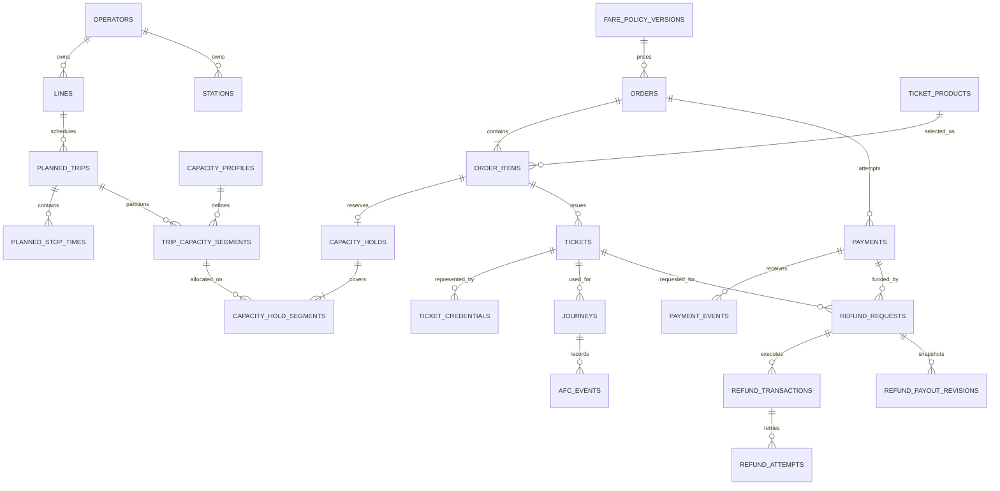

# Entity relationship overview

All shown business relationships are operator-scoped. Deletion does not cascade through ticketing or finance history. Identity credential child rows may use the normal ASP.NET Identity cascade rules, but domain history restricts deletion of referenced users.
