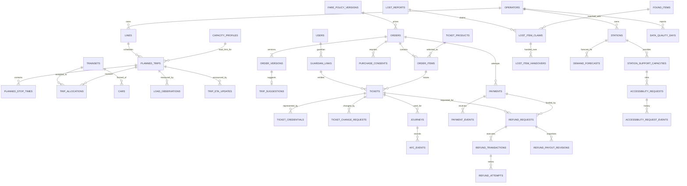
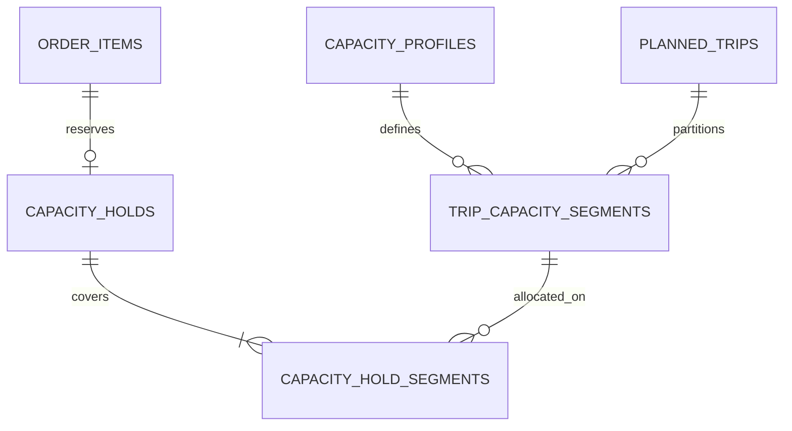

# Entity relationship overview

The diagram reflects SRS v1.2 (migration `006_srs_v1_2_alignment.sql`). The legacy
v1.1 capacity-hold chain still exists physically but is marked legacy and is not
part of any current flow.

`USERS` stands for the ASP.NET Core Identity table `public."AspNetUsers"`; the
physical name is quoted and lives outside the `metro` schema.

## Legacy chain (not used by SRS v1.2 flows)

## Notes

- All business relationships are operator-scoped through composite foreign keys
  `(operator_id, id)`.
- Deletion does not cascade through ticketing, finance or history. Twenty-five
  reconciliation tables reject `DELETE`/`TRUNCATE` at statement level.
- `tickets` carries order/version, service date, station pair, guardian relation
  and change count. Validity overlap is prevented by the GiST exclusion constraint
  `ex_tickets_no_overlapping_validity`, not by a "one active ticket" unique index.
- `trip_suggestions` keeps history; a trigger supersedes the previous current row
  and `v_current_trip_suggestion` exposes only one row per order version.
- `demand_forecasts.data_quality_status` records the completeness status the
  administrator confirmed; the seven-day rule itself lives in the service layer
  backed by `data_quality_days`.
- Identity credential child rows may use ASP.NET Identity cascade rules, but domain
  history restricts deletion of referenced users.
